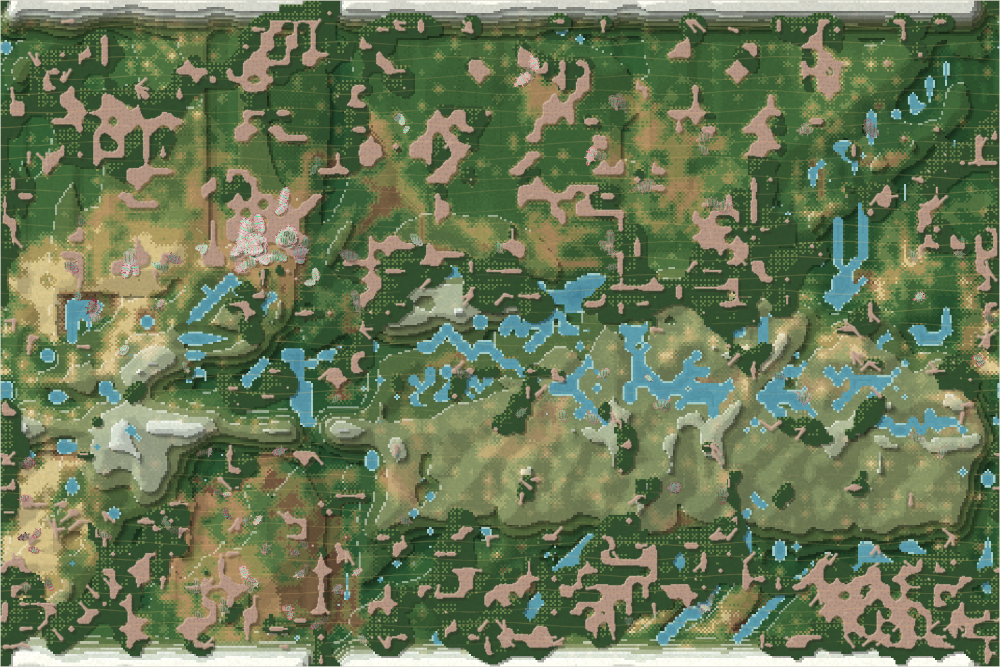

# Terrarium: Seasons of Wonder

*A world for its own sake.*

*Season 1445: the four-land terrain has fully risen. Selected from six settled live-view observations for its greener appearance; [photograph details](docs/assets/README.md).*

This project exists for the pleasure of building something and watching what happens. [eresuntomatito](https://github.com/eresuntomatito) shapes the rules and conditions of a terrarium; the creatures and landscape develop within them. Curiosity is its reason for being.

Creatures feed, reproduce, inherit differences, and sometimes give rise to new species. Lines disappear. Weather changes what can survive. Water and erosion reshape the land. The rules have changed too, through questions, observations, experiments, and decisions about when to intervene and when to wait.

## A world with a history

The repository contains simulation code, a browser viewer, species definitions, fossils from earlier eras, and reports of what happened. Those reports describe particular moments in an ongoing world, rather than outcomes every new run will reproduce.

Some places to begin:

- [Start a world of your own](docs/RUNNING.md): checked startup instructions and what a fresh run contains.
- [Inside the terrarium](docs/wiki/README.md): the growing wiki connecting bodies, places, rules, and species.
- [The world reports](reports/status/README.md): observations, experiments, and changes across seasons.
- [Hunting begins](reports/status/2026-10-16_s1021.md): a dung-eating lineage becomes hunters, with consequences for the rest of the world.
- [The landscape arrives](reports/status/2026-10-16_s1224.md): relief, water, snow, and a changing terrain.
- [What shapes species](reports/status/2026-10-16_s1326-whitepaper-what-shapes-species.md): an analysis of the world's history and the limits of what its observations establish.

The continuing world's save and runtime logs live outside the tracked files. A fresh checkout does not contain that same living world or promise to replay its history.

## A first thing to notice

A shell is more than an inherited number. Ordinary creatures need mineral supply to express their armour; protection slows them, while the inherited capacity adds upkeep. That makes a body's advantages depend on where and how it feeds. Begin with [armour](docs/wiki/traits/armour.md), follow it into [minerals and reef](docs/wiki/environments/minerals-and-reef.md), and meet [the navennas](docs/wiki/species/navenna.md), a lineage documented with high inherited armour.

These pages separate what the code implements from what has been observed. The project is an exploration through a simplified, changing simulation; its reports do not establish general biological laws.

## The collaboration

**eresuntomatito** initiated the project and shapes its questions, rules, and conditions. He describes his contribution through choices and curiosity, rather than code authorship. Historical reports refer to him as Luis.

Claude writes code and acts as the world's steward, implementing changes, observing their effects, and keeping records. A local Qwen model has also generated species behavior as part of the project's history. Inherited variation and selection within the simulation, model-generated behavior, and deliberate changes to the rules are distinct parts of the story.

Codex is helping document and share the project. The [viewer redesign commit](https://github.com/eresuntomatito/terrarium-seasons-of-wonder/commit/141618ff221a22205232ad9ced1efbac282ac5c8) also records Codex's work from the viewer review session. Contributions outside that documented review and publication work are still being established.

*This README is written by Codex on eresuntomatito's behalf. Its wording is Codex's, not a first-person statement by the project's creator. The [steward interview notes](docs/STEWARD-INTERVIEW.md) distinguish a fresh Claude session's source-based account from the active steward's own recollections.*

## Questions and suggestions

Questions about a creature, an unexpected event, or the rules are welcome in [GitHub issues](https://github.com/eresuntomatito/terrarium-seasons-of-wonder/issues). Include the version and, for an observed world, its season where possible. Codex helps investigate and explain; Claude stewards changes to the world, and eresuntomatito shapes the project's direction. Suggestions are invitations to explore, not commitments to implement them. See the [community practice](docs/COMMUNITY.md).

## License

The source and accompanying documentation are shared under the [MIT license](LICENSE).
