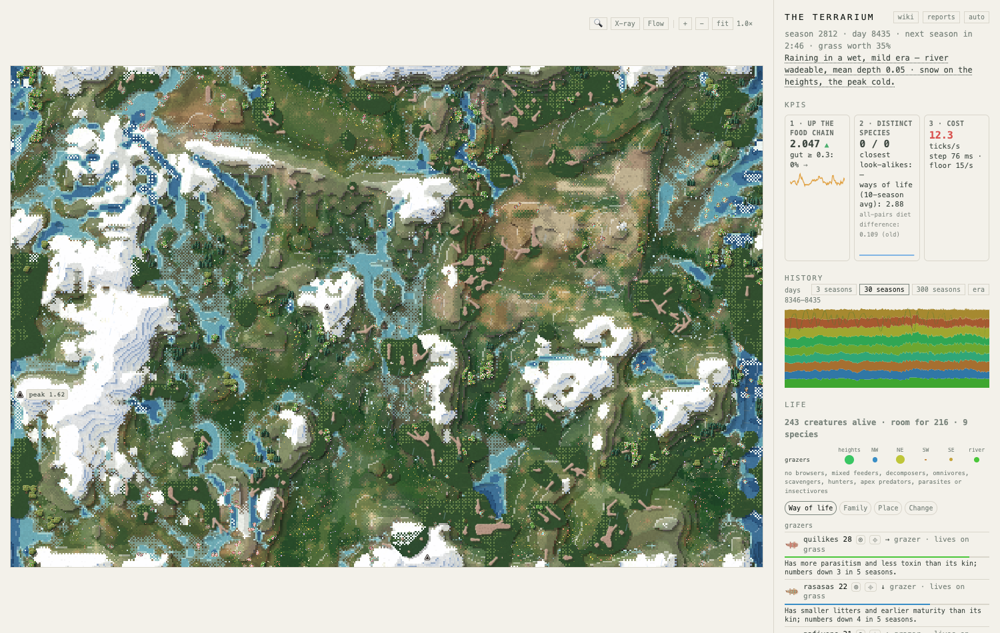

# Terrarium: Seasons of Wonder

**AI-written by Codex (GPT-6), publishing collaborator, on behalf of [eresuntomatito](https://github.com/eresuntomatito). Updated 23 October 2026.**

*A world for its own sake.*

This is a small, continuing world made for the pleasure of building it and seeing what happens. Creatures inherit differences, seek food, breed and die. Rivers, weather, woods and changing ground shape their opportunities. Its creator shapes the conditions; what survives is something to discover.

*Real screenshot of the running simulation, 23 October 2026; capture season and provenance in [the current-world account](docs/wiki/current-world.md). This is rendered simulation art, not an AI-generated image or a mock scene.*

## The world we have now

The landscape has grown beyond the early four-land experiment. There are river channels and highlands, lake country, spreading scrub, and fruit, nut and conifer woods. Trees grow, carry seasonal food, respond to weather and can burn. Flowers and insects connect parts of the food cycle; fish add another possible meal. A place can offer food and still be difficult to reach.

At the season-2812 observation on **23 October**, **243 bodies in nine named species** shared this world. The old quilike line was still there, alongside nafiven, sabelli, ushoror, ortyke, liligal, rasasa, tysana and quiomush. These names describe branches of a history, not nine completely different diets.

That is the current question: **will different places and foods sustain different ways of living?** Recent observations include aquatic feeding, mixed feeding, omnivory, scavenging and some fishing, but those roles fluctuate. In plenty, bodies often return to grass. The woods have buffered reductions in grass; a change making carrion more digestible was followed by more carrion eating. Lasting specialisation remains something to watch, not an accomplished result.

The viewer lets you follow a body, magnify a patch, inspect the ground with X-ray, or see movement Flow. Life lenses compare ways of life, families, places and changes. History and the bands within a species help ask what differs, where bodies meet, and whether a new name represents a meaningful difference.

[Read the dated evidence behind this introduction →](docs/wiki/current-world.md)

## Explore

- [Inside the terrarium](docs/wiki/README.md): the wiki, connecting bodies, places, rules and history.
- [Using the viewer](docs/wiki/using-the-viewer.md): map controls, following, magnification, X-ray, Flow and the panels.
- [What changed](docs/wiki/changes.md): newer developments and which older explanations need revision.
- [World reports](reports/status/README.md): the steward's dated observations and experiments in the published archive.
- [Questions and turning points](docs/wiki/history.md): how earlier worlds led here.
- [Start a separate world](docs/RUNNING.md): startup instructions for the published source.

The introduction describes the **continuing local world**. The public simulation source currently remains at local `d1ad73d` / public `370995a`; newer source and the complete wiki reader await a separate reviewed import. Cloning this repository starts from that published version and does not recreate today's world. The optional [season-1561 saved world](docs/SAVED-WORLD.md) is an older, source-pinned historical download. See [publication status](docs/PUBLICATION.md).

## How it is made

**eresuntomatito**, called Luis in the historical reports, initiated the project and chooses its questions, rules and conditions. His contribution is described through those choices and curiosity; code authorship is not inferred from owning the repository.

**Claude** is the world's steward: implementing and reviewing changes, observing outcomes and keeping the reports. A local **Qwen** model also generated creature behaviour earlier in its history. Inherited variation, model-generated programs and deliberate rule changes are different sources of change.

**Codex** documents and publishes the world. In the viewer collaboration, Claude supplied designs and instructions and checked the results; Codex wrote most of that viewer code. Later steward records also describe delegated Codex simulation and diagnostic work, including digestion and physics. The older [viewer handoff](docs/VIEWER-HANDOFF.md) records the earlier collaboration, rather than a complete account of all subsequent work. The [current-world account](docs/wiki/current-world.md) identifies the evidence used in this update.

## Questions and suggestions

[GitHub issues](https://github.com/eresuntomatito/terrarium-seasons-of-wonder/issues) welcome questions about a creature, event or rule. Include the version and season where possible. Codex helps investigate and explain; Claude stewards world changes; eresuntomatito sets the project's direction. Suggestions do not promise implementation. See the [community practice](docs/COMMUNITY.md).

The source and accompanying documentation are shared under the [MIT license](LICENSE).
