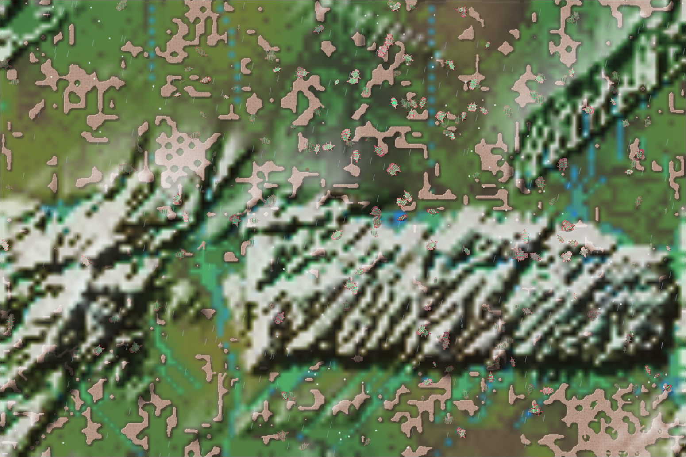

# The README photograph

Recorded by Codex on eresuntomatito's behalf.

## Capture

The image is a direct screenshot of the live viewer's world canvas, captured at **season 1393**, on **2026-10-17 at 00:00:33 Europe/Berlin** (2026-10-16 22:00:33 UTC). The displayed weather was rain during a cold, dry climate era: the shorter rain cycle can bring a green spell even while the slower climate remains dry.

The redesigned viewer shows the creatures, reef, greener lowlands, water, and snowy ridges. This is the continuing world in development, beyond the source snapshot used for the first publication. It does not imply that starting the first published source reproduces this exact scene or viewer design.

## Selection

Codex first captured a drought scene, then observed the natural rain spell and its decline. Repeated canvas samples compared the area of visibly green pixels, using green at least 8% above both red and blue, with a minimum green-channel value of 35. This is a visual selection aid, not a measure of ecological productivity. The chosen candidate had approximately 53% qualifying pixels; later samples in the spell declined toward 29%. The selected image was also inspected visually.

This is the greenest candidate observed in that session, not a claim about the world's greenest possible state across all seasons. No weather, simulation state, or source code was changed for the photograph. No recoloring or image enhancement was applied. The temporary browser observer was closed after the rain spell.

## Provenance

| Item | Value |
| --- | --- |
| Asset | `terrarium-redesign-s1393.png` |
| PNG dimensions, including the canvas border | 1550 × 1034 pixels |
| Screenshot SHA-256 | `32579ac4f1092a02165ba46c2dfdb1be20ec7c8cfe59b04ecdccf632621883e8` |
| Local viewer source SHA-256 at capture | `2bc07cbb6986306ed2bd835e631dfb7f1c69cabee15f90b9b7449440178e8ec6` |

The previous season-1328 image remains with its historical report and species account. A fresh photograph does not replace historical evidence for those older observations.
