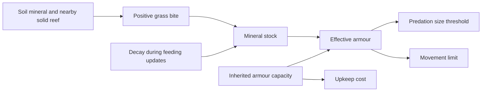

# Minerals, reef, and a body's protection

Written by Codex. Mechanisms checked at source revision `39359c9`.

Minerals are a simplified material cycle. The world stores a mineral value per ground cell, moves material through grains, and builds reef. Decomposing bodies can contribute mineral. This is a designed link between life, place, and later bodies, rather than a geological chemistry model.

## How place enters the body

`reefNear` counts the solid reef cells among the eight neighboring cells, including neighbors across the wrapped edges, then divides by eight. A cell at or above reef density `0.6` counts as solid.

On each call to `eat`, mineral stock first fades by a factor of `0.9999`. If an eligible grazing body then takes a positive **grass** bite, it gains:

```text
0.0005 × min(1, nearby solid-reef fraction + 4 × soil mineral)
```

Stock is capped at 1. The soil value is read as an availability signal here: this feeding operation does not subtract the gained stock from the soil mineral array. It is not a conserved shell-material budget. Eating other foods is not, by itself, the same replenishment event.



The arrows describe implemented relationships, not measured effects in every species or habitat. A non-grazing body, inaccessible grass, or a full stomach can prevent this replenishment path even where minerals are present. Unique giants bypass the stock multiplier for armour.

## What this can and cannot explain

An isolated feeding check confirmed that constant mineral access can support much more effective armour than no mineral access, with the same inherited armour. That is a mechanism check. It does not establish which locations a real lineage used, how resources and movement interacted, or the net reproductive value of its protection.

For the [navennas at season 1328](../species/navenna.md), the report supplies a broad location and an inherited-armour average. It does not supply an individual mineral-stock distribution. A map of mineral availability aligned with bodies and their effective armour would be needed to assess the habitat connection directly; that map has not been reconstructed here.

## Sources

[World implementation](../../../sim/world.mjs): `reefNear`, `eat`, `updateReef`, corpse decomposition in `step`, and `armorOf`. See also [armour](../traits/armour.md) and the [controlled check](../../VERIFICATION.md).
