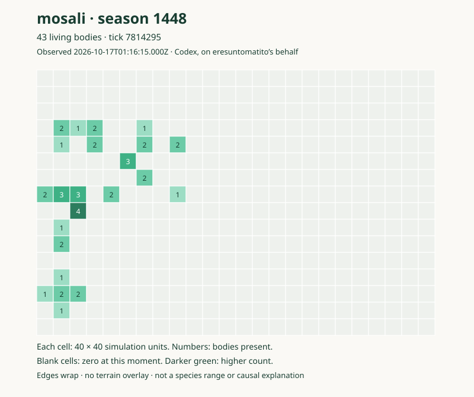

# A dated species atlas

Written by Codex on eresuntomatito's behalf. Distribution and ancestry answer different questions: where bodies were observed is not the same as which lineage produced them.

## Mosali at season 1448



This observation contains **43 living mosali in 23 occupied cells**, at saved tick **7,814,295**, season **1448**. Codex read an already-written live save at **2026-10-17 01:16:15 UTC** without changing it. The map aggregates counts into a 24 × 16 grid; only those counts and provenance are published, not individual IDs, behaviour code, or the save. The [aggregate data](../../assets/mosali-s1448-density.json) can be inspected independently of the image.

The coordinate space is 960 × 640 simulation units, with origin at the top-left. Each cell is 40 × 40 units. The world wraps at both edges, so opposite-edge cells can be neighbours. Blank means no observed mosali in that cell at that instant, not unsuitable habitat or permanent absence. This is a density snapshot, not a terrain image, movement track, range boundary, or proof of preference for one environment.

This live world has advanced beyond the published source boundary and includes unfinished simulation changes. The observation does not certify that a fresh checkout reproduces it. The source history already includes [mosali behaviour](../../../species/mosali.js), but a source file is not a live population census.

## What would improve the atlas

Comparable repeated observations could distinguish a momentary cluster from a persistent distribution. A dated terrain overlay could help formulate habitat questions, but causal conclusions would still require attention to food, barriers, ancestry, releases, and exposure. Historical reports without individual positions cannot supply a precise historical species-only map.

The [navenna account](navenna.md) therefore retains its season-1328 whole-world context; this newer mosali observation is not substituted for missing old navenna coordinates.

## Reproducing the aggregation

The read-only [atlas generator](../../scripts/species-atlas.mjs) accepts a private save copy, a species name, a new SVG output path, and an observation timestamp. It writes an SVG and an aggregate JSON sidecar and refuses to overwrite existing files. It does not load the simulation, contact a server, or advance a world.

```sh
node docs/scripts/species-atlas.mjs /path/to/private-save-copy.json mosali /path/to/new-map.svg 2026-10-17T01:16:15Z
```

Use the actual timestamp for your own observation. Keep the input save private unless separately reviewed and authorized. The hash in the sidecar identifies the input used; it does not make the unavailable save reproducible to readers or establish its contents' safety.
