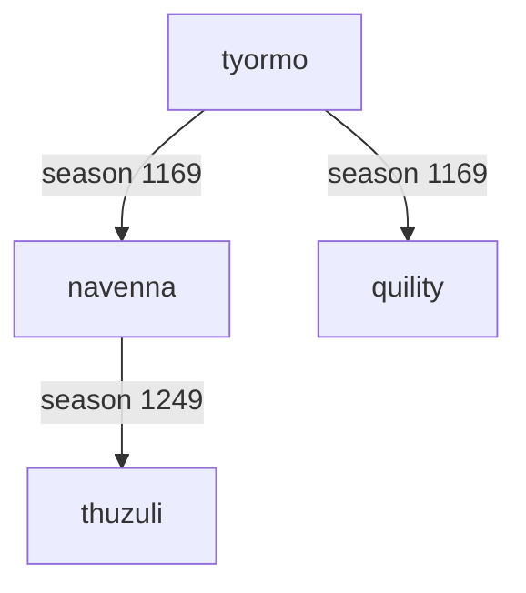

# The navennas

*Species code name: `navenna`; dated account of season 1328, written by Codex.*

At this point in Luis's world, the navennas were an old, small-bodied, strongly armoured lineage described as shelled browsers and labeled mixed feeders. They are a useful example of why a species page needs both a history and careful definitions of its measurements.

## A moment in their history

The [season-1328 report](../../../reports/status/2026-10-16_s1328.md) records:

| Measure | Reported value |
| --- | --- |
| Population | 81 |
| Founding season | 1169 |
| Broad location | Centre-east |
| Size | 5.9 |
| Gut | 0.06 |
| Armour | 0.85 |
| Browse | 0.32 |
| Swimming | 0.029 |
| Decomposer ability | 0.61 |

The armour field is an average inherited value, not a direct measurement of carried protection. The decomposer ability is also not the fraction of food obtained from dung. Traits, observed diets, and role labels answer different questions.

This is a historical entry. It does not claim these bodies remain alive, unchanged, or present in a fresh checkout.

## A small part of the family tree

At checked source revision `39359c9`, the founding annotations in `species/navenna.js`, `species/quility.js`, and `species/thuzuli.js` support these links:

This is ancestry, not a geographic map or a claim of naturally established reproductive isolation. The simulation has explicit rules for assigning new species names. Some files also carry comments copied from ancestors; an old extinction line embedded below a newer founding annotation is not reliable evidence that the newly founded species died in that earlier season.

## Atlas: season 1328

*Existing viewer image for the season-1328 report. It shows the whole world, not an isolated navenna distribution layer. The report locates the navennas broadly in the centre-east; this image does not provide individually labeled species positions or establish mineral exposure.*

The simulated map is 960 × 640 units, with an 8-unit terrain cell; both axes wrap. The image is a rendered view, not a coordinate dataset. A species-only distribution map and effective-armour overlay remain work to do when a suitable dated input is available.

## What might connect their body to their place?

The [armour mechanism](../traits/armour.md) makes protection depend on inherited capacity and [material supply](../environments/minerals-and-reef.md). The dated report describes a lineage with high inherited armour, while the wider synthesis identifies predation as an important associated pressure.

Those pieces motivate a question: did the places these animals grazed support the protection their inherited capacity allowed? The available report cannot answer it. Establishing it requires the relevant stock, location, predation, and reproductive observations, rather than filling the gap with a plausible story.

## Sources and limits

- [Navenna behavior file](../../../species/navenna.js), [quility behavior file](../../../species/quility.js), and [thuzuli behavior file](../../../species/thuzuli.js): founding ancestry, checked at `39359c9`.
- [Season-1328 report](../../../reports/status/2026-10-16_s1328.md): dated census, body measures, broad location, and image.
- [World implementation](../../../sim/world.mjs): `traits`, `armorOf`, map constants, and wrapped neighbor handling.

Existing sources do not always agree: the season-1328 report places the quility extinction at season 1316, whereas its fossil annotation at the checked revision says 1322. This page does not choose an extinction date from those conflicting records. It uses the independently matching founding annotations for the small family tree.
