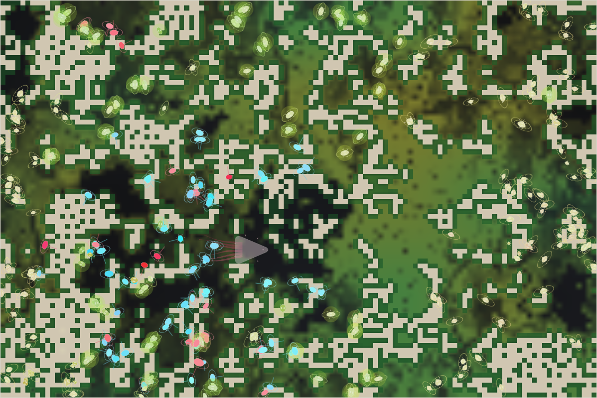

# World status — season 767 (Oct 15, 11:05)

**Window:** the last 30 seasons (s737 → s767). Previous report: [season 761](2026-10-15_s761.md) (6 seasons ago — written early at Luis's request, to bring in the screenshot and the species table).

## 0. The world at this moment

Rain in a wet era: green is spreading again across the east after the drought. The herds now sit in **separate regions** — one colour group mostly in the east and north, the others in the west around the sleeping kraken (the pale shape at the centre) — a first visible sign of the home ranges switched on at s756.

## 1. In one paragraph
The progenitor's family is down to **three species** (tyorors, omorushes, kelimos) after 12 extinctions in 30 seasons, all of them **pure grass specialists** (gut 0.09–0.15, the lowest yet) with big litters, short legs, sharp eyes and a little more shell. Hunting of young continues as a side-line (meat ≤ 6% of any body's recent diet). The rollout is fully on: relatives still breed freely under the new whole-creature kinship, and home ranges are pulling the species into regions — but no new ways of life have appeared: no niche splits, no mind splits.

## 2. Then and now

| | ~s737 | s767 (now) |
|---|---|---|
| Bodies / room | ≈330 / 300 | 332 / 300 |
| Living species (progenitor line) | 9 (s733) | **3** |
| Leading species | omthukes 84, kelimos 69 (s733) | tyorors 157, omorushes 97, kelimos 78 |
| Kraken | gen 39, asleep | gen 39, asleep (rises at s770); E 4.4 |
| Grass | drought at s733 | recovering after the s765 drought (plants 3,900; worn roots 153, recovering 537) |

**Bodies, family average** (s723 reading → s761 report → now):

| Trait | s723 | s761 | s767 | |
|---|---|---|---|---|
| Size | 6.2 | 7.1 | **6.85** | eased back a little |
| Gut | 0.25 | 0.17 | **0.12** | still falling — grass only |
| Litter | 3.0 | 3.6 | **3.7** | ↑ |
| Legs | 0.85 | 0.66 | **0.66** | settled low |
| Eyes | 0.75 | 0.88 | **0.88** | settled high |
| Armour | 0.15 | 0.22 | **0.25** | ↑ slowly |
| Maturity | 1.05 | 1.16 | **1.21** | later |
| Stamina (wind) | 0.83 | 0.82 | **0.75** | ↓ |
| Browse | 0.12 | 0.06 | **0.06** | gone flat |

**Family deaths since the last report** (s761 → s767): born +1,000 · eaten +290 · starved +420 · old age +290 — starvation led, from the s765 drought.

## 2b. Species alive at this report (s767)

| Species | Line | Bodies | Since | Size | Gut | Litter | Legs | Eyes | Kills (all time) | From the progenitor (code / body) | Standing |
|---|---|---|---|---|---|---|---|---|---|---|---|
| **tyorors** | P.2.8.15.5.3.31.3.4.7 | 157 | s758 | 7.0 | 0.11 | **3.8** | 0.64 | 0.88 | 94 | 20% / 31% | the largest and newest; split from the kelimos at s757; latest-maturing (×1.25) |
| **omorushes** | P.2.8.15.5.3.31.3.4.6 | 97 | s748 | 6.7 | **0.15** | **3.8** | **0.71** | 0.85 | 324 | 22% / 31% | the most meat-leaning gut, longest legs and most stamina of the three — the best-equipped hunters of young |
| **kelimos** | P.2.8.15.5.3.31.3.4 | 78 | s723 | 6.9 | **0.09** | 3.6 | 0.63 | **0.93** | **645** | 22% / 30% | the parent line and oldest survivor (44 seasons); sharpest eyes, purest grass gut, yet the top killer of young over its long life |
| *the kraken* | K | 1 | — | 26 | 0.84 | — | — | — | 74,290 | — | gen 39, asleep; gen 38's life: stuck 65%, 6.5 meals per 1,000 ticks |

**Reading it:** three near-identical grazers. The only lasting difference is a mild one — omorushes lean (a little) toward meat and movement, kelimos and tyorors toward pure grazing.

## 3. What happened in the world (s737 → s767)
- **3 great divides** (s744 venorvens 4 ways; s747 and s757 kelimos, both into equal "like the rest" halves), **5 splits**, **no mind splits, no niche splits**.
- **12 species extinct:** fidronas, ormoras, ushzusas, omthukes, quiratys, firaors, zubelmos, thubelvens, venorvens, keomgals, ommosas, fithuthus — every divide product from before s748 except the omorushes is gone.
- **9 new hidden minds** appeared; none spread (0 carriers now).
- **Droughts** at s752 and s765; grass recovered both times; the grazing mosaic is now a permanent feature (hundreds of worn and recovering cells).
- **Kraken:** rose at s740, s750, s760 — ~35 kills a season, 0 rages in the window; no longer shapes the herds.

## 4. What we changed (since the last report, s761 → s767)
| When | Change |
|---|---|
| s762 | Niche split reads the **recent** diet (meals fading over about a day) instead of the lifetime diet |
| s765 | Reports: screenshot of the world (section 0) and species table (2b); reports page with read/unread and a badge in the viewer |
| — | Rule: a report is written automatically at any check-in once the newest is 30 seasons old |

(Earlier changes in the window — room 300, juveniles, birth variation, carrion gradient, hidden minds, split minimum 15, the rollout — are in the [s761 report](2026-10-15_s761.md).)

## 5. How it shows in the creatures
- **Grass is everything:** with browse gone flat and meat a sliver, the gut keeps sliding toward pure grazing (0.12). Every trait that pays for grazing (eyes to find grass, big litters to refill after droughts) holds or grows; legs and stamina, which pay only for chasing or fleeing, keep falling.
- **Shell creeping up (0.25):** the young are hunted by cousins; a thicker shell makes an animal harder to overpower — the first visible answer to juvenile hunting.
- **Later maturing (×1.21):** a longer childhood is affordable when grass is plenty and the kraken is away — and it makes bigger, safer adults.
- **Home ranges → regions:** the screenshot shows species separating by area; whether that grows into real differences will show in the kinship panel (% apart between species) over the next reports.

## 6. Backlog
**Your call, now**
1. **Niche bar** — even on the recent diet, the most meat-fed body is at 6–17% meat; the 60% bar stays out of reach. Options: lower to ~15%, make it relative (≥3× the species' average), or leave it for a true hunter line.

**Pending**
- Kraken learning B1b (self-tuned reflexes); minds within minds; reef rays unused; Phase III (hunters) and IV–VIII; viewer ideas 4–6.

## 7. Risks
- **Mass extinction: elevated.** Three species, one diet, one body plan; 12 extinctions in 30 seasons; nothing else alive in the world, rescues off. A long drought in a dry era could take the family to one species — or none.
- **Single-species collapse: high** — the three survivors are 157 / 97 / 78; the smallest would fall under the 15-body founding line in one bad drought.
- **Kraken line: low** — fed and asleep.
- **Server: stable** — no errors since the last restart, memory 220–330 MB.

## 8. Next to watch
- Kraken rises at s770 into three regional herds.
- Whether omorushes keep the meat-leaning edge (the only seed of a hunter line).
- Kinship % apart between the three species as home ranges hold them apart.
- The next divide only if one species passes 60% (tyorors are at 47%).
