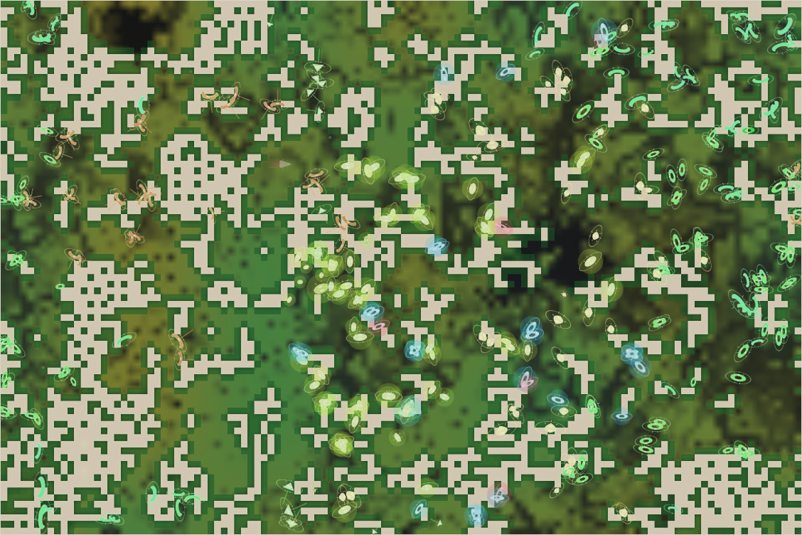

# World status — season 797 (Oct 15, 12:50)

**Window:** the last 30 seasons (s767 → s797). Previous status report: [season 767](2026-10-15_s767.md). Test report in between: [stomach test, s789](2026-10-15_s789-stomach-test.md).

## 0. The world at this moment

Rain in a **dry era**, after a hard drought (green is coming back, but grass is still thin: 1,900 plants). The herds are visibly **regional and more varied in look**: a brown-marked group in the west, green-rimmed groups in the east and north, pale groups through the middle — seven species that each mostly keep to their own ground. The young kraken (gen 40, the small grey shape left of centre) sleeps until season 800.

## 1. In one paragraph
A drought era. The family grew back from **three species to seven**, mostly through the great divide splitting whichever species survived the droughts best (tyorors at s771, tyomushes at s794). The kraken line passed to its 40th generation. The animals are now **all-in grass specialists** (gut 0.09; the oldest line at 0.05), bigger litters (3.8), later-maturing, with short legs and a little shell; hunting of young has almost stopped, and the one meat-leaning line (omorushes) died out. Home ranges have turned species into regional populations — but they still live the same way of life.

## 2. Then and now

| | s767 | s797 (now) |
|---|---|---|
| Bodies / room | 332 / 300 | 331 / 300 |
| Living species (progenitor line) | 3 | **7** |
| Leading species | tyorors 157 | mobelmos 84, kelimos 67, tyomushes 65 |
| Kraken | gen 39, asleep | **gen 40** (gen 39 died of old age at s790, its egg hatched), asleep until s800 |
| Grass | recovering after the s765 drought | **drought** (plants 1,900; worn roots 364, recovering 1,254 — the most ever) |

**Bodies, family average** (s761 → s767 → now):

| Trait | s761 | s767 | s797 | |
|---|---|---|---|---|
| Size | 7.1 | 6.85 | **6.9** | steady |
| Gut | 0.17 | 0.12 | **0.09** | still falling |
| Litter | 3.6 | 3.7 | **3.8** | ↑ |
| Legs | 0.66 | 0.66 | **0.64** | low |
| Eyes | 0.88 | 0.88 | **0.87** | high |
| Armour | 0.22 | 0.25 | **0.25** | holding |
| Maturity | 1.16 | 1.21 | **1.27** | later and later |
| Stamina | 0.82 | 0.75 | **0.71** | ↓ |
| Resistance | 0.11 | 0.10 | **0.05** | almost gone (no toxic food) |
| Browse | 0.06 | 0.06 | **0.14** | ↑ — browse coming back in the drought |

**Family deaths in the window** (s767 → s797): born ≈ +3,500 · **starved ≈ +1,550** · old age ≈ +1,530 · eaten ≈ +400. Droughts, not predators, now kill most.

## 2b. Species alive at this report (s797)

| Species | Line | Bodies | Since | Size | Gut | Litter | Legs | Eyes | Kills (all time) | From the progenitor (code / body) | Standing |
|---|---|---|---|---|---|---|---|---|---|---|---|
| **mobelmos** | …7.1.1 | 84 | s795 | 6.8 | 0.10 | 3.8 | 0.64 | 0.88 | 1 | 22% / 32% | newest and largest; from the tyomushes' 4-way divide ("more resistant"); latest-maturing (×1.33) |
| **kelimos** | …4 | 67 | s723 | 6.8 | **0.05** | 3.6 | 0.63 | 0.80 | **732** | 24% / 31% | the old parent line, 74 seasons; purest grass gut; once the top hunter of young |
| **tyomushes** | …7.1 | 65 | s772 | 6.8 | **0.13** | 3.7 | 0.65 | 0.91 | 44 | 22% / 32% | the most meat-leaning gut left; divided at s794 |
| **fidroras** | …7.1.3 | 40 | s795 | 6.7 | 0.10 | **3.9** | 0.62 | 0.88 | 0 | 22% / 33% | biggest litters, most shell (0.28) |
| **tyorors** | …7 | 40 | s758 | **7.6** | **0.03** | 3.9 | 0.67 | 0.91 | 179 | 22% / 34% | the biggest bodies and purest grazers; shrinking after two divides |
| **tyvenushes** | …7.1.2 | 27 | s795 | 6.9 | 0.12 | 3.7 | 0.65 | 0.88 | 0 | 22% / 32% | from the 4-way divide ("less resistant") |
| **galmoushes** | …7.3 | 8 | s772 | 6.9 | 0.10 | 3.8 | 0.62 | **0.96** | 43 | 19% / 35% | sharpest eyes and most stamina (0.99); dwindling — the next to go |
| *the kraken* | K | 1 | — | 18 (young) | 0.84 | — | — | — | 74,396 | — | gen 40; gen 39's life: stuck 66%, 9.3 meals per 1,000 ticks, 3 rages |

**Reading it:** seven species, but still one way of life. The differences are small and mostly in timing (maturity), litter, shell and eyes — and in *where* they live. The tyomushes (gut 0.13) are the last line with any lean toward meat.

## 3. What happened in the world (s767 → s797)
- **3 great divides** (tyorors twice at s771 after a drought made them dominant; tyomushes 4 ways at s794), **6 splits**, **no mind splits, no niche splits**.
- **3 extinctions:** zuthutys (s784), **omorushes** (s787 — the meat-leaning line), and the kraken gen 39 by old age (s790; its egg hatched gen 40).
- **Two droughts** (s771–773 and s788–797): the worst grazing damage yet (1,254 cells recovering); starvation passed predation as the main cause of death.
- **12 new hidden minds**, none spread.
- **Kraken:** rose at s770, s780, s790; 0 rages; gen 39 fed better than gen 38 (9.3 vs 6.5 meals per 1,000 ticks) but was stuck as often (66%).

## 4. What we changed (s767 → s797)
| When | Change |
|---|---|
| s768 | Reports page: read/unread and a badge in the viewer; automatic status report every 30 seasons |
| s780 | **Label-based niches**: each body's recent diet makes it a hunter, scavenger, omnivore, browser, mixed feeder or grazer; a local group of 15 living differently from its species splits (scavengers after 3 days) |
| s789 | **Stomach experiment** — built, tested, *not applied* (see the test report) |
| — | Decomposers and parasites for the family: agreed, waiting for the grass to recover |

## 5. How it shows in the creatures
- **Drought selects for breeders and waiters:** bigger litters (3.8) refill after die-offs; later maturing (×1.27) makes sturdier adults; stamina and legs keep falling because nothing needs chasing or fleeing.
- **Browse is creeping back (0.06 → 0.14):** in droughts the thicket outlasts the grass (it holds on in dry ground), so a little browsing pays again — the first stirring of the browser niche since season 740.
- **Resistance is almost gone (0.05):** with no toxic food anywhere, it is pure cost.
- **Home ranges show in space:** the screenshot's species occupy their own regions, and their looks differ more than before.

## 6. Backlog
**Your call**
- From the stomach test: **grass quality that varies with the season** (most promising), **thicket shoots worth eating again**, **meat fattens more** — none applied yet.

**Waiting on the world**
- **Decomposers and parasites** — as soon as the grass recovers (plants > ~3,500, no die-off).

**Pending**
- Kraken learning B1b; minds within minds; reef rays unused; Phase III (no meat line left now); viewer ideas 4–6.

## 7. Risks
- **Mass extinction: moderate** (down from elevated): seven species instead of three, spread over the map — a drought no longer hits one herd. But all seven live the same way, and nothing else is alive.
- **Small species: high** — galmoushes (8) will likely vanish; the newest splits (27–40) are near the 15-body line in a bad drought.
- **Kraken line: low** — a young, fed kraken; egg-laying worked at s790.
- **Server: stable** — no errors; memory 220–330 MB.

## 8. Next to watch
- Grass recovery → decomposers and parasites go in.
- Whether browse keeps rising (a browser species would be the first new way of life).
- The young kraken's first season at s800.
