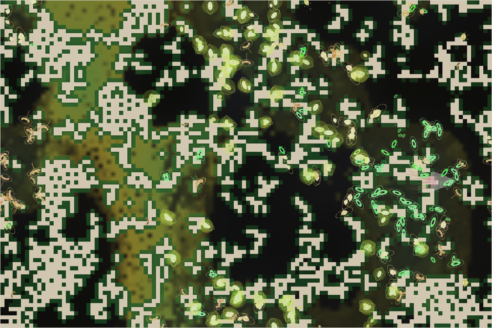

# World status — season 814 (Oct 15, 14:05) · monitoring run report

**Window:** the monitoring run, 4 cycles of ~15,000 ticks from the baseline at season 802 (tick 4,335,910 → 4,398,015, ≈62,000 ticks, 12 seasons), set against the last 30 seasons for context. Previous status report: [season 797](2026-10-15_s797.md).

## 0. The world at this moment

A **drying era**, overcast; grass thinning again (1,800 plants) after recovering mid-run. Four species: a dense **green-ringed herd in the east**, right beside the sleeping kraken (the grey shape at the right edge); pale, glowing herds through the middle and north; brown-marked animals in the west.

## 1. In one paragraph
Over the run the family went from **seven species to four** (three extinct by old age after their numbers fell in a deep drought around season 809), while bodies **grew** (+0.5 size), **put on fat** and kept specialising on grass. The three food changes and the new decomposer and parasite abilities are live, but **no new way of life has appeared**: 331 of 332 bodies are grazers. The selection ledger shows why: in this world, **surviving droughts is about fat and size, not diet**, and the new abilities are so far pure cost — the animals that carried more of them died more.

## 2. Then and now (baseline s802 → s814)

| | Baseline (s802) | Cycle 1 (s805) | Cycle 2 (s809) | Cycle 3 (s812) | Cycle 4 (s814) |
|---|---|---|---|---|---|
| Bodies | 332 | 330 | 329 | 329 | 332 |
| Species | 7 | 7 | 5 | 4 | 4 |
| Grass (plants) | 3,165 | 4,644 | ≈150 (deep drought)¹ | 3,620 | 3,960 |
| Niches | 331 grazers, 1 mixed | 330 grazers | 326 grazers, 2 omnivores, 1 mixed | 329 grazers | 331 grazers, 1 omnivore |

¹ measured with the first version of the cycle tool; the deep drought itself is confirmed by the starvation spike (+137 starved) and two extinctions in that cycle.

**Family traits, baseline → cycle 4** (change in units of the trait's spread across the family):

| Trait | Baseline | Cycle 4 | Change |
|---|---|---|---|
| **Size** (genes) | 6.85 | **7.36** | **+0.74 spread** — the biggest change |
| **Fat** | 0.84 | **0.96** | **+0.42** |
| Litter | 3.80 | 3.69 | −0.46 |
| Gut | 0.072 | 0.058 | −0.24 (further to grass) |
| Armour | 0.25 | 0.24 | −0.24 |
| Stamina | 0.71 | 0.69 | −0.21 |
| Fright | 0.34 | 0.32 | −0.23 |
| Browse | 0.153 | 0.150 | no change |
| Maturity, legs, eyes, mouth | — | — | no real change |
| Decomposer / parasite ability | (new) | 0.033 / 0.034 | still at their starting level |

## 2b. Species alive at this report (s814)

| Species | Line | Bodies | Since | Size | Gut | Litter | Legs | Eyes | Fat | Kills (all time) | From the progenitor (code / body) | Standing |
|---|---|---|---|---|---|---|---|---|---|---|---|---|
| **kelimos** | …4 | 102 | s723 | 7.4 | **0.03** | 3.6 | 0.63 | 0.74 | **0.47** | 732 | 25% / 32% | the old parent line, 91 seasons and 69 generations; purest grazers, fattest |
| **mobelmos** | …7.1.1 | 91 | s795 | 7.0 | 0.08 | 3.7 | 0.64 | 0.86 | 0.39 | 26 | 23% / 33% | the strongest of the s794 divide; most browsing after tyorors (0.17) |
| **tyorors** | …7 | 78 | s758 | **8.2** | 0.06 | 3.8 | 0.63 | **0.96** | 0.40 | 184 | 23% / 35% | the biggest and sharpest-eyed; browse 0.20, the highest |
| **fidroras** | …7.1.3 | 59 | s795 | 6.9 | **0.12** | 3.7 | 0.66 | 0.86 | 0.41 | 29 | 22% / 31% | the most meat-leaning gut left; latest-maturing (×1.36) |
| *the kraken* | K | 1 | — | 23.8 | 0.84 | — | — | — | — | 74,530 | — | gen 40, growing; asleep until s820 |

**Extinct during the run:** tyomushes (s808), galmoushes (s809), tyvenushes (s811) — all of old age, after the drought had cut their numbers.

## 3. What happened in the world
- **A drought** around cycle 2 (s807–810): grass fell to almost nothing; starvation doubled; three small species did not recover their numbers and aged out.
- **No divides** (no species passed 60%), **no splits of any kind**, **no new minds spread**.
- **Kraken:** rose at s810 (+78 kills over the run); now 23.8 in size.

## 4. What we changed (s797 → s814)
| When | Change |
|---|---|
| s802 | **Foods that differ:** grass energy follows moisture (0.6–1.3×), thicket shoots richest in dry spells (0.8–1.4×), rich food fattens more (meat 1.3×, carrion 1.1×, shoots 1.0×, grass 0.7×) |
| s802 | **Selection ledger** (traits of breeders and of the dead by cause) and the cycle tool |
| s806 | **Decomposers and parasites for everyone:** two inherited abilities with a cost (decomposer > 0.15: droppings + better carrion; parasite > 0.25: feeds on and infests weak, crowded bodies of other species) |

## 5. How it shows in the creatures
- **Bigger and fatter:** the clearest response of the run, and the selection ledger explains it (section 9).
- **Still grass:** gut kept falling, browse did not move despite richer shoots, and no animal reached the decomposer or parasite thresholds.

## 6. Backlog
**Your call**
- Whether to give the new abilities and the food changes **more time** (they may need hundreds of generations) or **a nudge** (see section 9, "what would change things").

**Pending**
- Kraken learning B1b; minds within minds; reef rays unused; Phase III; viewer ideas 4–6; the stomach (revisit when a meat line exists).

## 7. Risks
- **Mass extinction: moderate.** Four species (down from seven), one way of life; a drying era is beginning.
- **Small species: moderate** — the smallest now has 59, comfortably above the 15-body line.
- **Kraken line: low.**
- **Server: stable** (no errors this run; memory 220–330 MB).

## 8. Next to watch
- The drying era: whether fat and size carry the family through, and whether shoots (richest when dry) finally pay.
- Whether any animal crosses the decomposer (0.15) or parasite (0.25) threshold.

## 9. What shapes the species (new)

**How to read this:** the selection ledger records the traits of every animal that **breeds** and of every animal that **dies**, by cause, since the run began (1,105 breeders, 610 old-age deaths, 363 starved, 129 eaten). Each number below is how far that group's average sits from the living family's average, in units of the trait's spread. Positive = the group carries *more* of the trait than the living. A trait that **breeders carry more of** and **the dying carry less of** is being selected *for*.

| Trait | Breeders | Died old | **Starved** | **Eaten** | Verdict |
|---|---|---|---|---|---|
| **Fat** | −0.14 | +0.06 | **−2.67** | **−1.55** | **The strongest force in the world:** the starved and the eaten were the lean ones. Fat decides who survives a drought and who is caught. |
| **Size** | +0.08 | −0.28 | **+0.23** | **−0.32** | Pulled both ways: the small are eaten (mostly young), the big starve in droughts; the eating wins → bodies grew. |
| **Decomposer ability** | −0.02 | −0.58 | **+0.55** | **+1.14** | **Selected against:** animals carrying more of it starved and were eaten more — its cost (upkeep, worse grazing) bites before its benefit (only above 0.15). |
| **Parasite ability** | −0.02 | −0.61 | +0.46 | +0.54 | **Selected against**, for the same reason. |
| Gut | **−0.16** | +0.05 | +0.03 | +0.11 | Breeders have *purer grass guts* → gut keeps falling. |
| Browse | **−0.10** | −0.03 | −0.02 | −0.05 | Breeders browse *less* — richer dry-season shoots have not yet tipped the balance. |
| Resistance | **−0.13** | −0.03 | −0.07 | −0.03 | Shed as pure cost (no toxic food anywhere). |
| Fright | −0.11 | +0.07 | +0.05 | **−0.25** | The calm get caught → fearfulness pays when hunted. |
| Litter, legs, stamina, armour, maturity, eyes, mouth | within ±0.13 | | | | No clear force this run. |

**Which rules and conditions drove the changes**
1. **Drought (the grass cycle and the climate's dry eras)** — the dominant force. It decides who starves, and fat decides who survives it. *Rich food fattens more* (applied at s802) lands here: fat rose +0.42 in the run.
2. **Predation of the young (juveniles + the kraken + cousins)** — the second force: small and lean bodies are eaten, so size climbs.
3. **The grass energy rule (energy × (1 − gut)²)** — a steady push: breeders have the purest grass guts; nothing in the world rewards leaving grass enough to reverse it.
4. **Costs of unused abilities** — every ability that does not pay right now (resistance, the new decomposer and parasite abilities) is being shed.
5. **The great divide and room** — no influence this run (no species passed 60%); extinctions came from drought plus small numbers.

**What would change things** (for discussion, nothing applied)
- **New abilities need a payoff before the threshold:** today a decomposer gets nothing below 0.15 and pays its cost from the first step. Making the benefit grow smoothly from zero (as browse and gut do) would let selection find them.
- **Parasites need weak hosts:** they only infest the weak and crowded; in good years there are none. They will only take hold in droughts — or if infestation can also reach healthy-but-crowded hosts at a lower rate.
- **Browsing** would pay if grass were poorer for longer: the dry-season penalty (0.6×) may be too mild against the shoots' bonus (1.4×) given how little browse the family has.
