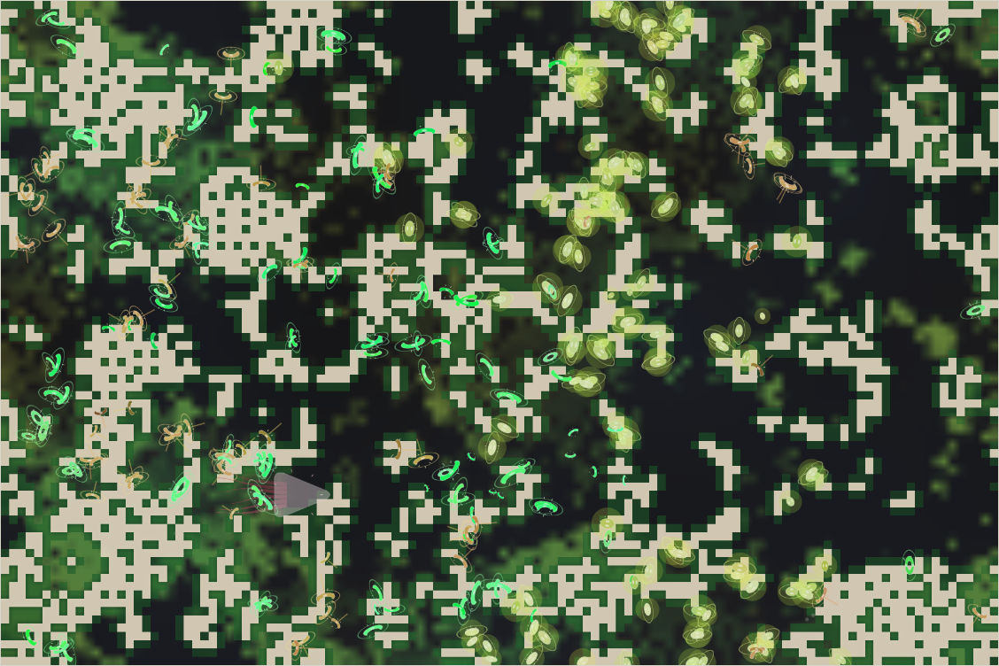

# World status — season 844 (Oct 15, 15:30)

**Window:** the last 30 seasons (s814 → s844). Previous status report: [season 814](2026-10-15_s814.md). Test report in between: [a way out of grass, s835](2026-10-15_s835-way-out-of-grass-test.md).

## 0. The world at this moment

Storms in a **dry era**, after a deep drought — the ground is mostly dark, grass almost gone (≈400 plants). The map has split into **two halves**: green-striped and brown-marked herds across the west, pale glowing herds across the east. The kraken sleeps in the south-west.

## 1. In one paragraph
Thirty seasons of a dry era. The family held at four species (the tyorors died out; a divide made the tysathus), but **bodies got smaller, eyes dimmer, shells thinner** — the drought is pruning everything that costs upkeep. Two of the "way out of grass" changes are live (the gut plateau since s837, the carrion stepping stone since s842): the first omnivores and scavengers are appearing and, for the first time, the decomposer and parasite abilities are creeping up — but the family is still 98% grazers, and the drought, not diet, is in charge.

## 2. Then and now

| | s814 | s844 (now) |
|---|---|---|
| Bodies / room | 332 / 300 | 331 / 300 |
| Species | 4 (kelimos, mobelmos, tyorors, fidroras) | 4 (kelimos, tysathus, fidroras, mobelmos) |
| Grass | 3,960 | **≈400** (deep drought, dry era) |
| Ways of life | 331 grazers, 1 omnivore | 324 grazers, **3 omnivores, 3 mixed feeders, 1 scavenger** |
| Kraken | gen 40, asleep | gen 40, asleep (rises at s850); 1 rage |

**Family traits, s814 → s844** (change in units of the trait's spread):

| Trait | s814 | s844 | Change |
|---|---|---|---|
| **Eyes** | 0.85 | **0.71** | **−1.33 spread** — the biggest change |
| **Size** | 7.36 | **6.94** | **−0.69** |
| Armour | 0.24 | 0.20 | −0.43 |
| Legs | 0.64 | 0.63 | −0.37 |
| Fat | 0.96 | 0.84 | −0.33 |
| **Parasite ability** | 0.034 | **0.044** | **+0.34** — rising for the first time |
| **Decomposer ability** | 0.033 | **0.038** | **+0.19** |
| Gut | 0.058 | 0.052 | −0.11 |
| Browse, litter, fright, maturity | — | — | no real change |

## 2b. Species alive at this report (s844)

| Species | Line | Bodies | Since | Size | Gut | Litter | Legs | Eyes | Fat | Kills (all time) | From the progenitor (code / body) | Standing |
|---|---|---|---|---|---|---|---|---|---|---|---|---|
| **kelimos** | …4 | 137 | s723 | 7.0 | **0.04** | 3.5 | 0.63 | 0.66 | **0.50** | 855 | 25% / 30% | the old line (121 seasons, 86 generations); fattest — the drought's survivor |
| **tysathus** | …4.8 | 97 | s837 | 7.0 | 0.07 | **3.9** | 0.62 | 0.66 | 0.46 | 13 | 26% / 32% | split from the kelimos at s836 ("bigger litters") |
| **fidroras** | …7.1.3 | 78 | s795 | 6.6 | 0.07 | 3.7 | 0.63 | **0.84** | 0.34 | 68 | 22% / 31% | sharpest eyes; highest parasite ability (0.06) |
| **mobelmos** | …7.1.1 | 19 | s795 | 7.2 | 0.08 | 3.9 | 0.67 | 0.76 | **0.26** | 44 | 26% / 34% | leanest, most browsing (0.23), highest decomposer ability (0.07); dwindling in the drought |
| *the kraken* | K | 1 | — | 26 | 0.84 | — | — | — | — | 74,665 | — | gen 40, full size; asleep until s850 |

## 3. What happened in the world (s814 → s844)
- **A dry era with a deep drought** at its end (grass ≈400).
- **1 divide** (kelimos, s836, by litter size → tysathus), **1 extinction** (tyorors, s821, of old age — the biggest bodies, 64 seasons).
- **No niche splits** yet — the omnivores and scavengers are scattered individuals, not a local group of 15.
- **3 new hidden minds**, none spread. The kraken rose 3 times; 1 rage.

## 4. What we changed (s814 → s844)
| When | Change |
|---|---|
| s814 | Status reports gain section 9 (what shapes the species) |
| s835 | Test: a way out of grass (4 variants × 30,000 ticks) — published |
| **s837** | **Gut plateau:** a gut keeps all of grass's value up to 0.15 |
| **s842** | **Carrion stepping stone:** carrion digested best by a gut near 0.3, torn off faster |
| s847 (scheduled) | Protein for breeding |

## 5. How it shows in the creatures
- **The drought prunes costs:** eyes (−1.3), size (−0.7), armour, legs and fat all fell — anything that costs upkeep or needs feeding.
- **The new abilities stir:** with the plateau removing the cost of the first steps and carrion feeding the drought's dead to the living, parasite and decomposer abilities rose for the first time (still far from their thresholds).
- **Still grass:** gut barely moved (−0.11) — the plateau has had 7 seasons, all of them dry.

## 6. Backlog
**Scheduled**
- Protein for breeding — season 847, if the carrion step shows no harm (so far: none; losses follow the drought).

**Your call**
- Whether the decomposer/parasite benefit should start below the threshold (section 9 of the s814 report).

**Pending**
- Kraken learning B1b; minds within minds; reef rays unused; Phase III; viewer ideas 4–6; the stomach (when a meat line exists).

## 7. Risks
- **Mass extinction: moderate.** Four species in a deep drought; the kelimos (137, fattest) are the anchor.
- **Small species: high for the mobelmos** (19, leanest) — they may not survive this drought.
- **Kraken line: low.** **Server: stable** (no errors; memory 220–290 MB).

## 8. Next to watch
- Whether the drought breaks before the mobelmos fall under 15.
- The protein step at s847; the first niche split (omnivores or scavengers forming a local group).

## 9. What shapes the species

**How to read this:** the selection ledger compares the traits of everyone who **bred** (3,388) and **died** in the window — of old age (1,397), **starved (1,663)**, eaten (329) — with the living. Because the living themselves changed a lot this window, compare the groups **with each other**, especially the starved against the breeders.

| Trait | Breeders | Died old | Starved | Eaten | Starved vs breeders | Reading |
|---|---|---|---|---|---|---|
| **Fat** | −0.30 | +0.11 | **−2.36** | **−1.12** | **−2.06** | Still **the strongest force**: the starved and the eaten were the lean. |
| Size | −0.03 | −0.13 | +0.12 | −0.21 | +0.15 | The big starve, the small are eaten — this window the drought won, so bodies shrank. |
| Eyes | +0.09 | +0.16 | **+0.25** | +0.10 | **+0.16** | Sharp eyes cost upkeep; in a drought the sharp-eyed starve more → eyes fell sharply. |
| Armour | +0.13 | +0.10 | **+0.26** | +0.13 | **+0.13** | Same: shell costs upkeep; the armoured starve more → armour fell. |
| Resistance | +0.09 | +0.11 | +0.24 | +0.05 | +0.15 | Shed as cost. |
| Gut | −0.24 | −0.26 | −0.09 | −0.11 | +0.15 | The starved had slightly *less* pure grass guts — in a drought, grass is all there is; but the plateau keeps the cost small. |
| Parasite / decomposer | +0.01 / −0.08 | | +0.07 / 0.00 | | ≈0 | No longer selected against — the plateau and carrion made them nearly free. |

**Which rules and conditions drove the changes**
1. **The dry era and its drought** — overwhelmingly. It killed by starvation (1,663 — more than old age), and starvation picks out the lean and the costly: eyes, shell, resistance and size were pruned.
2. **Fat** — the trait that decides survival, again; *rich food fattens more* helps only those who eat rich food, and few do.
3. **The gut plateau and the carrion step** — too young to show in gut (7 and 2 seasons, all dry), but they changed the selection on the new abilities from *against* (s814: decomposers and parasites died more) to *neutral* (now) — the first step for them to spread.
4. **Predation** — minor this window (329 eaten).
