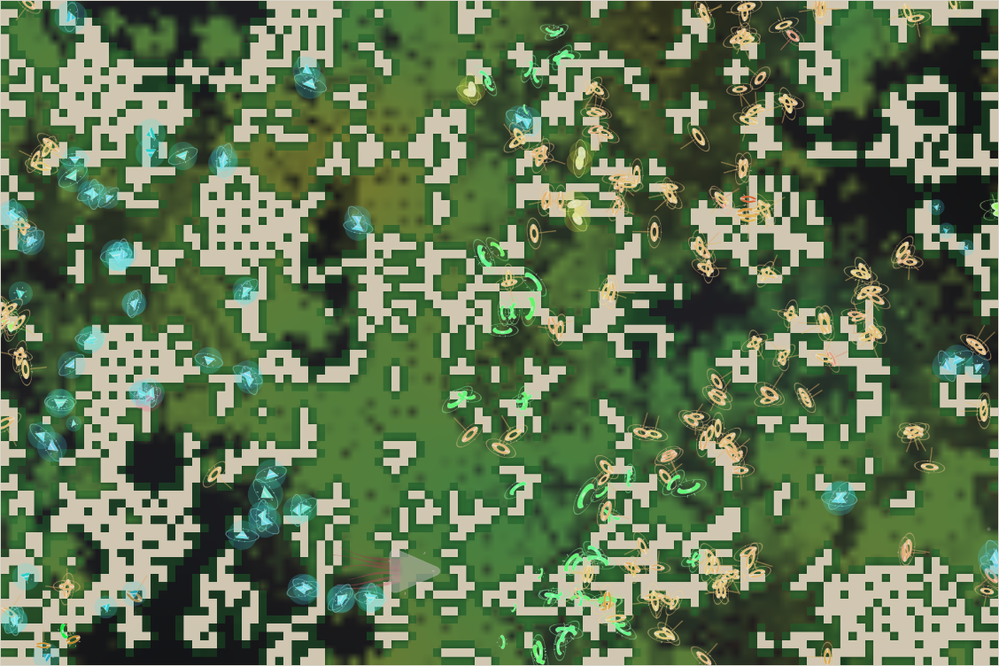

# World status — season 874 (Oct 15, 17:25)

**Window:** the last 30 seasons (s844 → s874). Previous status report: [season 844](2026-10-15_s844.md). No test report in between (the weak-prey/pack test results are in the steward log, s866).

## 0. The world at this moment

The grass is **drying again** (≈1,500 plants, 3,800 of 9,600 cells green). The map has split in two. The **ommooms**, amber with trail markings and the largest species, fill the centre and the east. **Glowing kethulis** hold the west. The other species are scattered between them in small numbers. The kraken is asleep in the south (the grey shape near the bottom).

## 1. In one paragraph
Thirty seasons with **every remaining rule change applied one by one**: protein for breeding (s847), smooth benefits for the new abilities (s863), weak prey (s866), **the climate** (s867) and pack hunting (s869). The population held at 330 the whole time, and the climate caused no crash. The family is still overwhelmingly grazers, but the **decomposer ability has taken off for the first time**: from 0.038 to 0.098, the biggest change of any trait. **25 animals now live as decomposers**, mainly kethulis and their offshoot the ommooms. **Two mind splits** produced the nadroors and the ommooms; the fidroras and mobelmos died out. The climate's new traits (coat, water thrift) are spreading through births but **don't yet differ between north and south**.

## 2. Then and now

| | s844 | s874 (now) |
|---|---|---|
| Bodies / room | 331 / 300 | 330 / 300 |
| Species | 4 (kelimos, tysathus, fidroras, mobelmos) | 5 (**ommooms**, kethulis, tysathus, kelimos, nadroors) |
| Grass | ≈400 (deep drought) | ≈1,500 (drying again after a wet spell at s866, 5,000) |
| Ways of life | 324 grazers, 3 omnivores, 3 mixed, 1 scavenger | 296 grazers, **25 decomposers**, 8 mixed feeders, 1 scavenger |
| Kraken | gen 40, asleep | **gen 41** (gen 40 died of old age at s851; its egg hatched); asleep |

**Family traits, s844 → s874** (change measured in units of how much the trait varies across the family):

| Trait | s844 | s874 | Change |
|---|---|---|---|
| **Decomposer ability** | 0.038 | **0.098** | **+1.77** — the biggest change, and the first real rise of a new ability |
| **Fright** | 0.32 | 0.26 | **−0.85** — calmer animals |
| Gape (mouth) | 0.58 | 0.55 | −0.63 |
| Stamina | 0.67 | 0.74 | +0.53 |
| **Gut** | 0.052 | **0.073** | **+0.44** — the first sustained rise away from pure grass |
| Litter | 3.69 | 3.79 | +0.43 |
| Maturity | 1.32 | 1.29 | −0.24 |
| Legs, browse | — | — | +0.2 each |
| Eyes, fat | — | — | −0.2 each |
| Size, armour, resistance, parasite ability | — | — | no real change |
| **Coat / water thrift** (new, s867) | — | 0.30 / 0.20 | at their starting values; north and south still the same |

## 2b. Species alive at this report (s874)

| Species | Line | Bodies | Since | Size | Gut | Litter | Eyes | Fat | Decomposer | Kills (all time) | Standing |
|---|---|---|---|---|---|---|---|---|---|---|---|
| **ommooms** | …8.1.2 | 189 | s869 | 7.0 | 0.07 | 3.8 | 0.67 | **0.90** | 0.10 | 56 | split by mind from the kethulis at s868 (70 → 189); now the largest species, in the centre and east |
| **kethulis** | …8.1 | 74 | s847 | 7.0 | 0.09 | 3.9 | 0.70 | 0.82 | **0.13** | 204 | the most decomposer-leaning line; holds the west; lost most of its numbers to two mind splits |
| **tysathus** | …8 | 58 | s837 | **6.3** | 0.06 | 3.9 | 0.73 | 0.88 | 0.04 | **323** | smallest bodies, the most browsing (0.23) and highest parasite ability (0.07); **the top hunter of the window** (+310 kills) |
| kelimos | …4 | 6 | s723 | 7.0 | 0.10 | 3.0 | 0.75 | 0.82 | 0.02 | 880 | the old line (151 seasons, 102 generations); now at 6 |
| nadroors | …8.1.1 | 4 | s855 | 7.2 | 0.09 | 4.0 | 0.56 | 0.94 | 0.02 | 1 | split by mind from the kethulis at s855; reached 28, now 4 |
| *the kraken* | K | 1 | — | 24.6 | 0.84 | — | — | — | — | 74,840 | gen 41, growing; asleep |

## 3. What happened in the world (s844 → s874)
- **Grass swung:** the deep drought broke at s853, came back at s862 (≈290 plants), there was a wet spell at s866 (≈5,000), and it is drying again now.
- **Three mind splits**, all from the tysathu → kethuli line: the **kethulis** (s847), the **nadroors** (s855) and the **ommooms** (s868). The ommooms then outbred everyone.
- **Two extinctions:** fidroras (s858, after 64 seasons) and mobelmos (s873, after 78 seasons), both of old age after their numbers fell.
- **No divides and no niche splits** (the 25 decomposers are spread across two species and don't yet form a local group of 15).
- **Kraken:** gen 40 died of old age at s851 and gen 41 hatched; it rose at s850, s860 and s870.

## 4. What we changed (s844 → s874)
| When | Change |
|---|---|
| s847 | **Protein for breeding** (the last step of "a way out of grass") |
| s863 | **Smooth benefits:** the decomposer and parasite abilities pay a little from the first step instead of only past a threshold |
| s866 | **Weak prey:** starving, old or infested animals are easier to overpower |
| **s867** | **Climate:** a cold north and a warm south, warm and cold eras, food that answers to temperature (grass grows best when mild, frost in the cold, winter buds, rot and dung faster in the heat). New inherited **coat** (warmth at a cost in heat) and **water thrift** (less cost in dry ground, slower maturing) |
| s869 | **Pack hunting:** each jawed relative near the prey (up to 3) makes it easier to overpower |

## 5. How it shows in the creatures
- **Decomposers have appeared.** Once smooth benefits made the first step pay, the ability took off. It is highest in the kethulis (0.13) and ommooms (0.10), and 25 animals now feed mainly on droppings. This is the second way of life to take hold in this family's history.
- **Guts are moving off pure grass** (+0.44): the gut plateau, carrion and protein together have reversed a long slide, slowly.
- **Weak prey feeds hunters.** Kills rose sharply: the tysathus alone made about 310 kills in the window. The headless test predicted +18%. Pack help is too rare to see yet.
- **Calmer, softer-mouthed animals:** fright and gape fell, so fearfulness no longer pays as much in a world where most deaths are starvation.
- **The climate has not yet sorted anyone by region.** Seven seasons is too short: coat and water thrift sit at their starting values everywhere, and size is the same north and south (6.9 vs 6.8).

## 6. Backlog
**Scheduled / running**
- Climate monitoring (every 10 minutes) until three stable checks after s869; one stable check so far.

**Pending**
- Kraken learning B1b; minds within minds; reef rays unused; Phase III; viewer ideas 4–6; water holes (water need, option 1); the stomach (when a meat line exists).

## 7. Risks
- **Mass extinction: moderate.** Five species, but two are close to vanishing (kelimos 6, nadroors 4). The ommooms (189) hold 57% of the family and the divide line is 60%, so **a great divide of the ommooms is likely soon**.
- **Small species: high:** the kelimos and nadroors will probably not survive this drying spell.
- **Climate:** no harm so far (bodies 330–332 throughout; starvation follows the grass).
- **Kraken line: low. Server: stable** (no errors; memory 240–290 MB).

## 8. Next to watch
- Whether the decomposers form a local group of 15 and split off as the first **decomposer species**.
- Whether coat and size start to differ between the cold north and the warm south.
- An ommoom divide at 60%.

## 9. What shapes the species

**How to read this:** the selection ledger compares the traits of everyone who **bred** (4,071) or **died** in the window — of old age (1,398), **starved (1,844)**, eaten (830) — with the living, in units of how much each trait varies. Compare the groups with each other, especially the starved against the breeders.

| Trait | Breeders | Died old | Starved | Eaten | Starved vs breeders | Reading |
|---|---|---|---|---|---|---|
| **Fat** | +0.03 | +0.60 | **−2.07** | **−1.21** | **−2.11** | Still **the strongest force**: the lean starve and are caught. |
| **Decomposer** | −0.70 | −0.85 | −0.68 | −0.70 | ≈0 | Every group sits far below the living: the ability rose **late in the window** (after s863), faster than anyone could die of it. Neutral between breeders and the starved, so it costs nothing. |
| Size | +0.16 | +0.13 | +0.32 | −0.29 | +0.16 | The big starve, the small are eaten; the two balance (size −0.08). |
| Gut | −0.20 | −0.19 | −0.09 | +0.01 | +0.11 | The living have more gut than any group that left, so guts are drifting up. Starvation no longer punishes it. |
| Fright | +0.30 | +0.57 | +0.26 | +0.36 | −0.04 | Everyone who left was more fearful than the living; the calm are replacing them. |
| Eaten-specific | | | | | | The eaten were smaller (−0.29) and leaner (−1.21), and browsed more (+0.22): weak prey makes the starving easy meals. |
| Armour, eyes, stamina | | | +0.13 to +0.22 | | ≈+0.15 | Costly traits still starve slightly more. |

**Which rules and conditions drove the changes**
1. **The grass cycle** (droughts at s853 and s862 and the present drying) is still the main killer (1,844 starved), and fat still decides who survives it.
2. **Smooth benefits** (s863) are what moved the **decomposer ability**. It was neutral at s844 and has risen sharply since. Dung, which rots faster in the warm south, is the food it pays for.
3. **Weak prey** (s866): the eaten are now mostly the starving and lean (fat −1.21). Predation more than doubled in the window (830 eaten vs 329).
4. **Mind splits**, not divides, made this window's new species: three, all from one line.
5. **The climate** (s867) has not yet left a mark on traits, but it raises the cost of keeping warm in the north and of thick coats in the south, so expect the first regional differences in coat and size over the next 30 seasons.
