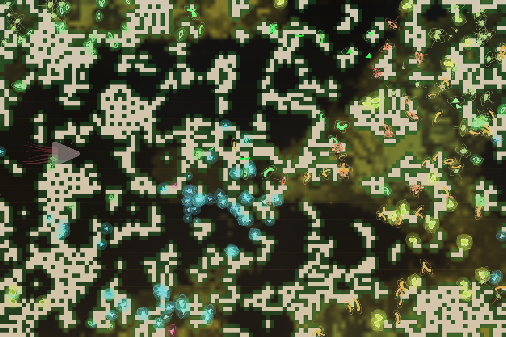

# World status — season 911 (Oct 15, 18:45)

**Window:** the last 37 seasons (s874 → s911). The report came a few seasons late because the s904 mark fell between check-ins. Previous status report: [season 874](2026-10-15_s874.md).

## 0. The world at this moment

A **dry spell inside a wet, warm era**: the centre of the map has browned, and the grass hangs on around the reef and in the east. The **east is crowded** with the ushtyke family: yellow-glowing nafinas, orange ushtykes, red mothus and green droranas, the four parts of the s906 divide. A **blue glowing herd of kethulis** fills the centre-south, and the small, glowing **dronathus** live in the north-west. The kraken (the grey shape at the west edge) has just finished its season.

## 1. In one paragraph
The **most species since the genesis** (8, up from 5). Two great divides (ommooms s875, ushtykes s906) and a mind split (dronathus, s907) made five new species, while three old lines died out (kelimos after 154 seasons, nadroors, ommooms). The family is still a family of grazers, but **guts doubled their rise** (0.073 → 0.120), **browsing climbed** (0.17 → 0.23, the biggest change) and **shells came back** (0.20 → 0.26). For the first time **the climate has left a mark**: animals in the cold north carry thicker coats than those in the warm south (0.31 vs 0.27), and the southern kethulis have the thinnest coats of all (0.21). The decomposer surge of the last window has ebbed (0.098 → 0.065): it rose in a drought and faded in the wet.

## 2. Then and now

| | s874 | s911 (now) |
|---|---|---|
| Bodies / room | 330 / 300 | 332 / 300 |
| Species | 5 | **8** |
| Grass | ≈1,500 (drying) | ≈5,000 (a wet, warm era; dry spell now) |
| Ways of life | 296 grazers, 25 decomposers, 8 mixed | 331 grazers, 1 mixed feeder (plenty of grass, so diets go back to grass) |
| Kraken | gen 41, size 24.6 | gen 41, **full size 26**; rose at s880, s890, s900 and s910 |
| North / south coat | 0.30 / 0.31 | **0.31 / 0.27** |

**Family traits, s874 → s911** (change measured in units of how much the trait varies across the family):

| Trait | s874 | s911 | Change |
|---|---|---|---|
| **Browse** | 0.169 | **0.233** | **+1.25**: the biggest change; thicket shoots pay, especially in cold spells (winter buds) |
| **Size** | 6.90 | **6.47** | **−0.93**: bodies shrinking |
| **Gut** | 0.073 | **0.120** | **+0.91**: the second window in a row of rising guts |
| **Armour** | 0.20 | **0.26** | **+0.87**: shells back (weak prey and packs make hunting more common) |
| Decomposer | 0.098 | 0.065 | −0.55: the drought surge has ebbed |
| Legs | 0.633 | 0.646 | +0.41 |
| Fright, maturity, stamina, eyes, litter | — | — | −0.26 to −0.33 |
| Fat | 0.76 | 0.82 | +0.19 |
| Parasite ability, resistance, gape | — | — | no real change |

## 2b. Species alive at this report (s911)

| Species | Line | Bodies | Since | Where | Size | Gut | Browse | Armour | Coat | Water | Fat | Decomp. | Standing |
|---|---|---|---|---|---|---|---|---|---|---|---|---|---|
| **kethulis** | …8.1 | 89 | s847 | centre-south | 6.0 | 0.08 | 0.19 | 0.23 | **0.21** | 0.21 | 0.61 | 0.03 | the oldest living line now (64 seasons); latest-maturing (×1.41); thinnest coats (the warm south); **507 kills**, the top hunters |
| **ushtykes** | …8.1.2.2 | 60 | s876 | east | 6.8 | 0.12 | 0.24 | 0.29 | 0.31 | 0.21 | 0.97 | 0.09 | divided four ways at s906 |
| **droranas** | …2.2.3 | 53 | s907 | north-east | 6.7 | 0.13 | **0.27** | **0.33** | 0.33 | 0.26 | 0.99 | 0.05 | "more shelled" part of the divide: most armour and most browsing of the new lines |
| **dronathus** | …8.1.3 | 43 | s907 | north-west | **5.4** | 0.13 | 0.26 | 0.19 | 0.32 | 0.22 | 0.55 | 0.04 | split by mind from the kethulis ("a comparison flipped"); the smallest bodies ever in this family |
| **nafinas** | …2.2.1 | 39 | s907 | east | 7.0 | 0.13 | 0.24 | 0.26 | 0.31 | **0.30** | 0.88 | **0.12** | "later-maturing" part of the divide; the most water-thrifty and most decomposer |
| **mothus** | …2.2.2 | 24 | s907 | north-east | 7.0 | 0.16 | 0.20 | 0.30 | 0.32 | 0.21 | **1.10** | 0.09 | "a new mind" part of the divide; fattest |
| **tysathus** | …8 | 16 | s837 | north | 6.9 | **0.22** | **0.31** | 0.20 | **0.35** | 0.14 | 0.93 | 0.06 | the most meat-leaning gut and most browsing; thickest coats; 561 kills; dwindling |
| galsaras | …8.1.2.1 | 5 | s876 | north-east | **8.1** | 0.06 | 0.16 | 0.11 | 0.25 | 0.17 | 1.15 | 0.10 | the largest bodies; nearly gone |
| *the kraken* | K | 1 | — | west | 26 | 0.84 | — | — | — | — | — | — | gen 41, full size; 75,065 kills |

## 3. What happened in the world (s874 → s911)
- **Two great divides:** the **ommooms** at s875 (3 groups: ommooms, galsaras, ushtykes) and the **ushtykes** at s906 (4 groups: ushtykes and three new species, the nafinas, mothus and droranas).
- **One mind split:** the **dronathus** (21 kethulis, s907).
- **Three extinctions:** **kelimos** (s877, of old age; the old line, 154 seasons and 102 generations), nadroors (s878, old age) and ommooms (s905, starving, after losing most of their numbers to the divide).
- **Grass:** recovered to ≈5,000 by s883, dried to ≈1,300 at s902, and is back up in a wet, warm era now.
- **Kraken:** rose four times (s880, s890, s900, s910); gen 41 reached full size.
- **The climate monitor ended at s875:** three stable checks, no crash, costs kept as built.

## 4. What we changed (s874 → s911)
Nothing. No rules or parameters changed in the window, so all of the above came from the rules already live (the last, pack hunting, went live at s869).

## 5. How it shows in the creatures
- **The climate is starting to sort coats by region:** thicker in the cold north (0.31), thinner in the warm south (0.27). The southern kethulis carry the thinnest coats (0.21), and the northern tysathus and droranas the thickest (0.33–0.35). Size has not followed yet (6.47 north vs 6.43 south).
- **Browsing and guts rose together.** The droughts and the cold eras reward animals that can eat shoots and a little meat. The tysathus (gut 0.22, browse 0.31) are furthest along that path.
- **Shells came back** (+0.87), most in the new eastern lines (0.26–0.33). Predation rose: 1,323 eaten in the window, up from 830, as weak prey and packs give hunters more chances.
- **Bodies shrank** (6.90 → 6.47), and the dronathus (5.4) are the smallest ever. Section 9 explains why: big bodies starve.
- **The decomposer surge faded** with the wet: dung pays in droughts and the warm south, but the label lapses when grass is plentiful.

## 6. Backlog
**Pending**
- Kraken learning B1b; minds within minds; reef rays unused; Phase III; viewer ideas 4–6; water holes (water need, option 1); the stomach (when a meat line exists).

## 7. Risks
- **Mass extinction: low to moderate.** Eight species spread over the map is the healthiest spread since the genesis, but three are small (galsaras 5, tysathus 16, mothus 24).
- **Small species: high for galsaras and tysathus.** The tysathus are the most meat-leaning line; losing them would set the path toward meat back.
- **Kraken line: low** (gen 41, full size). **Server: stable** (no errors; memory 230–300 MB).

## 8. Next to watch
- Whether the north–south coat difference keeps widening, and whether size follows (Bergmann's rule: bigger bodies in the cold).
- Whether the tysathus survive; the first omnivore or browser species.
- The next drought: whether the decomposers come back, and in which lines.

## 9. What shapes the species

**How to read this:** the selection ledger compares the traits of everyone who **bred** (5,116) or **died** in the window — of old age (1,779), **starved (2,012)**, eaten (1,323) — with the living, in units of how much each trait varies. When every group sits on the same side of the living (as for gut, browse and armour), the trait changed during the window and the living have moved past those who left. Compare the groups with each other, especially the starved against the breeders.

| Trait | Breeders | Died old | Starved | Eaten | Starved vs breeders | Reading |
|---|---|---|---|---|---|---|
| **Fat** | −0.19 | +0.08 | **−2.83** | **−1.66** | **−2.64** | Still **the strongest force**, stronger than ever: the lean starve and are caught. |
| **Size** | +0.64 | +0.49 | **+0.90** | +0.45 | **+0.26** | The big starve the most → bodies shrank. |
| Gut | −0.31 | −0.41 | −0.31 | −0.20 | 0.00 | Every group had less gut than the living → guts rose all window, and gut no longer costs anyone their life. |
| Browse | −0.22 | −0.28 | −0.26 | −0.27 | −0.04 | Same pattern: browsing rose steadily and is free. |
| Armour | −0.44 | −0.47 | −0.50 | −0.53 | −0.05 | Rose sharply; **the eaten had the least shell** (−0.53). |
| Eyes | +0.55 | +0.66 | +0.56 | +0.52 | ≈0 | Fell everywhere: eyes are an upkeep cost with little use for grazers. |
| Fright | +0.33 | +0.33 | +0.34 | +0.38 | ≈0 | The calm keep replacing the fearful. |
| Parasite | −0.18 | −0.19 | −0.06 | −0.21 | +0.12 | Slightly more in the starved: still a small cost. |
| Decomposer | +0.11 | +0.31 | +0.01 | +0.14 | −0.09 | Those who left carried more than the living: the surge has ebbed with the wet. |

**Which rules and conditions drove the changes**
1. **Starvation still decides most things** (2,012 starved), and it picks out the lean and the big. Fat and smaller bodies are its answer.
2. **The great divide** made most of the new species (two divides, 7 groups), each sorted by a different trait (shell, maturity, wind, mind), so the new species start out different.
3. **Weak prey and packs** raised predation by 60% (1,323 eaten). The eaten have the least shell, so armour climbed back.
4. **The way out of grass** (plateau, carrion, protein) and the **winter buds** of the climate let guts and browsing rise without a penalty. In the starved-vs-breeders column both are now neutral, where gut was once selected against.
5. **The climate** has begun to sort coats by region, its first visible effect. A thick coat saves food in the cold north and costs it in the warm south.
