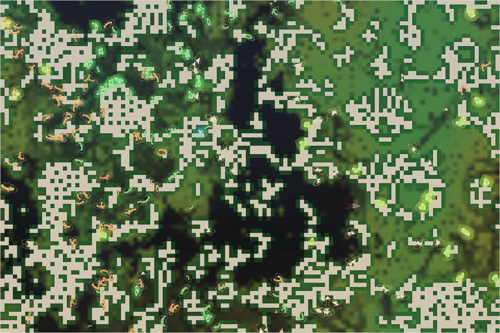

# World status — season 948 (Oct 15, 20:20)

**Window:** the last 37 seasons (s911 → s948). As before, the report is a few seasons late because the 30-season mark (s941) fell between check-ins. Previous status report: [season 911](2026-10-15_s911.md).

## 0. The world at this moment

**Rain in a wet, mild era.** The grass is coming back (≈2,500–3,000 plants), with the barest ground around the central reef. **Orange modrolis** crowd the west, the **largest species** at 126. **Green dronathus and kekequis** live in the north-west and the south. **Pale quitybels** and **yellow-glowing nafinas** share the east. The small grey shape in the centre-east is **the new kraken**, generation 42, hatched at s941.

## 1. In one paragraph
A window of **turnover**. Five species died out (galsaras, tysathus, mothus, ushtykes, droranas), and three new ones came from the dronathu line: the **quitybels** by a mind split (s925), and the **modrolis** and **kekequis** by a divide (s931). The kethulis are down to one animal. **The old kraken died** at s940 after 1,885 days and laid an egg; generation 42 hatched a season later. The new line (the dronathu family) brought a different body: **later maturing, more stamina, weaker eyes, less shell**, and its winners have **purer grass guts**, so the family's gut slipped back (0.120 → 0.092) after two windows of rising. The **decomposer ability rose again** (0.065 → 0.112), led by the nafinas (0.23, the highest ever). For a few seasons around s940 the **quitybels became the first mixed-feeder species** before the rain turned them back to grass.

## 2. Then and now

| | s911 | s948 (now) |
|---|---|---|
| Bodies / room | 332 / 300 | 332 / 300 |
| Species | 8 | 6 (one of them a single kethuli) |
| Grass | ≈5,000 (wet, warm era) | ≈2,500–3,000 (wet, mild era; rain now) |
| Ways of life | 331 grazers, 1 mixed | 319 grazers, **7 mixed feeders, 3 omnivores, 2 scavengers, 1 browser** |
| Kraken | gen 41, full size | **gen 42**, young (size 18) |
| North / south coat | 0.31 / 0.27 | **0.40 / 0.40**: coats thickened everywhere; no regional difference |

**Family traits, s911 → s948** (change measured in units of how much the trait varies across the family):

| Trait | s911 | s948 | Change |
|---|---|---|---|
| **Stamina** | 0.72 | **0.90** | **+1.09** |
| **Maturity** | 1.26 | **1.40** | **+1.07**: slower to grow up |
| **Eyes** | 0.66 | **0.56** | **−1.05**: the dimmest yet |
| **Decomposer** | 0.065 | **0.112** | **+0.94** |
| **Armour** | 0.26 | 0.20 | −0.86: the shell gain of the last window lost |
| Size | 6.47 | 6.12 | −0.50 |
| **Gut** | 0.120 | **0.092** | **−0.45**: the first fall since s844 |
| Browse | 0.233 | 0.260 | +0.42 |
| Legs, fright, fat, resistance | — | — | −0.28 to −0.36 |
| Coat (all) | ≈0.30 | ≈0.40 | thicker everywhere |

## 2b. Species alive at this report (s948)

| Species | Line | Bodies | Since | Where | Size | Gut | Browse | Armour | Coat | Water | Fat | Decomp. | Kills (all time) | Standing |
|---|---|---|---|---|---|---|---|---|---|---|---|---|---|---|
| **modrolis** | …8.1.3.2 | 126 | s932 | west | 6.2 | **0.06** | 0.27 | 0.23 | 0.39 | 0.20 | 0.81 | 0.09 | 44 | from the dronathu divide; purest grass gut, latest-maturing; the biggest species, up from 50 |
| **quitybels** | …8.1.3.1 | 71 | s926 | east | 6.0 | 0.12 | 0.28 | **0.26** | 0.41 | 0.14 | 0.81 | 0.08 | **256** | mind split from the dronathus; reached 165 (50%) then fell; **mixed feeders at s940**; the window's top hunters |
| **kekequis** | …8.1.3.3 | 59 | s932 | south-centre | **5.8** | 0.07 | **0.32** | 0.13 | **0.46** | 0.19 | 0.67 | 0.09 | 38 | the "more browsing" part of the divide: most browse and the thickest coats |
| **nafinas** | …8.1.2.2.1 | 40 | s907 | east | 6.7 | **0.16** | 0.18 | 0.21 | 0.31 | **0.36** | 0.75 | **0.23** | **300** | the last of the ushtyke family; **highest decomposer ability ever** (0.23), most water-thrifty, most meat-leaning gut |
| **dronathus** | …8.1.3 | 35 | s907 | north-west | 5.9 | 0.14 | 0.20 | **0.08** | 0.41 | 0.19 | 0.68 | 0.13 | 57 | the parent of three species; fell to 6, recovering; dimmest eyes (0.45), almost no shell |
| kethulis | …8.1 | 1 | s847 | north | 7.0 | 0.02 | 0.19 | 0.10 | 0.15 | 0.17 | 0.90 | 0.06 | 570 | the last one; mother line of every living species |
| *the kraken* | K | 1 | s941 | centre-east | 18 (young) | 0.84 | — | — | — | — | — | — | 75,228 (line) | **gen 42**; gen 41 died of old age at s940 and left the egg |

## 3. What happened in the world (s911 → s948)
- **One mind split:** the **quitybels** (15 dronathus, s925). They grew to half the family by s939, briefly became **mixed feeders** (s940; starving quitybels on bare ground began to turn toward meat), then fell back to 71.
- **One great divide:** the **dronathus** at s931 into three groups: dronathus, **modrolis** and **kekequis** ("more browsing").
- **Five extinctions:** galsaras (s916, eaten), **tysathus** (s926, of old age, after 89 seasons; the most meat-leaning line), mothus (s926), ushtykes (s928, starving) and droranas (s938).
- **The kraken:** gen 41 died of old age at **s940** after 1,885 days, laying an egg; **gen 42 hatched at s941**. It rose at s920, s930 and s940.
- **Grass:** drying to ≈1,400 at s930, recovering since; rain and a mild era now.

## 4. What we changed (s911 → s948)
Nothing. Rules and parameters were unchanged all window, and there were no rescues.

## 5. How it shows in the creatures
- **One family replaced another.** The ushtyke family (from the ommooms) and the old tysathus faded, and the **dronathu family** took over (modrolis, quitybels, kekequis, dronathus: 291 of 332). Most of the trait changes are the dronathus' own body spreading: **slow to mature, long-winded, dim-eyed, little shell**.
- **The gut setback is a founder effect,** not selection against gut. Breeders and the starved carried the same gut (section 9). The winners (modrolis, kekequis) simply started out as purer grazers.
- **Decomposers rose again,** from 0.065 to 0.112, and the nafinas reached **0.23**. Their numbers are small, but in the next drought they are the line most likely to live on dung.
- **Coats thickened everywhere** (0.30 → 0.40), with no north/south difference. That points to the era (mild and cold spells), not the regions. The s911 gap was noise.
- **The way of life is widening a little:** 13 animals are now not grazers, the most since s874.

## 6. Backlog
**Pending**
- Kraken learning B1b; minds within minds; reef rays unused; Phase III; viewer ideas 4–6; water holes (water need, option 1); the stomach (when a meat line exists).
- **Report timing:** the auto-report keeps landing 5–7 seasons late because check-ins are ~9 seasons apart. A small option: write the report at the first check-in **within 5 seasons before** the 30-season mark. Your call.

## 7. Risks
- **Mass extinction: moderate.** 291 of 332 animals belong to one family (the dronathus' descendants); the nafinas (40) are the only other line.
- **Small species:** the kethulis are finished (1). The **nafinas** carry the highest decomposer ability and the most meat-leaning gut, and losing them would set both paths back.
- **Kraken line: moderate** for now: gen 42 is young (size 18) and must grow through its first seasons.
- **Server: stable** (no errors; memory 225–290 MB).

## 8. Next to watch
- Whether the quitybels turn to mixed feeding again in the next drought, and stay.
- The nafinas: the first decomposer species if a drought gives them dung.
- The young kraken's first season.
- A modroli divide: they hold 38% now; the line is 60%.

## 9. What shapes the species

**How to read this:** the selection ledger compares the traits of everyone who **bred** (4,684) or **died** in the window — of old age (2,028), **starved (1,421)**, eaten (1,235) — with the living, in units of how much each trait varies. When every group sits on the same side of the living, the trait changed during the window because one family replaced another; the column that matters for selection is starved vs breeders.

| Trait | Breeders | Died old | Starved | Eaten | Starved vs breeders | Reading |
|---|---|---|---|---|---|---|
| **Fat** | −0.06 | +0.18 | **−2.69** | **−1.40** | **−2.63** | **The strongest force**, as in every window. |
| **Size** | +0.26 | +0.27 | **+0.45** | +0.03 | **+0.19** | The big starve → bodies shrink. |
| **Legs** | +0.24 | +0.22 | +0.38 | **+0.45** | +0.14 | Long legs cost upkeep and did not save the eaten. |
| Resistance | −0.18 | −0.07 | −0.08 | −0.03 | +0.10 | Small cost, being shed. |
| Gut | +0.29 | +0.32 | +0.30 | +0.30 | **0.01** | **Neutral**: guts fell because the winning family started purer, not because gut costs lives. |
| Decomposer | −0.44 | −0.40 | −0.55 | −0.53 | **−0.11** | Rising, and the starved carried *less* of it than breeders: **it now helps survive hunger**, the first time the ledger shows a benefit. |
| Stamina, maturity | −0.26 / −0.56 | | | | ≈0 | Rose with the dronathu family; neutral. |
| Eyes, armour | +0.37 / +0.44 | | | | ≈0 | Fell with the dronathu family; neutral. |
| Browse, parasite, fright | | | | | ≈0 | No force. |

**Which rules and conditions drove the changes**
1. **Mind splits and the great divide** shaped this window more than selection did. One split and one divide founded three species from one line. That line's body then spread through the family: slow maturing, long-winded, dim-eyed, little shell.
2. **Starvation** still picks out the lean and the big (1,421 starved, fewer than last window).
3. **Smooth benefits for decomposers** now show up as a real advantage. Animals with more of the ability starved less, and the ability rose +0.94.
4. **Predation** stayed high (1,235 eaten). The quitybels (256 kills) and nafinas (300) did most of the hunting of the young.
5. **The climate** thickened coats everywhere through its eras, but has not yet made a regional difference.
