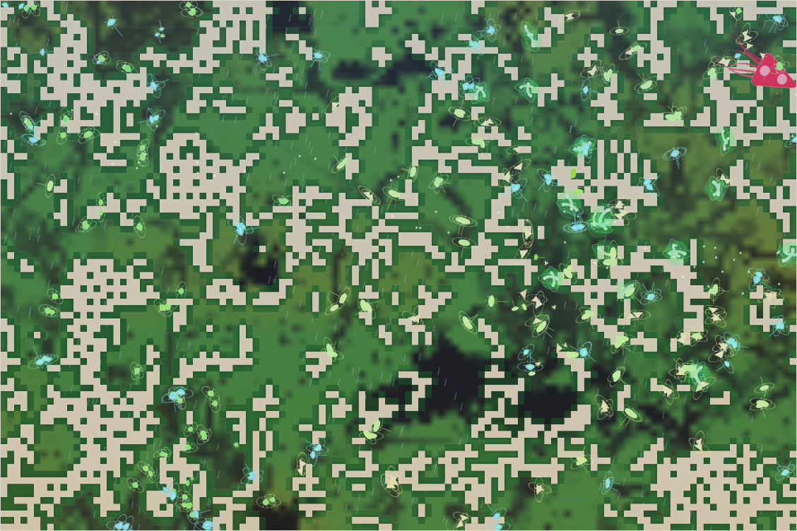

# World status — season 991 (Oct 15, 23:50)

**Window:** the last 43 seasons (s948 → s991). The report is 13 seasons late: it was due at s978, the check-in that should have written it was taken up by the history and label fixes, and the next fell later. Previous status report: [season 948](2026-10-15_s948.md).

## 0. The world at this moment

**Storms in a wet, mild era** (the rain streaks of the new weather layer are visible). The grass is green almost everywhere (≈2,450 plants), with bare dark patches around the centre. Five species are spread across the map:
- **green dronasas and galushors** in the west and centre;
- **purple-marked ushradros** through the middle;
- **pale quitybels and blue glowing belliushs** in the east.

**The kraken** (generation 42, now full-grown) is **awake**, the red shape at the top-right corner.

## 1. In one paragraph
The **decomposer window.** For the first time, splits came from **ways of life rather than minds or divides**: three **niche splits** in 30 seasons.
- **Ushradros** (s958): from nafinas living on dung.
- **Galushors** (s977): from ushradros, again on dung.
- **Belliushs** (s988): from quitybels living as mixed feeders.
- **The decomposer ability more than doubled** (0.112 → 0.254, the biggest change of any trait). **78 animals now live mainly on dung**, a quarter of the family.
- **The whole dronathu family died out** (dronathus, modrolis and kekequis), along with the kethulis, the mother line of every living species. Browsing went with them (0.26 → 0.09).
- **The survivors are the dung-eating lines:** shelled, sharp-eyed and wide-mouthed.
- **No hunter has emerged;** see section 8 and the discussion with Luis.

## 2. Then and now

| | s948 | s991 (now) |
|---|---|---|
| Bodies / room | 332 / 300 | 329 / 300 |
| Species | 6 | 5 (all born in this window) |
| Grass | ≈2,500 | ≈2,450 (wet, mild era; storms) |
| Ways of life (each animal, last day of diet) | 319 grazers, 7 mixed, 3 omnivores, 2 scavengers, 1 browser | **226 grazers, 78 decomposers, 20 mixed feeders, 4 scavengers, 1 omnivore** |
| Kraken | gen 42, young (size 18) | gen 42, **full size (26)**; rose every 10 seasons |
| North / south coat | 0.40 / 0.40 | 0.32 / 0.33 (still no regional split) |

**Family traits, s948 → s991** (change measured in units of how much the trait varies across the family):

| Trait | s948 | s991 | Change |
|---|---|---|---|
| **Browse** | 0.260 | **0.092** | **−2.23**: the browsing dronathu family is gone |
| **Decomposer** | 0.112 | **0.254** | **+2.16**: the biggest rise of any trait so far |
| **Stamina** | 0.90 | 0.70 | **−1.52** |
| **Eyes** | 0.56 | 0.68 | **+1.20** |
| **Gape** | 0.54 | 0.63 | **+1.00** |
| **Armour** | 0.20 | 0.29 | **+0.99** |
| Fright | 0.22 | 0.29 | +0.88 |
| Litter | 3.71 | 3.82 | +0.51 |
| Gut | 0.092 | 0.057 | −0.50 |
| Size, legs, maturity, fat, parasite, resistance | — | — | within ±0.35 |

## 2b. Species alive at this report (s991)

| Species | Line | Bodies | Since | Where | Size | Gut | Browse | Armour | Coat | Water | Fat | **Decomposer** | Standing |
|---|---|---|---|---|---|---|---|---|---|---|---|---|---|
| **ushradros** | …2.2.1.1 | 89 | s959 | centre | 6.5 | 0.05 | 0.04 | 0.31 | 0.26 | 0.31 | 0.81 | **0.32** | the **first niche split** of the genesis era (24 dung-eating nafinas); parent of two species; peaked at 165 |
| **dronasas** | …2.2.1.1.1 | 78 | s974 | centre-east | 6.0 | 0.08 | 0.05 | 0.28 | 0.30 | 0.22 | 0.80 | **0.38** | mind split from the ushradros; the **highest decomposer ability**; the first species ever **labelled "decomposers"** by its diet (s980; the label flickers with the weather) |
| **quitybels** | …8.1.3.1 | 73 | s926 | east | 6.5 | 0.08 | 0.18 | 0.20 | 0.40 | 0.10 | 1.00 | 0.05 | the last of the dronathu family; **429 kills**, still the main hunter of the young |
| **galushors** | …2.2.1.1.2 | 62 | s977 | west | **5.7** | 0.04 | 0.07 | **0.40** | 0.32 | **0.35** | 0.52 | 0.36 | second dung niche split (17 ushradros); the smallest and **most shelled** species, most water-thrifty |
| **belliushs** | …8.1.3.1.1 | 29 | s989 | north-east | 6.9 | 0.04 | **0.21** | 0.18 | 0.39 | 0.13 | **1.17** | 0.02 | niche split from the quitybels (25 mixed feeders); the only browsers left; fattest |
| *the kraken* | K | 1 | s941 | roaming | **26** | 0.84 | — | — | — | — | — | — | gen 42, full size; 75,509 kills (line) |

## 3. What happened in the world (s948 → s991)
- **Three niche splits**, the first of the genesis era: **ushradros** (s958, decomposers), **galushors** (s977, decomposers) and **belliushs** (s988, mixed feeders).
- **One mind split:** **dronasas** (s973, from the ushradros, "a part copied and changed").
- **Six extinctions**, all of old age:
  - kethulis (s949, after 102 seasons; mother line of all living species);
  - kekequis (s958);
  - nafinas (s965);
  - **dronathus** (s987, after 81 seasons);
  - modrolis (s988);
  - plus the last kethuli line.
- **No divides** (no species passed 60%).
- **The kraken** grew to full size and rose at s950, s960, s970, s980 and s990.
- **Grass:** droughts at s965–s977 (≈1,100–1,500 plants); wet since.

## 4. What we changed (s948 → s991)
| When | Change |
|---|---|
| s954 | **Climate made visible** (Luis): a climate dial in the side panel and weather on the map (rain, snow, frost, heat shimmer) |
| s968 | **Species panel** shows decomposer, parasite, coat and water thrift, with relatives' standouts and "part decomposer/…" tags (Luis: "the viewer still says ushradros are grazers") |
| s977 | **"Omnivore" label** needs real meat (≥20% carrion + flesh); **history** keeps every age (it had kept only ~32 seasons), with a **300-seasons** range (Luis) |

No rules or parameters of the world itself changed in the window.

## 5. How it shows in the creatures
- **Decomposers took hold.** The smooth benefit (s863) made the first steps pay, and the droughts of s965–s977 made dung the food that got animals through. Three lines are now built around it, with abilities of 0.32–0.38 (from 0.03 at the start). The ledger shows dung-eating neither hurting nor helping the starved against the breeders this window (+0.04): **it spread by founding new species**, not by slow selection.
- **The browsers are gone.** The dronathu family carried the browse gains of s911–s948, and its whole line aged out, so browse collapsed (−2.23). The belliushs (0.21) are the only browsers left.
- **Shell, eyes and mouth came back** with the dung-eating lines (armour +0.99, eyes +1.20, gape +1.00). Galushors have the most shell (0.40) of any living species, at the smallest size, which fits the mass of young hunting the quitybels do.
- **The climate still sorts no one by region** (coat 0.32 north vs 0.33 south). See section 8.
- **Labels:** each animal's way of life is judged over its last day of eating. A species' label is judged over only the last few minutes, so it flips with each shower and dry spell (dozens of "have become …" lines in the chronicle). 78 animals are decomposers by the day-long measure, while each species' label shows its last few minutes, mostly grass.

## 6. Backlog
**Under discussion with Luis (not applied)**
- **Why no hunter has emerged**, and four ways to open the door:
  - **A:** flatter gut valley (`fleshPower` 0.5, jaws at 0.15);
  - **B:** hunting skill from gape and legs;
  - **C:** more room for small bodies;
  - **D:** packs counted by lineage branch.
  Luis likes all four.
- **Room by body mass** instead of by head count, and **letting food set the population**. A capacity test is running (section 7).
- **Climate by distance from the middle of the map** (no wrap seam) and a softer era swing, so that hot and cold species can form.

**Small fix to propose**
- Give the species diet label the same one-day memory as each animal's way of life, so labels stop flickering with the weather and agree with the niche counts.

**Pending**
- Kraken learning B1b; minds within minds; reef rays unused; Phase III; viewer ideas 4–6; water holes; the stomach.

## 7. Risks
- **Mass extinction: moderate.** Five young species (all under 70 seasons old). The dronathu family is down to two (quitybels, belliushs), and the rest are one family of dung-eaters.
- **Small species:** belliushs (29) are new and small.
- **Kraken line: low** (full-grown gen 42).
- **Server: stable** (no errors; memory 190–290 MB).
- **Capacity test:** with the room limit lifted, numbers jumped from 330 to ~3,100 in 3,000 ticks, and each tick took 0.4–0.6 s against the 0.033 s the live world needs. **A food-led world would need a firm ceiling.** Fixed-ceiling runs (500 / 800 / 1,200) are in progress to measure what the grass carries in wet and dry spells.

## 8. Next to watch
- Whether the dung-eaters stay distinct or slide back to grass in the wet.
- The quitybels: the last hunters of the young, and the last of the dronathu family.
- The capacity results, and Luis' choices on the hunter path and room by mass.

## 9. What shapes the species

**How to read this:** the selection ledger compares the traits of everyone who **bred** (3,927) or **died** in the window — of old age (2,666), **starved (624)**, eaten (640) — with the living, in units of how much each trait varies. When every group sits on the same side of the living, the trait changed through the turnover of species (founding of new lines and extinction of old ones). The column that measures selection itself is starved vs breeders.

| Trait | Breeders | Died old | Starved | Eaten | Starved vs breeders | Reading |
|---|---|---|---|---|---|---|
| **Fat** | +0.29 | +0.23 | **−2.05** | −0.47 | **−2.34** | **The strongest force**, as in every window. |
| Size | −0.03 | −0.07 | +0.19 | −0.14 | +0.21 | The big starve a little more. |
| Eyes | −0.61 | −0.72 | −0.46 | −0.87 | +0.15 | Rose by turnover; slight upkeep cost. |
| Litter | −0.22 | −0.32 | −0.09 | **−0.57** | +0.13 | The eaten came from small litters. |
| Browse | +0.74 | +0.94 | +0.62 | **+1.22** | −0.11 | Fell by turnover; **the eaten were the browsers** (the quitybels' prey). |
| Armour | −0.25 | −0.29 | −0.22 | **−0.68** | +0.03 | **The eaten had the least shell** → armour rose. |
| Gape | −0.83 | −0.86 | −0.93 | −1.11 | −0.11 | Rose by turnover. |
| Decomposer | −0.33 | −0.41 | −0.29 | −0.47 | +0.04 | Rose by **founding** (niche splits), neutral in selection. |
| Stamina | +0.42 | +0.56 | +0.34 | +0.56 | −0.08 | Fell with the dronathu family. |
| Gut, parasite, resistance, maturity | | | | | ≈0 | No force. |

**Which rules and conditions drove the changes**
1. **Niche splits** (live since s757, first used now): a local group of 15 living on dung or mixed food became a species. Three did, and they made this window. The new lines carry their founders' bodies (shell, eyes, mouth, dung ability), and the family follows.
2. **Old age and turnover:** six extinctions, all of old age, ended the dronathu family and with it browsing and stamina. Starvation was light (624, the fewest of any window), because the wet spells were long.
3. **Fat** still decides who starves.
4. **Hunting of the young:** the eaten were soft, browsing animals from small litters. Shell is coming back, as it does whenever predation picks up.
5. **Smooth benefits** (s863) made dung worth eating at any ability, the precondition for the decomposer splits.
