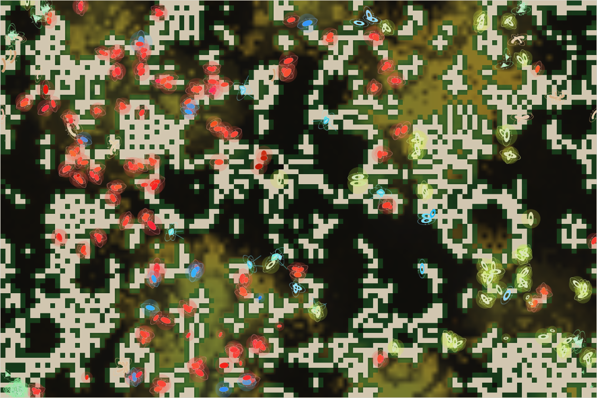

# World status — season 1021 (Oct 16, 02:25)

**Window:** the last 30 seasons (s991 → s1021). Previous status report: [season 991](2026-10-15_s991.md). Test report in between: [the hunter roadmap, s998](2026-10-16_s998-hunter-roadmap-test.md).

## 0. The world at this moment

**A drought** (the grass is browning across the middle). The map is split between two species:
- **Red glowing saomors** fill the western half. They are this window's **hunters**: 181 animals, 1,116 kills.
- **Yellow-green glowing tytyvens** hold the east.

A few blue animals (mosaquis and others) are scattered between them. **There is no kraken.**

## 1. In one paragraph
**The window when hunting began.** Luis asked for every wall to hunting to be lowered. The first switch, a **flatter gut valley** (s1000), multiplied kills about five-fold. **Animals eaten rose from 640 to 3,410** in this window, and a hunter species took over.
- **The saomors** began as a dung-eating niche split (s1004). They became the main hunters, grew from 17 to 181, and now hold 46% of the family.
- **Seven species were eaten out:** belliushs, zumooms, orrabels (the first hunter species, eaten itself after 9 seasons), nanagals, quitybels (after 95 seasons) and two others.
- **The kraken line ended:** generation 42 died of old age at s1000, and its hatchling was eaten while dormant at s1003.

Luis then added **predator brakes** (the energy pyramid and costly failed attacks, s1017), **relaxed the pause rule** to a backstop, and **raised the room to 360** (up to 396 animals). The world filled the new room at once. Bodies are **bigger, fatter and slower to breed** (litter −1.67, size +1.24): the classic answer of prey to predation.

## 2. Then and now

| | s991 | s1021 (now) |
|---|---|---|
| Bodies / room | 329 / 300 | **396 / 360** |
| Species | 5 | 7 (two of them under 15) |
| Grass | ≈2,450 (storms) | ≈5,200, drying (drought in a wetting era) |
| Eaten in the window | 640 | **3,410** |
| Ways of life (each animal, last day of diet) | 226 grazers, 78 decomposers, 20 mixed, 4 scavengers, 1 omnivore | 328 grazers, **67 decomposers**, 1 mixed feeder |
| Kraken | gen 42, full-grown | **extinct** (s1003) |
| Animals with jaws (gut > 0.15 / > 0.25) | — | 72 / 8 |

**Family traits, s991 → s1021** (change measured in units of how much the trait varies across the family):

| Trait | s991 | s1021 | Change |
|---|---|---|---|
| **Litter** | 3.82 | **3.57** | **−1.67**: fewer, better-provisioned young |
| **Eyes** | 0.68 | 0.55 | **−1.45** |
| **Size** | 6.24 | **6.90** | **+1.24**: bigger bodies are harder to overpower |
| Stamina | 0.70 | 0.52 | −0.90 |
| Resistance | 0.040 | 0.073 | +0.83 |
| Browse | 0.092 | 0.149 | +0.80 |
| **Fat** | 0.70 | **0.97** | **+0.78** |
| **Gut** | 0.057 | **0.091** | **+0.76**: the hunters' guts |
| Maturity | 1.42 | 1.32 | −0.72 |
| Fright | 0.29 | 0.24 | −0.66 |
| Armour | 0.29 | 0.25 | −0.45 |
| Decomposer | 0.254 | 0.296 | +0.28 |

## 2b. Species alive at this report (s1021)

| Species | Line | Bodies | Since | Where | Size | Gut | Gape | Armour | Fat | Decomp. | Kills (all time) | Standing |
|---|---|---|---|---|---|---|---|---|---|---|---|---|
| **saomors** | …1.1.4 | **181** | s1004 | west | 6.8 | **0.14** | 0.68 | 0.22 | 0.83 | 0.35 | **1,116** | a dung-eating niche split that became **the hunters**: 17 → 181; thinnest coats (0.12) |
| **mosaquis** | …1.1.3.1 | 97 | s1019 | south-west | 7.1 | 0.04 | 0.50 | 0.28 | 0.90 | **0.40** | 2 | niche split of dung-eating nathumos; **61% dung**, the clearest decomposer species yet |
| **tytyvens** | …3.1.3 | 65 | s1011 | east | 6.9 | 0.08 | 0.71 | 0.23 | 1.10 | 0.06 | 196 | "more shelled" part of the quitybel divide; holds the east |
| nathumos | …1.1.3 | 26 | s998 | north-west | 7.1 | 0.05 | 0.50 | **0.34** | 1.23 | 0.39 | 134 | grazer split from the ushradros; the main prey (492 eaten) |
| ushradros | …1.1 | 14 | s959 | centre | **7.5** | 0.05 | 0.52 | 0.24 | 1.21 | 0.33 | 496 | the parent of five species; the biggest bodies, dwindling |
| zuralis | …3.1.5 | 11 | s1011 | centre-east | 6.7 | 0.06 | **0.76** | 0.26 | 0.94 | 0.08 | 144 | part of the quitybel divide; widest mouths |
| dronasas | …1.1.1 | 2 | s974 | west | 7.1 | 0.14 | 0.58 | 0.29 | 1.32 | 0.29 | 486 | early hunters (of the valley's first seasons), now almost gone |

## 3. What happened in the world (s991 → s1021)
- **New species:**
  - **nathumos** (s997, niche split: grazing ushradros);
  - zumooms (s999, mind split: the last galushors);
  - orrabels (s1003, mind split: quitybels);
  - **saomors** (s1004, niche split: dung-eating ushradros);
  - **tytyvens, nanagals, zuralis** (s1010, the great divide of the quitybels);
  - **mosaquis** (s1018, niche split: dung-eating nathumos).
- **Extinctions:**
  - galushors (s999, into the zumoom split);
  - **six eaten out:** belliushs (s1000), zumooms (s1005), orrabels (s1012), nanagals (s1020), **quitybels** (s1020, after 95 seasons) and **the kraken** (s1003, a dormant hatchling).
- **Kraken:** gen 42 died of old age (s1000) and laid an egg. Gen 43 hatched at s1002 and was eaten asleep a season later. No rescue (Luis' rule).
- **Grass:** wet most of the window; a deep drought at s1015 (≈330 plants) and another drying now.

## 4. What we changed (s991 → s1021)
| When | Change |
|---|---|
| s998 | **Hunter roadmap** tested (6 variants) and scheduled: valley, skill, packkin, sizevar, massroom |
| **s1000** | **Valley:** meat digests as gut^0.5, jaws from gut 0.15 |
| s1003, s1005 | The pause rule postponed the remaining switches twice (dronasas and zumooms eaten down) → **skill s1024, packkin s1028, sizevar s1032, massroom s1036** |
| s1005 | Pause rule counts only species of 15 or more |
| **s1016** | **Pause rule relaxed** (Luis) to a backstop: only if the family falls below 250 |
| **s1016** | **Room 300 → 360** (up to 396 heads; measured 29 ms per tick at 400) |
| **s1017** | **Predator brakes:** the energy pyramid (a hunter keeps 35% of a kill, was 90%) and costly failed attacks (0.03 per slip) |
| — | Measured: the machine runs ≈400 animals at most (330 → 24 ms, 400 → 28.5, 500 → 39, 800 → 104 per tick) |

## 5. How it shows in the creatures
- **A hunter species, from an unexpected place.** The saomors were founded as dung-eaters (decomposer 0.35). With the valley they were the first to carry enough gut (0.14) to use jaws, and they turned on their neighbours: about 970 kills in 17 seasons. In the wet their diet still reads "93% grass", since meat comes in bursts. They are **hunting omnivores**, not true carnivores.
- **Prey answered as prey do:** bigger bodies (+1.24) are harder to overpower; fat (+0.78) gets them through; litters shrank (−1.67) and maturity sped up.
- **The hunters got hunted too.** Dronasas (486 kills) and orrabels (217 kills) were both eaten out: same size as their prey, so their prey could eat them back.
- **Decomposers held their ground.** The mosaquis live 61% on dung, and the family's dung ability kept rising (0.30).
- **Eyes and stamina keep falling** (−1.45, −0.90). Selection doesn't favour them: neither helps against same-size ambushers.

## 6. Backlog
**Scheduled**
- **Skill s1024, packkin s1028, sizevar s1032, massroom s1036** (the rest of the hunter roadmap).

**In reserve (predator brakes)**
- Herd vigilance (many eyes); hunter territories.

**Your call**
- **The kraken** is gone. If it ever returns: make a dormant kraken impossible to eat (today it can't be *seen* asleep, but can still be eaten on contact).
- Species diet labels: give them the same one-day memory as each animal's way of life (they still flip with each shower).

**Pending**
- Kraken learning B1b (moot without a kraken); minds within minds; reef rays unused; Phase III; viewer ideas 4–6; water holes; the stomach; climate by distance from the middle of the map.

## 7. Risks
- **Mass extinction: elevated.** Six species eaten out in 20 seasons. The saomors hold 46% and the 60% divide line is close. Two species are under 15.
- **Prey crash:** the saomors could eat their prey down and then starve. The pyramid (s1017) is meant to slow exactly that; 4 seasons is too soon to tell.
- **No kraken:** the world has lost its apex and its oldest line.
- **Server: stable** (no errors; memory 180–300 MB). The headless tests overloaded the machine once (load 128); now kept to 6 runs at most.

## 8. Next to watch
- Whether the saomors split by diet (true hunters vs dung-eaters) or divide at 60%.
- Whether the prey keep growing bigger, and the hunters follow.
- The rest of the roadmap: skill (s1024) should give hunters a bigger edge, so watch for the next wave of eaten-out species.

## 9. What shapes the species

**How to read this:** the selection ledger compares the traits of everyone who **bred** (6,066) or **died** in the window — of old age (1,332), starved (1,257), **eaten (3,410)** — with the living, in units of how much each trait varies. **For the first time, being eaten was the most common death.** Compare the groups with each other, especially the eaten and the starved against the breeders.

| Trait | Breeders | Died old | Starved | **Eaten** | Starved vs breeders | Reading |
|---|---|---|---|---|---|---|
| **Fat** | −0.28 | −0.02 | **−2.69** | **−1.73** | **−2.41** | Still **the strongest force**, now also against predators: the lean are caught. |
| **Size** | −0.40 | −0.80 | −0.12 | **−0.46** | +0.29 | Everyone who left was smaller than the living: **bodies grew** to escape the size rule. The starved were slightly bigger than breeders. |
| **Litter** | +0.43 | +0.76 | +0.45 | +0.38 | ≈0 | Big-litter lines (the quitybel family) were eaten out: fewer, larger young won by **turnover**. |
| Eyes | +0.89 | +1.20 | +0.81 | +1.02 | ≈0 | Fell by turnover: the sharp-eyed lines vanished. |
| Gut | −0.07 | −0.28 | −0.10 | −0.02 | ≈0 | Rose with the saomors; neutral in selection. |
| Decomposer | −0.62 | −0.67 | −0.74 | −0.58 | −0.13 | Rose by founding (saomors, mosaquis); slightly protective in hunger. |
| Maturity | +0.25 | +0.44 | +0.08 | +0.41 | −0.17 | Late maturers were eaten more (longer as small juveniles). |
| Armour | −0.22 | +0.04 | −0.30 | −0.25 | −0.08 | The eaten had less shell, but armour fell overall (the shelled lines went out by turnover). |

**Which rules and conditions drove the changes**
1. **The valley switch** (s1000) let a quarter of the family use jaws, and predation became the top cause of death for the first time (3,410 eaten).
2. **Niche splits** (four this window) and **one great divide** made seven species. The saomors' rise from a 17-animal split shows how fast a new way of life can now take over.
3. **The size rule** is the prey's best defence: bigger bodies are harder to take, so size rose fast.
4. **Fat** still decides survival, in drought and against hunters alike.
5. **The new room** (360) let the population rise to 396 at once. Grass is plentiful, so room, not food, still sets numbers.
