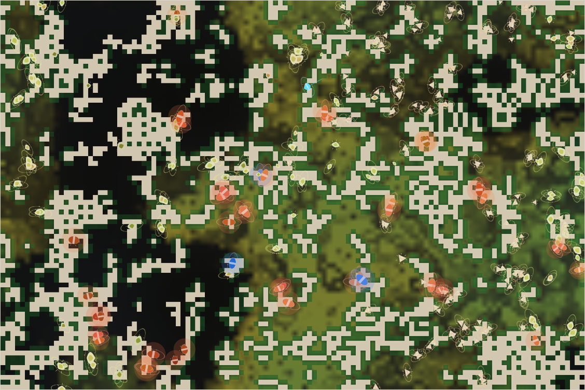

# World status — season 1090 (Oct 16, 06:00)

**Window:** the last 38 seasons (s1052 → s1090). The report is 8 seasons late (due s1082; check-ins fell either side). Previous status report: [season 1052](2026-10-16_s1052.md).

## 0. The world at this moment

**Overcast in a wet era**, with the grass back (≈4,900 plants) except a dark, bare patch in the north-west. Three species share the map:
- **small, pale kethus** crowd the east, the most numerous species;
- **yellow saornas** hold the west and north;
- **large, glowing red-orange tysadros** are scattered through the middle.

No hunters stand out any more.

## 1. In one paragraph
**After the hunt.** In the last window the world had narrowed to one prey line and one hunter family. In this one **the prey line died out**: the tytyvens, the smallest animals of the era, died of old age at s1066. With them went the reason to hunt.
- **Predation fell by three quarters** (1,735 eaten, down from 7,161).
- **Guts dropped to the lowest ever** (0.035).
- **Every species is a grazer again.**

The whole family is now the **saomor line** (4 species, 292 animals). Under room by mass and the size rule, **bodies kept growing** (median 9.1 at s1080), and **the head count fell to 240**. Then came the first counter-move: the **kethus shrank** from 9.0 to 6.9 and became the most numerous species (145), the start of a small, many-bodied line inside a world of giants. Animals also **mature much later** (+2.17, the biggest change).

## 2. Then and now

| | s1052 | s1090 (now) |
|---|---|---|
| Bodies / room | 397 / 360 | **292** / 360 (room by mass: lowest 240 at s1071) |
| Species | 6 (one prey line + hunter family) | **4, all of the saomor line** |
| Grass | ≈300 (deep drought) | ≈4,900 (wet era) |
| Eaten in the window | 7,161 | **1,735** |
| Ways of life (each animal, last day) | 207 decomposers, 172 grazers, … | **287 grazers, 5 decomposers** |
| Animals with jaws (gut > 0.15) | ~100 | 17 |
| Size: median / spread | 7.1 / 1.71 | **7.9** / 1.19 |

**Family traits, s1052 → s1090** (change measured in units of how much the trait varies across the family):

| Trait | s1052 | s1090 | Change |
|---|---|---|---|
| Fat (stores) | 0.07 | 1.32 | +6.24: refilled after the drought (stores, not genes) |
| **Maturity** | 1.34 | **1.66** | **+2.17**: much slower to grow up |
| Browse | 0.217 | 0.287 | +0.99 |
| Eyes | 0.50 | 0.39 | −0.75: the dimmest ever |
| **Gut** | 0.070 | **0.035** | **−0.71**: back to pure grass |
| Stamina | 0.44 | 0.19 | −0.65 |
| Legs, armour | — | — | +0.58 each |
| Fright | 0.25 | 0.17 | −0.56 |
| **Size** | 7.06 | **7.93** | **+0.52** |
| Resistance | 0.09 | 0.12 | +0.52 |

## 2b. Species alive at this report (s1090)

| Species | Line | Bodies | Since | Where | Size | Gut | Gape | Armour | Browse | Decomp. | Coat | Standing |
|---|---|---|---|---|---|---|---|---|---|---|---|---|
| **kethus** | …4.7.1 | **145** | s1052 | east | **6.9** (from 9.0) | 0.03 | **0.82** | **0.35** | 0.29 | 0.33 | 0.06 | niche split of grazing thuzunas; **the small, numerous line**: shrinking and growing in numbers; widest mouths, most shell |
| **saornas** | …4.6.2 | 117 | s1056 | west and north | 8.5 | 0.04 | 0.65 | 0.23 | 0.30 | 0.31 | 0.07 | from the moquiom divide; parent of the tysadros |
| **tysadros** | …4.6.2.1 | 46 | s1063 | centre | **9.2** | 0.05 | 0.64 | 0.20 | 0.22 | **0.45** | 0.13 | mind split from the saornas ("a comparison flipped"); the biggest and most dung-able |
| thuzunas | …4.7 | 1 | s1049 | north | 10.2 | 0.00 | 0.65 | 0.15 | 0.17 | 0.48 | 0.13 | the last one; once the strongest hunters (431 kills) |

## 3. What happened in the world (s1052 → s1090)
- **New species:**
  - kethus (s1052, niche split: grazing thuzunas);
  - **omdrotys, saornas, tyvenors** (s1055, the moquiom divide);
  - orzuvens (s1057, mind split: kethus);
  - **tysadros** (s1063, mind split: saornas);
  - thubelthus (s1072, the tysadro divide).
- **Extinctions (11):**
  - **saomors** (s1060, eaten; 54 seasons, 4,474 kills);
  - moquioms, tyvenors, omdrotys (starving);
  - **tytyvens** (s1066, old age; **the last prey line**);
  - orzuvens (eaten), beltyzus, thubelthus.
- **Grass:** the deep drought ended at s1053; another dry spell around s1080; wet now.

## 4. What we changed (s1052 → s1090)
Nothing. No rules or parameters changed. At s1071 the steward flagged that **room by mass is shrinking the head count** as everyone grows, and proposed three options (turn it off; count mass as size¹ instead of size²; or leave it). It is **waiting for Luis**.

## 5. How it shows in the creatures
- **Without prey, hunting stopped paying.** The last hunters' lines (saomors, beltyzus, thuzunas) ate each other out or aged out, and guts fell back to grass (0.035). The roadmap's switches stay live, but there is no small prey left to use them on.
- **Giants, then a counter-move.** The size rule protects the big, and room by mass doesn't penalise size directly, so bodies grew (to 11 at the top). Each big body takes more room, so heads fell to 240. Now the **kethus** are shrinking (9.0 → 6.9) and outbreeding the giants: 145 heads in the room that 80 giants would take. This is room by mass doing what it was meant to.
- **Slow lives:** maturity +2.17, stamina −0.65, eyes −0.75. Big, slow-maturing, dim-eyed grazers, safe from the size rule, with nothing to chase or flee.
- **Coats are very thin** (0.06–0.13), the thinnest yet: a long warm spell.

## 6. Backlog
**Waiting for Luis**
- **Room by mass:** off, gentler (size¹), or leave it. The kethus' shrinking may be answering it on its own.

**In reserve**
- Herd vigilance; hunter territories (not needed while there are no hunters).

**Pending**
- Species diet labels with a one-day memory; a dormant-kraken guard if it ever returns; minds within minds; reef rays; Phase III; viewer ideas 4–6; water holes; the stomach; climate by distance from the middle of the map.

## 7. Risks
- **Mass extinction: elevated.** 4 species, all one line, one of them a single animal. The family itself is steady (240–292).
- **Low diversity of ways of life:** everyone grazes again; no hunters, few decomposers by diet.
- **Server: stable** (no errors; memory 265–345 MB, one high reading at s1061).

## 8. Next to watch
- Whether the kethus keep shrinking into a small, numerous prey class. If so, hunting may restart from the giants.
- Whether the head count recovers under room by mass as the kethus multiply.
- Divides: the kethus are at 50%, close to the 60% line.

## 9. What shapes the species

**How to read this:** the selection ledger compares the traits of everyone who **bred** (4,057) or **died** in the window — of old age (964), starved (1,463), eaten (1,735) — with the living, in units of how much each trait varies.

| Trait | Breeders | Died old | Starved | Eaten | Starved vs breeders | Reading |
|---|---|---|---|---|---|---|
| **Fat** (stores) | −0.29 | −0.17 | **−2.40** | **−1.30** | **−2.11** | The strongest force, as always. |
| **Size** | +0.37 | +0.02 | **+0.80** | −0.06 | **+0.43** | **The big starve.** The first real counter-pressure to the giants, and why the kethus' shrinking pays. |
| Maturity | −1.20 | −1.94 | −0.97 | −1.61 | +0.23 | Everyone who left matured earlier than the living: the late-maturing lines won by turnover. |
| Gut | +0.12 | +0.25 | +0.24 | **+0.48** | +0.12 | The eaten were the meat-leaning: the hunters ate each other out. |
| Stamina | +0.81 | +1.60 | +0.40 | +1.28 | −0.41 | Fell by turnover; slightly protective in hunger. |
| Fright | +0.47 | +0.77 | +0.13 | +0.82 | −0.34 | The fearful were eaten more; the calm remain. |
| Browse | −0.58 | −0.88 | −0.30 | −0.92 | +0.28 | Rose; the browsers starved a little more than breeders. |
| Decomposer | +0.41 | +0.14 | +0.70 | +0.24 | **+0.29** | **Now a cost:** with grass plentiful, dung ability no longer protects. |

**Which rules and conditions drove the changes**
1. **The prey line died out**, and with it predation: eaten fell from 7,161 to 1,735.
2. **The size rule plus room by mass** made giants; **starvation pushes back** (the big starve, +0.43), and the kethus are the first line to answer by shrinking.
3. **Fat** still decides survival.
4. **Turnover:** 11 extinctions and 7 new species, all within one line. Diversity of species holds, but diversity of ways of life has collapsed back to grazing.
