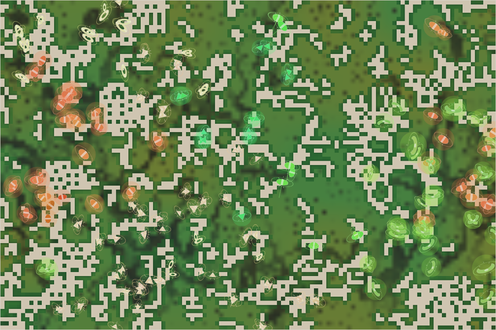

# World status — season 1128 (Oct 16, 07:50)

**Window:** the last 38 seasons (s1090 → s1128). The report is 8 seasons late (due s1120). Previous status report: [season 1090](2026-10-16_s1090.md).

## 0. The world at this moment

**Storms in a wet, cold era**, and the map is green everywhere (≈4,000 plants). Six species:
- **orange-banded, glowing tysadros**, the giant hunters, in the west and far east;
- **pale kethus and sabelbels** through the south and north;
- **big, glowing green bellizus** in the east;
- a few **green tyormos** in the centre.

## 1. In one paragraph
**A world of giants.** The family's average size reached **9.4** (it was 6.3 at s991), and every species is now 8.4–10.3. The size rule protects big bodies from hunters, and the cold era rewards them too, so the family kept growing. Under room by mass, the same total mass holds **fewer animals: 226**, the fewest since the room was raised. The kethus' shrinking (s1090) reversed: they are back to 9.1.

Hunting continued from the giants:
- the **tysadros** made about 520 kills;
- the small **rasalis**, the **saornas** (57 seasons) and three short-lived splits were eaten out.

Mid-window Luis switched the **crowding rule from root family to species** (s1126), so small species now keep breeding when the world is full. It is too early to see the effect.

## 2. Then and now

| | s1090 | s1128 (now) |
|---|---|---|
| Bodies / room | 292 / 360 (by mass) | **226** / 360 (by mass) |
| Species | 4 | 6 |
| Grass | ≈4,900 (wet) | ≈4,000 (wet, cold era, storms) |
| Size: mean / spread | 7.9 / 1.19 | **9.4** / 1.23 |
| Eaten in the window | 1,735 | 2,084 |
| Ways of life | 287 grazers, 5 decomposers | 224 grazers, 1 decomposer, 1 omnivore |

**Family traits, s1090 → s1128** (change measured in units of how much the trait varies across the family):

| Trait | s1090 | s1128 | Change |
|---|---|---|---|
| **Size** | 7.93 | **9.43** | **+1.25** |
| Eyes | 0.39 | 0.49 | +1.05 |
| Fat (stores) | 1.32 | 1.87 | +1.01 |
| Browse | 0.287 | 0.251 | −0.78 |
| Decomposer | 0.345 | 0.384 | +0.57 |
| Maturity | 1.66 | 1.72 | +0.52 |
| Armour, stamina, gape, legs, litter, gut | — | — | ±0.36–0.46 |

## 2b. Species alive at this report (s1128)

| Species | Line | Bodies | Since | Where | Size | Gut | Gape | Armour | Decomp. | Kills (all time) | Standing |
|---|---|---|---|---|---|---|---|---|---|---|---|
| **kethus** | …4.7.1 | 72 | s1052 | south | 9.1 | 0.04 | 0.82 | **0.47** | 0.35 | 646 | the oldest living line; parent of six species; regrew after shrinking; most shell |
| **tysadros** | …6.2.1 | 51 | s1063 | west and east | 10.1 | 0.05 | 0.72 | 0.20 | 0.44 | **1,180** | **the giant hunters**; divided at s1125 |
| **bellizus** | …6.2.1.2 | 39 | s1125 | east | **10.3** | 0.03 | 0.70 | 0.22 | 0.44 | 2 | from the tysadro divide; the biggest bodies |
| sabelbels | …4.7.1.5 | 26 | s1117 | north | 8.4 | 0.05 | 0.76 | 0.37 | 0.27 | 62 | from the kethu divide |
| tyormos | …4.7.1.6 | 15 | s1117 | centre-north | 8.4 | **0.13** | **0.84** | 0.30 | 0.37 | 140 | the most meat-leaning gut, widest mouths; thinnest coats (0.02) |
| quibelmos | …6.2.1.3 | 10 | s1125 | centre | 9.6 | 0.06 | 0.67 | 0.24 | 0.45 | 2 | from the tysadro divide ("narrower-mouthed") |

## 3. What happened in the world (s1090 → s1128)
- **Divides:** kethus (s1093 → rasalis; s1117 → sabelbels, tyormos, tygalors); tysadros (s1125 → bellizus, quibelmos).
- **Niche splits:** omushthus (s1095, dung), quigalfis (s1105, grazers), mobelzus (s1106, grazers).
- **Extinctions (8):**
  - thuzunas (s1090, eaten);
  - omushthus (old age);
  - mobelzus and **rasalis** (eaten: the small line the tysadros hunted);
  - **saornas** (s1113, eaten, 57 seasons);
  - quigalfis (old age);
  - tygalors (starving).
- **Climate:** a cold era now (coats a little thicker: north 0.14, south 0.18).

## 4. What we changed (s1090 → s1128)
| When | Change |
|---|---|
| **s1126** | **Crowding by species** (Luis): births slow most for the commonest *species*, not the shared root family, so small and new species keep breeding when the world is full |
| s1126 | Correction noted: the founders' fresh-lifespan reset only exists on the god's unused code-mutation path; today's splits keep real ages |

## 5. How it shows in the creatures
- **Giants:** size +1.25. Every group that left (bred, died old, starved, eaten) was smaller than the living. The size rule (hunters need to be bigger) and the cold era both favour big bodies, and nothing in room by mass charges a body for its own size, only the whole population.
- **Fewer heads:** the mass budget is fixed (~780), so bigger bodies mean fewer animals (292 → 226). The kethus' shrinking was a short counter-move; it reversed when the rasalis, the smaller line, were eaten out.
- **The hunters are giants hunting giants' young:** the tysadros (10.1) kill mostly the young of other species. Adults are now too big for anyone.

## 6. Backlog
**Waiting for Luis**
- **Room by mass** is now clearly shrinking the head count (397 → 226 in 90 seasons). Options from s1071: turn it off; count mass as size¹; leave it. Luis mentioned "something more drastic", pending.

**In reserve**
- Herd vigilance; hunter territories.

**Pending**
- Species diet labels with a one-day memory; minds within minds; reef rays; Phase III; viewer ideas 4–6; water holes; the stomach; climate by distance from the middle of the map.

## 7. Risks
- **Mass extinction: elevated.** Six species from two lines; heads at 226, the lowest of the era.
- **Head count:** if sizes keep rising, the world could fall under 200 animals, with fewer chances for variation and splits.
- **Server: stable** (no errors; memory 255–330 MB).

## 8. Next to watch
- Whether crowding by species lets small new species survive their first seasons.
- Whether sizes keep rising, and Luis' decision on room by mass.

## 9. What shapes the species

**How to read this:** the selection ledger compares the traits of everyone who **bred** (4,314) or **died** in the window — of old age (873), starved (1,423), eaten (2,084) — with the living, in units of how much each trait varies.

| Trait | Breeders | Died old | Starved | Eaten | Starved vs breeders | Reading |
|---|---|---|---|---|---|---|
| **Fat** | −0.88 | −0.74 | **−2.60** | **−1.69** | **−1.71** | The strongest force, again. |
| **Size** | −0.93 | −1.11 | −0.59 | **−1.33** | **+0.34** | Everyone who left was smaller; **the eaten were the smallest**, so the size rule drives growth. The big starve a little more (+0.34) but not enough to stop it. |
| Eyes | −0.70 | −0.79 | −0.56 | −0.86 | +0.13 | Rose by turnover. |
| Maturity | −0.49 | −0.54 | −0.41 | −0.61 | +0.09 | Later maturing keeps winning. |
| Browse | +0.32 | +0.47 | +0.36 | +0.32 | ≈0 | Fell by turnover. |
| Resistance | −0.36 | −0.34 | −0.25 | −0.48 | +0.11 | Rose. |
| Gut | −0.04 | −0.12 | +0.15 | −0.01 | +0.19 | Meat-leaning guts starve more: little prey to eat. |

**Which rules and conditions drove the changes**
1. **The size rule:** the eaten are the smallest, so bodies grow. That's the escape from predation.
2. **Room by mass** turns that growth into fewer heads.
3. **The cold era** adds a little more reason to be big.
4. **Fat** still decides survival.
5. **Crowding by species** (s1126) is too new to show.
