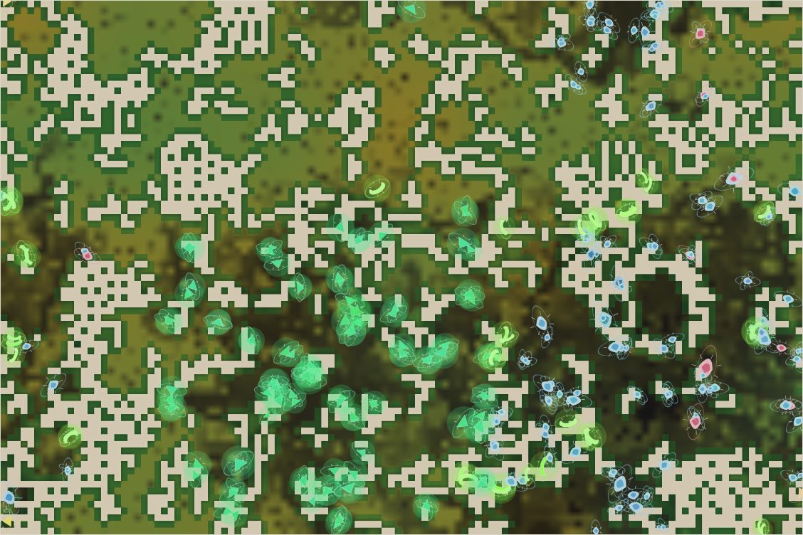

# World status — season 1163 (Oct 16, 09:40)

**Window:** the last 35 seasons (s1128 → s1163). Five seasons late (due s1158). Previous status report: [season 1128](2026-10-16_s1128.md).

## 0. The world at this moment

**Overcast in a wet era**, with the grass back (≈4,200 plants). The viewer's clock now reads **"grass worth 66%"**. The map:
- **Green glowing tyormos** crowd the centre and south;
- **small blue-marked kelitys** fill the east;
- a few **yellow-green omkequis** sit between them;
- the north is open grassland with no herds.

## 1. In one paragraph
**The window when food started to count.** Three changes went in, all at Luis' request:
- **crowding by species** (s1126);
- **evolving grass** (hardiness and sweetness, s1141);
- **leaner grass** (s1146): every 5 seasons each grass bite is worth 10% less, until the room ceiling stops being touched for 9 seasons.

Four steps have run (100% → 66%), and the effect on bodies is immediate:
- **The giants starved first.** The tysadros, at size 12 the biggest bodies ever, starved out at s1151 after 88 seasons. The kethus (108 seasons, mother of every living species) starved out at s1162.
- **Bodies shrank by 1.2 spreads** (9.4 → 8.0), the fastest change in size of the era.
- **Heads recovered** from 226 to 327 under room by mass: smaller bodies, more animals.

The grass itself is starting to sort: **hardier in the north** (0.26 vs 0.22 in the south), though not yet by dry and wet ground.

## 2. Then and now

| | s1128 | s1163 (now) |
|---|---|---|
| Bodies / room | 226 / 360 (by mass) | **327** / 360 (by mass) |
| Species | 6 | 4 |
| Grass (plants) / worth | ≈4,000 / 100% | ≈4,200 / **66%** |
| Size (mean) | 9.43 | **7.97** |
| Ways of life (each animal, last day) | 224 grazers, 1 decomposer, 1 omnivore | 289 grazers, **33 decomposers**, 3 mixed, 1 scavenger, 1 omnivore |
| Room ceiling | touched | still touched (the 9-season countdown hasn't started) |

**Family traits, s1128 → s1163** (change measured in units of how much the trait varies across the family):

| Trait | s1128 | s1163 | Change |
|---|---|---|---|
| **Maturity** | 1.72 | 1.60 | **−1.23**: faster to grow up |
| **Eyes** | 0.49 | 0.38 | −1.21 |
| **Size** | 9.43 | **7.97** | **−1.18** |
| Browse | 0.251 | 0.178 | −1.15 |
| Stamina | 0.234 | 0.068 | −1.14 |
| Fat (stores) | 1.87 | 1.18 | −0.96: leaner food |
| Fright | 0.18 | 0.23 | +0.83 |
| **Litter** | 3.54 | **3.78** | **+0.77**: more young |
| Gape | 0.76 | 0.82 | +0.77 |
| Resistance | 0.142 | 0.074 | −0.64 |

**The grass** (from `tools/grass.mjs`; start at s1141: hardiness and sweetness 0.20 everywhere, spread 0.12):

| | Hardiness | Sweetness |
|---|---|---|
| All grass | 0.237 (spread 0.154) | 0.211 (spread 0.155) |
| Dry third / wet third | 0.227 / 0.209 | 0.214 / 0.210 |
| North / south | **0.257 / 0.216** | 0.213 / 0.209 |

## 2b. Species alive at this report (s1163)

| Species | Line | Bodies | Since | Where | Size | Gut | Gape | Armour | Litter | Decomp. | Standing |
|---|---|---|---|---|---|---|---|---|---|---|---|
| **kelitys** | …7.1.8 | 149 | s1135 | east | **7.7** (from 10.3) | 0.05 | 0.80 | 0.40 | 3.80 | 0.32 | from the kethu divide; shrank fastest, now the biggest species; parent of three splits |
| **tyormos** | …7.1.6 | 108 | s1117 | centre and south | 8.4 | 0.03 | 0.82 | 0.30 | 3.73 | **0.45** | the window's hunters (939 kills), now back to pure grass (gut 0.03); the most dung-able |
| omkequis | …7.1.6.3 | 39 | s1161 | centre | 8.0 | **0.02** | 0.82 | 0.37 | 3.83 | 0.36 | from the tyormo divide ("longer-legged") |
| vengalras | …7.1.8.3 | 3 | s1163 | south-west | 9.7 | 0.12 | 0.84 | 0.49 | 3.84 | 0.28 | brand new: a dung niche split of kelitys |

## 3. What happened in the world (s1128 → s1163)
- **Splits:**
  - divides: kethus (s1134 → kelitys), kelitys (s1151 → omomquis), tyormos (s1161 → omkequis);
  - niche splits: mokenas (s1152), droushlis (s1153), vengalras (s1163), all dung-eaters;
  - mind split: venkevens (s1156).
- **Extinctions (10):**
  - sabelbels (old age), quibelmos (old age), bellizus (starving);
  - **tysadros** (s1151, starving; size 12, 88 seasons);
  - droushlis, mokenas (eaten);
  - venkevens (starving, one season);
  - **kethus** (s1162, starving; 108 seasons, the mother line);
  - omomquis (starving).
- **Grass worth:** 90% (s1146), 81% (s1151), 73% (s1156), 66% (s1161).

## 4. What we changed (s1128 → s1163)
| When | Change |
|---|---|
| s1126 | **Crowding by species**, not root family (Luis) |
| **s1141** | **Evolving grass:** each cell's grass has hardiness and sweetness, inherited when it sprouts (from neighbours, grazers' seeds, or the seed bank), mutating ±0.05; standing variation 0–0.4 at the start |
| **s1146** | **Leaner grass:** grass worth × 0.9 every 5 seasons (≈3 generations), floor 35%; stops for good after 9 seasons without touching the room ceiling; waits only if the family is under 100 |
| — | New readout `tools/grass.mjs`; the viewer clock shows "grass worth N%" |

## 5. How it shows in the creatures
- **Leaner grass is undoing the giants.** Every group that left the world, and above all the starved (+1.50), was bigger than the living. Bodies fell from 9.4 to 8.0 in 35 seasons, and room by mass turned the lost size into more heads (+101). The two oldest lines, tysadros and kethus, starved out: big, slow and costly.
- **Faster, bigger families:** litters +0.77, maturity −1.23. Leaner food rewards breeding sooner and more.
- **Decomposers again:** 33 animals live mainly on dung (1 at s1128), and three dung niche splits. Leaner grass makes dung worth more by comparison.
- **The grass sorts slowly:** hardier grass in the north (the cold north grows less, so slow-growing hardy grass loses less there), and the spread of both traits is growing. Dry and wet ground aren't split yet: 22 seasons and about 5 droughts so far.

## 6. Backlog
**Running**
- **Leaner grass:** next step at s1166 (59%), unless the room ceiling stays untouched for 9 seasons first.
- **Evolving grass:** sorting.

**Afterwards (Luis' plan)**
- Revisit room by mass once food is in charge (it may no longer be needed).
- More grass traits (root vigour, defence, cold tolerance); a viewer tint for grass strains.

**Pending**
- Species diet labels with a one-day memory; herd vigilance; hunter territories; minds within minds; reef rays; Phase III; viewer ideas 4–6; water holes; the stomach; climate by distance from the middle of the map.

## 7. Risks
- **Few species:** 4, all from the kethu line. The family itself is growing (327).
- **Droughts on leaner grass:** each step makes the next drought harsher. The only brake is a pause under 100 animals.
- **Server: stable** (no errors; memory 220–295 MB).

## 8. Next to watch
- When the room ceiling stops being touched, which starts the 9-season countdown to the end of the leaner steps.
- Whether sizes keep falling, and whether a small, numerous line appears (a prey class for any future hunter).
- Whether hardy grass takes the dry ground.

## 9. What shapes the species

**How to read this:** the selection ledger compares the traits of everyone who **bred** (4,569) or **died** in the window — of old age (423), **starved (2,170)**, eaten (1,875) — with the living, in units of how much each trait varies.

| Trait | Breeders | Died old | **Starved** | Eaten | Starved vs breeders | Reading |
|---|---|---|---|---|---|---|
| **Fat** | +0.39 | +0.76 | **−2.28** | −1.07 | **−2.67** | The strongest force; stronger with leaner food. |
| **Size** | +1.19 | +1.20 | **+1.50** | +0.96 | **+0.31** | **The big starve**: leaner grass punishes size, and bodies shrink. |
| Maturity | +0.50 | +0.67 | +0.56 | +0.51 | ≈0 | Late-maturing lines left; faster lives remain. |
| Litter | −0.46 | −1.19 | −0.55 | −0.56 | ≈0 | Small-litter lines left; bigger litters remain. |
| Stamina, eyes, legs | +0.4 to +0.7 | | | | ≈+0.1 | Upkeep with no use, shed with the old giant lines. |
| Armour | +0.60 | +0.38 | +0.74 | +0.50 | +0.13 | Shell costs upkeep; the starved carried more. |
| Fright | −0.59 | −0.63 | −0.63 | −0.58 | ≈0 | Rose by turnover. |
| Gut, decomposer | | | | | ≈0 | No force. |

**Which rules and conditions drove the changes**
1. **Leaner grass** (s1146): starvation became the main force again (2,170 starved), and it picks out the big and the lean. The giants' age ended in about 15 seasons.
2. **Room by mass** turned smaller bodies into more animals (226 → 327).
3. **Fat** still decides who starves.
4. **Evolving grass** is too young to change the animals; it is sorting itself first.
