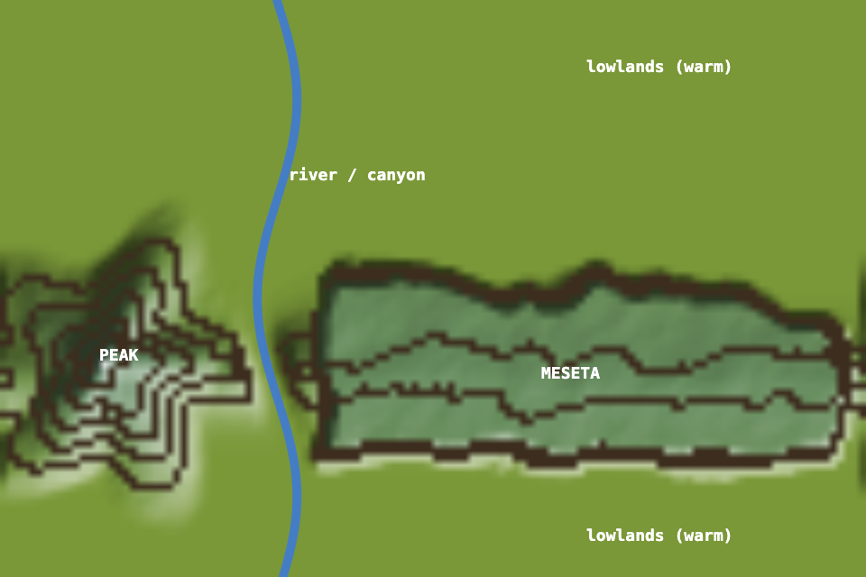

# Proposal — orography: mountains, a river, slopes and earthquakes (season 1172, Oct 16)

**Request (Luis):** bring in relief, gradually, with some drastic moments (earthquakes). There are two parts: **water flow and erosion**, and **elevation, which brings cold**. A mountain range runs across the map, cut by a river. Steep and flat ground, cold heights and warm lowlands, and river crossings should all reward different traits. Nothing has been built yet. This page breaks the idea down; the decisions to settle are in section 8.

## 1. The map you described

The world is 960 × 640 px and **wraps both ways** (leave the right edge and you come back at the left; the same for top and bottom).

```
 y=0   ┌──────────────┬──────────────────────────────────────┐  lowland (river level, warm)
       │              ║                                      │
       │              ║  river (flows top → bottom,          │
       │              ║  ~32% from the left, x ≈ 310 px)     │
 y≈320 │   . ▲ .      ║   ┌──────────────────────────────┐   │  ← meseta edge (escarpment)
       │  .▲▲▲▲▲.     ║   │   MESETA (flat, high-ish)    │   │
 y≈416 │ ▲▲ PEAK ▲▲ ══╬══ │ ─ ─ ─ ridge line ─ ─ ─ ─ ─ ─  │   │  ← the ridge ("the new north"), 35% from the bottom
       │  .▲▲▲▲▲.  canyon │   (≈30% of the map's height) │   │
 y≈512 │   . ▲ .      ║   └──────────────────────────────┘   │  ← meseta edge
       │              ║                                      │
 y=640 └──────────────┴──────────────────────────────────────┘  lowland (river level, warm)
         (wraps: the bottom lowland meets the top lowland; the river continues)
```

- **The ridge line** runs horizontally at about 35% from the bottom (y ≈ 416). It's the highest line of the map, and the coldest: your "actual north".
- **West of the river: the peak.** A pointy cone on the ridge line (height 1.0), with steep sides all round.
- **East of the river: the meseta.** A flat, raised table (height ≈ 0.6) spanning ±15% of the map's height around the ridge line (y ≈ 320–512, 30% of the map). Its edges are steep escarpments, and its top is flat.
- **The river** runs from top to bottom at about 32% from the left, always at the lowest level. Where it crosses the range it cuts a **canyon**. Because the map wraps, it flows out at the bottom and in at the top: one endless river.
- **Lowlands** above and below the range sit at river level: warm and flat. They meet across the top/bottom edge, so **the wrap seam disappears**. Today the coldest row touches the hottest row across that edge; with this layout, warm lowland meets warm lowland.

## 2. What each part does

**Elevation and cold**
- **Temperature from height:** T = (today's climate eras) − lapse × elevation. The peak is coldest (frost, little grass), the meseta cool, the lowlands warm.
- **Replacing north and south:** this replaces today's gentle north–south gradient. The cold and warm regions become **far apart and stable**, which is exactly what has stopped hot and cold species from forming so far.
- **Already in place:** the coat, fat and size rules already reward thick coats and big bodies in the cold, and thin coats in the heat. This gives them real, separate places to work.

**Slopes**
- **Climbing costs:** going uphill costs energy in proportion to the climb and the body's mass, and steep ground slows everyone. Going downhill is a little cheaper.
- **Who pays:** long legs and stamina help on slopes (both are fading today, because nothing uses them). Big bodies pay most.
- **Flat ground:** the meseta and lowlands are cheap to cross. The peak's flanks and the meseta's escarpments are the hard parts.

**The river**
- **Wet banks:** river cells and their banks stay moist, so there's lush (sweet) grass along the river even in droughts. The river becomes the drought refuge.
- **Flow follows the climate:** wide in wet eras, a thin stream in dry ones. When it dries, the bed stays as a **dry canyon**: low, sheltered, warmer.
- **Crossing it:** wading through water slows and costs energy; small bodies may be swept downstream. That could make the river a **barrier between east and west**, the classic way new species form (vicariance), and it would reward whatever trait helps crossing.

**Erosion (slow)**
- **Wearing down:** over many seasons the river deepens its canyon and slopes wear down a little.
- **Soil:** worn-off soil collects as **fertile ground** along the river and the foot of slopes.
- **Real change:** the landscape shifts on the scale of hundreds of seasons, and the grass follows the soil.

**Earthquakes (drastic, rare)**
- **When:** perhaps one every 50–100 seasons.
- **What happens:** a quake lifts or drops a stretch of ground, opens a new gorge, or **moves the river's course** a little. Herds are cut off or suddenly joined.
- **Logged** in the chronicle like any other event, and visible on the map.

## 3. What it could mean for the creatures

| Place | Conditions | Traits it would reward |
|---|---|---|
| **Peak** | coldest, steep, sparse grass, frost | thick coats, fat, bigger bodies, long legs, stamina; thicket buds (browsing) |
| **Meseta** | cool, flat, dry, open | hardy grass, water thrift, fast legs for open ground; easy hunting ground (no cover) |
| **Escarpments** | steep edges | climbers; a barrier between meseta and lowland herds |
| **River and banks** | wet, lush, sweet grass | grazers that crowd the banks; crossers |
| **Canyon (dry)** | low, sheltered, warm | a refuge in droughts and cold eras |
| **Lowlands** | warm, flat, wet and dry spells | thin coats, smaller bodies, big litters; the boom-and-bust grazers |

**Speciation drivers:** the river (east/west), the range (high/low), and the escarpments (meseta/lowland). Each can split a species by place, which is what the climate alone never managed.

## 4. How the land would rise ("gradually, and sometimes drastic")

- **Gradual:** the relief grows from flat to full height over about **30 seasons**, roughly 6 grass steps or 20 generations. Bodies can adapt while it rises.
- **The river** appears first as a wet strip, then sinks into its canyon as the range rises around it.
- **Earthquakes** come only once the relief is complete, as rare sudden events on top of slow erosion.

## 5. Phases (each tested headless, then rolled out)

| Phase | What | Effect on the world |
|---|---|---|
| **O1** | Elevation map (peak, meseta, ridge, lowlands, canyon) + **temperature from height**; the viewer shades relief (hillshade, contour lines) | cold heights and warm lowlands; the wrap seam gone |
| **O2** | **Slope costs:** climbing costs energy and slows; legs and stamina help | climbers vs flatlanders |
| **O3** | **The river:** water cells, moist banks, flow that follows the climate, dry canyon, a cost to cross | refuge, sweet-grass banks, an east/west barrier |
| **O4** | **Erosion:** canyon deepening, soil to the lowlands | slow change in where grass grows best |
| **O5** | **Earthquakes:** rare lifts, drops, river shifts | sudden isolation and mixing |

**Cost to the machine:** elevation and slope are one value per cell, computed once (and on each quake). Movement and temperature read them. That's cheap next to the animals.

**Interactions to keep in mind:**
- **The coral reef** (today's maze of walls) would stay on top of the relief. Perhaps it grows less on high ground.
- **Thicket** would favour slopes.
- **Leaner grass** and **evolving grass** keep running. Hardy grass should settle on the meseta and sweet grass along the river, which gives the grass a map too.

## 6. Order I'd suggest

O1 first, alone: relief and cold, rising over 30 seasons. It's the biggest change and the one the climate has been waiting for. Then O2 and O3, then O4 and O5 once the land has settled. Leaner grass may still be stepping down at the same time. If you'd rather keep changes apart, O1 can wait until the grass settles.

## 7. Open details (my defaults, unless you say otherwise)

- **Heights:** peak 1.0, meseta 0.6, lowlands and river 0. Lapse: the peak about 0.35 colder than the lowlands (frost on the summit in cold eras).
- **Slope cost:** +up to 50% upkeep on the steepest ground for a size-7 body; ×√(mass) for bigger ones.
- **River width:** 2–5 cells by the climate; crossing at up to 60% speed, with a small energy cost.

## 8. Decisions to settle

1. **Temperature:** should height **replace** the north–south gradient (recommended: removes the wrap seam), or **add** to it?
2. **River crossing:** use **existing traits** (size and legs help wading, small bodies get swept), or add a **new "swimming" trait** with its own cost?
3. **The river as a barrier:** **costly** (slows and tires, recommended), or nearly **impassable** for small bodies (strong east/west separation)?
4. **Pace:** the land rises over **~30 seasons**? Earthquakes **once every 50–100 seasons**, or more often?
5. **Erosion:** include it (O4), or leave the land fixed between quakes?
6. **Start now** with O1 (while the grass steps continue), or wait until the leaner grass settles?

---

## 9. Luis' decisions (s1186) and progress

- **Temperature:** height replaces north–south.
- **River crossing:** size, legs, fat and upkeep decide. Big bodies pay more to move and more still to swim, and wading gets hard gradually once the water is deeper than the legs are long. A **swimming skill** starts dormant and evolves on its own. The river is costly for small bodies unless they swim. (Later, perhaps: an "experience" cost so no animal can learn every skill.)
- **Earthquakes:** small ones every 15–30 seasons, at least one big one per 100.
- **Water and erosion together:**
  - **Flow:** water runs from top to bottom and finds its own way down, slowly deepening its bed. Reef is worn and reshaped gradually, not swept away.
  - **The river follows the weather:** rain swells it, snow on the heights holds water and releases it when it warms, deep cold can freeze it, and long dry spells leave a canyon.
- **Start now**, in parallel with the grass steps.

| Step | What | Status |
|---|---|---|
| 1 | **Relief** + temperature from height + slope costs | **live from s1186**, rising to full height by s1216 (tested: no errors, same speed, population held) |
| 2 | **Water + erosion + swimming** (the river finds its way, weather-driven flow, snow, ice, canyon) | next: build and test |
| 3 | **Earthquakes** (small and big) | after step 2 |

## 10. Making it visible

**The relief at full height** (a preview of what the map will show by s1216; the river here is only a sketch of step 2):



**Updated s1194 (Luis):** the outlines are now irregular and natural — the ridge line wanders, the peak has spurs and ridges, the meseta has bays and headlands, the canyon meanders. Computed once, no runtime cost; erosion and quakes will keep reshaping it.

**What the viewer shows, step by step:**

| Step | On the map | In the side panel / clock |
|---|---|---|
| **1 · Relief** *(live)* | **Shaded hills** lit from the north-west, **contour lines** every ⅙ of the height, a **blue-to-amber tint** by temperature (cold heights, warm lowlands); **frost glints** and **snow** fall on the heights in cold eras | the climate dial's bar reads **peak → lowlands**; text "peak: cold · lowlands: warm" |
| *1 · additions* | a **relief toggle** (like the kraken's mind) to switch the shading off; a soft **white cap** on the summit while it is below the frost line; a **hover readout** of height and temperature under the pointer | "land rising: N%" in the clock until the relief is full grown |
| **2 · Water** | the river drawn as **moving blue water**, width following its flow; **paler, rippled** where it floods after snowmelt; **white ice** when frozen; when dry, a **dark sandy bed** (the canyon); **wet banks** greener; reef cells along the bed **fade gradually** as they wear | a **river gauge** in the side panel: water level, snow stored on the heights, frozen or flowing |
| *2 · creatures* | **ripples** around animals wading or swimming; animals **swept** a little downstream when they can't hold | the species panel shows the **swimming** skill with relatives' standouts ("swimmers") |
| **3 · Earthquakes** | a short **shake** of the map, **crack lines** where the ground broke, a **dust ring** fading over a few seconds; the contour lines **jump** where the land rose or fell | a **toast** and a chronicle line ("The earth shakes: the meseta's east edge rises"), with strength |
| **Reports** | each status report gets the **screenshot with relief** plus, every few reports, a **before/after relief map** (erosion and quakes over the window) | a short "land" section: river course, canyon depth, quakes in the window |
