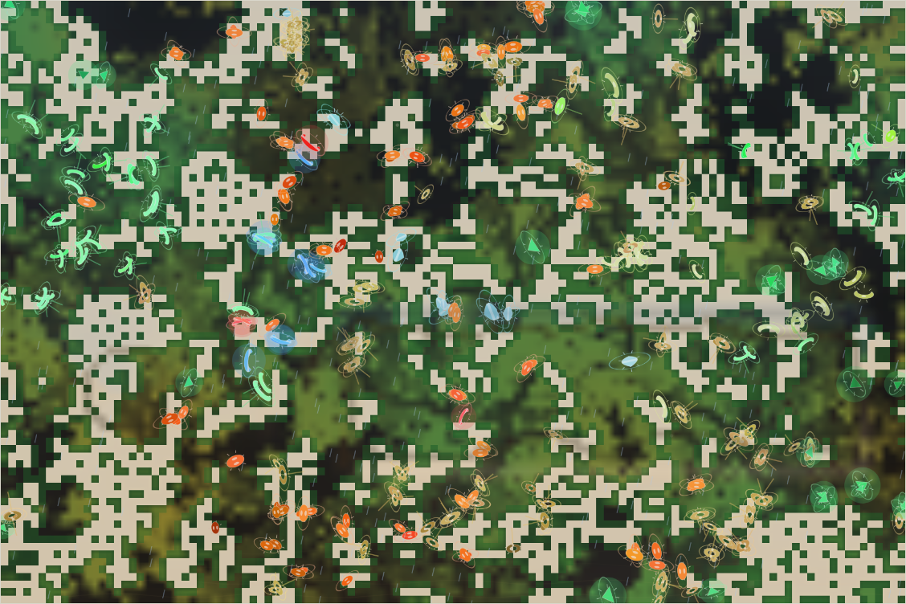

# World status — season 1194 (Oct 16, 11:35)

**Window:** the last 31 seasons (s1163 → s1194). Previous status report: [season 1163](2026-10-16_s1163.md). In between: the [orography proposal](2026-10-16_s1172-orography-proposal.md) (with Luis' decisions, progress and the visual plan).

## 0. The world at this moment

**Rain in a dry, mild era** after a drought (≈820 plants). The clock reads **"grass worth 35%"**: the floor. On the map:
- **orange-marked quilitys and navennas** spread across the north and south;
- **green liquioms** in the west, **pale quiquiquis** in the east.

The **first faint contour of the rising mountain range** crosses the middle of the map. The relief began at s1186 and stands at about a quarter of its full height.

## 1. In one paragraph
**Leaner grass ran its course:** eight steps down to the 35% floor (s1188). It never found the point where room stops binding, because **room by mass still binds**. The population settled between 220 and 390, swinging with the droughts (219 at s1186).

**The family turned to dung.** The decomposer ability jumped **0.37 → 0.52**, the biggest change of the window. **254 of 315 animals now live mainly on dung**; every species gets 9–24% of its food from it. With grass at a third of its worth, droppings are the best value food around.

**Hunters:** the quilitys and navennas took turns; the kelitys (s1182) were eaten out.

**The orography began (s1186):** the ridge, peak and meseta are rising (full by s1216), cold comes from height now, and slopes cost energy.

## 2. Then and now

| | s1163 | s1194 (now) |
|---|---|---|
| Bodies / room | 327 / 360 (by mass) | 315 / 360 (by mass; lowest 219 at s1186) |
| Species | 4 | 8 |
| Grass (plants) / worth | ≈4,200 / 66% | ≈820 / **35% (floor)** |
| Ways of life (each animal, last day) | 289 grazers, 33 decomposers | **254 decomposers**, 52 grazers, 4 scavengers, 3 mixed, 2 omnivores |
| Relief | flat | rising (~25%) |

**Family traits, s1163 → s1194** (change measured in units of how much the trait varies across the family):

| Trait | s1163 | s1194 | Change |
|---|---|---|---|
| **Decomposer** | 0.372 | **0.520** | **+2.34**: the family turns to dung |
| Litter | 3.78 | 3.66 | −0.89 |
| Maturity | 1.60 | 1.48 | −0.84: faster to grow up |
| Eyes | 0.38 | 0.30 | −0.80 |
| Fright | 0.23 | 0.28 | +0.58 |
| Fat (stores) | 1.18 | 0.93 | −0.49 |
| Legs, armour, parasite | — | — | ±0.4 |
| Size | 7.97 | 7.82 | −0.11 (the shrinking slowed) |

**The grass** (`tools/grass.mjs`):

| | s1163 | s1194 |
|---|---|---|
| Hardiness: all (spread) | 0.237 (0.154) | **0.300** (0.190) |
| Hardiness: north / south | 0.257 / 0.216 | 0.313 / 0.277 |
| Sweetness: all | 0.211 | **0.170** |

Hardy grass is gaining everywhere and sweet grass losing. Droughts and grazing favour holding on over being rich. Dry and wet ground still aren't clearly split.

## 2b. Species alive at this report (s1194)

| Species | Line | Bodies | Since | Where | Size | Gut | Decomp. | Dung in diet | Standing |
|---|---|---|---|---|---|---|---|---|---|
| **quilitys** | …6.4 | 120 | s1169 | centre | **7.2** | 0.04 | **0.55** | 24% | from the tyormo divide; once hunters (1,195 kills), now the most dung-dependent; parent of four splits |
| **navennas** | …6.5 | 91 | s1169 | north-centre | 8.4 | 0.06 | 0.51 | 19% | from the tyormo divide; the window's hunters (817 kills all time) |
| liquioms | …6.5.1 | 54 | s1190 | north-west | 7.9 | 0.05 | 0.49 | 9% | grazer niche split from the navennas |
| quiquiquis | …6.4.1 | 25 | s1180 | north-east | 8.4 | 0.04 | 0.48 | 18% | grazer niche split from the quilitys |
| tyormos | …6 | 24 | s1117 | east | 8.0 | 0.08 | 0.51 | 21% | the oldest living line (77 seasons), parent of all; dwindling |
| raquikes | …6.4.3 | 13 | s1185 | centre-north | 9.0 | 0.03 | 0.52 | 20% | dung niche split from the quilitys |
| tymoushes | (new) | 13 | s1194 | west | 8.3 | 0.05 | 0.49 | 16% | the newest split |
| omthuors | …6.4.4 | 2 | s1186 | north-east | 8.1 | 0.08 | 0.50 | 17% | dung niche split; nearly gone |

## 3. What happened in the world (s1163 → s1194)
- **Splits:**
  - divide: tyormos (s1168 → quilitys, navennas);
  - niche splits: quiquiquis and galquigals (s1180), raquikes (s1184), omthuors (s1186), liquioms (s1190);
  - tymoushes (s1194).
- **Extinctions (5):** vengalras (s1165, starving), omkequis (s1170, eaten), **kelitys** (s1182, eaten; 47 seasons), galquigals (s1182, old age, 2 seasons).
- **Grass worth:** 59% (s1166), 53% (s1171), 48% (s1176), 43% (s1181), 39% (s1186), **35% (s1191): the floor**.
- **Weather:** a drought crash at s1186 (219 animals); rain now.

## 4. What we changed (s1163 → s1194)
| When | Change |
|---|---|
| s1172 | **Orography proposal** (Luis): range, river, slopes, erosion, earthquakes, in 3 steps; decisions taken at s1186 |
| **s1186** | **Step 1 — relief:** ridge at 35% from the bottom, a pointy peak west of the river line, a flat meseta east, a canyon; rising over 30 seasons; **temperature from height** replaces north–south; **climbing** costs energy (heavier, fatter, short-legged bodies pay more) and steep ground slows; viewer: shaded relief, contour lines, cold/warm tint by height |
| s1194 | Relief outlines made more irregular (Luis), computed once with no cost at runtime |

## 5. How it shows in the creatures
- **Dung became the staple.** Lean grass made droppings relatively rich, and the old decomposer ability (0.37) had something to work with. Every species now eats dung, and the ability rose faster than anything before it. The family has become **grazer-decomposers**: they eat grass, and live off each other's droppings when grass runs short.
- **Faster lives:** maturity −0.84, litter down a little. Lean food rewards breeding early.
- **Shrinking has slowed** (7.97 → 7.82). The size rule against hunters and the lean food now pull in opposite directions.
- **The relief is too young to show in the bodies.** In the headless test at full height, about a third of the animals lived on the heights.

## 6. Backlog
**Your call**
- **Room by mass still binds**, even at 35% grass. Food is not yet the only limit. Options:
  - **(a) Turn room by mass off**, back to a head ceiling of 396. Food would then be the main limit at about 300–390.
  - **(b) Lower the grass floor** below 35%.
  - **(c) Leave it.** With dung as food, the family may now be living partly off itself.

**Running**
- **Relief:** rising to full by s1216.
- **Evolving grass:** hardy grass gaining.

**Next (orography)**
- Step 2: water + erosion + swimming (weather-driven river, snow, ice, canyon).
- Step 3: earthquakes.

**Pending**
- Species diet labels with a one-day memory; herd vigilance; hunter territories; more grass traits; a grass-strain tint; minds within minds; reef rays; Phase III; viewer ideas; the stomach.

## 7. Risks
- **Droughts on the grass floor:** the family fell to 219 at s1186; the brake (pause under 100) never triggered.
- **One way of life again:** grazer-decomposers everywhere; few hunters.
- **Server: stable** (no errors; memory 250–300 MB).

## 8. Next to watch
- The relief at full height (s1216): who moves onto the peak and meseta, and whether coats thicken there.
- Your choice on room by mass.
- Whether the dung economy holds through the next drought.

## 9. What shapes the species

**How to read this:** the selection ledger compares the traits of everyone who **bred** (7,423) or **died** in the window — of old age (796), starved (2,834), **eaten (3,805)** — with the living, in units of how much each trait varies.

| Trait | Breeders | Died old | Starved | Eaten | Starved vs breeders | Reading |
|---|---|---|---|---|---|---|
| **Fat** | −0.19 | +0.19 | **−1.47** | **−0.93** | **−1.28** | The strongest force. |
| **Decomposer** | −1.02 | −1.14 | −1.16 | −1.10 | −0.15 | Everyone who left had **less** than the living: the ability rose fast during the window. Slightly protective in hunger. |
| Size | −0.28 | −0.37 | −0.01 | **−0.56** | +0.27 | The eaten were the small; the starved a bit bigger than breeders. The two pressures balance, and size holds. |
| Maturity, browse, resistance | +0.4 | | | | ≈0 | Fell by turnover. |
| Legs | +0.08 | +0.11 | +0.15 | +0.25 | +0.07 | The eaten had longer legs (or spent them running). |
| Gut, gape, parasite | | | | | ≈0 | No force. |

**Which rules and conditions drove the changes**
1. **Leaner grass** (to 35%): starvation (2,834) and the turn to dung.
2. **Smooth benefits for decomposers** (since s863): any ability pays, so a lean world pushes it up fast.
3. **Room by mass** still caps numbers, so food never fully took over.
4. **Predation** (3,805 eaten): the quilitys' and navennas' hunting; the small are eaten.
5. **The relief** (from s1186): too young to show.
