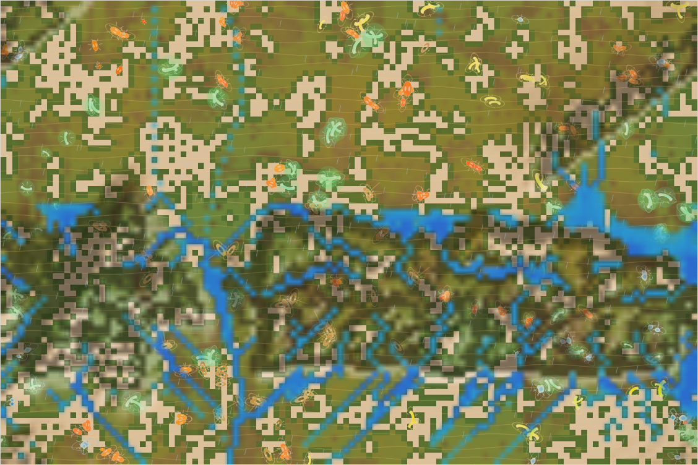

# World status — season 1260 (Oct 16, 17:30)

**Window:** the last 36 seasons (s1224 → s1260). The report is 6 seasons late (due s1254). Previous status report: [season 1224](2026-10-16_s1224.md).

## 0. The world at this moment

**Rain on the range.** Water runs everywhere off the mountains:
- a long **lake** along the meseta's north edge;
- a wide **pond** in the north-east, where the great quake dropped the ground;
- **streams** branching down the peak's flanks and through the canyon.

The herds live in the lowlands above and below; 72 of 241 animals are on the range.

## 0b. The land (orography X-ray)

*The land alone. Elevation runs from −0.52 (sunk and carved) to 0.97 (the peak); contours every 0.1; red tint = steep; blue = water with white flow arrows; white speckle = snow (none now: a warm, wet spell).*

- **Drainage:** a **branching network** has formed by itself: streams run off every slope of the peak and the meseta and gather in the lowlands below. There is no single river. Water is in 347 cells now; 82 of them are deeper than 0.05 (the lake and ponds).
- **Carving:** **475 cells are carved close to the 0.30 limit**. Some deep grooves cross the meseta and the lowlands **diagonally**. They were cut in the first seasons of the water, when a routing quirk sent every stream down-left (fixed at s1219), and today's water still follows them. That's an accident of history the world now has to live with.
- **The great earthquake** (s1236, in the lowlands, strength 0.27, a 307 px fault) moved 1,725 cells by more than 0.02. Its sunken side is the **bluish band in the north-east**, which now holds a pond. It struck before the world began logging its quakes, so its fault line isn't drawn. The next quake is due around s1265.
- **Snow and frost:** none at present (a warm, wet spell).

## 1. In one paragraph
**A smaller, shell-bearing world.** Room was cut by 40% (Luis, for speed), and numbers settled at 183–240. Five lines from the busy galushty family died out, including the galushtys themselves after 53 seasons; two new niche splits of the navennas took their place.

The animals changed fast:
- **Armour jumped from 0.35 to 0.54**, the biggest change in any window (+3.5 spreads), under steady hunting (2,446 eaten).
- **Maturity is later** (+1.9) and **eyes dimmer** (−1.4).
- **Bodies are smaller** (7.9 → 6.9).
- **Dung use** fell back (0.63 → 0.53) with the end of the most dung-dependent lines.

The land was shaped by water and by the first, **great earthquake** (s1236). The **grass sorted further:** hardy grass on dry ground (0.39 against 0.33 on wet) and in the north.

## 2. Then and now

| | s1224 | s1260 (now) |
|---|---|---|
| Bodies / room | 309 / 360 | **240 / 216** (heads ≤ 238; cut s1232) |
| Species | 8 | 5 |
| Grass (plants) / worth | ≈3,950 / 35% | ≈3,550 / 35% |
| Ways of life (each animal, last day) | 189 grazers, 117 decomposers | 131 grazers, 108 decomposers, 1 mixed |
| Land | full relief, canyon carved | + the great quake (s1236), a branching drainage, a lake and ponds |
| Speed | 19 ticks/s | ≈ 26–30 ticks/s (thinking every third tick, lazy reef rays, smaller room) |

**Family traits, s1224 → s1260** (change measured in units of how much the trait varies across the family):

| Trait | s1224 | s1260 | Change |
|---|---|---|---|
| **Armour** | 0.349 | **0.538** | **+3.48**: shells everywhere |
| **Decomposer** | 0.625 | 0.531 | −2.02 |
| **Maturity** | 1.45 | 1.67 | **+1.94** |
| **Eyes** | 0.25 | 0.14 | −1.37 |
| **Size** | 7.93 | **6.91** | −1.09 |
| Fat (stores) | 1.12 | 0.65 | −0.82 |
| Fright | 0.26 | 0.35 | +0.78 |
| Legs | 0.642 | 0.625 | −0.51 (the leggy galushtys are gone) |
| Litter | 3.70 | 3.81 | +0.41 |
| Swimming | 0.019 | 0.024 | still drifting low |
| Coat | — | range 0.099, lowlands 0.090 | a hint of difference, in a warm spell |

**The grass:** hardiness 0.377 (spread 0.28); dry ground 0.387 vs wet 0.325; north 0.421 vs south 0.342. Sweetness 0.143; wet 0.169 vs dry 0.125.

## 2b. Species alive at this report (s1260)

| Species | Line | Bodies | Since | Where | Size | Gut | Legs | Coat | Swim | Decomp. | Standing |
|---|---|---|---|---|---|---|---|---|---|---|---|
| **thuzulis** | …6.5.5 | 73 | s1249 | north-west of the range | 6.6 | 0.05 | 0.61 | 0.13 | 0.015 | 0.49 | dung niche split of the navennas; largest in 10 seasons |
| **navennas** | …6.5 | 72 | s1169 | north-centre | 7.0 | 0.03 | 0.63 | 0.09 | 0.020 | 0.52 | the oldest line now (92 seasons), parent of the two newest |
| quilitys | …6.4 | 35 | s1169 | on the range (west) | **7.7** | 0.09 | 0.63 | **0.02** | 0.025 | **0.62** | the window's hunters (2,779 kills all time); thinnest coats |
| sabelushs | …4.5.3 | 33 | s1218 | east | 6.9 | 0.07 | **0.65** | 0.05 | **0.037** | 0.58 | the last of the galushty family; the best swimmers |
| sazuthus | …6.5.6 | 28 | s1250 | on the range (centre) | **6.4** | 0.02 | 0.63 | **0.14** | 0.022 | 0.46 | grazer niche split of the navennas; smallest, thickest coats |

## 3. What happened in the world (s1224 → s1260)
- **Niche splits:** raquithus (s1233), naliras (s1231), **thuzulis** (s1248, dung), **sazuthus** (s1250, grazers).
- **Extinctions:**
  - naliras (eaten);
  - raquithus (old age);
  - **lityvens** (s1240, old age, 43 seasons);
  - **galushtys** (s1255, old age, 53 seasons; parent of five species);
  - the omnivore splits of the last window were already gone.
- **The great earthquake** (s1236), in the lowlands: the north-west side rose, the south-east side sank, and reef shattered in 65 places.
- **Weather:** a wet spell now (grass ≈3,550).

## 4. What we changed (s1224 → s1260)
| When | Change |
|---|---|
| s1225 | **Water tilt** (Luis): steep at the top edge (0.15 per row) easing to 0.01 by halfway down |
| s1232 | **Speed:** thinking every third tick, reef rays only on request, **room 360 → 216** |
| s1233 | **Species diet labels** keep a one-day memory (they no longer flip with each shower) |
| s1235 | **Commit 7de7494** (all work since 091774d) |
| s1239 | **Orography X-ray** for every report (this report's section 0b); the world logs its quakes |

## 5. How it shows in the creatures
- **Shells:** armour rose by 3.5 spreads. Everyone who left the world (bred, died old, starved, eaten) had less shell than the living, and the eaten the least (−1.17). With the hunter switches live and the giants gone, shells are the prey's answer.
- **Slow lives, small bodies:** later maturing (+1.9), smaller (−1.1). Leaner food and the smaller room favour small, careful bodies.
- **Legs and swimming:** legs fell back with the end of the leggy galushtys. Swimming stays low (0.024), highest in the sabelushs (0.037), who live by the eastern ponds.
- **Coats:** the range's animals carry slightly thicker coats (0.099 against 0.090 below), and the range's own sazuthus are the thickest (0.14). That's the first hint of the cold sorting coats, even in a warm spell.

## 6. Backlog
**Your call (open)**
- Room by mass (keep, off, or gentler).
- The kraken (return, with a guard for the sleeping egg-born).
- Divides vs predation.

**Running**
- Earthquakes (next ~s1265; the logged faults will appear in this X-ray); water, erosion, swimming; evolving grass.

**Ready to build**
- A leaner grass search (the next speed lever).
- More grass traits; a grass-strain tint and ripples in the viewer; herd vigilance; hunter territories; an experience cost for skills.

## 7. Risks
- **Few species (5), one family:** all are descendants of the quility/navenna lines.
- **Old diagonal grooves:** an early routing quirk shaped where the water still runs; it may take quakes and centuries of erosion to change.
- **Server: stable** (no errors; memory 190–230 MB).

## 8. Next to watch
- The next earthquake (~s1265), with its fault drawn in the X-ray.
- The first cold era on the full relief: snow on the heights, ice on the streams, coats on the range.
- Whether shells keep rising, and whether hunters answer (gape, skill).

## 9. What shapes the species

**How to read this:** the selection ledger compares the traits of everyone who **bred** (5,091) or **died** in the window — of old age (588), starved (2,126), **eaten (2,446)** — with the living, in units of how much each trait varies.

| Trait | Breeders | Died old | Starved | Eaten | Starved vs breeders | Reading |
|---|---|---|---|---|---|---|
| **Fat** | +0.78 | +0.76 | **−1.58** | −0.46 | **−2.37** | The strongest force. |
| **Armour** | −0.92 | −0.63 | −0.88 | **−1.17** | ≈0 | Rose fast; **the eaten had the least shell**. |
| **Maturity** | −1.03 | −0.84 | −1.01 | −1.23 | ≈0 | Rose by turnover: late-maturing lines remain. |
| **Size** | +1.04 | +0.67 | **+1.30** | +0.92 | **+0.25** | Everyone who left was bigger; **the big starve**. |
| Decomposer | +0.87 | +0.67 | +0.89 | +1.09 | ≈0 | Fell by turnover (the dung-heaviest lines ended). |
| Eyes | +0.66 | +0.47 | +0.68 | +0.85 | ≈0 | Fell; the eaten had the sharpest eyes (a cost, not a help). |
| Fright | −0.32 | −0.06 | −0.28 | **−0.60** | ≈0 | The calm were eaten: fearfulness pays again. |
| Gut | +0.39 | +0.08 | +0.56 | +0.56 | +0.17 | Meat-leaning guts starved and were eaten. |

**Which rules and conditions drove the changes**
1. **Predation** (2,446 eaten): shells (+3.5) and fright (+0.8) rose; the eaten were soft, calm and sharp-eyed.
2. **Starvation and the smaller room:** the big and the lean starve, so bodies shrank and fat still decides.
3. **Turnover:** the galushty family ended (dung-heavy, leggy, swimming), taking those traits down with it.
4. **The land:** the great quake and the drainage reshaped where water and wet banks are; the range holds 30% of the animals.
5. **Evolving grass:** hardy grass now clearly holds the dry ground and the north.
