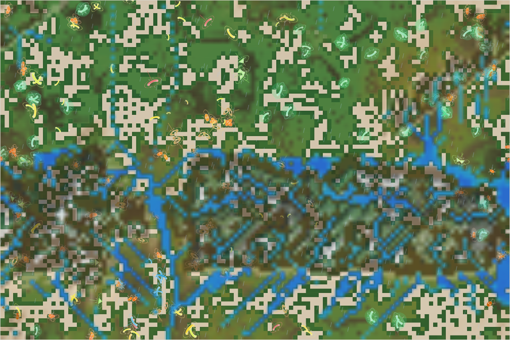
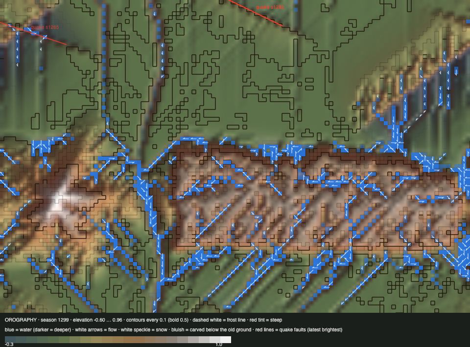

# World status — season 1298 (Oct 16, 19:30)

**Window:** the last 38 seasons (s1260 → s1298). The report is 8 seasons late (due s1290). Previous status report: [season 1260](2026-10-16_s1260.md).

## 0. The world at this moment

**Rain, and the wettest the range has looked.** Lakes line the meseta's north edge, streams branch down the peak and through the canyon, and ponds sit in the east. 859 cells hold water, 536 of them deeper than 0.05. The lowlands are green, and the herds graze above and below the range.

## 0b. The land (orography X-ray)

*Elevation −0.60 … 0.96; contours every 0.1; red tint = steep; blue = water with flow arrows; red lines = logged quake faults.*

- **Carving deepens.** 849 cells are carved close to the 0.30 limit (475 at s1260). The streams are cutting into the meseta and the lowlands, and the old diagonal grooves are now valleys. The deepest ground (−0.60) is where the great quake's sunken side meets a carved channel.
- **Quakes:**
  - **Small quakes:** two logged, now drawn as the red faults near the top edge. s1265 struck the north-west lowlands (strength 0.08, 166 px); s1282 the north-centre lowlands (0.06, 134 px).
  - **The great quake** of s1236 isn't in the log. Together the three have moved 1,989 cells by more than 0.02.
  - **Next:** due around s1303.
- **Lakes:** 536 cells of deep water in this rain, the most so far. The meseta's north edge, the canyon and the north-east hollow (the great quake's) hold them.
- **Snow:** none (a warm, wet spell).

## 1. In one paragraph
A quieter window for the animals: the population steady at 229–241, 6 species, two dung-eating niche splits (one eaten out within 8 seasons). The bodies kept moving in one direction:
- **More shell** (armour 0.54 → 0.61; the navennas carry **0.78**, the most ever).
- **Smaller** (6.9 → 6.45; the navennas 5.8).
- **More browsing** (0.17 → 0.24, the biggest change).
- **Swimming is rising** (0.024 → ~0.045; the sabelushs 0.059).

The land kept working: rain filled lakes, streams cut deeper, and two small quakes moved the north lowlands.

## 2. Then and now

| | s1260 | s1298 (now) |
|---|---|---|
| Bodies / room | 240 / 216 | 240 / 216 |
| Species | 5 | 6 |
| Grass (plants) / worth | ≈3,550 / 35% | ≈5,100 / 35% |
| Ways of life (each animal, last day) | 131 grazers, 108 decomposers | 195 grazers, 29 decomposers, **15 mixed feeders**, 1 omnivore |
| Water | 347 wet cells, 82 deep | **859 wet, 536 deep** (rain) |
| Carved deep (> 0.25) | 475 cells | **849 cells** |
| Quakes | 1 (great, s1236) | 3 (+ small s1265, s1282) |

**Family traits, s1260 → s1298** (change measured in units of how much the trait varies across the family):

| Trait | s1260 | s1298 | Change |
|---|---|---|---|
| **Browse** | 0.170 | **0.237** | **+1.36** |
| **Resistance** | 0.093 | 0.161 | +0.98 |
| Parasite ability | 0.046 | 0.069 | +0.59 |
| **Size** | 6.91 | **6.45** | −0.55 |
| **Armour** | 0.538 | **0.605** | +0.48 |
| Gut | 0.051 | 0.070 | +0.44 |
| Decomposer | 0.531 | 0.561 | +0.41 |
| **Swimming** | 0.024 | **≈0.045** | doubled (from a low start) |
| Coat | range 0.099, lowlands 0.090 | range 0.042, lowlands 0.045 | thin everywhere (warm spell) |

**The grass:** hardiness 0.399 (spread 0.31, still widening); north 0.421 vs south 0.376. By today's moisture, the "wet third" now reads hardier than the "dry third" (0.38 vs 0.34). In this rain the map's wet ground includes the range, where hardy grass lives, so that comparison is noisy; the north–south gap holds. Sweetness 0.147.

## 2b. Species alive at this report (s1298)

| Species | Line | Bodies | Since | Where | Size | Gut | Armour | Browse | Swim | Decomp. | Standing |
|---|---|---|---|---|---|---|---|---|---|---|---|
| **navennas** | …6.5 | 67 | s1169 | north-centre | **5.8** | 0.05 | **0.78** | **0.30** | 0.037 | 0.50 | the oldest line (129 seasons); small, heavily shelled browsers, the prey form |
| **thuzulis** | …6.5.5 | 58 | s1249 | north-east | 6.5 | 0.10 | 0.64 | 0.24 | 0.050 | 0.45 | dung split of the navennas, now mixed eaters |
| **sabelushs** | …4.5.3 | 51 | s1218 | on the range (west) | 7.1 | 0.07 | 0.42 | 0.14 | **0.059** | 0.57 | **the hunters** (2,179 kills all time); the best swimmers |
| quilitys | …6.4 | 36 | s1169 | on the range (centre) | 7.0 | 0.06 | 0.38 | 0.23 | 0.051 | **0.78** | old hunters (3,015 kills); now the most dung-able |
| orgalras | …6.4.9 | 18 | s1289 | south-west | 7.4 | 0.09 | 0.39 | 0.15 | 0.018 | **0.79** | dung niche split of the quilitys; 82 kills already |
| ragalnas | …6.5.5.1 | 11 | s1266 | centre | 6.9 | 0.05 | 0.66 | 0.18 | 0.026 | 0.57 | dung niche split of the thuzulis |

## 3. What happened in the world (s1260 → s1298)
- **Niche splits:** ragalnas (s1266, from thuzulis), tyushmos (s1287, from thuzulis, eaten out at s1293), orgalras (s1289, from quilitys).
- **Extinctions:** sazuthus (s1282, eaten, 33 seasons), tyushmos (s1293, eaten, 8 seasons).
- **Quakes:** small ones at s1265 (north-west lowlands) and s1282 (north-centre lowlands), shattering reef in 35 and 17 places.
- **Weather:** a long wet spell, with the most water the range has held; snow came at s1270, then melted.

## 4. What we changed (s1260 → s1298)
Nothing. The world ran on its own.

## 5. How it shows in the creatures
- **Two body plans** are separating:
  - **Small, shelled, browsing prey:** the navennas (5.8, armour 0.78, browse 0.30).
  - **Bigger, softer hunters and dung-eaters:** the sabelushs, quilitys and orgalras (7.0–7.4, armour about 0.4).

  That's the prey/predator split the hunter roadmap aimed for. This time it formed through shells and browsing rather than through size alone.
- **Browsing rose by 1.4 spreads:** the long wet spell keeps the thicket's shoots growing, and the small shelled lines live on them.
- **Swimming doubled** from its low start. The lines that live on the range among the lakes and streams (sabelushs, quilitys, thuzulis) are highest. This is the first sign of the dormant skill being selected.
- **Resistance and parasite ability** rose a little, both by turnover.

## 6. Backlog
**Your call (open)**
- Room by mass; the kraken; divides vs predation.

**Running**
- Quakes (next ~s1303); water, erosion, swimming; evolving grass.

**Ready to build**
- A leaner grass search (speed); more grass traits; viewer additions (grass-strain tint, ripples); herd vigilance; hunter territories; an experience cost for skills.

## 7. Risks
- **Few species, one family** (6, all from the quility/navenna lines), but stable numbers.
- **Carving reaching its limit** over large areas (849 cells at about 0.30): the land is getting cut into channels everywhere water runs. If this continues, the cap (0.30) shapes the land more than the physics. It's worth reviewing whether deeper carving or deposition (silt settling in slow water) should come next.
- **Server: stable** (no errors; memory 205–215 MB).

## 8. Next to watch
- The next quake (~s1303).
- Whether swimming keeps rising among the range's lines.
- Whether the navennas' shells push the hunters toward bigger mouths or packs.

## 9. What shapes the species

**How to read this:** the selection ledger compares the traits of everyone who **bred** (3,793) or **died** in the window — of old age (824), starved (1,407), eaten (1,562) — with the living, in units of how much each trait varies.

| Trait | Breeders | Died old | Starved | Eaten | Starved vs breeders | Reading |
|---|---|---|---|---|---|---|
| **Fat** | −0.16 | +0.09 | **−2.33** | **−1.52** | **−2.17** | The strongest force. |
| **Size** | +0.57 | +0.43 | **+0.96** | +0.27 | **+0.40** | **The big starve.** Bodies keep shrinking. |
| **Browse** | −0.76 | −0.80 | −0.83 | −0.81 | ≈0 | Rose by turnover: the browsing lines thrive. |
| Armour | −0.46 | −0.35 | −0.47 | **−0.51** | ≈0 | Still rising; the eaten had the least. |
| Resistance | −0.52 | −0.59 | −0.51 | −0.47 | ≈0 | Rose by turnover. |
| Fright | −0.39 | −0.32 | −0.40 | **−0.44** | ≈0 | The calm are eaten. |
| Legs | +0.29 | +0.42 | +0.41 | +0.27 | +0.12 | Long legs a small cost. |
| Gut, decomposer, gape | | | | | ≈0 | No force. |

**Which rules and conditions drove the changes**
1. **Starvation** picks out the big and the lean, so bodies shrink.
2. **Predation:** the soft and the calm are eaten, so shells and fright rise.
3. **The wet spell and the thicket:** browsing pays.
4. **Water on the range:** swimming begins to rise in the lines that live there.
5. **The land** (quakes, carving, lakes) shapes where everyone lives, but hasn't split a species by place yet.
