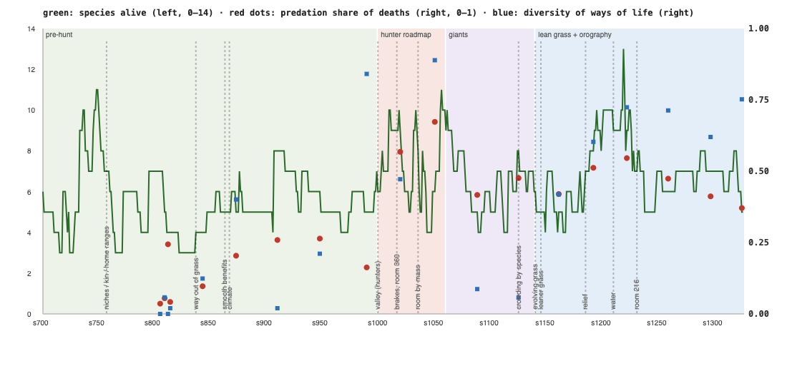

# Whitepaper — what shapes species, what shapes diversity, and what makes a richer food chain (season 1326, Oct 16)

**A one-time synthesis** of the whole genesis era (s700 → s1326, about 625 seasons, ≈210 generations). It draws on every source the world keeps:
- the species register (birth and extinction season of every species);
- the chronicle (every split with its kind and founding size, every extinction with its cause);
- 19 selection-ledger snapshots (s805 → s1326);
- the steward log (every rule change and when).

Status reports' section 9 looks at one window at a time; this page looks at all of them together.

---

## Executive summary

1. **Traits are shaped by a few steady forces, every window:**
   - **Fat** decides who starves, in all 19 snapshots without exception.
   - **Size** is pulled two ways: the big starve, the small are eaten.
   - **Predation** raises shells and fear.
   - **Any trait that costs upkeep and isn't used** (eyes, stamina, resistance) withers.

   New abilities spread only when they **pay from the first step** (smooth benefits); a threshold kills them.
2. **The number of species is remarkably stable**, between 3 and 13 and usually 5–7, whatever we changed. What changes is **turnover**: how fast species are born and die. The hunter roadmap **tripled turnover** (from 5 to 13 new species per 30 seasons) but raised the average count by only about 2.
3. **Diversity is made by splits and unmade by small founding groups.** Most species come from great divides (69) and niche splits (35). Half of all species last **9 seasons or less**. Small founding groups die young (9 seasons) and groups of 40–80 last twice as long (20). Until s1126 a crowding-rule flaw also made small species age out.
4. **Ways of life — the food chain — grew richer only with predation.** Diversity of ways of life correlates with the share of deaths by predation (**r = +0.60**), not with grass (−0.12) or starvation (+0.01). Predation is also what spreads body sizes (**r = +0.62**). Grazing, decomposing and hunting now coexist, but **no true carnivore has ever persisted**. The hunters are omnivores and their meat comes in bursts. The apex (the kraken) was lost at s1003 and not replaced.
5. **The levers that worked** were the ones that removed a **wall** from the path to a way of life:
   - the gut plateau and the carrion step;
   - smooth benefits for decomposers;
   - the valley switch for hunters;
   - crowding by species.

   **Levers that only added cost or pressure didn't create diversity.** Leaner grass, room by mass and earthquakes so far changed bodies, not the number of ways of life.

---

> **Correction (s1339):** the species counts in this paper came from the species register, which kept one stale entry: the galushors were never marked extinct (their last members left in a split at s999). **From s999 on, every count of species alive is one too high:** the hunter-roadmap phase averaged 6.3 (not 7.3), the giants 5.4 (not 6.4), lean grass and orography 5.9 (not 6.9), and the green line in the chart sits one too high after s999. The conclusions don't change. From now on species are counted from the world's population history.

## 1. The long view

| Phase | Seasons | Species alive (mean, min–max) | New / extinct per 30 seasons | Extinctions by cause |
|---|---|---|---|---|
| Pre-hunt (grazing, decomposers) | s700–999 | 5.5 (3–11) | 5.0 / 5.0 | **old age 39**, starving 3, eaten 1 |
| Hunter roadmap | s1000–1060 | **7.3** (4–11) | **12.8 / 11.3** | **eaten 19**, old age 2, starving 1 |
| Giants (room by mass, no prey) | s1061–1140 | 6.4 (4–10) | 4.5 / 6.0 | old age 8, eaten 5, starving 2 |
| Lean grass + orography | s1141–1326 | 6.9 (4–13) | 5.9 / 6.1 | eaten 14, starving 12, old age 12 |

**How species die changed completely** with the hunter roadmap: from almost always old age (a species stops breeding and fades) to mostly being eaten. In the last phase the three causes are balanced.

---

## 2. What shapes species (the traits)

From the selection ledger in every status report (breeders compared with the starved, the eaten and those dead of old age):

| Force | Evidence across the era | Traits it moves |
|---|---|---|
| **Starvation** (droughts, lean grass, crowding) | Fat lower in the starved than in breeders by −1.3 to −2.7 spreads in **every** window | **fat** ↑, **size** ↓ (the big starve: +0.15 to +0.9 in most windows), costly traits ↓ |
| **Predation** | The eaten were smaller, softer, calmer and leaner in nearly every window since s1000 | **armour** ↑ (0.20 → 0.73 by s1326), **fright** ↑, **size** ↑ when hunters need size to overpower (s1021–1128), litters ↓ |
| **Upkeep with no use** | Eyes, stamina, resistance and legs fell whenever nothing needed them | **eyes** 0.85 → 0.15, **stamina** 0.7 → 0.06 |
| **Food that differs** | Gut rose only after the plateau (s837); decomposing only after smooth benefits (s863); browsing in wet and cold spells | **gut** (0.04 → 0.12 at peaks), **decomposer** (0.03 → 0.63), **browse** |
| **The land** (since s1186) | Legs rose on the slopes (+0.79 at s1224); swimming doubled once lakes held water | **legs**, **swimming** (0 → 0.05) |
| **Turnover itself** | In most windows the biggest trait changes are "everyone who left differs from the living" — new species founding from one line | whatever the winning line carried |

**A rule of thumb that held throughout:** a new ability spreads only if **its first step pays**. The decomposer ability sat at 0.03 for 60 seasons with a threshold, then rose 20-fold once it paid from zero. Gut stayed pinned until the plateau made the first steps free. Hunting stayed absent until the valley made half-way guts useful.

---

## 3. What shapes species diversity

### 3a. How species are born

| Origin | Species founded (s700+) | Median founders | Median lifetime | Died out by |
|---|---|---|---|---|
| **Great divide** (a species passing 60% splits) | 69 | 40 | 16 seasons | old age 41, eaten 17, starving 9 |
| **Niche split** (a local group living differently) | 35 | 22 | 11 seasons | eaten 15, old age 12, starving 5 |
| **Mind split** (a hidden variant mind takes hold) | 13 | 16 | **21 seasons** | eaten 6, old age 4, starving 3 |
| Drift split | 3 | 55 | 2 seasons | eaten 2, starving 1 |

- **Great divides make most species**, by cutting the most successful one into pieces. That's an engine of richness, but also of turnover: the small pieces are often eaten or fade.
- **Mind splits are rare but last longest.** A different way of behaving is a real difference, more than a body-trait cut.
- **Niche splits** are the only splits that create a **new way of life** (the decomposer and grazer splits since s958). They are also the shortest-lived, because the niche often fades when conditions change.

### 3b. How long species last

Of 196 species that died out: median lifetime **9 seasons** (quartiles 5 and 21), the longest **154** (the kelimos).

| Founding group | Species | Median lifetime |
|---|---|---|
| under 20 | 27 | 9 seasons |
| 20–40 | 51 | 15 seasons |
| 40–80 | 32 | **20 seasons** |
| 80 or more | 5 | 7 seasons (too few to read) |

Bigger founding groups live longer, but weakly (r = +0.14 on a log scale). **Chance and conditions after founding matter more than size at birth.**

### 3c. What goes with more species (19 snapshots; correlation with species alive over the previous 15 seasons)

| Condition | r | Reading |
|---|---|---|
| **Share of deaths by predation** | **+0.46** | more hunting → more species (through more splitting and turnover, and more ways of life) |
| **Grass (plants)** | **+0.42** | wetter times hold more species |
| Diversity of ways of life | +0.30 | |
| Gut, armour, share not grazing | +0.24 to +0.27 | |
| Share of deaths by starvation | −0.20 | hunger thins species out |
| **Number of animals** | **−0.02** | **room doesn't set the number of species** |
| Body-size spread | +0.01 | no link |

*Caution: 19 points, and conditions and rule changes are tangled in time. These are associations, not proof.*

### 3d. What limited diversity (found and fixed or still open)
- **Fixed:** the crowding rule counted the root family, so after the genesis small species were throttled like big ones and aged out (39 of 44 extinctions before s1000 were old age). It now counts species (s1126).
- **Open:** the divide cuts the strongest species into groups that hunters then eat out. That's the main reason turnover is high but richness flat.
- **Open:** one root line. Every species descends from the progenitors, so all share one body plan and can only diverge so far.

---

## 4. What makes a more complex food chain

| Measure | Pre-hunt (s805–990) | Since the valley (s1020–1326) |
|---|---|---|
| Share of deaths by predation | 4–26% | **37–67%** |
| Diversity of ways of life (Shannon) | 0–0.84, mostly < 0.4 | **0.06–0.89, mostly > 0.4** |
| Share not living as grazers | 0–31% | up to **84%** (dung in droughts) |
| Body-size spread | 0.47–0.71 | **0.71–1.66** |
| Trophic levels present | grass (+ the kraken) | grass, dung, carrion, hunting (omnivores) — **no kraken** |

- **Predation is the engine of complexity.** Diversity of ways of life rises with predation share (r = +0.60), and so does the spread of body sizes (r = +0.62). A world without hunters stays a world of grazers.
- **Decomposers are the second ladder.** Dung and carrion fed a whole branch (the ushradro family, the mosaquis, the dronasas, today's thuzulis and orgalras). It worked because smooth benefits made the first step pay.
- **What's missing:**
  - **a true carnivore.** Hunters keep gut ≈ 0.10–0.20; meat is a side food; the energy pyramid (35%) keeps meat-only lives marginal;
  - **an apex.** Since the kraken died nothing eats the hunters except other hunters;
  - **parasites,** which never took hold (ability stays ≈ 0.05).
- **Prey and predator have now separated by body plan:** small, shelled browsers (the navennas: size 5.8, armour 0.78) against bigger, softer hunters. That's the first stable prey/predator pair.

---

## 5. What we tried, and what it did

| Season | Change | Effect on traits | Effect on diversity / food chain |
|---|---|---|---|
| s757 | Niche splits, kin gap, home ranges | regional herds | splits by way of life become possible |
| s802 | Foods that differ (grass by moisture, shoots, rich food fattens) | fat ↑ | none |
| s806 | Decomposer and parasite abilities (with thresholds) | selected *against* | none |
| s837–847 | Gut plateau, carrion step, protein | gut ↑ slowly | first omnivores and scavengers |
| s863 | **Smooth benefits** | decomposing 0.03 → 0.3+ | **the decomposer branch** (first niche splits, s958) |
| s866–869 | Weak prey, packs | kills +18% | small |
| s867 | Climate (hot/cold) | coats rose with eras, not by region | none |
| **s1000** | **Valley (half-way guts can hunt)** | gut ↑, armour ↑ later | **predation 4% → 50%+, turnover ×3, ways of life ↑**; the kraken lost |
| s1017 | Predator brakes (pyramid, lunge) | — | steadier numbers |
| s1024–1036 | Skill, packs by branch, size variety, room by mass | size spread ↑↑ | prey/hunter size split, then giants |
| s1126 | **Crowding by species** | — | small species stop aging out |
| s1141 | Evolving grass | — | grass sorts itself (hardy dry/north) |
| s1146 | Leaner grass (to 35%) | giants starve, size ↓, dung ↑ | none directly |
| s1186–1220 | Relief, water, swimming, earthquakes | legs ↑, swimming ↑ | none yet (no split by place so far) |
| s1232 | Room −40% (speed) | — | species count unchanged |

---

## 6. What we have not tried yet (ideas ranked by expected effect on diversity)

| Idea | Why it should help | Effort |
|---|---|---|
| **1. Barriers that isolate** (the river or the range made hard to cross for a while; or islands of grass) | Speciation by place (vicariance) is the classic diversity engine; our map mixes everyone. The relief and water exist now, so make them separate populations. | small–medium |
| **2. Gentler great divides** (a higher threshold, or larger minimum groups) | Divides make the most species but most pieces are eaten young; bigger founding groups live twice as long | small |
| **3. A second, unrelated root** (a new progenitor with a different body plan, e.g. a small fast seed-eater) | One root limits how far species can diverge | medium |
| **4. An apex again** (the kraken, or a new top hunter), with a guard for its young | Top-down control spreads niches and keeps any one species from dominating | small |
| **5. Herd vigilance and hunter territories** (predator brakes in reserve) | Predation drives complexity, but hunters eat new species out within seasons; territories thin hunters, vigilance protects herds | small |
| **6. More grass traits** (root vigour, defence, cold) and seed dispersal by eaters | Food diversity begets eater diversity; defended plants give the resistance trait a use | medium |
| **7. A meat-only niche that pays** (carcasses richer, or an energy pyramid that rewards specialised guts) | No true carnivore yet; meat is always a side food | small |
| **8. Mate choice** (sexual selection: preferring partners by colour or size) | Splits species without needing a new niche; very effective in nature | medium |
| **9. An experience cost for skills** (Luis' idea) | Stops generalists from doing everything; forces specialisation | medium |
| **10. Parasites that work** (infest healthy hosts at a low rate) | A third trophic path besides hunting and dung | small |

---

## 7. Recommendations
1. **Next:** barriers (idea 1) plus gentler divides (idea 2), together. They are cheap, test the strongest theory of diversity, and use the land we just built.
2. **Then:** an apex with a guard (idea 4) or vigilance and territories (idea 5), to stop hunters eating every new species within seasons.
3. **Measure richness, turnover, founding size and lifetime in every status report**, alongside section 9, so the next whitepaper has more than 19 points.

*Data: species register, chronicle (data/server.log), 19 ledger snapshots (data/cycles.jsonl), steward log. Correlations are Pearson on the snapshot series; lifetimes from birth and extinction seasons; founding sizes from the chronicle's split lines. All rule changes are confounded with time, so read the associations as hypotheses for experiments, not as conclusions.*
