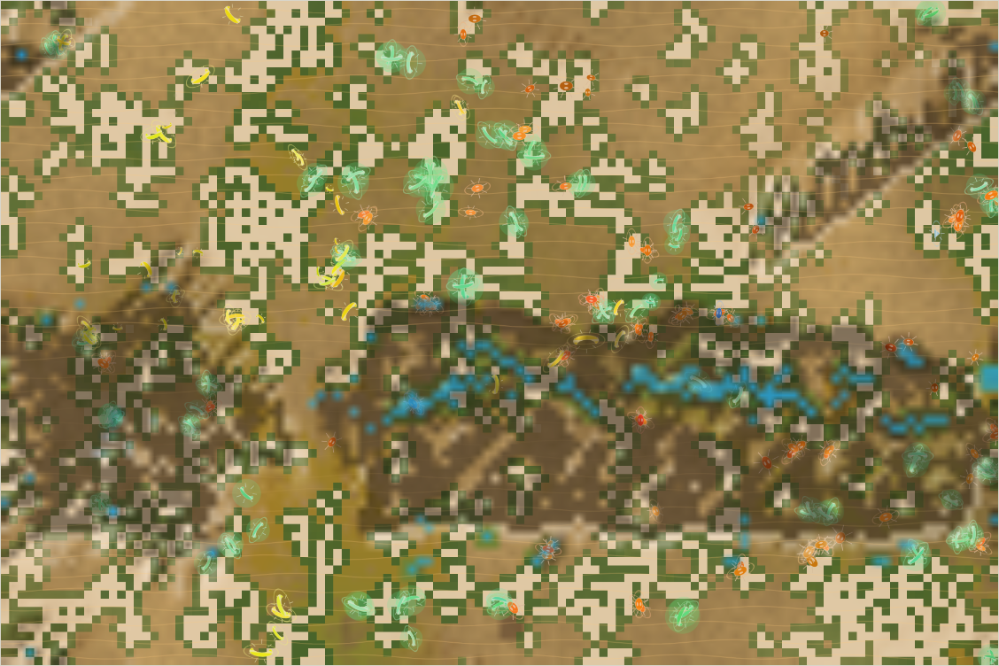
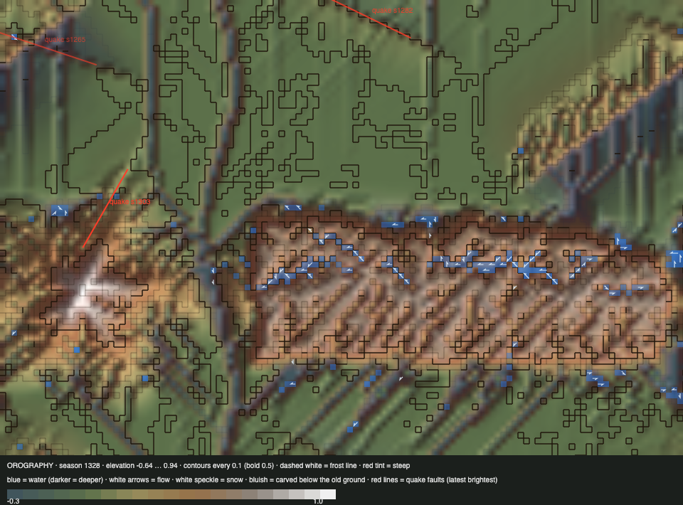

# World status — season 1328 (Oct 16, 21:10)

**Window:** the last 30 seasons (s1298 → s1328). Previous status report: [season 1298](2026-10-16_s1298.md). In between: the [whitepaper on what shapes species and diversity](2026-10-16_s1326-whitepaper-what-shapes-species.md).

## 0. The world at this moment

**A drying spell.** Most streams on the range have fallen back: 234 wet cells, against 859 in the rain of s1298. Grass is still good (≈5,200 plants). **Small, shelled navennas and thuzulis** fill the lowlands and climb onto the meseta; the bigger sabelushs keep to the west. **Four species** are left.

## 0b. The land (orography X-ray)

*Elevation −0.64 … 0.94; contours every 0.1; red tint = steep; blue = water with flow arrows; white = snow (the summit); red lines = logged quake faults.*

- **The meseta is being cut into a ribbed plateau.** **1,046 cells** are carved close to the 0.30 limit (849 at s1298). The parallel grooves are the old diagonal channels, deepened by every wet spell.
- **A third logged quake** (s1303, strength 0.05, 127 px) crossed the **peak's north-east flank**, the first to touch the mountains. Together the quakes have moved 2,214 cells.
- **Water** is down to pools along the meseta's edges in this dry spell; there is a little snow on the summit.
- **The carve limit:** with over a thousand cells at the limit, it, rather than the physics, now sets the depth of the valleys (flagged at s1298).

## 1. In one paragraph
**The oldest lines are ending.** The **quilitys**, the hunters' line of 153 seasons and the parent of 9 species, died of old age at s1316. So did the ragalnas (56 seasons). A new dung split, the omgalnas, starved out within 7 seasons.

**Four species remain,** all from the navenna/quility family. The prey body plan keeps winning:
- **shells** up to 0.71 (the navennas **0.85**);
- **later maturing** (+0.90);
- **more browsing** (+0.58);
- **smaller bodies** (6.2).

The family is now mostly **browsers and mixed feeders**; dung use is easing off. **Predation is easing too** (1,094 eaten in the window, against 1,562 in the last), with fewer, softer hunters.

## 2. Then and now

| | s1298 | s1328 (now) |
|---|---|---|
| Bodies / room | 240 / 216 | 241 / 216 |
| Species | 6 | **4** (one of them a single animal) |
| Grass (plants) / worth | ≈5,100 / 35% | ≈5,200 / 35% |
| Ways of life (each animal, last day) | 195 grazers, 29 decomposers, 15 mixed | 209 grazers, **18 mixed**, 13 decomposers |
| Water | 859 wet cells, 536 deep (rain) | 234 wet, 1 deep (dry spell) |
| Carved deep (> 0.25) | 849 | **1,046** |
| Quakes logged | 2 | 3 (+ s1303 on the peak) |

**Family traits, s1298 → s1328** (change measured in units of how much the trait varies across the family):

| Trait | s1298 | s1328 | Change |
|---|---|---|---|
| **Maturity** | 1.70 | **1.86** | **+0.90** |
| Resistance | 0.161 | 0.223 | +0.60 |
| **Armour** | 0.605 | **0.707** | +0.58 |
| Browse | 0.237 | 0.275 | +0.58 |
| Litter | 3.80 | 3.70 | −0.56 |
| Stamina, gape | — | — | +0.4 each |
| Gut, decomposer, parasite | — | — | −0.35 each |
| Size | 6.45 | 6.23 | −0.29 |
| Swimming | ≈0.045 | 0.044 | holding (the thuzulis 0.062, the highest) |

**The grass:** hardiness 0.467 (spread 0.33): **hardy grass is taking over everywhere**, and the north/south gap has closed (0.470 / 0.464). Sweetness is falling (0.129). Lean food and frequent droughts favour hardy grass across the map.

## 2b. Species alive at this report (s1328)

| Species | Line | Bodies | Since | Where | Size | Gut | Armour | Browse | Swim | Decomp. | Standing |
|---|---|---|---|---|---|---|---|---|---|---|---|
| **thuzulis** | …6.5.5 | 108 | s1249 | centre, on the meseta | 6.5 | 0.06 | 0.65 | 0.28 | **0.062** | 0.37 | the largest; parent of five dung splits (all gone); the best swimmers |
| **navennas** | …6.5 | 81 | s1169 | centre-east | **5.9** | 0.06 | **0.85** | **0.32** | 0.029 | 0.61 | the oldest line now (159 seasons); the shelled browsers; labelled **mixed feeders** |
| **sabelushs** | …4.5.3 | 50 | s1218 | west | 7.1 | 0.06 | 0.43 | 0.15 | 0.043 | 0.62 | **the hunters** (2,444 kills all time); softer, bigger |
| drokesas | …6.5.5.3 | 1 | s1316 | east | 6.1 | 0.11 | 0.69 | 0.19 | 0.058 | 0.45 | dung niche split of the thuzulis; one left |

## 3. What happened in the world (s1298 → s1328)
- **Splits:** drokesas (s1316, dung, from the thuzulis); omgalnas (s1319, dung, from the thuzulis; starved out by s1326).
- **Extinctions:** **quilitys** (s1316, old age, 153 seasons), ragalnas (s1318, old age, 56 seasons), omgalnas (s1326, starving, 7 seasons). (Orgalras and tyushmos ended earlier in the window, at s1310 and s1293.)
- **Quake:** s1303, small, crossing the peak's north-east flank.
- **Weather:** rain early in the window, drying now.

## 4. What we changed (s1298 → s1328)
| When | Change |
|---|---|
| s1326 | **Whitepaper** on what shapes species, diversity and the food chain (with recommendations) |
| s1326 | Reports page sorted by season number (special reports were out of order) |

No rules or parameters of the world changed.

## 5. How it shows in the creatures
- **The prey body plan is winning:** shelled (armour 0.71), small, browsing, late-maturing, and resistant. The navennas carry the most shell ever (0.85).
- **Hunters are fading:** the quilitys' line ended, and the sabelushs (50) are the only hunters left. Predation fell by a third.
- **Swimming holds** at about 0.044, highest in the thuzulis (0.062), who live on the meseta among its pools.
- **Fewer species (4), one family.** The whitepaper's recommendations (barriers, gentler divides, an apex) address exactly this.

## 6. Backlog
**Your call (from the whitepaper)**
- **Barriers that isolate** (the river or the range hard to cross for a while) plus **gentler divides**: the cheapest test of what makes species.
- An **apex** again (with a guard for its young), or **herd vigilance and hunter territories**.
- The **carve limit** (0.30): let valleys deepen further, or add silt settling in slow water.
- Still open: room by mass; the kraken.

**Running**
- Quakes (next ~s1331); water, erosion, swimming; evolving grass (hardy grass taking over).

## 7. Risks
- **Mass extinction: elevated.** 4 species, one of them a single animal, all one family.
- **The hunters' line is thin** (sabelushs 50). If it ends, predation, the engine of complexity in the whitepaper, goes with it.
- **Server: stable** (no errors; memory 205–256 MB).

## 8. Next to watch
- Whether the sabelushs hold, and whether the shelled prey push the hunters toward wider mouths (gape +0.4 this window) or packs.
- The next quake (~s1331).
- Your choice on the whitepaper's recommendations.

## 9. What shapes the species

**How to read this:** the selection ledger compares the traits of everyone who **bred** (2,981) or **died** in the window — of old age (652), starved (1,235), eaten (1,094) — with the living, in units of how much each trait varies.

| Trait | Breeders | Died old | Starved | Eaten | Starved vs breeders | Reading |
|---|---|---|---|---|---|---|
| **Fat** | −0.34 | −0.23 | **−2.46** | **−1.74** | **−2.11** | The strongest force, again. |
| **Size** | +0.55 | +0.25 | **+0.84** | +0.38 | **+0.29** | The big starve, so bodies keep shrinking. |
| **Armour** | −0.58 | −0.44 | −0.60 | **−0.79** | ≈0 | Rose; **the eaten had the least**. |
| **Maturity** | −0.85 | −1.25 | −0.72 | −1.13 | +0.13 | Rose by turnover: the late-maturing lines remain. |
| Gape | −0.65 | −0.48 | −0.71 | −0.83 | ≈0 | Rose; the eaten had the narrowest mouths. |
| Browse, resistance | −0.6 | | | | ≈0 | Rose by turnover. |
| Decomposer | +0.18 | +0.27 | +0.08 | +0.31 | −0.10 | Fell with the dung lines' end. |

**Which rules and conditions drove the changes**
1. **Starvation** picks out the big and the lean.
2. **Predation** picks out the soft, so shells rise.
3. **Turnover:** the old hunting line (quilitys) and the dung lines ended, taking their traits with them.
4. **Lean, hardy grass and the thicket** favour browsing.
5. **The land:** carving and quakes keep reshaping the range; the meseta's pools hold the swimmers.
