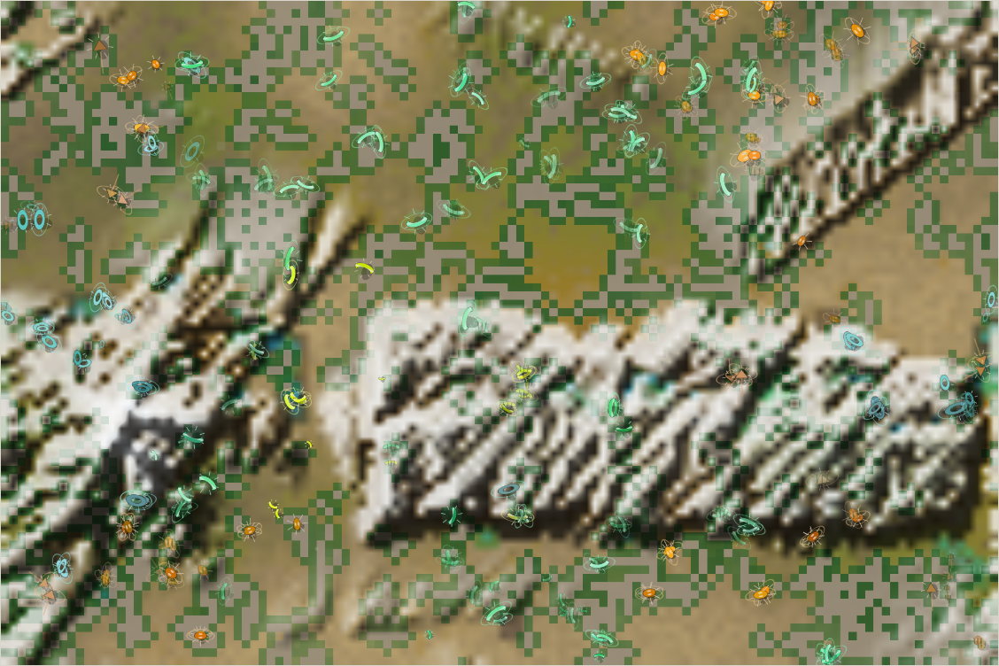
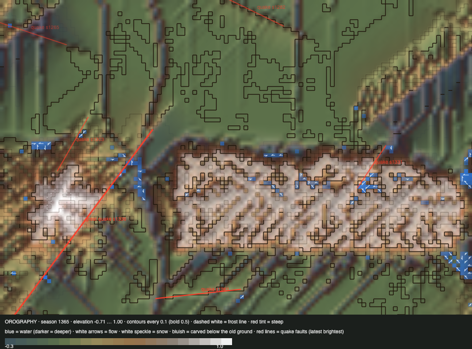

# World status — season 1365 (Oct 16, 23:00)

**Window:** the last 37 seasons (s1328 → s1365). The report is 7 seasons late (due s1358). Previous status report: [season 1328](2026-10-16_s1328.md).

## 0. The world at this moment

**A dry, warm spell; the land shows its bones.** The meseta stands out pale and furrowed by its carved ribs, and the peak's flanks are cut by gullies. Little water is left (156 wet cells). Herds spread across the golden lowlands and onto the range: 92 of 239 animals live on it.

## 0b. The land (orography X-ray)

*Elevation −0.71 … 1.00; contours every 0.1; red tint = steep; blue = water with flow arrows; red lines = logged quake faults.*

- **A second great earthquake** (s1336, in the mountains, strength 0.15) broke a **478 px fault diagonally across the peak**, the long red line, and lifted its north-west side. The summit now reaches **1.00**, the highest yet. Small quakes struck at s1331 (on the meseta's north edge) and s1361 (the southern lowlands). Six quakes are now logged.
- **Carving:** **1,229 cells** at the limit (1,046 at s1328). The meseta is a ribbed plateau, and the lowest ground is now −0.71.
- **Water** is down to a few pools (a dry spell). **Lichen** covers the heights (1,057).

## 1. In one paragraph
**The new ways of life started to work.** Water plants (from s1343), lichen (s1346), smooth parasitism (s1349), carcasses and meat for specialists (s1352) all went in one by one:
- **Swimming took off in the stream-side lines:** the liralis reach **0.151** and the tythuushs **0.103**. The family average was 0.044 at s1328, and the liralis were founded at 0.04.
- **The heights hold more life:** 92 animals on the range, against 61 at s1328.
- **Coats sort by place:** **0.064 on the range against 0.042 below.**
- **Not yet:** parasites (no infestations so far) and true carnivores (gut ≤ 0.11).

**The species:**
- The navennas' shells reached **0.98**, nearly the maximum.
- The sabelushs, the last of the galushty line, crashed to 18.
- **Three new niche splits** came, all from dung-eaters: the liralis, tythuushs and linaushs.

## 2. Then and now

| | s1328 | s1365 (now) |
|---|---|---|
| Bodies / room | 241 / 216 | 239 / 216 |
| Species | 4 | 6 |
| Grass (plants) / worth | ≈5,200 / 35% | ≈5,500 / 35% |
| Ways of life (each animal, last day) | 209 grazers, 18 mixed, 13 decomposers | 193 grazers, **39 decomposers**, 7 mixed |
| **On the range / coat there vs below** | 61 / — | **92 / 0.064 vs 0.042** |
| **Swimming** (family / best line) | 0.044 / 0.062 | 0.06 / **0.151** (liralis) |
| Water plants / lichen | — | 33 (dry spell; ~550–640 when wet) / **1,057** |
| Carved deep (> 0.25) | 1,046 | 1,229 |
| Quakes logged | 3 | 6 (one great, s1336) |

## 2b. Species alive at this report (s1365)

| Species | Line | Bodies | Since | Where | Size | Gut | Armour | Browse | Coat | **Swim** | Decomp. | Standing |
|---|---|---|---|---|---|---|---|---|---|---|---|---|
| **thuzulis** | …6.5.5 | 93 | s1249 | centre | 7.2 | 0.08 | 0.56 | 0.34 | 0.05 | 0.056 | 0.36 | the largest; hunters now (1,113 kills) |
| **navennas** | …6.5 | 69 | s1169 | centre | 6.2 | 0.04 | **0.98** | **0.35** | 0.02 | 0.058 | 0.67 | the oldest line (196 seasons); shells at the maximum; **mixed feeders** |
| **liralis** | …4.5.3.3 | 40 | s1339 | west | 7.3 | **0.11** | 0.44 | 0.16 | 0.06 | **0.151** | 0.67 | dung split of the sabelushs; **the swimmers**; hunters too (349 kills) |
| tythuushs | …4.5.3.3.1 | 19 | s1354 | centre-east | 7.1 | 0.02 | 0.52 | 0.25 | **0.14** | **0.103** | 0.64 | dung split of the liralis; swimmers with thick coats |
| sabelushs | …4.5.3 | 18 | s1218 | south-west | 5.9 | 0.04 | 0.57 | 0.16 | 0.04 | 0.030 | 0.67 | the old hunters (2,521 kills), crashed from 73 |
| linaushs | …6.5.7 | 1 | s1355 | — | 6.2 | 0.10 | — | — | — | — | — | dung split of the navennas; one left |

## 3. What happened in the world (s1328 → s1365)
- **Niche splits (all dung):** liralis (s1339, from sabelushs), tythuushs (s1354, from liralis), linaushs (s1355, from navennas).
- **Extinctions:** drokesas (s1330, old age).
- **Earthquakes:** s1331 (small, meseta edge), **s1336 (great, across the peak)**, s1361 (small, southern lowlands).
- **Weather:** a wet spell mid-window (849 wet cells at s1346), dry now.

## 4. What we changed (s1328 → s1365)
| When | Change |
|---|---|
| s1329 | **Gentler great divide:** pieces ≥ 30, at most 2, place weighs 5 |
| s1330 | **Viewer layers:** ground, relief, water, reef, creatures, then the air |
| s1339 | **Diversity section** (8b) in every report; whitepaper corrected (a stale register entry) |
| **s1343** | **Water plants:** in standing water; waders reach the edges, swimmers the deep |
| **s1346** | **Lichen** on the heights, worth more to a thick coat |
| **s1349** | **Smooth parasitism:** any ability can infest weak, crowded hosts |
| **s1352** | **Carcasses** last longer and feed more; **meat** keeps up to 90% for a meat gut |
| s1342, s1347 | Commits 1b9e26c and 39a6a20; Luis' viewer review in another session (hands off index.html); `AGENTS.md` coordination with Codex |

## 5. How it shows in the creatures
- **Swimming is being selected.** Since water plants made water worth entering, the lines that live among the streams and pools have quadrupled their swimming. That's the dormant skill waking, exactly as the design intended.
- **The heights became a place to live:** lichen feeds the range's animals, half again as many live up there, and their coats are thicker than in the lowlands. It's the first coat difference by place since the climate was introduced.
- **Shells at the limit:** the navennas' armour is 0.98. Prey can't get much safer this way, so the next move is the hunters'.
- **Not yet:** parasites (ability 0.04, no infestations; hosts weak and crowded enough are rare in good times) and meat specialists (no gut above 0.11).

## 8b. Diversity

| Measure | s1328 → s1365 (37 seasons) |
|---|---|
| Species alive (mean / min–max) | 4.3 / 3–6 |
| New species / extinctions (per 30 seasons) | 3 / 2 (2.4 / 1.6) |
| Born by | niche split 3 (founders median 17) |
| Died by | old age 1 (lived median 14 seasons) · eaten 1 (lived median 11 seasons) |
| Lifetime of species that died (median) | 14 seasons |
| Share of deaths by predation / starvation / old age | 31% / 45% / 25% |

*The whole era (s700+), founding size → lifetime: under 20 founders: 28 species, median 11 · 20–39: 52 species, median 15 · 40–79: 32 species, median 20 · 80+: 5 species, median 7 (seasons).*

No great divide happened in this window (none since the gentler rule).

## 6. Backlog
**Your call**
- **The four isolated places** (barriers), next on your list now that other ways of life pay.
- Room by mass; the kraken (an apex).

**Running**
- Water plants, lichen, parasites, carcasses, meat specialists (all young); quakes (next ~s1380s); erosion.

**Waiting**
- Your viewer review. I'm hands off `index.html` until you say it's done.

## 7. Risks
- **Few species, one family** (6, one of them a single animal).
- **The carve limit** (0.30) now shapes 1,229 cells.
- **Server: stable** (no errors; memory 176–383 MB, back down to 176).

## 8. Next to watch
- Swimming: does a true water-living species split off (a niche split by water plants)?
- The first parasite infestation; the first meat gut above 0.3.
- Coats on the range in the next cold era.

## 9. What shapes the species

**How to read this:** the selection ledger compares the traits of everyone who **bred** (3,262) or **died** in the window — of old age (807), starved (1,456), eaten (1,000) — with the living, in units of how much each trait varies.

| Trait | Breeders | Died old | Starved | Eaten | Starved vs breeders | Reading |
|---|---|---|---|---|---|---|
| **Fat** | −0.18 | −0.26 | **−2.01** | **−1.35** | **−1.84** | The strongest force, as always. |
| **Size** | −0.28 | −0.69 | −0.06 | **−0.54** | +0.22 | Bodies grew back (+0.85): the eaten were small, so size protects again. |
| Fright | −0.03 | +0.14 | +0.08 | **−0.28** | +0.11 | The calm were eaten. |
| Eyes | +0.06 | +0.32 | +0.23 | −0.19 | +0.17 | Sharp eyes cost upkeep; the starved had more. |
| Decomposer | −0.19 | −0.32 | −0.37 | +0.12 | −0.18 | Rose (+0.40); **it protects against starving**. |
| Legs | ≈0 | | | | ≈0 | Rose (+0.59) by turnover. |
| Armour | | | | | ≈0 | Eased a little (−0.42) as the softer new splits grew. |

**Which rules and conditions drove the changes**
1. **Starvation** (1,456): fat decides; dung ability protects.
2. **Predation** (1,000): the small and the calm are eaten, so bodies grew back.
3. **Water plants:** swimming rises in the stream-side lines (shown by line, not in the family ledger yet).
4. **Lichen and the cold heights:** more life on the range, and thicker coats there.
5. **Earthquakes:** the great quake raised the peak; carving keeps cutting the range.
