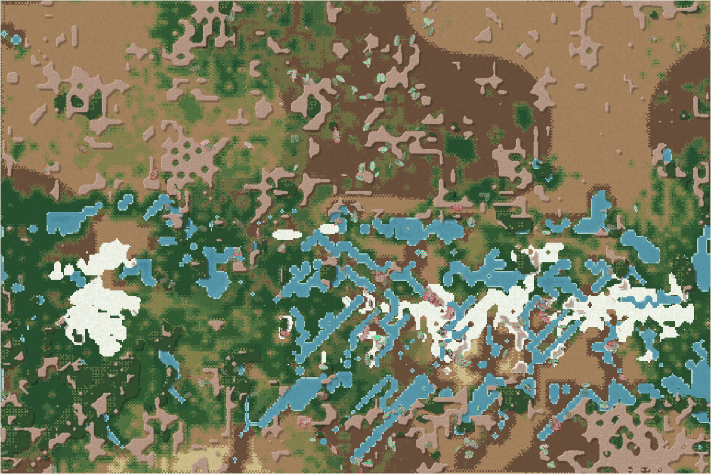

# World status — season 1396 (Oct 17, 00:20)

**Window:** the last 31 seasons (s1365 → s1396). Previous status report: [season 1365](2026-10-16_s1365.md). This report lands **at the start of the four sections' transformation** (rollout.sections from s1396, rising over 10 seasons to s1406).

## 0. The world at this moment

**A wet spell, and the first minutes of the change.** It's raining in a wetting era:
- **Snow** caps the peak (left) and lies along the meseta's crown.
- **Water** stands in pools and streams on the range's flanks: 908 wet cells, against 156 at s1365.
- **Where the animals are:** the shelled decomposers (mosalis, ushdrogals, navennas) crowd the north-centre. The liralis keep to the streams, and the thuzulis hold the west.

The transformation is about 5% risen here, so the new frame (the wall, the seam river, the spine) is still too faint to see.

## 0b. The land (orography X-ray)

*Elevation −0.70 … 0.93; contours every 0.1; red tint = steep; blue = water with flow arrows; red lines = logged quake faults.*

- **A third great earthquake** (s1391, in the mountains, strength 0.20) broke a **420 px fault**, the long diagonal line through the peak's west side, and lifted its north side.
- **Small quake:** one at s1365 (lowlands, 0.05).
- **Quakes logged:** seven in all.
- **Water after rain:** the meseta's carved ribs fill and drain in parallel streams down both escarpments. Pools also stand along the meseta's north foot.
- **The new frame is just starting:** at about 5% of its rise, the wall and the seam river show only as faint straight contours along the edges.

## 1. In one paragraph
**The family turned to dung, and the land began to change shape.**
- **Three in five animals now live as decomposers:** 135 of 241, up from 39 at s1365.
- **Two niche splits came from them:** the ushdrogals (s1373, from the navennas) and the mosalis (s1382, from the ushdrogals). The mosalis are now the most numerous species (72).
- **Shells stay near the maximum** in that line (0.96–0.98).
- **The apex rules (live since s1371) did not make an apex.** Predation doubled at first, but the bodies that grew were well-fed grazers. Inherited size then fell (6.41 now, 0.6 SD below s1365), and no meat gut passed 0.26.
- **The sabelushs died out** (s1371, eaten): the last of the old hunters, after 153 seasons.
- **The four sections began at s1396**, Luis' option B (details in section 4).

## 2. Then and now

| | s1365 | s1396 (now) |
|---|---|---|
| Bodies / room | 239 / 216 | 241 / 216 |
| Species | 6 | 6 |
| Grass (plants) / worth | ≈5,500 / 35% | ≈3,400–5,600 (varying) / 35% |
| Ways of life (each animal, last day) | 193 grazers, 39 decomposers, 7 mixed | 95 grazers, **135 decomposers**, 11 mixed |
| **Swimming** (family / best line) | 0.06 / 0.151 | 0.07 / **0.181** (liralis) |
| Climbing (new, s1389) | — | 51 bodies above 0, max 0.019 |
| Largest grown body / max gut | 9.7 / 0.26 | 10.6 / 0.23 |
| Wet cells | 156 (dry) | 908 (wet) |
| Quakes logged | 6 | 7 (great quake s1391) |

## 2b. Species alive at this report (s1396)

| Species | Line | Bodies | Since | Where | Size | Gut | Armour | Browse | Coat | Swim | Decomp. | Standing |
|---|---|---|---|---|---|---|---|---|---|---|---|---|
| **mosalis** | …5.8.1 | 72 | s1382 | north-centre | 6.2 | 0.04 | **0.98** | **0.44** | 0.07 | 0.014 | **0.74** | the newest and most numerous; dung split of the ushdrogals |
| ushdrogals | …6.5.8 | 46 | s1373 | north-centre | 6.6 | 0.03 | 0.97 | 0.40 | 0.08 | 0.051 | 0.72 | dung split of the navennas; mixed feeders |
| **liralis** | …5.3.3 | 43 | s1339 | centre | 6.6 | **0.14** | 0.46 | 0.15 | 0.06 | **0.181** | 0.64 | the swimmers; the main hunters now (1,402 kills) |
| navennas | …1.6.5 | 32 | s1169 | north-centre | 6.3 | 0.05 | 0.96 | 0.38 | 0.08 | 0.060 | 0.68 | the oldest line (227 seasons) |
| thuzulis | …6.5.5 | 27 | s1249 | west | 5.7 | 0.06 | 0.55 | 0.30 | 0.08 | 0.047 | 0.28 | shrank (93 → 27; inherited size 7.24 → 5.6); the one line not on dung |
| tythuushs | …3.3.1 | 18 | s1354 | south-centre | 7.0 | 0.05 | 0.54 | 0.24 | **0.13** | 0.102 | 0.70 | thick-coated swimmers |

## 3. What happened in the world (s1365 → s1396)
- **Niche splits (both dung):** ushdrogals (s1373, from navennas), mosalis (s1382, from ushdrogals).
- **Extinctions:** linaushs (at the window's start, s1365, eaten; 11 seasons), **sabelushs (s1371, eaten; 153 seasons, the last galushty hunters)**.
- **Earthquakes:** s1365 (small, lowlands), **s1391 (great, mountains, 0.20)**.
- **Weather:** a drought around s1374 starved the thuzulis (112 → 78), then wet now.
- **Ways of eating:** the ushdrogals became mixed feeders (s1390).

## 4. What we changed (s1365 → s1396)
| When | Change |
|---|---|
| s1371 | **Apex rules** (Luis): growth after adulthood, shell-cracking bites, room for rare species, apex niche. Checkpoint at s1381 ([report](2026-10-16_s1381-apex-checkpoint.md)), options waiting for Luis |
| s1375 | [Proposal: four isolated sections](2026-10-16_s1375-four-sections-proposal.md) |
| **s1396** | **FOUR SECTIONS** (Luis' answers s1389, option B; tested headless, live from s1396, rising over 10 seasons). **The frame:** • a mountain wall along the top/bottom edge • a seam river along the left/right edge • a crag spine along the ridge where the meseta is not (closing the saddle) • the meseta broader to the north, still flat, with sharper escarpments • the lowlands tilted down west → east, with valleys into two deep channels • the channels drain south through narrow gorges in the spine and the wall **Crossing:** • a new inherited **climbing** skill (dormant, like swimming) • steps onto crags or cliffs need climbing; steps into deep water need swimming • a body kept back 30 times makes that side its home • quakes turn cliffs into scree **Water:** • rain on the heights is measured above the tilted lowland • the strong top pull eases to 0.01 as the land rises **Headless test:** • crossings fell from about 100–240 to 0–4 per 1,500 ticks • starvation +30% at first; bodies steady; 0 errors |
| s1396 | Viewer frame: stride 14 (a mature flag and an age share per creature), for the viewer session's young/adult/elder display |

## 5. How it shows in the creatures
- **Dung beats hunting.** Hunters have no meat specialists to grow into, so the family turned to droppings: decomposer ability 0.66, +0.65 SD in the window. Dung-eaters split off twice in 10 seasons. It's the same pattern as s1194 and s991: when grass is lean and meat is risky, the dung niche fills.
- **Shells hold** at 0.96–0.98 in the dung line, while the liralis and thuzulis stay soft (0.46–0.55) and fast.
- **Growth after adulthood replaced big genes.** Bodies grow when well fed, so inherited size fell (−0.63 SD), and maturity came earlier (−0.98 SD).
- **Swimming keeps rising** in the liralis (0.151 → 0.181). That's the skill that will decide who crosses the new rivers.
- **Climbing is dormant**: 51 bodies have a trace, and the best is 0.019. The wall and the spine will ask 0.4–0.7.

## 6. Backlog
**Your call**
- **The apex checkpoint options** (s1381): growth fed by meat, richer meat from meat-eaters, slower big lives, or more time.
- **The ice pass:** the lowland rivers never freeze in today's climate (the coldest lowland is about 0.47, and water freezes below 0.2). Colder cold eras would open it.
- **The top water pull** was eased 0.15 → 0.01 with the sections. Keep it eased, or restore it?
- Room by mass; the carve cap.

**Running**
- The four sections' rise (s1396 → s1406).
- Apex rules; water plants; lichen; parasites; carcasses; quakes (next in about 15–30 seasons).

**Waiting**
- The viewer review. I'm hands off `index.html`; the viewer session adds the age display.

## 7. Risks
- **The west may empty.** The tilt makes the west lowland higher and a little colder, and it is the smallest section. In the fully-risen headless run its lowland went from 14 to 1 animals. That's for evolution to decide (no rescues).
- **Starvation at the change.** Some bodies are cut off from their food or homes as the barriers rise, and the headless test showed +30% starvation at first. The pause brake (family < 100) is the only brake.
- **Few lines:** six species, five of them from one navenna–lirali stem.
- **Server: stable** (0 errors; memory 176–275 MB).

## 8. Next to watch
- **The transformation** (s1396 → s1406):
  - crossings per season (`records.sections`) and how many are turned back;
  - the animal count per section;
  - whether populations settle on each side;
  - the first **section-born split**, since isolation is what the sections are for.
- **Climbing** waking: the first body above 0.3.
- **Swimmers crossing** the deep channels, the liralis first.
- The apex options, when Luis chooses.

## 8b. Diversity

| Measure | s1365 → s1396 (31 seasons) |
|---|---|
| Species alive (mean / min–max) | 5.4 / 4–6 |
| New species / extinctions (per 30 seasons) | 2 / 1 (1.9 / 1.0) |
| Born by | niche split 2 (founders median 20) |
| Died by | eaten 1 (lived median 153 seasons) |
| Lifetime of species that died (median) | 153 seasons |
| Share of deaths by predation / starvation / old age | 39% / 51% / 9% |

*The whole era (s700+), founding size → lifetime: under 20 founders: 28 species, median 11 · 20–39: 53 species, median 15 · 40–79: 32 species, median 20 · 80+: 5 species, median 7 (seasons).*

No great divide happened in this window.

## 9. What shapes the species

**How to read this:** the selection ledger compares the traits of everyone who **bred** (4,025) or **died** in the window with the living, in units of how much each trait varies. The deaths were from old age (385), starvation (1,866) and being eaten (1,772). The living moved a lot in the window, so every group sits a little "behind" them (most values share a sign). The difference between groups is what selection is doing.

| Trait | Living shift | Breeders | Died old | Starved | Eaten | Starved vs breeders | Reading |
|---|---|---|---|---|---|---|---|
| **Fat** | −0.61 | +0.80 | +1.21 | **−1.53** | −0.65 | **−2.33** | The strongest force, as always: the lean starve. |
| **Size** | −0.63 | +0.50 | +0.27 | +0.79 | +0.24 | **+0.29** | **Big bodies starve more.** Growth after adulthood costs upkeep, so the inherited size falls. |
| Decomposer | **+0.65** | −0.39 | −0.45 | −0.53 | −0.31 | −0.14 | Rising fast; dung ability protects against starving. |
| Armour | +0.72 | −0.33 | −0.13 | −0.38 | **−0.43** | −0.05 | Rising; the eaten were the softer. |
| Browse | +0.56 | −0.36 | −0.15 | −0.32 | **−0.52** | +0.04 | Browsers escape the hunters (they feed in thicket). |
| Gut | −0.19 | +0.16 | −0.05 | +0.20 | **+0.27** | +0.04 | Meat-leaning guts are eaten more (hunting is risky). |
| Maturity | −0.98 | +0.33 | +0.24 | +0.45 | +0.41 | +0.12 | Breeding comes earlier. |
| Fright | −0.64 | +0.49 | +0.68 | +0.68 | +0.35 | +0.19 | The jumpy starve (fright wastes time); calmer now. |

**Which rules and conditions drove the changes**
1. **Starvation** (51% of deaths): fat decides, and the apex growth rule makes big bodies costly.
2. **Predation** (39%): soft, meat-leaning and non-browsing bodies are eaten. Shells and thicket protect.
3. **Dung:** decomposing protects against starving, so two dung splits came in 10 seasons.
4. **Water plants:** swimming keeps rising in the stream-side liralis.
5. **Earthquakes:** a great quake (s1391) lifted the peak's north side.
6. **From s1396, the four sections:** the land itself starts to divide the family.
