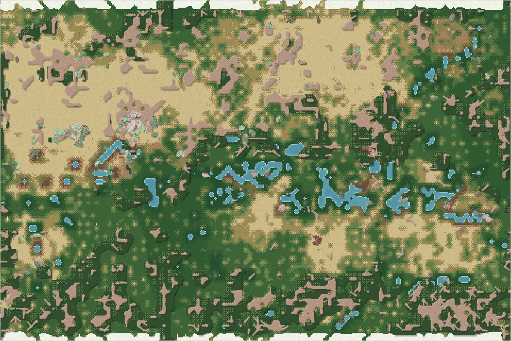

# World status — season 1474 (Oct 17, 03:50)

**Window:** the last 78 seasons (s1396 → s1474). Previous status report: [season 1396](2026-10-17_s1396.md). **This report is 48 seasons late:** it was due at s1426, and five check-ins (s1430–s1465) missed that the newest report had passed 30 seasons. That's my error. The window covers **the whole four-sections transformation and the 68 seasons after it**.

## 0. The world at this moment

**A dry, mild era.**
- **The wall** shows as a white, snow-edged strip along the top and bottom of the map.
- **The range:** pools stand on the meseta, and the peak sits on the left.
- **Ground:** the north lowlands are golden and dry, and the south and west are green.
- **The herds** gather in the north-west (the mosalis' country) and the north-east.

## 0b. The land (orography X-ray)

*Elevation −0.59 … 1.26; contours every 0.1; red tint = steep; blue = water with flow arrows; red lines = logged quake faults.*

- **The frame is complete** (since s1406):
  - the **wall** along the top and bottom edges, crest 1.0 (up to 1.26 where a quake lifted it);
  - the **seam channel** down the left/right edge, and the **river-line channel** at a third of the width (the two straight vertical lines);
  - the **tilt**: the west lowlands sit higher, lighter in the X-ray;
  - the **spine** closes the old saddle west of the meseta.
- **Water** is on the range only (a dry era: 437 wet cells, almost no deep water). Both channels run dry, so the drought pass is open.
- **Quakes:** three small ones in the window (s1417 and s1442 in the mountains, s1468 in the lowlands); ten logged in all.

## 1. In one paragraph
**The land divided the family, and the species settled by section.**
- **The rise worked.** Crossings fell from about 600–800 per season during the rise to almost none at full height (0–16 per season, s1402–1408).
- **A gate fix restored a little traffic.** After the fix at s1409 (falling, sliding along walls, gentle ground free), crossings settled at **30–160 per season**. They're mostly through the dry channel beds in droughts.
- **Species now keep to sections:**
  - the tyzuors live **only in the north-east**;
  - the mosalis, ushdrogals and the last drobelvens live in the **north-west**;
  - the liralis live in the north-east.
- **Turnover was high:** five new species, six extinctions.
  - **The navennas died out** (s1414, eaten), the oldest line (245 seasons) and the mother of the dung stem.
  - **The thuzulis died out** (s1425, old age, 176 seasons).
- **The meat side came through scavenging.** The drobelvens (s1427) were scavengers from the start and grew into **the largest bodies of the genesis era** (15.6). Then they were eaten down from 50 to 4–8.
- **Guts rose** (family 0.05 → 0.10, max 0.36), but **still no true hunter**.

## 2. Then and now

| | s1396 | s1474 (now) |
|---|---|---|
| Bodies / room | 241 / 216 | 238 / 216 |
| Species | 6 | 5 (mean 6.1, range 5–9 in the window) |
| Ways of life | 95 grazers, 135 decomposers, 11 mixed | 72 grazers, **146 decomposers**, 19 mixed, 1 scavenger |
| Family size (inherited) / gut | 6.41 / 0.052 | **5.56 / 0.099** |
| Largest body / max gut | 10.6 / 0.23 | 15.6 (s1457; 14.0 now) / 0.36 (s1439; 0.32 now) |
| **Crossings per season** | ~740 (rising) | **30–160** (mostly dry beds) |
| Lowland sections (NW / NE / SW / SE) | — | **148 / 67 / 7 / 3** (13 on the heights) |
| Swimming / climbing (best) | 0.181 / 0.019 | 0.22 (liralis) / 0.11 |
| Quakes logged | 7 | 10 |

## 2b. Species alive at this report (s1474)

| Species | Line | Bodies | Since | Section | Size | Gut | Armour | Browse | Coat | Swim | Climb | Decomp. | Standing |
|---|---|---|---|---|---|---|---|---|---|---|---|---|---|
| **mosalis** | …5.8.1 | 111 | s1382 | **NW** (100), SW 7 | 5.0 | 0.10 | 0.90 | **0.48** | **0.20** | 0.03 | 0.03 | 0.73 | the most numerous; shelled browsers and dung-eaters of the north-west; thicker coats (the west is colder) |
| ushdrogals | …6.5.8 | 46 | s1373 | **NW** (41) | 6.0 | 0.05 | 0.91 | 0.32 | 0.10 | 0.06 | 0.05 | **0.80** | the purest dung-eaters |
| **liralis** | …5.3.3 | 36 | s1339 | **NE** (23) | 6.4 | **0.20** | 0.58 | 0.22 | 0.05 | **0.22** | 0.06 | 0.72 | the swimmers and the main killers (3,708 kills) |
| **tyzuors** | …5.5.5.1 | 37 | s1412 | **NE only** (37) | 5.6 | 0.08 | 0.62 | 0.35 | 0.08 | 0.03 | 0.01 | 0.39 | the last grazers of the thuzuli line; one section only |
| drobelvens | …3.3.2 | 8 | s1427 | NW | **8.5** | 0.14 | 0.42 | 0.34 | 0.05 | 0.21 | 0.02 | 0.73 | the scavenger giants (largest 14.0; record 15.6); eaten down from 50 |

## 3. What happened in the world (s1396 → s1474)
- **The four sections rose** (s1396 → s1406). The gate was refined at s1409 (section 4).
- **New species (5):**
  - belsafis (s1408, mind split of thuzulis);
  - droormos (s1410, mind split of mosalis);
  - tyzuors (s1412, grazer split of belsafis);
  - **drobelvens** (s1427, dung split of liralis, scavengers at once);
  - quidrotys (s1441, mixed-feeder split of mosalis, briefly omnivores).
- **Extinctions (6):**
  - **navennas** (s1414, eaten, **245 seasons**);
  - tythuushs (s1414, eaten, 60);
  - **thuzulis** (s1425, old age, **176**);
  - droormos (s1429, old age, 19);
  - belsafis (s1432, eaten, 24);
  - quidrotys (s1470, old age, 29).
- **Earthquakes:** s1417 (mountains), s1442 (mountains), s1468 (lowlands), all small.
- **Weather:** dry spells around s1412, s1430, s1457 and now, with wet spells between.

## 4. What we changed (s1396 → s1474)
| When | Change |
|---|---|
| s1396 | **Four sections live** (see [s1396](2026-10-17_s1396.md)); frame stride 14 for the viewer's life stages |
| s1396 | **Commits** a19479c (the viewer review: papercut terrain, coral reef, axolotl creatures, zoom, tooltip, life stages) and 1d7ced1 (four sections, apex rules, reports). Viewer hands-off lifted |
| **s1409** | **Gate refined** (the viewer session saw bodies shuffling at the plateau's foot; Luis: "if they don't have climbing skills they would fall"): • a refused step slides along the barrier, as at reef walls; • the wall's direction is remembered for 90 ticks, so steering stops pressing into it; • needs under 0.15 are free (gentle slopes and old scarps had been blocking steps everywhere); • **falling**: a body on crags or a cliff beyond its climbing falls a cell a tick downhill, losing energy. Refused steps went from about 310k per season to 3–12k, at a lower cost per tick (41 → 33 ms headless) |

## 5. How it shows in the creatures
- **Each section has its own species.** None of the five lives everywhere, and the tyzuors have never been seen outside the north-east. The family lives as **two regional groups**:
  - the dung-and-shell lines in the cooler, higher **north-west**: mosalis, ushdrogals, drobelvens;
  - the swimmers and grazers in the **north-east**: liralis, tyzuors.

  The **south is nearly empty** (10 animals). It's the smaller side, cut off by the spine and the meseta's escarpments. That's the isolation the sections were built for, and no section-born split has come yet.
- **The west, which emptied during the rise, is now the most crowded section.** The mosalis took it, with thicker coats there (0.20, the family's highest), as the colder west would select.
- **Climbing is waking slowly:** best 0.11, against the 0.4–0.7 the crags ask. Swimming is highest in the liralis (0.22), but the channels are dry this era, so it barely matters now.
- **Smaller bodies, longer guts.** Inherited size fell 6.41 → 5.56 (−0.84 SD) while guts doubled (+0.69 SD). Big bodies are both eaten (+0.87 SD among the eaten) and costly. Meat leaning paid at last, through carrion.
- **Maturity came later** (+1.38 SD, the largest shift): the starved and old matured earlier than the living.

## 6. Backlog
**Your call**
- **Apex options** (s1381): growth fed by meat, richer meat from meat-eaters, slower big lives, or more time. The scavenger giants showed size can come from carrion, but they were eaten down.
- **The ice pass** (lowland rivers never freeze); **the top water pull** (eased to 0.01 with the sections).
- **Viewer open items:** blocky water, flat terraces right after load, the elder look, loud toxin stripes.
- Room by mass; the carve cap.

**Running**
- The sections (watch crossings and section endemics); apex rules; water plants; lichen; parasites; carcasses; quakes.

## 7. Risks
- **The south is nearly empty** (SW 7, SE 3). A section that empties loses its own evolution. No rescues; it may refill in a wet era when the channels fill or through dry beds.
- **Few lines:** five species, all from the navenna–lirali stem. The tyzuors are the last of the thuzuli line.
- **Server: stable.** Up 3 h 40 min since the s1409 restart, 0 errors, memory 235–310 MB.
- **Reporting:** five check-ins missed the due report. From now on each check-in compares this season with the newest report's season explicitly.

## 8. Next to watch
- **The first section-born split:** a species born of isolation, which is the sections' purpose.
- **Does the south refill**, and from which side?
- **Climbing past 0.3**; swimmers crossing in the next wet era.
- **The drobelvens:** recover or vanish (8 left)?
- The first true hunter (meat ≥ 60% from kills, not carrion).

## 8b. Diversity

| Measure | s1396 → s1474 (78 seasons) |
|---|---|
| Species alive (mean / min–max) | 6.1 / 5–9 |
| New species / extinctions (per 30 seasons) | 5 / 6 (1.9 / 2.3) |
| Born by | mind split 2 (founders median 24) · niche split 3 (founders median 19) |
| Died by | eaten 3 (lived median 60 seasons) · old age 3 (lived median 29 seasons) |
| Lifetime of species that died (median) | 60 seasons |
| Share of deaths by predation / starvation / old age | 53% / 36% / 11% |

*The whole era (s700+), founding size → lifetime: under 20 founders: 30 species, median 14 · 20–39: 56 species, median 16 · 40–79: 33 species, median 20 · 80+: 5 species, median 7 (seasons).*

No great divide happened in this window.

## 9. What shapes the species

**How to read this:** the selection ledger compares the traits of everyone who **bred** (10,746) or **died** in the window with the living, in units of how much each trait varies. The deaths were from old age (1,141), starvation (3,864) and being eaten (5,744). The difference between groups is what selection is doing.

| Trait | Living shift | Breeders | Died old | Starved | Eaten | Starved vs breeders | Reading |
|---|---|---|---|---|---|---|---|
| **Fat** | +0.25 | +0.77 | +0.52 | **−1.38** | −0.75 | **−2.15** | The strongest force, as always: the lean starve. |
| **Size** | **−0.84** | +0.61 | 0.00 | +0.39 | **+0.87** | −0.22 | **The big are eaten** (shell-cracking bites), so the family shrank. |
| **Gut** | **+0.69** | −0.07 | −0.35 | −0.39 | +0.24 | −0.32 | Guts doubled: low guts starve; carrion and dung pay. |
| Armour | −0.11 | −0.55 | +0.09 | −0.19 | **−0.92** | +0.36 | The eaten were the soft (the drobelvens, 0.42). |
| Browse | +0.34 | −0.47 | −0.16 | −0.29 | **−0.66** | +0.18 | Thicket feeders escape. |
| Decomposer | +0.22 | −0.46 | −0.24 | **−0.75** | −0.31 | −0.29 | Dung ability still protects against starving. |
| Maturity | **+1.38** | −0.40 | −0.80 | −0.71 | −0.18 | −0.31 | Later maturity: the early-maturing starved. |
| Parasitism | +0.85 | −0.18 | −0.15 | −0.07 | −0.24 | +0.11 | Drifting up (0.03 → 0.07), still no infestations to speak of. |

**Which rules and conditions drove the changes**
1. **Predation** (53% of deaths, up from 39%): the big and soft are eaten, so the family is smaller. Shells and thicket protect.
2. **Starvation** (36%): fat decides; dung and longer guts protect.
3. **The four sections:** species sorted by region (NW dung-and-shell, NE swimmers and grazers), the south emptied, and thicker coats appeared in the colder west.
4. **Carcasses and meat specialists:** a scavenger line arose (drobelvens) and grew giant, then became prey.
5. **Apex growth rule:** the giants were scavengers, not hunters. Size without a hunter's diet made them a large target.
