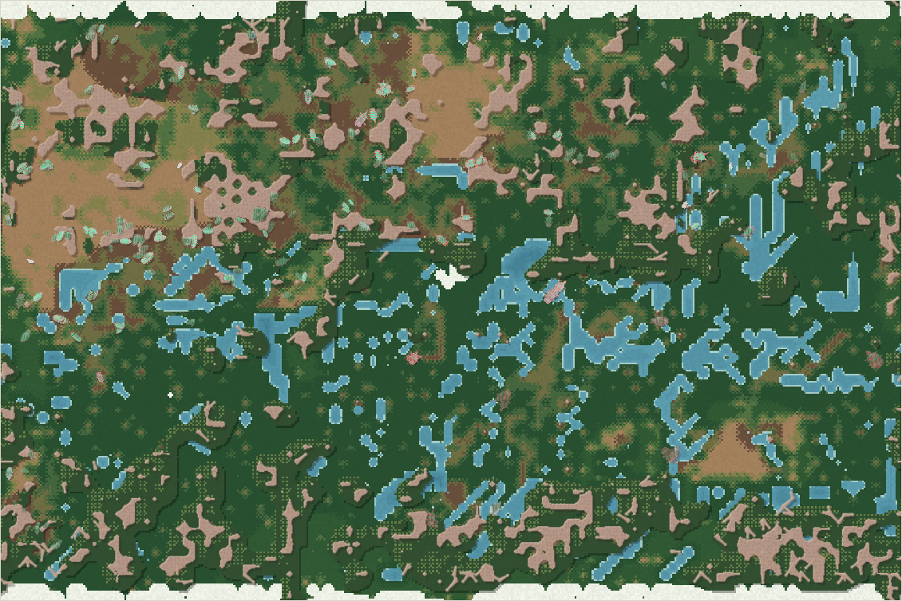
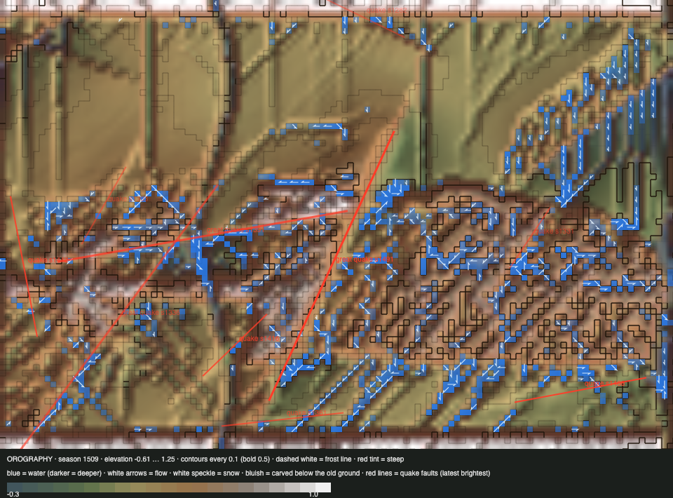

# World status — season 1509 (Oct 17, 05:45)

**Window:** the last 35 seasons (s1474 → s1509). Previous status report: [season 1474](2026-10-17_s1474.md).

## 0. The world at this moment

**Rain in a dry era, and the land is green almost everywhere.**
- **Water** fills the channels and the meseta's ribs: 988 wet cells, against 437 at s1474.
- **The wall** shows as a white strip along the top and bottom.
- **The herds** crowd the north-west: the nanasas and ushdrogals, 142 of 240 animals.

## 0b. The land (orography X-ray)

*Elevation −0.61 … 1.25; contours every 0.1.*

- **A fourth great earthquake** (s1491, in the mountains, strength 0.22) broke a 424 px fault and lifted its north-west side. Ten quakes are logged in all.
- **Rain** filled the channels again, so the river barriers are closed for now.

## 1. In one paragraph
**The mosalis, the north-west's ruling line (119 seasons), broke apart and are gone.** As they passed 60% of the family, the great divide fired three times in three seasons (s1493–95):
- **First, along their seams:** 30 more shelled ones became the **nanasas**. They are now the largest species (116), dung-eating omnivores of the north-west.
- **Again:** 34 became the **quiordros**, now 5.
- **Then by the old median-cut fallback** ("the land is cut in four"): three pieces of 36 each. All three died within 4–12 seasons (tyorthus, belzudros, omraras).

**Other events:**
- The last mosali died of old age (s1502).
- The drobelvens, the scavenger giants, died of old age after 72 seasons (s1499).
- In the north-east, the tyzuors split twice into grazer kinds: the fifiors starved out in 3 seasons; the **ushtyras** (s1504) hold at 28.
- **The sections keep the species regional:** the ushdrogals live only in the north-west, the tyzuors and ushtyras only in the north-east, and the liralis in the north-east and south-east.

## 2. Then and now

| | s1474 | s1509 (now) |
|---|---|---|
| Bodies / room | 238 / 216 | 240 / 216 |
| Species | 5 | 6 (mean 6.3, range 5–10 in the window) |
| Ways of life | 72 grazers, 146 decomposers, 19 mixed, 1 scavenger | 69 grazers, 138 decomposers, 31 mixed, 2 browsers |
| Family size / gut | 5.56 / 0.099 | 5.59 / 0.082 |
| Armour (family) | 0.79 | **0.86** |
| **Legs / eyes** | 0.67 / 0.13 | **0.63 / 0.07** (both fell about 1 SD) |
| Crossings per season | 30–160 | 76–121 (wet now) |
| Lowland sections (NW / NE / SW / SE) | 148 / 67 / 7 / 3 | **157 / 65 / 12 / 4** |
| Climbing best / swimming best | 0.11 / 0.22 | **0.14** / 0.21 |
| Quakes (chronicle, in the window) | — | 1 great (s1491); 11 logged in all (the X-ray draws only the latest 10, so it always says 10) |

## 2b. Species alive at this report (s1509)

| Species | Line | Bodies | Since | Section | Size | Gut | Armour | Browse | Coat | Swim | Climb | Decomp. | Standing |
|---|---|---|---|---|---|---|---|---|---|---|---|---|---|
| **nanasas** | …5.8.1.3 | 116 | s1493 | **NW** 93, NE 15, SW 8 | 5.0 | 0.10 | **0.96** | 0.46 | **0.23** | 0.03 | 0.03 | 0.72 | the mosalis' heirs; shelled, thick-coated dung-eaters and omnivores |
| ushdrogals | …6.5.8 | 49 | s1373 | **NW only** | 6.1 | 0.04 | 0.95 | 0.30 | 0.11 | 0.03 | 0.02 | **0.79** | the oldest living line (136 seasons) |
| ushtyras | …5.5.5.1.2 | 28 | s1504 | **NE** (26) | 5.9 | 0.06 | 0.62 | 0.42 | 0.12 | 0.02 | 0.01 | 0.36 | grazer split of the tyzuors |
| tyzuors | …5.5.5.1 | 26 | s1412 | **NE** (25) | 5.4 | 0.03 | 0.64 | 0.40 | 0.13 | 0.03 | 0.02 | 0.40 | north-east grazers |
| **liralis** | …5.3.3 | 16 | s1339 | NE 11, **SE 5** | **8.5** | **0.19** | 0.59 | 0.18 | 0.05 | **0.21** | **0.11** | 0.72 | the biggest and most skilled: swimmers and climbers; the main killers (4,372 kills); shrinking |
| quiordros | …5.8.1.4 | 5 | s1494 | scattered | 5.3 | 0.17 | 0.98 | 0.46 | 0.25 | 0.03 | 0.02 | 0.75 | second divide piece; fading |

## 3. What happened in the world (s1474 → s1509)
- **New species (7):**
  - fifiors (s1479, grazers from the tyzuors);
  - **nanasas** (s1493, divide along seams);
  - quiordros (s1494, divide along seams);
  - tyorthus, belzudros and omraras (s1495, **median-cut divide**);
  - ushtyras (s1504, grazers from the tyzuors).
- **Extinctions (6):**
  - fifiors (s1482, starved, 3 seasons);
  - **drobelvens** (s1499, old age, 72);
  - tyorthus (s1500, starved, 4);
  - **mosalis** (s1502, old age, **119**);
  - belzudros (s1503, old age, 8);
  - omraras (s1507, old age, 12).
- **Earthquake:** **great, s1491** (mountains, 0.22).
- **Weather:** a drought around s1482, then wet from s1491.

## 4. What we changed (s1474 → s1509)
Nothing in the world. The check-in schedule was rebuilt at s1474 with an explicit report-due test after the missed report.

## 5. How it shows in the creatures
- **The great divide still cuts the leading species into small pieces that die.** Of the five divide pieces, only the first (nanasas, 30 founders, taking the more shelled) thrived. The median-cut pieces (36 each) lived 4–12 seasons. That matches the whitepaper (founders under 40: median life about 15 seasons). The divide's fallback still cuts in four, although your s1329 rule caps the seam path at 2 pieces.
- **Regional species hold.** The ushdrogals have not left the north-west, and the tyzuors and their splits have not left the north-east. The south stays nearly empty (16), held only by a few liralis (SE) and nanasas (SW).
- **The liralis are the most skilled line:** swim 0.21, climb 0.11 (the family's best), size 8.5. But they are only 16 now, with 1,985 of their own eaten.
- **Legs and eyes fell** about 1 SD each. Both cost upkeep, and in a fenced, crowded north-west, running and seeing far pay less.
- **Shells rose again** (0.86): the eaten were the soft (−0.67 SD).

## 6. Backlog
**Your call**
- **The divide's median-cut fallback:** keep cutting in four, cap it at 2 pieces like the seam path, or drop it (no divide when there are no seams).
- **Apex options** (s1381); the ice pass; the top water pull; the viewer's open items; room by mass; the carve cap.

**Running**
- The sections; apex rules; water plants; lichen; parasites; carcasses; quakes.

## 7. Risks
- **Few lines and fast turnover:** 7 new species and 6 extinctions in 35 seasons. Species lifetime median is 12 seasons in the window.
- **The south is nearly empty** (16).
- **The north-west holds 2 of 3 animals,** so the next divide will cut there again.
- **Server: stable.** Up 5 h 34 min, 0 errors, memory 245–321 MB (321 now; watch).

## 8. Next to watch
- Whether the **nanasas** hold (they took the mosalis' place, and the divide rule will fire on them too at 60%).
- The **liralis**: the family's swimmers and climbers, and few now.
- **Climbing past 0.3**, and the first truly isolated split.
- The south refilling.

## 8b. Diversity

| Measure | s1474 → s1509 (35 seasons) |
|---|---|
| Species alive (mean / min–max) | 6.3 / 5–10 |
| New species / extinctions (per 30 seasons) | 7 / 6 (6.0 / 5.1) |
| Born by | niche split 2 (founders median 30) · great divide 2 (founders median 34) · drift split 3 (founders median 36) |
| Died by | starving 2 (lived median 4 seasons) · old age 4 (lived median 72 seasons) |
| Lifetime of species that died (median) | 12 seasons |
| Share of deaths by predation / starvation / old age | 55% / 32% / 13% |

*The whole era (s700+), founding size → lifetime: under 20 founders: 33 species, median 14 · 20–39: 59 species, median 15 · 40–79: 33 species, median 20 · 80+: 5 species, median 7 (seasons).*

*(The median-cut pieces are counted as drift splits here, because the chronicle names them "drifted apart".)*

## 9. What shapes the species

**How to read this:** the selection ledger compares the traits of everyone who **bred** (4,444) or **died** in the window with the living, in units of how much each trait varies. The deaths were from old age (579), starvation (1,411) and being eaten (2,452).

| Trait | Living shift | Breeders | Died old | Starved | Eaten | Starved vs breeders | Reading |
|---|---|---|---|---|---|---|---|
| **Fat** | −0.27 | +0.87 | +0.44 | **−1.20** | −0.67 | **−2.07** | The lean starve, as always. |
| Armour | **+0.45** | −0.46 | +0.02 | −0.41 | **−0.67** | +0.05 | The soft are eaten; shells rise. |
| Gut | −0.25 | +0.44 | +0.17 | +0.16 | **+0.64** | −0.28 | Meat-leaning guts are eaten more (the drobelvens, liralis). |
| Size | +0.03 | +0.43 | −0.27 | +0.31 | **+0.61** | −0.12 | The big are eaten. |
| Browse | +0.15 | −0.35 | +0.08 | −0.22 | **−0.53** | +0.13 | Thicket feeders escape. |
| **Legs** | **−1.05** | +0.03 | +0.32 | +0.11 | +0.10 | +0.08 | Fell by turnover (the long-legged lines died out). |
| **Eyes** | **−0.90** | +0.43 | +0.24 | **+0.62** | +0.50 | +0.19 | Sharp eyes cost upkeep, and the starved had more. |
| Fright | +0.30 | −0.20 | −0.22 | +0.16 | **−0.45** | +0.36 | The calm are eaten. |

**Which rules and conditions drove the changes**
1. **Predation** (55% of deaths): the soft, big, meat-leaning and calm are eaten, so shells rise.
2. **The great divide** (fired three times on the mosalis): one good piece (nanasas), four doomed ones.
3. **The four sections:** regional species, an empty south, the north-west crowded.
4. **Upkeep:** legs and eyes shrink where they don't pay.
