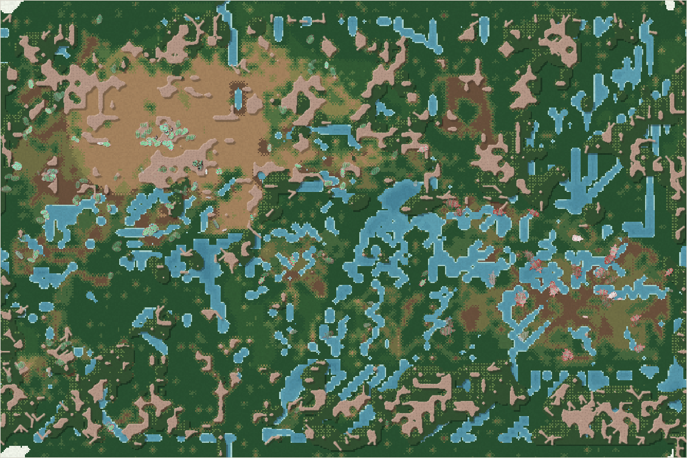
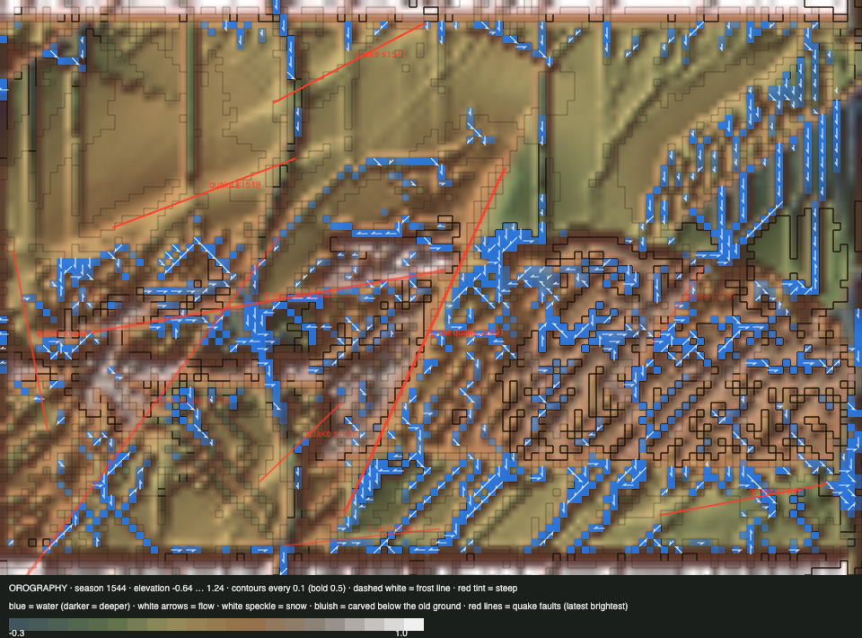

# World status — season 1544 (Oct 17, 08:10)

**Window:** the last 35 seasons (s1509 → s1544). Previous status report: [season 1509](2026-10-17_s1509.md). Two rule changes landed in this window: **the great divide rethought** (s1534) and **deposition** (s1542).

## 0. The world at this moment

**Rain at the start of a drying era.**
- **Water** stands at its highest in this window: 1,362 wet cells.
- **The herds:** the north-west is crowded with venthutys and nanasas, and the liralis graze up on the meseta.

## 0b. The land (orography X-ray)

*Elevation −0.64 … 1.24; contours every 0.1.*

- **Deposition (from s1542)** has begun refilling the deepest cuts. Cells at the 0.30 carving cap fell from 1,653 (s1536) to **1,139**, and none has yet filled above its old ground.
- **A small quake** struck the lowlands at s1543 (0.03).
- **The X-ray draws only the 10 most recent quakes.** There are 12 in the log.

## 1. In one paragraph
**The dung-eaters hold the north-west, the liralis took the meseta, and the north-east's grazer line ended.**
- **The north-west** belongs to three shelled, thick-coated dung lines, all from the nanasas: venthutys (105), nanasas (54), namodros (14). Dung ability across the family climbed to **0.83** (+1.17 SD, the window's largest shift).
- **The liralis**, the family's best climbers (0.10) and still its largest bodies, now live mostly **on the meseta**: 27 of 46, the first population living in the high country between the sections.
- **The tyzuors died out** (s1544, old age, 131 seasons): the last of the thuzuli line's grazers in the north-east. Only their offshoot, the ordrovens (19), remains there.
- **The ushdrogals**, the oldest living line (163 seasons), starved out at s1535.
- **The great divide fired once** (s1529, before the new rule), 96 + 49 along real seams: the namodros, at 14 now.
- **Two rule changes:** **the divide rethought** (s1534: pieces of at least 40, no four-way cut, the faintest seam promoted) and **deposition** (s1542: water lays down what it cuts).

## 2. Then and now

| | s1509 | s1544 (now) |
|---|---|---|
| Bodies / room | 240 / 216 | 238 / 216 |
| Species | 6 | 5 |
| Ways of life | 69 grazers, 138 decomposers, 31 mixed, 2 browsers | 69 grazers, **162 decomposers**, 7 mixed |
| Family size / gut | 5.59 / 0.082 | **6.10** / 0.070 |
| Dung ability (family) | 0.66 | **0.83** |
| Lowland sections (NW / NE / SW / SE) | 157 / 65 / 12 / 4 | 141 / 48 / 18 / 5 (and **27 liralis on the meseta**) |
| Crossings per season | 76–121 | 18–151 (mean ≈ 70; 151 in the first full season with deposition) |
| Climbing best / swimming best | 0.14 / 0.21 | **0.15** / 0.16 |
| Cells at the carving cap | 1,653 (s1536) | **1,139** (deposition refilling) |

## 2b. Species alive at this report (s1544)

| Species | Line | Bodies | Since | Where | Size | Gut | Armour | Browse | Coat | Swim | Climb | Decomp. | Standing |
|---|---|---|---|---|---|---|---|---|---|---|---|---|---|
| **venthutys** | …5.8.1.3.1 | 105 | s1526 | **NW** 81, NE 18, SW 6 | 5.6 | 0.07 | **0.95** | 0.45 | 0.25 | 0.05 | 0.02 | **0.91** | grazer split of the nanasas, 16 founders; now the largest species |
| nanasas | …5.8.1.3 | 54 | s1493 | **NW** 47, NE 7 | 5.8 | 0.07 | 0.95 | 0.45 | 0.24 | 0.06 | 0.02 | 0.88 | the mosalis' heirs; the mother of this window's two splits |
| **liralis** | …5.3.3 | 46 | s1339 | **meseta** 27, NE 18 | **8.3** | 0.08 | 0.58 | 0.17 | 0.05 | 0.16 | **0.10** | 0.78 | climbers on the plateau; the main killers (5,014 kills); the longest-lived line now (205 seasons) |
| ordrovens | …5.5.5.1.3 | 19 | s1520 | NE 13, SE 4 | 5.6 | 0.08 | 0.67 | 0.36 | 0.12 | 0.06 | 0.06 | 0.38 | the last grazers of the thuzuli line |
| namodros | …5.8.1.3.2 | 14 | s1529 | scattered (SW 6) | 5.8 | 0.09 | 0.95 | 0.46 | 0.27 | 0.03 | 0.06 | 0.88 | divide piece of the nanasas (49 founders) |

## 3. What happened in the world (s1509 → s1544)
- **New species (3):**
  - ordrovens (s1520, mixed-feeder split of tyzuors, 15 founders);
  - venthutys (s1526, grazer split of nanasas, 16);
  - namodros (s1529, **seam divide** of nanasas, 49).
- **Extinctions (4):**
  - quiordros (s1510, starved, 18 seasons);
  - ushtyras (s1519, old age, 15);
  - **ushdrogals** (s1535, starved, **163**, the oldest line);
  - **tyzuors** (s1544, old age, **131**).
- **Earthquakes:** small, s1520 and s1543 (lowlands).
- **Weather:** a dry spell around s1527, wet from about s1533.

## 4. What we changed (s1509 → s1544)
| When | Change |
|---|---|
| **s1534** | **Great divide rethought** (Luis): • pieces of at least 40 founders (`divideMin` 30 → 40), so a divide needs 80 or more; • real seams first (at most 2 pieces); • with no clear seam, the four-way median cut is gone: **the faintest seam is promoted**, cutting along the direction the group varies most at its widest gap, 40 or more each side. Niche, mind and drift splits stay at 15 founders (Luis). |
| **s1542** | **Deposition** (Luis): water carries what it cuts, carves only into spare capacity, and lays its load down where it slows, ponds or dries. Material is conserved. Headless: net land loss went from +3.7 to about 0; cuts refill. |
| s1536–42 | **Parked by Luis:** great floods. **Proposed:** [geology](2026-10-17_s1542-geology-proposal.md) (rock and layers, soils and minerals, slopes, uplift) |

## 5. How it shows in the creatures
- **Dung is the way of life:** 162 of 238 decomposers, with ability up to 0.83. Starvation picks the poorest dung-eaters (−1.06 SD among the starved), so it keeps rising.
- **The meseta became a home.** The liralis, with the family's best climbing, live up on the plateau, which no other species uses. It's the first sign of the high country between the sections working as a habitat of its own.
- **Bodies grew back** (5.59 → 6.10, +0.45 SD) and **litters shrank** (3.77 → 3.61, −0.69 SD): fewer, larger young.
- **Eyes rose a little** (+0.62 SD), against the last window. It's a small trait; turnover between lines explains it.
- **No section-born split yet.** The great divide fired once, along seams of kind within the north-west, not between sections.

## 6. Backlog
**Your call**
- **The geology proposal** (6 questions).
- **Apex options** (s1381); the ice pass; the top water pull; viewer items; room by mass; **the carving cap**, which can now be lifted with deposition in place.

**Parked**
- Great floods.

**Running**
- Sections, apex rules, the new divide, deposition (watch crossings), water plants, lichen, parasites, carcasses, quakes.

## 7. Risks
- **One stem:** all five species descend from the navenna–lirali stem. The thuzuli line is down to the ordrovens (19).
- **Crossings may rise with deposition:** 151 in its first full season against a window mean of about 70. Refilled beds could make the channels shallower. I'll watch for several seasons before calling it.
- **The south stays thin** (23).
- **Server: stable.** Up since the s1542 restart, 0 errors, memory 214 MB.

## 8. Next to watch
- **Crossings under deposition**, against the 70-a-season baseline.
- **The liralis on the meseta:** does a highland species split off?
- **The next great divide** under the new rule: piece sizes and lifetimes.
- Climbing toward 0.3; the first section-born split.

## 8b. Diversity

| Measure | s1509 → s1544 (35 seasons) |
|---|---|
| Species alive (mean / min–max) | 5.7 / 4–7 |
| New species / extinctions (per 30 seasons) | 3 / 4 (2.6 / 3.4) |
| Born by | niche split 2 (founders median 16) · great divide 1 (founders median 49) |
| Died by | starving 2 (lived median 163 seasons) · old age 2 (lived median 131 seasons) |
| Lifetime of species that died (median) | 131 seasons |
| Share of deaths by predation / starvation / old age | 42% / 47% / 11% |

*The whole era (s700+), founding size → lifetime: under 20 founders: 33 species, median 14 · 20–39: 63 species, median 15 · 40–79: 33 species, median 20 · 80+: 5 species, median 7 (seasons).*

*(The tool counts the quiordros and ushtyras by their parents' lifetimes; the window's extinctions lived 15–163 seasons.)*

## 9. What shapes the species

**How to read this:** the selection ledger compares the traits of everyone who **bred** (5,064) or **died** in the window with the living, in units of how much each trait varies. The deaths were from old age (579), starvation (2,361) and being eaten (2,126).

| Trait | Living shift | Breeders | Died old | Starved | Eaten | Starved vs breeders | Reading |
|---|---|---|---|---|---|---|---|
| **Fat** | +0.34 | +0.11 | +0.02 | **−1.53** | **−0.98** | **−1.64** | The lean starve and are eaten. |
| **Decomposer** | **+1.17** | −0.79 | −0.74 | **−1.06** | −0.62 | −0.27 | Dung ability is still selected up hard. |
| Size | +0.45 | −0.28 | **−0.72** | −0.27 | −0.22 | +0.01 | Bodies grew; the small died old. |
| Litter | **−0.69** | +0.23 | +0.20 | +0.37 | +0.10 | +0.14 | Smaller litters (bigger young). |
| Eyes | +0.62 | −0.37 | −0.42 | −0.32 | −0.46 | +0.05 | Up by turnover between lines. |
| Gut | −0.31 | +0.19 | +0.18 | +0.16 | **+0.36** | −0.03 | Meat-leaning guts are still eaten more. |

**Which rules and conditions drove the changes**
1. **Starvation** (47%): fat decides; dung ability saves, so the dung lines rose further.
2. **Predation** (42%): the lean and the meat-leaning are eaten. The liralis are the main killers.
3. **The sections:** the north-west belongs to one stem, and the meseta became the liralis' high country.
4. **The great divide** (one seam divide): a 49-founder piece, still alive at 14.
