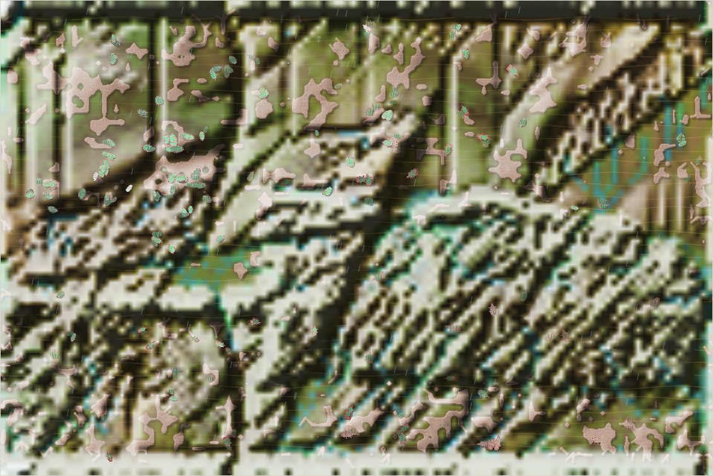
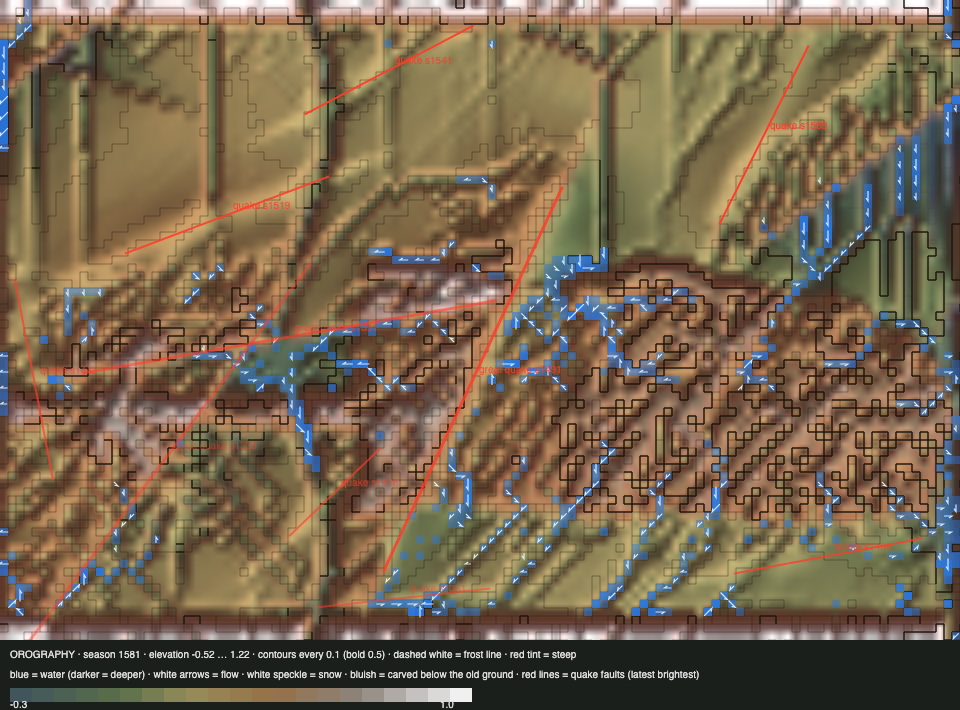

# World status — season 1580 (Oct 17, 11:20)

**Window:** the last 36 seasons (s1544 → s1580). Previous status report: [season 1544](2026-10-17_s1544.md). In this window **geology** went live (s1554), and the world was **sped up** (s1562–71).

## 0. The world at this moment

**Overcast, a dry and warm era.**
- **Water:** little stands (640 wet cells, almost no deep water), so the channels are low.
- **The herds** are spread wider than before: the north-west and north-east are about equal, and the south holds 50.

## 0b. The land (orography X-ray)

*Elevation −0.52 … 1.22; contours every 0.1.*

- **Geology at work (since s1554):**
  - rivers cut through soft rock: deepest cut **0.59**, past the old 0.30 cap;
  - **alluvium** covers **2,108** cells;
  - **70 cells** have filled above their old ground.
- **The lowest ground rose** from −0.64 to −0.52 as deposition filled the deepest pits.
- **A small quake** struck the lowlands at s1570. The X-ray draws only the latest 10 of 13 logged.

## 1. In one paragraph
**A quiet window for species, a busy one for the land, and the sections are leaking.**
- **No species was born or lost in 36 seasons,** the first such window of the genesis era. The same five lines held: venthutys, nanasas, namodros, ordrovens, liralis.
- **The sections stopped keeping them apart:**
  - the venthutys, all north-west at s1544, are now **half in the north-east**;
  - the namodros moved to the north-east;
  - the ordrovens, the last of the thuzuli line, moved **from the north-east into the south** (28 of 31).
- **Crossings ran at about 110 a season** through the window, against about 70 in the window before. That's consistent with deposition filling and shallowing the channels since s1542, with the dry era doing the rest.
- **The energy review (s1571)** found dung free energy and meat worth nothing. Luis chose **"honest dung"**, which is being tested.

## 2. Then and now

| | s1544 | s1580 (now) |
|---|---|---|
| Bodies / room | 238 / 216 | 219 / 216 |
| Species | 5 | 5 (none born, none lost) |
| Ways of life | 69 grazers, 162 decomposers, 7 mixed | 65 grazers, 140 decomposers, 13 mixed, 1 scavenger |
| Family size / gut / armour | 6.10 / 0.070 / 0.85 | **6.38** / 0.059 / **0.89** |
| Lowland sections (NW / NE / SW / SE) | 141 / 48 / 18 / 5 | **94 / 79 / 22 / 28** |
| Crossings per season | ≈ 70 (s1509–44) | **≈ 110** (54–235) |
| Land: deepest cut / alluvium / filled cells | 0.30 cap / — / 0 | **0.59 / 2,108 / 70** |
| Live speed | 19.6 ticks/s | **24.2 ticks/s** |

## 2b. Species alive at this report (s1580)

| Species | Line | Bodies | Since | Where | Size | Gut | Armour | Browse | Coat | Swim | Climb | Decomp. | Standing |
|---|---|---|---|---|---|---|---|---|---|---|---|---|---|
| **venthutys** | …5.8.1.3.1 | 73 | s1526 | **NW 35 / NE 37** | 6.4 | 0.06 | 0.96 | 0.45 | 0.23 | 0.06 | 0.03 | 0.90 | the largest; crossed into the north-east |
| nanasas | …5.8.1.3 | 67 | s1493 | **NW** 56 | 5.9 | 0.08 | 0.94 | 0.45 | 0.28 | 0.10 | 0.04 | 0.87 | still the north-west's line |
| ordrovens | …5.5.5.1.3 | 31 | s1520 | **SW 18 / SE 10** | 5.9 | 0.03 | 0.74 | 0.22 | 0.09 | 0.02 | **0.08** | 0.34 | moved south; the last thuzuli-line grazers |
| namodros | …5.8.1.3.2 | 30 | s1529 | **NE** 23, SE 6 | 6.8 | 0.09 | 0.93 | 0.28 | **0.32** | 0.05 | 0.04 | **0.93** | moved north-east; the purest dung-eaters |
| liralis | …5.3.3 | 18 | s1339 | **SE** 10, NE 5 | **7.9** | 0.03 | 0.58 | 0.15 | 0.16 | **0.19** | 0.08 | 0.77 | the oldest line (241 seasons); the swimmers; off the meseta now |

## 3. What happened in the world (s1544 → s1580)
- **Species:** no births or extinctions. Movements are as above.
- **Earthquake:** s1570 (small, lowlands).
- **Weather:** wet from about s1554 to 1565 (storms around s1568), dry and warm now.

## 4. What we changed (s1544 → s1580)
| When | Change |
|---|---|
| **s1554** | **Geology live** (Luis): three rocks in tilted and folded layers over a hard basement (the base level; the carve cap is lifted); erosion by rock; soils by rock; alluvium; rock minerals for shells. Viewer data: rock, alluvium, full height |
| s1554–62 | **Coordination:** the `AGENTS.md` world ↔ viewer section; the commit cadence (12 hours, or on request); an `AGENTS.md` watcher for this session; the viewer's X-ray data (climbing need, carving, quake faults) and the land sent on connect. Commits `d1ad73d`, `b52bd5d` |
| **s1562–71** | **Speed** (Luis): • the sandbox timeout only for minds that could loop forever; • species list, frame index and height map cached; • the server clock counts from each tick's start (it had been capping the world near 23 ticks/s); • the watchdog also restarts a frozen server. Live 19.6 → 24.2 ticks/s |
| s1571 | **Energy review** (Luis): dung is free energy, meat worth nothing, shells at 0.95, the gut valley. **Honest dung** chosen and in testing (not live) |

## 5. How it shows in the creatures
- **Shells and size crept up** (armour 0.85 → 0.89, size 6.10 → 6.38). With predation down to 30% of deaths (from 42%), there's little to stop them.
- **Starvation is the main killer** (53%). Fat decides it (−1.49 SD among the starved).
- **Coats thickened** in the dung lines (0.23–0.32). The west and the high country are cooler since the tilt.
- **Eyes fell** (−0.38 SD): the starved had more of them, and they cost upkeep.
- **Swimming and climbing** are flat (best 0.19 and 0.12). The crossings are happening through dry beds and shallow channels, not by skill.

## 6. Backlog
**Your call**
- **Honest dung:** results due from the test.
- The **three questions** from the energy discussion: corpses for decomposers, decomposers as prey, which traits open which foods.
- **The leaking sections:** deposition and dry eras keep the river barriers low. Accept it ("let geology do its thing"), or deepen the channels.
- Apex options; the ice pass; the top water pull; the barriers' look (Luis plans to rework); geology pieces 3–4.

**Parked**
- Great floods.

## 7. Risks
- **Isolation fading:** species are mixing across sections again, which works against the section-born split the sections were built for.
- **One stem:** all five species descend from one line. No births in 36 seasons is a sign of low turnover, not stability.
- **Server: stable.** Memory 193–305 MB, 0 errors, 24 ticks/s.

## 8. Next to watch
- **Honest dung** live: energy shares, guts, the dung lines' numbers.
- **Crossings** in the next wet era: do full channels close the sections again?
- **The first species born after the quiet window,** and whether it comes from isolation.

## 8b. Diversity

| Measure | s1544 → s1580 (36 seasons) |
|---|---|
| Species alive (mean / min–max) | 5.0 / 5–5 |
| New species / extinctions (per 30 seasons) | 0 / 0 (0.0 / 0.0) |
| Born by | none |
| Died by | none |
| Lifetime of species that died (median) | – |
| Share of deaths by predation / starvation / old age | 30% / 53% / 17% |

*The whole era (s700+), founding size → lifetime: under 20 founders: 33 species, median 14 · 20–39: 63 species, median 15 · 40–79: 33 species, median 20 · 80+: 5 species, median 7 (seasons).*

No great divide fired (no species reached 60% of the family).

## 9. What shapes the species

**How to read this:** the selection ledger compares the traits of everyone who **bred** (3,889) or **died** in the window with the living, in units of how much each trait varies. The deaths were from old age (673), starvation (2,068) and being eaten (1,167).

| Trait | Living shift | Breeders | Died old | Starved | Eaten | Starved vs breeders | Reading |
|---|---|---|---|---|---|---|---|
| **Fat** | +0.04 | +0.54 | +0.49 | **−1.49** | −0.84 | **−2.03** | The lean starve, as always. |
| Size | +0.31 | −0.11 | −0.44 | +0.11 | −0.43 | +0.22 | Small bodies are eaten; bodies grow. |
| Armour | +0.26 | −0.05 | +0.27 | −0.35 | +0.16 | −0.30 | Shells rise; the starved had less. |
| Eyes | −0.38 | +0.04 | −0.09 | +0.20 | 0.00 | +0.16 | Eyes cost upkeep. |
| Gut | −0.22 | −0.04 | +0.02 | −0.01 | +0.10 | +0.03 | Guts drift down: meat pays nothing (see the energy review). |

**Which rules and conditions drove the changes**
1. **Starvation** (53%): fat, and a dry era.
2. **Free dung:** the dung lines dominate (140 of 219), whatever the land does. Being tested.
3. **Geology and deposition:** fertile alluvium, and shallower channels that let species mix across the sections.
