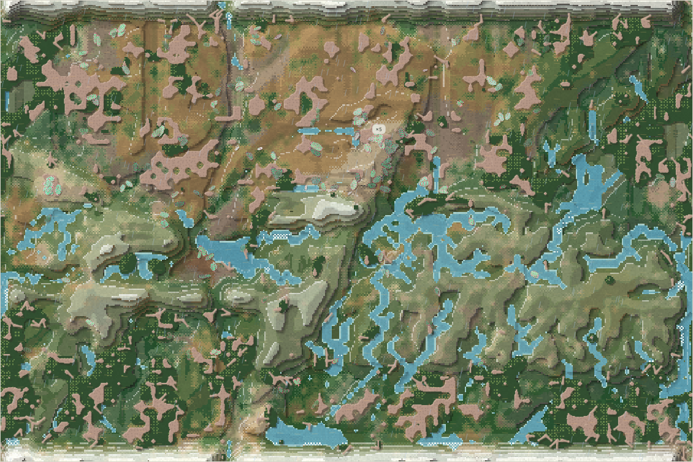
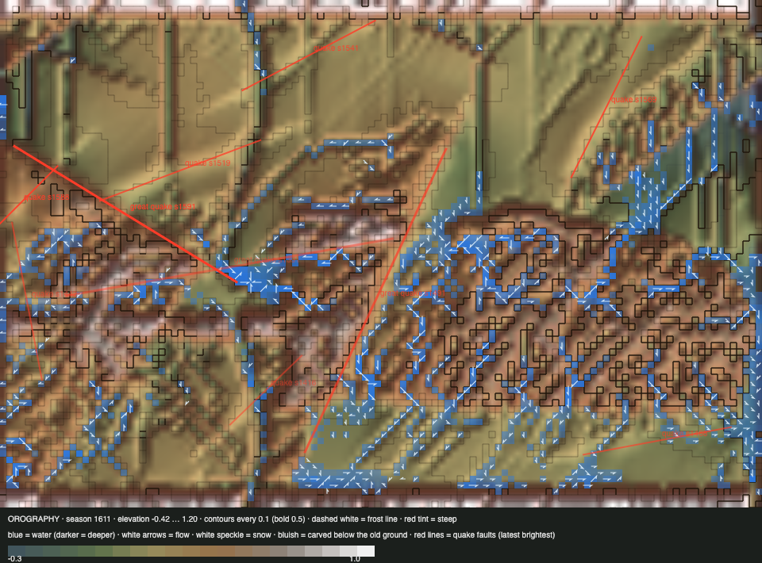

# World status — season 1610 (Oct 17, 13:20)

**Window:** the last 30 seasons (s1580 → s1610). Previous status report: [season 1580](2026-10-17_s1580.md). In this window the **energy work** began: the [flow report](2026-10-17_s1581-energy-flows.md), the [roadmap](2026-10-17_s1588-energy-roadmap.md), and honest dung built and in testing (not live).

## 0. The world at this moment

**Rain after a drought.** The land is greening again (1,151 wet cells), after a dry spell that left no deep water at s1610. The herds crowd the north-east now (147 lowland bodies there).

## 0b. The land (orography X-ray)

*Elevation −0.42 … 1.20.*

- **A great earthquake** (s1591, in the lowlands, 0.22, a 331 px fault), plus small ones at s1588 and s1570.
- **Rivers reach the basement:** the deepest cut is **0.705**, about the depth where the hard basement nearly stops carving. The lowest ground keeps rising (−0.52 → −0.42) as deposition fills the pits.
- **Alluvium** ≈ 2,000 cells.

## 1. In one paragraph
**The oldest line ended, and the new divide rule did its first work.**
- **The liralis died out** (s1606, old age, **268 seasons**). They were the oldest line of the genesis era: the swimmers, the climbers, and once the main hunters (5,125 kills).
- **Collapse while grass was plentiful:** they went 36 → 3 in a few seasons, along with the ordrovens (37 → 4, now 21) and the namodros (31 → 4, now 45). The likeliest cause is the **head cap**, filled by the dung lines, so rare species couldn't replace their dead. Falls after the great quake may have added to it.
- **The great divide**, under the rule Luis set at s1534, fired three times on the nanasas (s1600–02) along "faintest seams": **zudrofis** (53 founders), **ushsadros** (61) and **galorvens** (68). All three are alive at 25–41, a first for divide pieces, which used to die within 4–12 seasons.
- **Dung-eaters are 188 of 241 bodies.** The free dung gift still holds up the world.

## 2. Then and now

| | s1580 | s1610 (now) |
|---|---|---|
| Bodies / room | 219 / 216 | 241 / 216 (**at the head cap**) |
| Species | 5 | 7 |
| Ways of life | 65 grazers, 140 decomposers, 13 mixed | 45 grazers, **188 decomposers**, 7 mixed, 1 scavenger |
| Family size / dung ability | 6.38 / 0.81 | 5.99 / **0.86** |
| Lowland sections (NW / NE / SW / SE) | 94 / 79 / 22 / 28 | 67 / **147** / 5 / 15 |
| Crossings per season | ≈ 110 | 132–193 (drought) |
| Deepest cut / lowest ground | 0.59 / −0.52 | **0.705** / −0.42 |

## 2b. Species alive at this report (s1610)

| Species | Line | Bodies | Since | Where | Size | Gut | Armour | Toxin | Browse | Coat | Decomp. | Standing |
|---|---|---|---|---|---|---|---|---|---|---|---|---|
| venthutys | …1.3.1 | 63 | s1526 | NE 51, NW 12 | 6.4 | 0.06 | 0.91 | 0.53 | 0.38 | 0.19 | **0.96** | the largest |
| namodros | …1.3.2 | 45 | s1529 | **NE 43** | 5.8 | 0.04 | **0.96** | 0.60 | 0.25 | 0.34 | **0.97** | back from 4 |
| **zudrofis** | …1.3.3 | 41 | **s1600** | NE 29, NW 12 | 6.2 | 0.06 | 0.92 | 0.54 | 0.49 | 0.32 | 0.83 | divide piece (53, the less toxic) |
| **galorvens** | …1.3.5 | 31 | **s1602** | NW 22 | 6.5 | 0.04 | 0.92 | 0.57 | 0.49 | 0.32 | 0.82 | divide piece (68, the more shelled) |
| **ushsadros** | …1.3.4 | 25 | **s1600** | NW 13, NE 11 | 6.3 | 0.10 | 0.82 | 0.58 | 0.46 | 0.28 | 0.83 | divide piece (61, the less toxic) |
| ordrovens | …5.5.1.3 | 21 | s1520 | **SE 10, SW 6** | 4.1 | 0.05 | 0.64 | 0.57 | 0.28 | 0.12 | 0.49 | the last grazers, and the south's only line |
| nanasas | …1.3 | 15 | s1493 | NW | 6.4 | 0.09 | 0.88 | 0.60 | 0.54 | 0.31 | 0.82 | mother of the three divide pieces |

## 3. What happened in the world (s1580 → s1610)
- **New species (3):** zudrofis (s1600), ushsadros (s1600), galorvens (s1602), all **faintest-seam divides** of the nanasas.
- **Extinction:** **liralis** (s1606, old age, 268 seasons).
- **Earthquakes:** s1588 (small) and **s1591 (great, lowlands, 0.22)**.
- **Weather:** dry and warm from about s1580, a drought around s1605–10, rain now.

## 4. What we changed (s1580 → s1610)
| When | Change |
|---|---|
| s1581–90 | **Energy:** the [flow report](2026-10-17_s1581-energy-flows.md) (the free dung gift is 65% of income; kills vanish; prey hold little) and the [roadmap](2026-10-17_s1588-energy-roadmap.md), **agreed by Luis at s1597**: steps 1 → 1b + 2 → 3 → 4 → 5 → 6 → 7 → (8). New tool `tools/energy-ledger.mjs` |
| s1584 | Reports can show SVG images (server fix) |
| s1598 | The mating pile, diagnosed: the room ceiling plus no body-to-body collision. A personal-space rule is noted for Luis |
| s1604 | **Honest dung built** (Sonnet subagent; switched off until set). Its test with a 5-season fade dropped the world to 100 bodies and wiped out shelled dung lines; **a 10-season fade is being tested** before it goes live |

## 5. How it shows in the creatures
- **Dung ability rose further** (0.81 → 0.86), and the starved had less (−0.39 SD). The free gift keeps paying.
- **Browsing returned** (+0.25 SD): the starved browsed less (−0.53 SD).
- **Bodies shrank** (−0.45 SD) and legs shortened (−0.36 SD), with turnover toward the dung lines.
- **Toxins** are 0.53–0.60 in every line. Every species is toxic, and with shells at 0.82–0.96, hunting stays shut.
- **The head cap now decides who lives** when one line booms. That's a rule effect, not ecology: the ceiling blocks every species' births alike, so rare species can't recover in their own niche.

## 6. Backlog
**Running (the energy roadmap, agreed s1597)**
- **Step 1, honest dung:** the 10-season fade test, then go live, or hold until step 7 if dung lines still crash.
- Then 1b + 2 (carrion cap, kill leftovers to carcasses), 3, the proposal for 4, then 4, 5, 6, 7.

**Your call**
- **Room by heads:** when the cap is full, should rare species still be able to breed (room by niche or species), rather than the commonest filling it?
- **Personal space** between bodies.
- Apex options; the ice pass; the top water pull; the barriers' look.

## 7. Risks
- **Few lines:** seven species, six of them from the nanasa stem. The thuzuli line hangs on in the ordrovens (21).
- **Honest dung** will remove most of the dung lines' income. The fade length decides whether that's a shift or a crash.
- **Server: stable.** 0 errors, memory 288 MB (watch; it was 193 at the s1580 restart), 24 ticks/s.

## 8. Next to watch
- **Honest dung live** (after its test): the dung lines' numbers, starvation, and which grazers move into the room.
- **The three divide pieces:** do they hold, and do they stay regional?
- **The south:** the ordrovens are its only line.

## 8b. Diversity

| Measure | s1580 → s1610 (30 seasons) |
|---|---|
| Species alive (mean / min–max) | 5.8 / 5–8 |
| New species / extinctions (per 30 seasons) | 3 / 1 (3.0 / 1.0) |
| Born by | drift split 3 (founders median 61) |
| Died by | old age 1 (lived median 268 seasons) |
| Lifetime of species that died (median) | 268 seasons |
| Share of deaths by predation / starvation / old age | 29% / 51% / 20% |

*The whole era (s700+), founding size → lifetime: under 20 founders: 34 species, median 14 · 20–39: 63 species, median 15 · 40–79: 33 species, median 20 · 80+: 5 species, median 7 (seasons).*

*(The three new species came from the great divide's faintest-seam path. The tool counts them as drift splits, because the chronicle names them "drifted apart".)*

## 9. What shapes the species

**How to read this:** the selection ledger compares the traits of everyone who **bred** (3,248) or **died** in the window with the living, in units of how much each trait varies. The deaths were from old age (649), starvation (1,649) and being eaten (928).

| Trait | Living shift | Breeders | Died old | Starved | Eaten | Starved vs breeders | Reading |
|---|---|---|---|---|---|---|---|
| **Fat** | −0.10 | +0.95 | +1.03 | **−1.45** | −0.63 | **−2.40** | The lean starve, as always. |
| Dung ability | +0.39 | −0.17 | −0.23 | **−0.39** | +0.12 | −0.22 | Free dung protects against starving. |
| Browse | +0.25 | −0.16 | +0.04 | **−0.53** | +0.17 | −0.37 | Browsers survive the drought. |
| Eyes | −0.16 | +0.26 | +0.01 | **+0.54** | +0.15 | +0.28 | Eyes cost upkeep, and the starved had more. |
| Legs | −0.36 | +0.02 | −0.01 | +0.35 | −0.19 | +0.33 | Long legs cost upkeep in a drought. |
| Size | −0.45 | +0.12 | −0.08 | +0.19 | +0.11 | +0.07 | Smaller bodies, by turnover. |

**Which rules and conditions drove the changes**
1. **Starvation** (51%): fat; dung ability and browsing protect.
2. **The head cap:** when the dung lines boom, the rare lines can't replace their dead. The liralis, ordrovens and namodros crashed with grass all around.
3. **The great divide (faintest seam):** three pieces of 53–68 founders, all alive so far.
