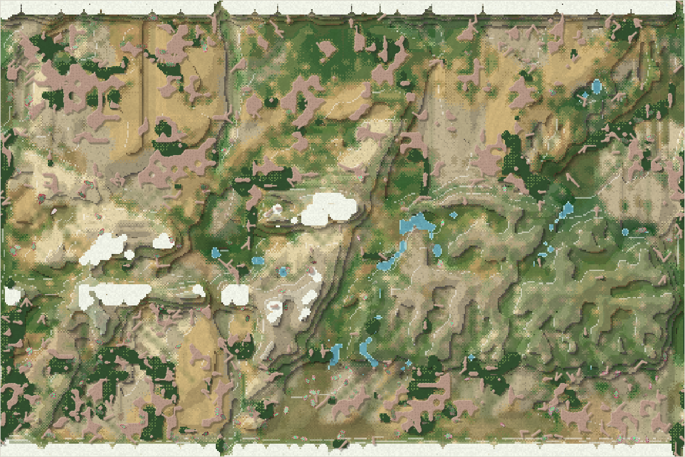
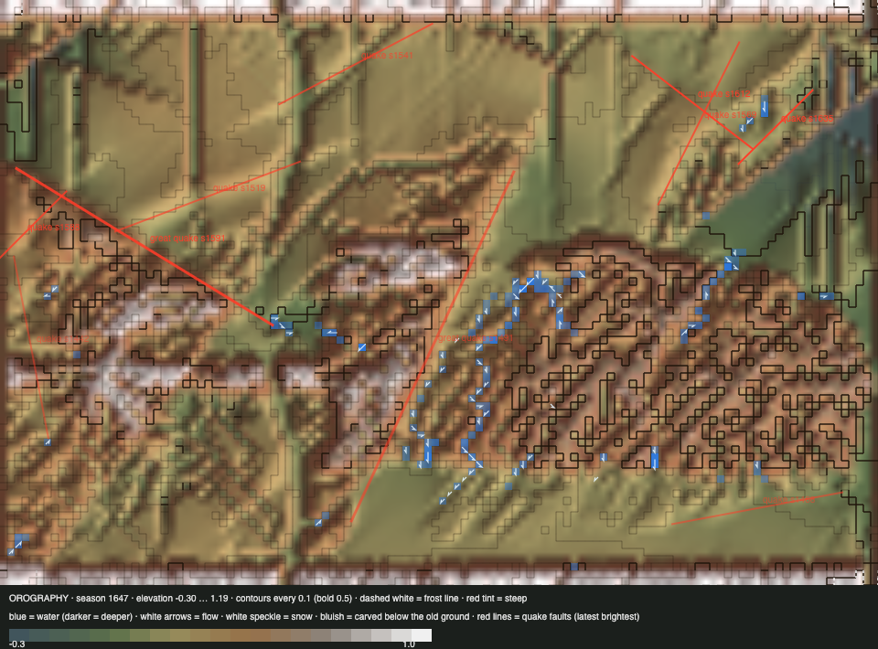

# World status — season 1645 (Oct 17, 15:25)

**Window:** the last 35 seasons (s1610 → s1645). Previous status report: [season 1610](2026-10-17_s1610.md). **Honest dung went live at s1620** (step 1 of the [energy roadmap](2026-10-17_s1588-energy-roadmap.md)), and its free gift faded to nothing by s1630. **The upheaval begins at s1646**, so this report is its "before".

## 0. The world at this moment

**Dry, and the land is thinner.** Plants are down to 3,647 and little water stands (136 wet cells). The herds are spread across all four lowlands: the south holds 115 of 239.

## 0b. The land (orography X-ray)

*Elevation −0.30 … 1.19.*

The last picture before the upheaval. The peak's summit stands at **0.90**; over the next 48 seasons a dome under it will lift it to about 1.8. Two small quakes struck the lowlands (s1612, s1635). Rivers have reached the basement in places, and deposition keeps raising the lowest ground (−0.42 → −0.30).

## 1. In one paragraph
**Honest dung changed the world's way of life within 25 seasons.**
- **Decomposers went from 188 bodies to 1.** Grazers (119), mixed feeders (75) and browsers (38) took their place.
- **Bodies became lighter and quicker:** size 5.99 → 4.30 (−2.66 SD, the largest shift of the genesis era), armour 0.89 → 0.68, dung ability 0.86 → 0.58, fat down, legs longer (+1.18 SD).
- **The energy ledger confirms it:** dung is 10% of income now, and all of it is real (what grazers didn't digest), against 65% from nothing before. Grazing and browsing carry 89%.
- **No crash:** 238–241 bodies throughout, though starvation rose (61% of deaths).
- **Turnover:** four species died out (nanasas 122 seasons, namodros 115, zudrofis 45, galorvens 24) and four were born, all splits by way of life (moushors already gone).
- **Meat is still at 0.1%.** The meat side waits for steps 1b–4.

## 2. Then and now

| | s1610 | s1645 (now) |
|---|---|---|
| Bodies / species | 241 / 7 | 239 / 6 |
| Ways of life | 45 grazers, **188 decomposers**, 7 mixed, 1 scavenger | **119 grazers, 38 browsers, 75 mixed**, **1 decomposer**, 5 scavengers, 1 omnivore |
| Size / armour / dung ability / legs | 5.99 / 0.89 / 0.86 / 0.64 | **4.30 / 0.68 / 0.58 / 0.69** |
| Energy income (ledger) | dung 65% (free) · plant 26% · browse 8% · flesh 0.1% | **plant 72% · browse 17% · dung 10% (honest)** · carrion 0.8% · flesh 0.1% |
| Lowland sections (NW / NE / SW / SE) | 67 / 147 / 5 / 15 | 44 / 78 / **44 / 71** |
| Peak (summit) | 0.90 | 0.90 → **~1.8 by s1694** |

## 2b. Species alive at this report (s1645)

| Species | Line | Bodies | Since | Way of life | Size | Gut | Standing |
|---|---|---|---|---|---|---|---|
| **ushbelbels** | …5.1.3.1 | 89 | s1614 | mixed feeder | 4.2 | 0.04 | the largest; split from the ordrovens |
| ordrovens | …5.5.1.3 | 48 | s1520 | grazer | 3.9 | 0.05 | the last of the thuzuli line; the south's mainstay |
| venthutys | …1.3.1 | 39 | s1526 | mixed feeder | 4.7 | 0.07 | the old dung line, turned to plants; energy low (0.82) |
| ushsadros | …1.3.4 | 36 | s1600 | mixed feeder | 5.3 | 0.03 | the one faintest-seam divide piece still alive |
| fimobels | …1.3.1.1 | 18 | s1644 | mixed feeder | 4.6 | 0.04 | split from the ushbelbels |
| thuomdros | …1.3.1.2 | 8 | s1643 | mixed feeder | 4.8 | 0.03 | grazer split of the venthutys |

## 3. What happened in the world (s1610 → s1645)
- **New species (4):**
  - ushbelbels (s1614, from ordrovens);
  - moushors (s1638, from venthutys, extinct s1646);
  - thuomdros (s1643, from venthutys);
  - fimobels (s1644, from ushbelbels).
- **Extinctions (4, plus moushors):**
  - nanasas (s1615, old age, 122 seasons);
  - galorvens (s1626, old age, 24);
  - namodros (s1644, starved, 115);
  - zudrofis (s1645, old age, 45).
- **Quakes:** small, s1612 and s1635 (lowlands).
- **Weather:** a drought around s1625–30, then dry again now.

## 4. What we changed (s1610 → s1645)
| When | Change |
|---|---|
| s1612 | `temp.relief.section` per cell for the viewer (the same rule as the crossing counter) |
| **s1620** | **Honest dung** (roadmap step 1). Dung carries what grazers didn't digest, decomposers eat it until it's gone, and the old free gift faded out over 10 seasons. A 5-season fade crashed the test world, so 10 was used |
| s1621 | `/docs/` read-only route for Codex's local wiki reader |
| **s1637** | **Falls fixed:** a cliff is now ground that *drops away*, not a gorge floor between walls. Falls went 914 → 93 per 2,000 ticks |
| s1641 | Commit `8c2d386` (the viewer's work, at its request) |
| **s1645** | **The upheaval set going** (Luis): a dome rises under the peak over 48 seasons (s1646 → s1694) by creep and imperfect quakes with cracks; the summit goes to ~1.8. Viewer height field `elev3` (−1 … 2.5) |

## 5. How it shows in the creatures
- **The end of the shelled dung-eaters.** Without free dung, armour (0.68) and dung ability (0.58) no longer pay their upkeep, and the small, long-legged, unshelled plant-eaters win. Every species alive is now a grazer, browser or mixed feeder.
- **Starvation is the world's brake again** (61% of deaths). Fat fell 1.5 SD, since energy is no longer free. The leaner-grass rule finally works as intended: **food, not the cap, now limits the world.** The cap is still touched, but plants are being eaten down.
- **Hunting is still shut.** Shells are softer now (0.68), but prey hold little energy and a kill mostly vanishes. Steps 1b–4 address exactly that.

## 6. Backlog
**Running**
- **The upheaval** (s1646 → s1694).
- Then roadmap steps **1b + 2** (carrion cap, kill leftovers to carcasses: Sonnet), 3, the proposal for 4, then 4–7. The watch after step 1 is done.

**Your call**
- Room by heads (rare species blocked at the cap); personal space between bodies; apex options; the ice pass; the top water pull.

## 7. Risks
- **The upheaval is the biggest change to the land since the orography.** Expect frost and crags at the peak, falls, cracks filling with water, the west sections' barriers buckling, and the fright of every quake. No rescues.
- **Few lines:** six species from two stems.
- **Server: stable.** 0 errors, memory 254 MB.

## 8. Next to watch
- **The upheaval:** the summit's height and temperature, quakes and cracks, the water, the west.
- **The new plant-eaters:** do they diversify by place (sections, heights) now that the land is changing?
- **After steps 1b + 2:** does carrion become a real food?

## 8b. Diversity

| Measure | s1610 → s1645 (35 seasons) |
|---|---|
| Species alive (mean / min–max) | 6.7 / 6–8 |
| New species / extinctions (per 30 seasons) | 4 / 4 (3.4 / 3.4) |
| Born by | niche split 4 (founders median 20) |
| Died by | old age 3 (lived median 45 seasons) · starving 1 (lived median 115 seasons) |
| Lifetime of species that died (median) | 115 seasons |
| Share of deaths by predation / starvation / old age | 25% / 61% / 14% |

## 9. What shapes the species

**How to read this:** the selection ledger compares the traits of everyone who **bred** (5,024) or **died** in the window with the living, in units of how much each trait varies. The deaths were from old age (704), starvation (3,078) and being eaten (1,244). The living moved so far that every group sits behind them, so read the *living shift*.

| Trait | Living shift | Breeders | Starved | Eaten | Reading |
|---|---|---|---|---|---|
| **Size** | **−2.66** | +1.14 | +1.28 | +1.41 | The big are eaten and starve; lighter bodies win. |
| **Armour** | **−1.82** | +1.16 | +1.21 | +1.34 | Shells no longer pay their upkeep. |
| **Dung ability** | **−1.72** | +1.03 | +1.13 | +1.23 | No free dung, so no dung-eaters. |
| **Fat** | **−1.52** | +0.70 | **−1.29** | −0.48 | Energy is scarce again; the lean starve. |
| **Legs** | **+1.18** | −0.76 | −0.76 | −0.97 | Long legs: the quick escape and reach food. |

**Which rules and conditions drove the changes**
1. **Honest dung** (s1620): the end of free energy remade the family within 25 seasons.
2. **Starvation** (61%): food, not the cap, now sets who lives.
3. **Drought:** plants thin, so browsing and mixed feeding pay.
