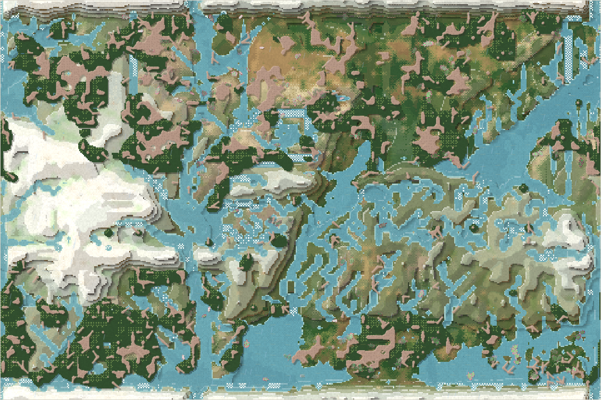
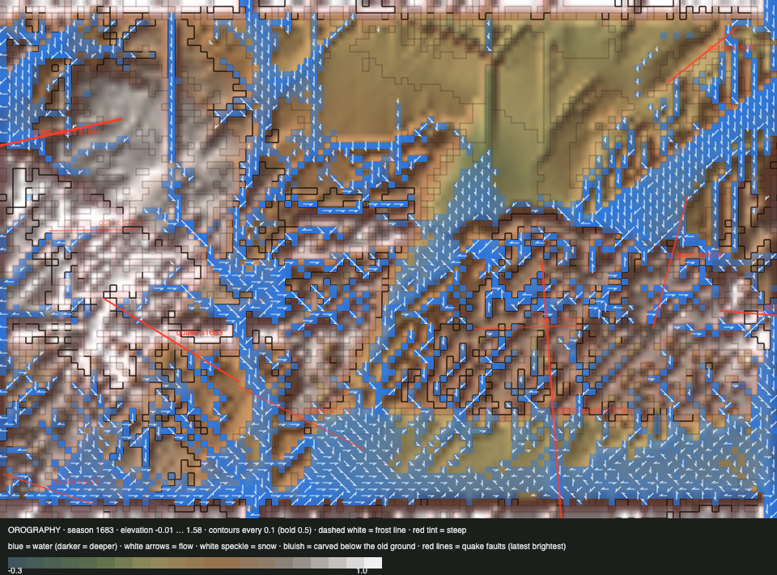

# World status — season 1683 (Oct 17, 17:20)

**Window:** the last 38 seasons (s1645 → s1683). Previous status report: [season 1645](2026-10-17_s1645.md). This is **the upheaval's window**: it began at s1646 and settles at s1694.

## 0. The world at this moment

**Spring on the new mountain.** The snow that covered up to 3,765 cells at s1673 has melted to 17, and the water is everywhere: 2,290 wet cells, the most in a long time. The herds crowd the north-east (125 lowland bodies there).

## 0b. The land (orography X-ray)

*Elevation −0.01 … 1.58 (the scale tops out at 1.0, so the dome shows as one white mass).*

- **The dome:** the summit has risen from **0.90 to 1.58**, with 0.81 of its planned ~1.0 uplift in place. **27 upheaval quakes** so far (6 great heaves), each leaving a narrow crack. The last ~10 seasons and the final settling bring it to about 1.8.
- **Crags** (climbing need above 0.5) now cover **1,993 cells**: the west has become high, rough country.
- **The lowest ground has risen to about 0** (−0.30 at s1645). The dome lifted the old gorges and deposition filled the pits.

## 1. In one paragraph
**The land rose, the west emptied, and the one surviving stem radiated into many short-lived species.**
- **The dome:** under the peak, the summit went 0.90 → 1.58. Snow covered the west in the cold (3,765 cells at s1673), then melted into a wet spring.
- **The west emptied:** its lowland held 0–29 bodies through the window, against 88 at s1645. The family lives in the north-east and south-east now.
- **The species churned:** with the old lines gone, the ordroven stem split **10 times in 38 seasons** (9 splits by way of life from ~16 founders, and one seam divide of 68). Ten species died out, most of old age, after a **median of 8 seasons**.
- **Shells kept falling** (armour 0.68 → 0.58) while eyes and browsing rose.
- **Predation is at its lowest** (15% of deaths).

## 2. Then and now

| | s1645 | s1683 (now) |
|---|---|---|
| Bodies / species | 239 / 6 | 239 / 8 |
| Ways of life | 119 grazers, 38 browsers, 75 mixed | **138 grazers**, 87 mixed, 6 browsers, 3 decomposers, 3 scavengers, 2 omnivores |
| Size / armour / browse / eyes | 4.30 / 0.68 / 0.36 / 0.05 | 4.47 / **0.58** / 0.39 / **0.11** |
| Peak (summit) | 0.90 | **1.58** (→ ~1.8 at s1694) |
| Crag cells / lowest ground | — / −0.30 | **1,993 / −0.01** |
| Lowland sections (NW / NE / SW / SE) | 44 / 78 / 44 / 71 | 26 / **139** / 6 / 60 |
| Deaths: predation / starvation / old age | 25% / 61% / 14% | **15% / 51% / 35%** |

## 2b. Species alive at this report (s1683)

| Species | Line | Bodies | Since | Where | Size | Gut | Armour | Browse | Standing |
|---|---|---|---|---|---|---|---|---|---|
| **ushbelbels** | …1.3.1 | 127 | s1614 | everywhere (NE 79, NW 24) | 4.3 | 0.05 | 0.58 | 0.41 | the dominant line; mother of most splits |
| ratytys | …1.3.1.3.x | 37 | s1674 | **SE 27** | 4.8 | 0.08 | 0.58 | 0.40 | grazer split of the movenquis; the south-east's |
| orgalkes | …1.3.1.3.2 | 25 | s1672 | NE 23 | 4.7 | 0.07 | 0.58 | 0.40 | grazer split of the movenquis |
| movenquis | …1.3.1.3 | 20 | s1667 | NE 15 | 4.5 | 0.06 | 0.53 | 0.44 | the seam divide (68 founders); mother of four splits |
| ordrovens | …5.1.3 | 17 | s1520 | SE 14 | 4.6 | **0.12** | 0.62 | 0.19 | the stem's root line (163 seasons) |
| fimobels | …1.3.1.1 | 9 | s1644 | NE | 4.0 | 0.02 | 0.61 | 0.36 | fading |
| drorabels | …1.3.1.4 | 3 | s1668 | — | 4.5 | 0.10 | 0.57 | 0.44 | fading |
| venraushs | — | 1 | s1678 | — | 4.9 | 0.05 | 0.52 | 0.42 | the last one |

## 3. What happened in the world (s1645 → s1683)
- **The upheaval:** 27 quakes (6 great). The summit went 0.90 → 1.58. A snowfield covered the west in the cold era, then melted into the wettest spring in a long while.
- **New species (10):** raomoms, omvenoms, zuthuvens, movenquis (seam divide), drorabels, venfizus, ketyushs, orgalkes, ratytys, venraushs.
- **Extinctions (10):** among them **venthutys** (s1657, 131 seasons, the last of the old dung stem) and **ushsadros** (s1658, 57, the last faintest-seam piece), plus eight short-lived splits (4–22 seasons).
- **A natural quake** (s1664, small, mountains), on top of the upheaval's own.

## 4. What we changed (s1645 → s1683)
| When | Change |
|---|---|
| s1645–46 | **The upheaval** set going (Luis): a dome under the peak over 48 seasons, by creep plus imperfect quakes with cracks |
| s1655 | Commit `06deda5` (speed, honest dung, falls fix, upheaval, viewer fields, the `/docs/` route, reports): Codex's reader was waiting for it |

## 5. How it shows in the creatures
- **Many births, short lives.** Nine of the ten new species were splits by way of life from about 16 founders. They lived a median of 8 seasons, the pattern the whitepaper found for small founding groups. The one divide (68 founders, the movenquis) has lasted 16 seasons and mothered four of the splits. *For Luis:* the 40-founder floor you set for the divide works. Niche splits still start from 15 (you chose to watch first). The window's evidence suggests they'd last longer from more.
- **Shells keep falling** (−2.42 SD): no free dung, and few hunters, so armour doesn't pay.
- **Eyes doubled** (0.05 → 0.11) and browsing rose: in a land of new crags, snow and water, seeing and choosing food pays.
- **The west's lowland emptied** as it rose into cold, crag-rimmed high country (the physics, not a rule). Climbing hasn't caught up (best about 0.17).

## 6. Backlog
**Running**
- **The upheaval** until s1694. Then **roadmap steps 1b + 2** (carrion cap, kill leftovers to carcasses: Sonnet), held until now so only one big change runs at a time.

**Your call**
- **Niche-split founders** (15 → 40, like the divide?).
- Room by heads; personal space; apex options; the ice pass; the top water pull.

## 7. Risks
- **One stem:** all eight species descend from the ordrovens.
- **Turnover:** ten births and ten deaths in 38 seasons. The world is restless but not diverse in kind: everything is a small plant-eater.
- **The last ~10 seasons of the upheaval** and its final settling will lift the west further.
- **Server: stable.** 0 errors, memory 225–297 MB.

## 8. Next to watch
- **The settling (s1694):** the summit's final height, the cracks, where the water goes.
- **Whether life climbs back into the west.**
- **Steps 1b + 2**, then whether carrion becomes a real food.

## 8b. Diversity

| Measure | s1645 → s1683 (38 seasons) |
|---|---|
| Species alive (mean / min–max) | 6.6 / 4–10 |
| New species / extinctions (per 30 seasons) | 10 / 10 (7.9 / 7.9) |
| Born by | niche split 9 (founders median 16) · great divide 1 (founders median 68) |
| Died by | old age 9 (lived median 8 seasons) · starving 1 (lived median 13 seasons) |
| Lifetime of species that died (median) | 9 seasons |
| Share of deaths by predation / starvation / old age | 15% / 51% / 35% |

## 9. What shapes the species

**How to read this:** the selection ledger compares the traits of everyone who **bred** (3,007) or **died** in the window with the living, in units of how much each trait varies. The deaths were from old age (1,041), starvation (1,519) and being eaten (447).

| Trait | Living shift | Breeders | Starved | Eaten | Reading |
|---|---|---|---|---|---|
| **Armour** | **−2.42** | +0.86 | +1.02 | +0.70 | Shells still falling: upkeep without enemies. |
| **Fat** | +0.50 | +0.86 | **−1.66** | −1.04 | The lean starve and are eaten. |
| Eyes | +0.78 | −0.58 | −0.60 | −0.45 | Rising. |
| Browse | +0.57 | −0.42 | −0.29 | −0.53 | Rising; thicket feeders escape. |
| Legs | −0.74 | +0.52 | +0.51 | +0.80 | Shorter legs now: long legs cost upkeep, and the eaten had them. |

**Which rules and conditions drove the changes**
1. **The upheaval:** a cold, crag-rimmed west (snow, frost, falls) that the family left. The rest crowd the east.
2. **Starvation** (51%): fat decides.
3. **Splits from small founders:** many short-lived species.
