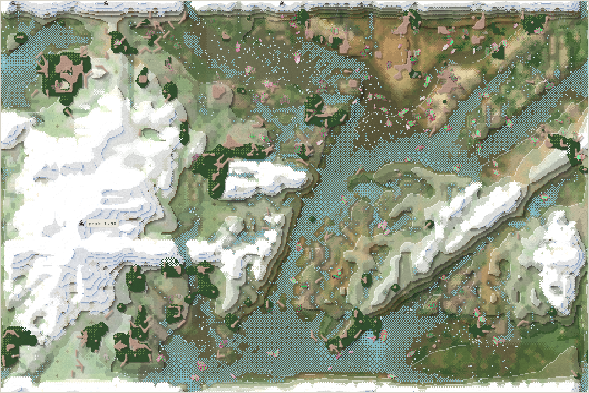
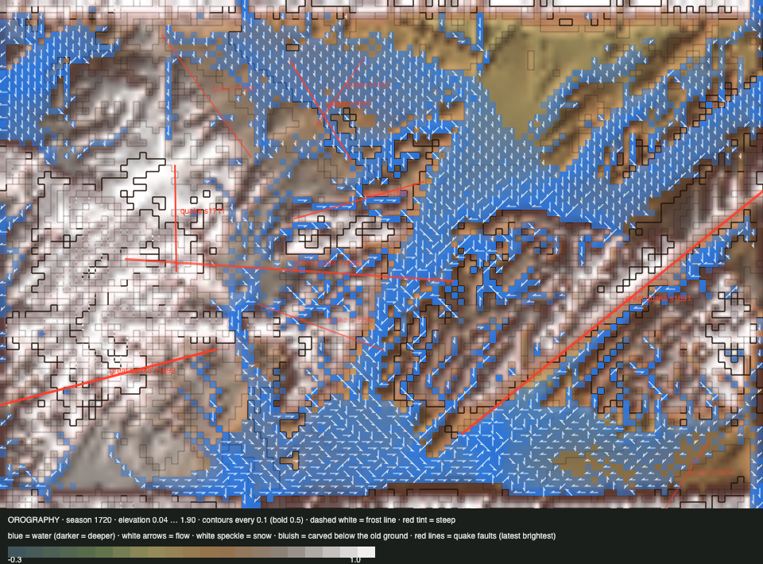

# World status — season 1719 (Oct 17, 19:20)

**Window:** the last 36 seasons (s1683 → s1719). Previous status report: [season 1683](2026-10-17_s1683.md). **The upheaval settled** (s1695, summit **1.90**), and **the sloppy reshaping of the map's edges** is under way (s1702 → s1750, 38% done).

## 0. The world at this moment

**Wet:** 2,166 wet cells and 1,617 under snow on the heights. The herds crowd the **north-east**: 184 of 238 bodies live in its lowland.

## 0b. The land (orography X-ray)

*Elevation 0.04 … 1.90 (the scale tops out at 1.0, so the dome and the wall show as one white mass).*

- **The dome stands:** the summit is at **1.90**. The ground settled at s1695 after **33 upheaval quakes**. Crags (climbing need above 0.5) cover **2,943 cells**.
- **A natural great quake** struck at s1692 (mountains, 0.27, a 516 px fault), with small ones at s1686 and s1711.
- **The reef is wearing away:** 1,217 cells (s1645) → **452**. The post-upheaval water washes it, and the quakes shattered it.
- **The edges are drifting toward the sloppy frame:** the mean height step across the left/right edge has gone 0.30 → **0.23**, and it keeps falling until s1750.

## 1. In one paragraph
**A world of grazers on a new mountain.**
- **Down to four species,** all from the ordroven stem. **The ordrovens themselves** (s1691, 169 seasons) and **the ushbelbels** (s1719, 105 seasons) died of old age. Nine species died in the window, six were born.
- **The new founder floors work:** this window's six births came from **31 to 59 founders** (the niche floor of 30 since s1692, the divide floor of 40), against ~16 before. Species lived a **median of 27 seasons**, against 8 in the last window.
- **The family is 86% grazers** (204 of 238), larger again (size 4.47 → **5.70**) and longer-legged.
- **Predation rose to 38% of deaths** (2,055 eaten). Bodies with a slightly meat-leaning gut, 27 of them, catch the young of the others: the orgalkes and mozuvens have about 600 kills each. **Yet flesh is still 0% of anyone's diet:** each kill yields almost nothing (77% of it vanishes, and the prey are small). Roadmap **step 2** (kill leftovers to carcasses) answers exactly this.

## 2. Then and now

| | s1683 | s1719 (now) |
|---|---|---|
| Bodies / species | 239 / 8 | 238 / **4** |
| Ways of life | 138 grazers, 87 mixed, 6 browsers, 3 decomposers, 3 scavengers, 2 omnivores | **204 grazers**, 31 mixed, 2 browsers, 1 omnivore |
| Size / legs / eyes / armour | 4.47 / 0.66 / 0.11 / 0.58 | **5.70 / 0.73** / 0.07 / 0.56 |
| Deaths: predation / starvation / old age | 15% / 51% / 35% | **38%** / 54% / 8% |
| Summit / crags / reef | 1.58 / 1,993 / ~890 | **1.90 / 2,943 / 452** |
| Lowland sections (NW / NE / SW / SE) | 26 / 139 / 6 / 60 | 6 / **184** / 10 / 31 |

## 2b. Species alive at this report (s1719)

| Species | Line | Bodies | Since | Founders | Size | Standing |
|---|---|---|---|---|---|---|
| **mozuvens** | …1.3.3.1 | 104 | s1703 | 39 (mixed-feeder split of ratytys) | 5.6 | the largest; ~600 kills (young) |
| orgalkes | …1.3.2 | 69 | s1672 | 15 (grazer split of movenquis) | 5.9 | the oldest living line now (47 seasons); ~600 kills |
| namobels | …1.3.3.1.1 | 61 | s1708 | **59** (seam divide of mozuvens, "less toxic") | 5.6 | |
| venmolis | …1.6.1 | 4 | s1706 | 31 (from fivenquis) | 5.3 | fading |

## 3. What happened in the world (s1683 → s1719)
- **Births (6):**
  - orravens (s1684, faintest-seam divide, 42 founders);
  - fivenquis (s1696, 33);
  - ushdrofis (s1700, 46);
  - mozuvens (s1703, 39);
  - venmolis (s1706, 31);
  - **namobels** (s1708, seam divide, 59).
- **Extinctions (9):**
  - **ordrovens** (s1691, 169 seasons, the root of today's stem);
  - **ushbelbels** (s1719, 105);
  - fimobels (45), ratytys (35), movenquis (27, eaten), orravens (20), drorabels (17), ushdrofis (9), venraushs (5); fivenquis eaten (s1715).
- **The upheaval settled** (s1695). **A great natural quake** (s1692, mountains, 0.27).
- **Weather:** a cold era with heavy snow, then wet now.

## 4. What we changed (s1683 → s1719)
| When | Change |
|---|---|
| s1692 | **Niche splits:** their own floor of 30 founders within 200 px (mind and drift splits keep 15) |
| s1694 | **Toxin** added to the selection ledger; roadmap v2 written ([report](2026-10-17_s1693-energy-roadmap-v2.md)); step 1c (toxin from what is eaten) agreed |
| s1695 | **The upheaval settled** |
| **s1702** | **Sloppy edges** (Luis): the land drifts over 48 seasons toward a frame whose edges blend into each other (180 px), whose wall wanders, swells and wears into gaps, and whose rivers meander. The viewer's part was asked in `AGENTS.md` |
| s1707 | Finer water data for the viewer (`water.w2`); the viewer's "no cell needs swimming" corrected (swimming binds on 5–17% of cells) |

## 5. How it shows in the creatures
- **The founder floors lengthened species' lives,** from a median of 8 seasons to 27, as the whitepaper predicted for bigger founding groups.
- **Bodies grew back** (+1.86 SD) and **legs lengthened** (+0.83 SD). The small and the short-legged are eaten (−1.11 SD size among the eaten). Juvenile hunting selects for size.
- **Eyes fell** (−0.75 SD): the starved had more.
- **Toxin is 0.53 across the family.** This is its first window in the ledger, so there's no trend yet.

## 5b. Diets

| Species | Bodies | grass | browse | dung | carrion | flesh | host |
|---|---|---|---|---|---|---|---|
| mozuvens | 104 | 80% | 12% | 7% | 1% | 0% | 0% |
| orgalkes | 69 | 81% | 12% | 6% | 1% | 0% | 0% |
| namobels | 61 | 86% | 6% | 8% | 0% | 0% | 0% |
| venmolis | 4 | 88% | 7% | 5% | 0% | 0% | 0% |
| **family** | 238 | **82%** | **10%** | **7%** | **1%** | **0%** | **0%** |

**Ways of life across the reports** (each body's recent diet):

| Report | Ways of life |
|---|---|
| s1544 | decomposer 162, grazer 69, mixed 7 |
| s1580 | decomposer 140, grazer 65, mixed 13, scavenger 1 |
| s1610 | decomposer 188, grazer 45, mixed 7, scavenger 1 |
| s1645 | grazer 119, mixed 75, browser 38, scavenger 5, decomposer 1, omnivore 1 |
| s1683 | grazer 138, mixed 87, browser 6, decomposer 3, scavenger 3, omnivore 2 |
| **s1719** | **grazer 204**, mixed 31, browser 2, omnivore 1 |

**What drove it:**
- **Honest dung (s1620)** ended the dung lines. Dung is now a 6–8% side food for everyone.
- **The thicket has shrunk** (1,032 cells, against ~2,000 before the upheaval), so browsing and mixed feeding gave way to grazing.
- **The wet spring and the snowmelt** made grass the best food.
- **Meat is caught but not eaten.** Kills feed the killer almost nothing (77% vanishes; small prey), so flesh shows 0% despite 2,055 deaths by predation.

## 6. Backlog
**Next (the roadmap):** **steps 1b + 1c + 2** (carrion cap, toxin from what is eaten, kill leftovers to carcasses), built by Sonnet once the sloppy reshaping settles (s1750). Then step 3, the proposal for 4, then 4–7. After that: a gentler climbing ramp, aquatic and highland ways of life, the gut valley, room by niche.

**For Luis:**
- **The reef is wearing away** (452 cells, 4.7%). Accept it, or slow the water's wear (`reefWash`)?
- Personal space between bodies; the ice pass; the top water pull. *Later:* a body-made toxin, slower-fading colour avoidance.

## 7. Risks
- **Four species from one stem** is the lowest count in a long while. The family is almost all grazers.
- **The west is empty** (16 bodies) under crags and snow.
- **Server: stable.** 0 errors, memory 227–249 MB.

## 8. Next to watch
- **The sloppy edges** reaching their end (s1750). The viewer re-measures the edge at s1720 and s1750.
- **Whether the juvenile hunters grow into a meat line** once step 2 makes kills pay.
- **Reef and thicket:** do they recover?

## 8b. Diversity

| Measure | s1683 → s1719 (36 seasons) |
|---|---|
| Species alive (mean / min–max) | 5.8 / 4–8 |
| New species / extinctions (per 30 seasons) | 6 / 9 (5.0 / 7.5) |
| Born by | drift split 1 (founders median 42) · niche split 4 (founders median 39) · great divide 1 (founders median 59) |
| Died by | old age 6 (lived median 45 seasons) · eaten 2 (lived median 27) · starving 1 (lived median 20) |
| Lifetime of species that died (median) | 27 seasons |
| Share of deaths by predation / starvation / old age | 38% / 54% / 8% |

*(The faintest-seam divides are counted under "drift split", because the chronicle names them "drifted apart".)*

## 9. What shapes the species

**How to read this:** the selection ledger compares the traits of everyone who **bred** (5,452) or **died** in the window with the living, in units of how much each trait varies. The deaths were from old age (454), starvation (2,944) and being eaten (2,055).

| Trait | Living shift | Breeders | Starved | Eaten | Reading |
|---|---|---|---|---|---|
| **Size** | **+1.86** | −0.95 | −0.80 | **−1.11** | Bodies grew back: the small are eaten (juvenile hunting) and starve. |
| **Fat** | +0.29 | +0.18 | **−1.42** | −1.03 | The lean starve and are eaten. |
| Legs | +0.83 | −0.56 | −0.55 | −0.54 | Longer legs win (escape, reach). |
| Eyes | −0.75 | +0.42 | +0.49 | +0.37 | Falling. |
| Armour | −0.54 | +0.43 | +0.38 | +0.38 | Still falling. |
| Toxin | — | — | — | — | 0.53, its first window in the ledger. |

**Which rules and conditions drove the changes**
1. **Starvation** (54%): fat.
2. **Predation of the young** (38%): size and legs.
3. **The founder floors:** longer-lived species.
4. **The new mountain and the wet:** grazing over browsing, and the east over the west.
