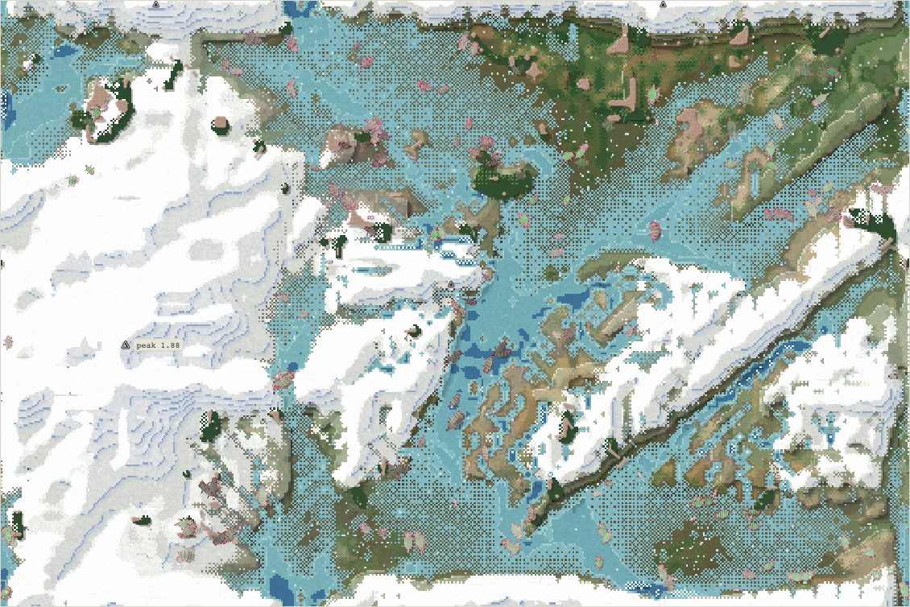
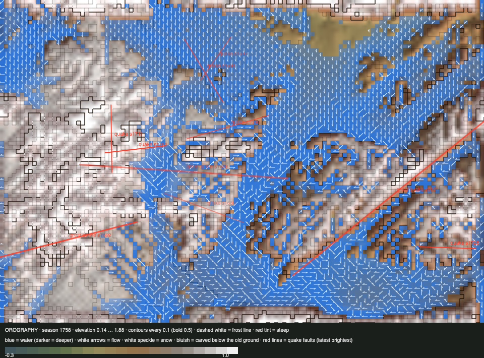

# World status — season 1757 (Oct 17, 21:10)

**Window:** the last 38 seasons (s1719 → s1757). Previous status report: [season 1719](2026-10-17_s1719.md). **The sloppy reshaping of the map's edges is complete** (s1702 → s1750).

## 0. The world at this moment

**The wettest moment in a long time:** 4,561 wet cells, and snow on 3,567 cells across the dome and the heights. The herds keep to the north-east (141 lowland bodies) and the south-east (58).

## 0b. The land (orography X-ray)

*Elevation 0.14 … 1.88.*

- **The edges are done.**
  - The mean height step across the left/right edge fell **0.30 → 0.17**. What's left is mostly the seam river's own bed and old carving.
  - The top/bottom step fell **0.14 → 0.09**, once the dome's unwrapped angle term was found and the tectonic step eased (s1721).
  - The viewer session confirms, at 2.5× zoom: *"both edges now look natural. There's no ruler line: the snowfield edge is ragged, and the wall continues across the north–south edge with the seam river cutting through it."*
- **The summit** stands at 1.88. Crags cover 2,789 cells.
- **Small quakes** struck at s1728 (mountains) and s1752 (lowlands).
- **Reef and thicket are still wearing away:** reef 452 → **242** cells; dense thicket about **570** cells, against ~2,000 before the upheaval.

## 1. In one paragraph
**A quiet window for species, a finished one for the land.**
- **One birth, one death:** the rathulis (s1733, a faintest-seam divide along *toxin*: 44 less toxic vs 49 more toxic) and the venmolis (s1720, starved). That leaves **four grazing species**, 96% grazers.
- **Bodies keep growing** (5.70 → 6.50), and legs and guts lengthen. The orgalkes now carry gut 0.12 and **1,646 kills**: young caught, nearly nothing eaten.
- **Toxin is falling for the first time on record:** 0.53 → 0.49 (−0.40 SD), and the starved carried more of it (+0.53 SD). With predation lower and toxin still filling from simply standing in thicket, its upkeep is now selected against. Roadmap **step 1c** will make it a diet choice.
- **Starvation is the main killer** (59%). Predation 33%.

## 2. Then and now

| | s1719 | s1757 (now) |
|---|---|---|
| Bodies / species | 238 / 4 | 228 / 4 |
| Ways of life | 204 grazers, 31 mixed, 2 browsers, 1 omnivore | **220 grazers**, 5 mixed, 2 decomposers, 1 omnivore |
| Size / legs / gut / toxin | 5.70 / 0.73 / 0.063 / 0.53 | **6.50 / 0.83 / 0.084 / 0.49** |
| Edge steps (left/right, top/bottom) | 0.23 / 0.14 | **0.17 / 0.09** |
| Reef / thicket (dense) | 452 / ~1,000 | **242 / ~570** |
| Deaths: predation / starvation / old age | 38% / 54% / 8% | 33% / **59%** / 8% |

## 2b. Species alive at this report (s1757)

| Species | Bodies | Since | Size | Gut | Toxin | Kills | Standing |
|---|---|---|---|---|---|---|---|
| **orgalkes** | 110 | s1672 | 6.1 | **0.12** | **0.42** | **1,646** | the oldest line now (85 seasons); the least toxic and the most meat-leaning |
| rathulis | 52 | s1733 | **7.3** | 0.03 | 0.50 | 155 | the "less toxic" half of the toxin divide, and the largest |
| namobels | 37 | s1708 | 6.9 | 0.05 | **0.63** | 483 | the most toxic |
| mozuvens | 29 | s1703 | 6.0 | 0.07 | 0.57 | 961 | the "more toxic" remainder |

## 3. What happened in the world (s1719 → s1757)
- **Birth:** rathulis (s1733, faintest-seam divide of the mozuvens, split along toxin).
- **Extinction:** venmolis (s1720, starved, 15 seasons).
- **Quakes:** small, s1728 and s1752.
- **The sloppy reshaping** ran s1702 → s1750.
- **Weather:** dry around s1745, very wet now.

## 4. What we changed (s1719 → s1757)
| When | Change |
|---|---|
| s1721 | **Top/bottom edge fixed:** the upheaval's dome used an unwrapped angle, so it lifted the two sides differently. The angle is corrected, and the tectonic step across both edges was eased onto a 12-cell ramp during the sloppy window |
| s1725–26 | The viewer's barrier X-ray scale (0.15–0.70, the world's real range) |
| s1702–50 | **The sloppy edges** completed (see 0b) |

## 5. How it shows in the creatures
- **Toxin's cost is starting to show** now that predation is lower. Two divides in a row have split along toxin (namobels "less toxic" at s1708, rathulis at s1733), so toxin is a trait the family sorts on.
- **Size and legs keep rising** (+0.82, +0.61 SD). The small and short-legged are eaten (juvenile hunting) and starve.
- **The orgalkes edge toward meat** (gut 0.12, 1,646 kills), but kills still give almost nothing. **Step 2** is next.

## 5b. Diets

| Species | Bodies | grass | browse | dung | carrion | flesh | host |
|---|---|---|---|---|---|---|---|
| orgalkes | 110 | 85% | 7% | 7% | 1% | 0% | 0% |
| rathulis | 52 | 89% | 3% | 8% | 0% | 0% | 0% |
| namobels | 37 | 92% | 1% | 7% | 0% | 0% | 0% |
| mozuvens | 29 | 86% | 6% | 8% | 0% | 0% | 0% |
| **family** | 228 | **87%** | **5%** | **7%** | **0%** | **0%** | **0%** |

**Ways of life across the reports:**

| Report | Ways of life |
|---|---|
| s1645 | grazer 119, mixed 75, browser 38, scavenger 5, decomposer 1, omnivore 1 |
| s1683 | grazer 138, mixed 87, browser 6, decomposer 3, scavenger 3, omnivore 2 |
| s1719 | grazer 204, mixed 31, browser 2, omnivore 1 |
| **s1757** | **grazer 220**, mixed 5, decomposer 2, omnivore 1 |

**What drove it:** the thicket keeps shrinking (about 570 dense cells), so browsing and mixed feeding all but vanished. The wet grassland pays best. Kills feed no one yet, and dung (honest) is a 7% side food everywhere.

## 6. Backlog
**Next (the roadmap):** **steps 1b + 1c + 2**: the carrion cap, toxin from what is eaten, kill leftovers to carcasses. Built by Sonnet, now that the land is settled. Then 3, the proposal for 4, then 4–7. After that: the climbing ramp, aquatic and highland ways of life, the gut valley, room by niche.

**For Luis:** **the reef and thicket** keep wearing away. Accept it, or slow the water's wear on the reef and help the hedge regrow? Also open: personal space; the ice pass; the top water pull. *Later:* a body-made toxin, slower-fading colour avoidance.

## 7. Risks
- **Four species, all grazers, one stem.** Diversity of kind is at a low. The roadmap steps are what open other roles.
- **The thicket's loss** removes browsing, and it was where toxin came from.
- **Server: stable.** 0 errors, memory 216–227 MB.

## 8. Next to watch
- **Steps 1b + 1c + 2:** does carrion become food, do the orgalkes' kills start to feed them, and does toxin sort by diet?
- **Toxin's fall:** does it continue?
- **Reef and thicket.**

## 8b. Diversity

| Measure | s1719 → s1757 (38 seasons) |
|---|---|
| Species alive (mean / min–max) | 3.7 / 3–4 |
| New species / extinctions (per 30 seasons) | 1 / 1 (0.8 / 0.8) |
| Born by | drift split 1 (founders median 44); the faintest-seam divide counts as a drift split here |
| Died by | starving 1 (lived median 15 seasons) |
| Share of deaths by predation / starvation / old age | 33% / 59% / 8% |

## 9. What shapes the species

**How to read this:** the selection ledger compares the traits of everyone who **bred** (5,270) or **died** in the window with the living, in units of how much each trait varies. The deaths were from old age (416), starvation (3,102) and being eaten (1,762). **Toxin is in the ledger for the first time.**

| Trait | Living shift | Breeders | Starved | Eaten | Reading |
|---|---|---|---|---|---|
| **Fat** | +0.17 | +0.37 | **−1.24** | −0.79 | The lean starve. |
| **Size** | +0.82 | −0.55 | −0.48 | **−0.74** | Bigger again: the small are eaten. |
| **Browse** | +0.78 | −0.36 | **−0.53** | −0.27 | Browsing ability rises, though the hedge to use it on shrinks. |
| Legs | +0.61 | −0.18 | −0.22 | −0.22 | Longer. |
| **Toxin** | **−0.40** | +0.44 | **+0.53** | +0.36 | **Falling:** the starved carried more. Its upkeep now outweighs its protection. |
| Gut | +0.31 | −0.34 | −0.43 | −0.13 | Edging up (the orgalkes). |

**Which rules and conditions drove the changes**
1. **Starvation** (59%): fat, plus toxin's upkeep.
2. **Predation of the young:** size and legs.
3. **The shrinking thicket:** browsing gone as a way of life.
