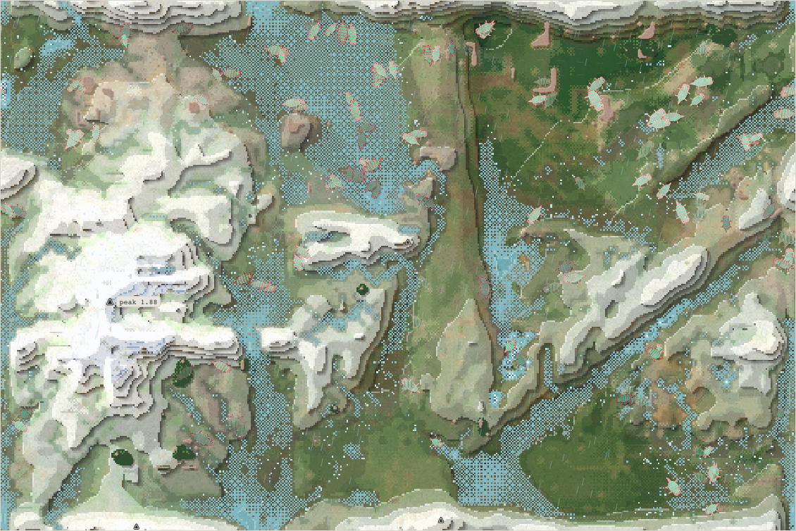
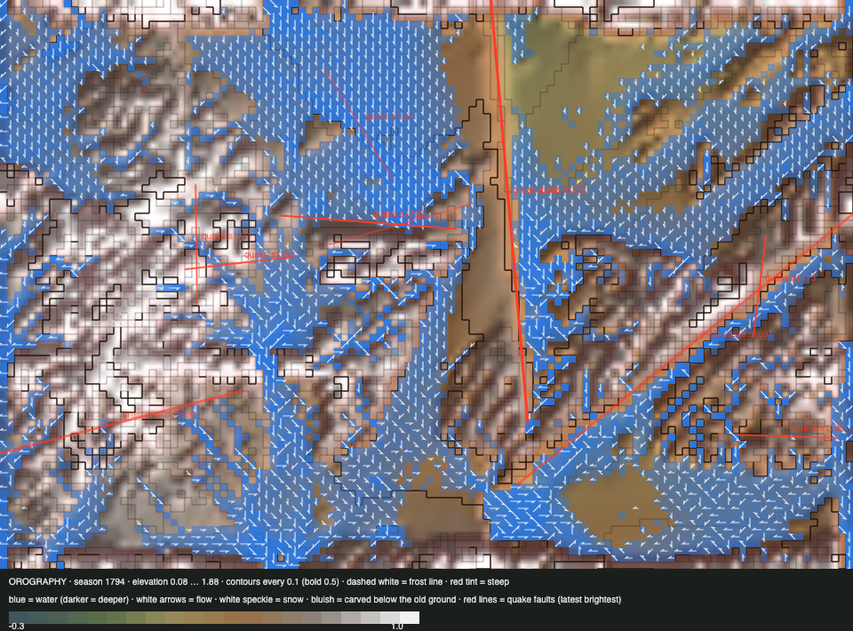

# World status — season 1794 (Oct 17, 23:15)

**Window:** the last 37 seasons (s1757 → s1794). Previous status report: [season 1757](2026-10-17_s1757.md). **Roadmap steps 1b + 1c + 2 went live at s1766** (the carcass made honest: carrion capped at the bite, toxin from shoots eaten, a meal limit with leftovers staying on the carcass).

## 0. The world at this moment

**Green and wet (4,160 wet cells) and suddenly empty:** **120 bodies** in 3 species, after a wave of predation in s1791–93.

## 0b. The land (orography X-ray)

*Elevation 0.08 … 1.88.*

- **A great earthquake** struck the lowlands at s1791 (0.16, a 506 px fault), with small ones at s1773 and s1790.
- **Reef 184 cells (1.9%) and thicket ~270:** both are almost gone.

## 1. In one paragraph
**The meat side opened, then the predators ate the world down.**
- **It began as hoped.** After step 2, carcasses carried kills' leftovers. Meat-leaning guts paid, and **the orgalkes became omnivores** (s1781, the first meat-eating species label of the era). The namobels boomed and the great divide split them four times (s1775–84; 52–87 founders each).
- **Then, within about two seasons (s1791–93), five species were eaten out:** orgalkes, namobels, thuvenushs, rathulis and naventys. Galordros and mozuvens had gone the same way earlier in the window. **Predation is 68% of deaths** (5,775 eaten).
- **The survivors are an arms race:** size **8.75** (+2.54 SD), legs **1.0** (+2.14), gape **0.87** (+2.96), toxin **0.62** (+2.47).
- **In the ledger's season:** 102 kills from 120 bodies. Prey are now big meals (~2.7 each), but only 8% of a kill reaches the hunter as flesh. Most goes to carcasses and carrion, or is lost to digestion.

## 2. Then and now

| | s1757 | s1794 (now) |
|---|---|---|
| Bodies / species | 228 / 4 | **120 / 3** |
| Ways of life | 220 grazers, 5 mixed, 2 decomposers, 1 omnivore | 117 grazers, 3 decomposers (omnivore labels came and went) |
| Size / legs / gape / toxin | 6.50 / 0.83 / 0.79 / 0.49 | **8.75 / 1.00 / 0.87 / 0.62** |
| Deaths: predation / starvation / old age | 33% / 59% / 8% | **68%** / 30% / 2% |
| Energy income (ledger) | plant 75% · shoots 16% · dung 8% · carrion 1% · flesh 0.2% (s1693) | plant 86% · dung 12% · carrion 1.2% · shoots 0.9% · flesh 0.4% |

## 2b. Species alive at this report (s1794)

| Species | Bodies | Since | Size | Gut | Toxin | Kills | Where |
|---|---|---|---|---|---|---|---|
| zuraquis | 64 | s1792 | 8.9 | 0.12 | 0.60 | 227 | NE |
| venthudros | 38 | s1792 | 8.9 | 0.10 | 0.63 | 70 | NE |
| ushlinas | 18 | s1775 | 9.0 | 0.09 | 0.65 | **869** | **SE** |

## 3. What happened in the world (s1757 → s1794)
- **Great divides:** five of the namobels (ushlinas, galordros, naventys, thuvenushs, and one more), plus faintest-seam splits of the ushlinas and zuraquis (s1791–92).
- **Omnivore labels:** orgalkes (s1781, again at s1791) and thuvenushs (s1783).
- **Extinctions (7):** mozuvens (s1776, eaten, 73 seasons), galordros (starved), **rathulis** (s1791, eaten), naventys (s1791, starved), **orgalkes** (s1791, eaten, 120 seasons), **thuvenushs** (s1792, eaten), **namobels** (s1792, eaten, 85).
- **Quakes:** a great one at s1791 in the lowlands; small ones at s1773 and s1790.

## 4. What we changed (s1757 → s1794)
| When | Change |
|---|---|
| s1759 | Commit `d99d4e8` (the viewer's work, at its request) |
| **s1766** | **Roadmap steps 1b + 1c + 2** (Sonnet-built, reviewed). Carrion yields at most the bite; toxin only from shoots eaten; each diner takes at most a meal, and leftovers stay on the carcass. Headless: carrion ×2.4, conservation exact, population steady |

## 5. How it shows in the creatures
- **Step 2 worked as designed:** meat became worth something. Carrion reached 5% of the family's diet and 11% of the orgalkes', and omnivores appeared.
- **Then the predation of the young ran away.** The eaten were the small, short-legged and narrow-mouthed (−1.71, −0.66, −1.61 SD), so every survivor is bigger, longer-legged and wider-mouthed. That makes them better at catching the others' young. The loop: bigger predators, more young eaten, bigger survivors.
- **Toxin came back up** (0.49 → 0.62) after its fall: with predation this heavy, it pays again.
- **What's still missing is a brake on predators.** Today a kill only blocks *further kills* for the handling time, and a jawed grazer loses nothing by also hunting the young. Nature's brakes are the cost of being a predator (fewer young, slower lives, the gut valley) and prey refuges (thicket, gone now; reef, almost gone).

## 5b. Diets

| Species | Bodies | grass | browse | dung | carrion | flesh | host |
|---|---|---|---|---|---|---|---|
| zuraquis | 64 | 87% | 1% | 12% | 1% | 0% | 0% |
| venthudros | 38 | 84% | 1% | 14% | 1% | 0% | 0% |
| ushlinas | 18 | 83% | 0% | 14% | 2% | 1% | 0% |
| **family** | 120 | **85%** | **1%** | **13%** | **1%** | **0%** | **0%** |

**What drove it:** the meat-leaning lines (orgalkes, thuvenushs) were themselves eaten out, so the survivors are grazers that kill young incidentally rather than eat them. **Dung rose to 13%:** with fewer, bigger grazers, more is left undigested per bite. **The thicket is gone** (browse 1%).

## 6. Backlog
**For Luis, now:** see section 7. Roadmap step 3 (decomposers on carcasses) waits until the family is stable again.

**Then:** the proposal for step 4 (bodies hold what they cost), steps 5–7; the climbing ramp, aquatic and highland ways of life, the gut valley, room by niche. The reef and thicket's decline.

## 7. Risks
- **A predation collapse is under way:** 120 bodies, 3 species, 102 kills in the last ledger season, and bodies' total energy falling (635 → 412). The leaner-grass brake is at 100 bodies, and there are **no rescues** under Luis's rules.
- **The options are Luis's call:**
  - **(a) Let it run:** the world has recovered from ~100 before. Prey may now be too big and toxic for the remaining hunters, and the system may settle.
  - **(b) Add a predator's cost:** a hunting or jaws upkeep, or fewer young for meat-leaning guts. The missing brake.
  - **(c) Refuges:** let the thicket regrow, so the young have cover.
  - **(d) Pause the meal-limit rule** (carcass2) while the family recovers.

  The steward's recommendation is **(a) with close watching, then (b)** as a designed rule, not a rescue.
- **Server: stable.** 0 errors.

## 8. Next to watch
- **Bodies per check-in:** whether the fall stops above 100.
- **Kills per season and prey size.**
- **Whether toxin and size make the survivors too costly to hunt.**

## 8b. Diversity

| Measure | s1757 → s1794 (37 seasons) |
|---|---|
| Species alive (mean / min–max) | 4.7 / 3–7 |
| New species / extinctions (per 30 seasons) | 6 / 7 (4.9 / 5.7) |
| Born by | great divide 4 (founders median 63) · drift split 2 (founders median 46) |
| Died by | eaten 5 (lived median 73 seasons) · starving 2 (lived median 11) |
| Lifetime of species that died (median) | 59 seasons |
| Share of deaths by predation / starvation / old age | **68%** / 30% / 2% |

## 9. What shapes the species

**How to read this:** the selection ledger compares the traits of everyone who **bred** (8,333) or **died** in the window with the living, in units of how much each trait varies. The deaths were from old age (155), starvation (2,511) and being eaten (5,775). The living shifted so far that every group sits behind them, so read the living shift.

| Trait | Living shift | Starved | Eaten | Reading |
|---|---|---|---|---|
| **Gape** | **+2.96** | −1.30 | −1.61 | Wide mouths: both to catch and to survive. |
| **Size** | **+2.54** | −1.36 | −1.71 | The small are eaten. |
| **Toxin** | **+2.47** | −1.06 | −1.19 | The less toxic are eaten; toxin pays again. |
| **Legs** | **+2.14** | −0.60 | −0.66 | Escape. |
| **Fat** | +1.78 | **−2.97** | −2.24 | The lean starve. |
| Gut | +0.32 | −0.21 | +0.02 | Edging up. |

**Which rules and conditions drove the changes**
1. **Step 2 (s1766):** meat worth eating. Omnivores appeared, then predation of the young ran away.
2. **No predator's cost:** hunting is free for a jawed grazer.
3. **No refuges:** thicket and reef almost gone.
4. **The great divide:** the booming namobels split into many, and most of the pieces were eaten.
