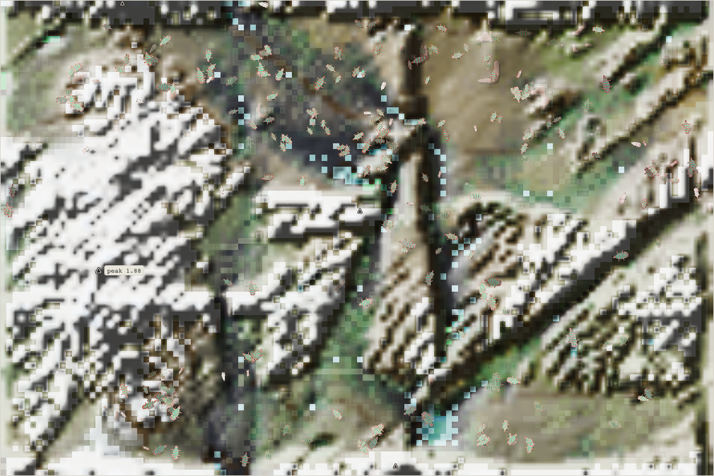
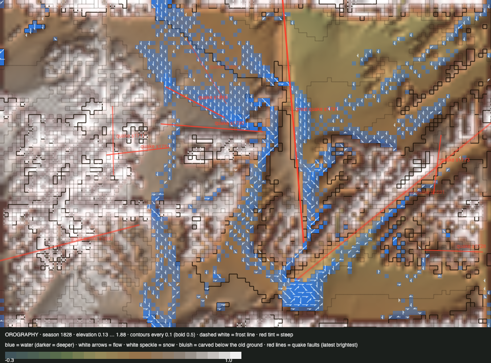

# World status — season 1827 (Oct 18, 01:30)

**Window:** the last 33 seasons (s1794 → s1827). Previous status report: [season 1794](2026-10-17_s1794.md). The predation collapse stopped at 120 bodies and the world refilled to 240, but **predation still decides who lives:** eleven species were born and ten eaten or starved out in 33 seasons. **Trees (roadmap step 3a, with fire) are built and tested, not yet live.**

## 0. The world at this moment

**Full again:** 238 bodies, crowding the river valleys and the lowland grass between the snowfields.

## 0b. The land (orography X-ray)

*Elevation 0.13 … 1.88.*

- **Drier than at s1794:** 1,419 wet cells, against 4,160. The great river and the southern lake hold most of the water.
- **One small quake** (s1817, lowlands, 0.03).
- **Reef 133 cells (1.4%), thicket ~250.** Both are still falling, since nothing in today's rules regrows them.

## 1. In one paragraph
**The world refilled, but it became a hunting ground for one species.**
- **The quilikes** (s1797, a great divide of the zuraquis) became omnivores within three seasons. They now hold half the world (123) and have **2,946 kills**.
- **Almost every new species is a slice of the quilikes, and the quilikes eat it.**
  - The quilikes were cut by the great divide **eight times** (s1808–26). The chronicle labels the split-off piece "less toxic" and the like, but **a probe (s1828) shows the pieces differ in body no more than random halves do: they differ by place** (see 5).
  - Each piece then became a species with 40–55 founders and was eaten out within 1–9 seasons: zuushbels, quisafis, orliors, droquiors, zutyzus.
  - Every such species lost to predation lived **a median of 5 seasons**.
- **The arms race reversed.** Inherited size fell from **8.75 to 5.69** (−3.4 SD), fat halved and toxin fell. Bodies are smaller and leaner, and legs, armour and browsing ability are up.
- **Predation is 72% of deaths** (5,983 eaten, against 2,205 starved and 149 of old age).

## 2. Then and now

| | s1794 | s1827 (now) |
|---|---|---|
| Bodies / species | 120 / 3 | **238 / 4** |
| Ways of life | 117 grazers, 3 decomposers | grazers; **omnivore labels on eight species** in the window (quilikes, ketyoms, zuraquis, lidronas, droquiors, zutyzus, zuushbels, libelnas) |
| Size (inherited) / legs / gape / toxin / fat | 8.75 / 1.00 / 0.87 / 0.62 / 1.76 | **5.69 / 1.14 / 0.85 / 0.53 / 0.67** |
| Armour / climb / swim | 0.55 / — / — | 0.60 / 0.31 / 0.15 |
| Deaths: predation / starvation / old age | 68% / 30% / 2% | **72%** / 26% / 2% |
| Wet cells / reef / thicket | 4,160 / 184 / ~270 | 1,419 / 133 / ~250 |

## 2b. Species alive at this report (s1827)

| Species | Bodies | Since | Size | Gut | Kills | Standing |
|---|---|---|---|---|---|---|
| **quilikes** | 123 | s1797 | 5.5 | **0.17** | **2,946** | the hunters of the age; parent of eight divides |
| venthudros | 85 | s1792 | 6.3 | 0.03 | 259 | the oldest line now (35 seasons); pure grazers, the most toxic and shelled |
| libelnas | 29 | s1826 | 6.1 | 0.18 | 86 | the newest quilike piece; omnivore label at once |
| sakeoms | 1 | s1825 | 7.3 | 0.24 | 79 | a lone scavenger (carrion 31% of its diet) |

## 3. What happened in the world (s1794 → s1827)
- **Births (11):** omushushs (s1795), quilikes (s1797), ketyoms (s1798), lidronas (s1808), zutyzus, quisafis, zuushbels (s1817), orliors, droquiors (s1821), sakeoms (s1825), libelnas (s1826). All of them come from the great divide, nine of them of the quilike line, with 40–58 founders each.
- **Extinctions (10):**
  - ushlinas (s1803, starved, 28 seasons; the great hunters of the collapse);
  - eaten: ketyoms (11), zuraquis (18), omushushs (16), lidronas (3), quisafis (5), orliors (1), droquiors (3), zuushbels (9), zutyzus (2).
- **Quake:** small, lowlands, s1817.
- **Weather:** the wet era ended; now drier.

## 4. What we changed (s1794 → s1827)

| When | Change |
|---|---|
| s1803 | Luis answered the trees-and-insects proposal ([proposal](2026-10-17_s1794-trees-insects-proposal.md), section 6). Fire was added at his request, with animals that flee it and can be burnt |
| s1803–20 | **Roadmap step 3a built** by Sonnet behind `rollout.trees`: three tree kinds by rock (fruit, nut, conifer), succession from thicket, seeds in fruit-eaters' dung, cover as thicket, shade, roots, breakage by floods, fire in drought; fruit, nuts and cones; the bite gene. Headless: 0 errors, 0 trees on wrong ground, 0.14 ms/tick. **Not live:** the world restart to switch it on was refused by the session's permission check, so it waits for Luis |

There were no changes to the live world in this window.

## 5. How it shows in the creatures
- **The divide feeds the hunters, and it splits by place, not by kind.** A probe on a copy of the world (s1828) ran the divide 40 times on the quilikes and compared the two pieces with random halves of the same species. Across all traits, the pieces differ by **0.20 SD**, against **0.19** for random halves. The biggest single gap is 0.36 against 0.36. Only their centres differ: **182 px apart**, against 20 for random halves. So the labels ("less toxic", "like the rest") are noise above the 0.3 SD naming bar. The new species are the same body in a neighbouring place, made unable to breed with its parent, and the parent, a hunter, eats them. Real difference only comes with time: the venthudros (divided at s1792) now differ from the quilikes by 1.57 SD, with gut −3.1 and armour +2.3.
- **Why size fell:** in this window **the big were eaten** (+1.56 SD among the eaten) and the bred were bigger too, yet the living are small. After the collapse, the population regrew from fast-breeding small lines, and hunting now takes adults as well as young. *Reading, not proven.*
- **Fat fell hardest** among the starved (−1.45 SD). The drier land is leaner.
- **Legs and armour rose,** escape and shell, while toxin fell. The toxin is paid for in shoots.

## 5b. Diets

| Species | Bodies | grass | browse | dung | carrion | flesh | host |
|---|---|---|---|---|---|---|---|
| quilikes | 109 | 78% | 2% | 14% | 4% | 1% | 0% |
| venthudros | 102 | 85% | 2% | 13% | 0% | 0% | 0% |
| libelnas | 26 | 75% | 2% | 15% | 6% | 1% | 0% |
| sakeoms | 1 | 47% | 0% | 15% | **31%** | 7% | 0% |
| **family** | 238 | **81%** | **2%** | **14%** | **3%** | **1%** | **0%** |

**What drove it:**
- **Meat finally shows** (carrion 3%, flesh 1%; it was 1% and 0%). That's the quilike line's kills landing as carcasses (step 2) and being eaten.
- **Dung holds at 14%.**
- **Browse is still ~2%:** the thicket is gone, and trees aren't live yet.

## 6. Backlog
- **For Luis, now:**
  - **switch on trees** (step 3a). The command is in the steward's last message, or allow the restart in the permission settings;
  - **whether the great divide should keep making species that differ only by place.** Options: require a real trait gap between the pieces (for example ≥ 0.5 SD beyond random halves), or let pieces stay one species until they drift apart, so that naming follows difference. *This is a design question, not a rescue.*
- **Then:** step 3b (flowers, insects, decomposers on carcasses, insect-eaters), the viewer's drawing of trees and fire, the step 4 proposal, the climbing ramp, and the ways of life left from roadmap v2.

## 7. Risks
- **One species is everyone's predator.** If the quilikes overshoot, the world could fall back toward ~120 again.
- **The venthudros are the only non-quilike line.** They hold because they are toxic and shelled (115 of 123 were "toxic & shelled" at s1811).
- **Server: stable,** with 0 errors. The trees code is on disk but not loaded by the running server.

## 8. Next to watch
- **Whether the quilikes' kills keep rising** and the divide pieces keep dying in 1–9 seasons.
- **The venthudros' toxin and shell.**
- **Once trees are live:** the first saplings (5–10 seasons), and whether the young survive more.

## 8b. Diversity

| Measure | s1794 → s1827 (33 seasons) |
|---|---|
| Species alive (mean / min–max) | 4.3 / 2–6 |
| New species / extinctions (per 30 seasons) | **11 / 10 (10.0 / 9.1)**, the fastest turnover in many reports |
| Born by | great divide 9 (founders median 50) · drift split 2 (founders median 41) |
| Died by | eaten 9 (lived median **5 seasons**) · starving 1 (lived 28) |
| Lifetime of species that died (median) | 9 seasons |
| Share of deaths by predation / starvation / old age | **72%** / 26% / 2% |

*The whole era (s700+), founding size → lifetime:* under 20 founders: 46 species, median 14 seasons · 20–39: 70, median 16 · 40–79: 54, median 18 · 80+: 6, median 11. **Large founding groups no longer protect a species when its neighbour hunts it.**

## 9. What shapes the species

**How to read this:** the selection ledger compares the traits of everyone who **bred** (8,458) or **died** in the window with the living, in units of how much each trait varies among the living. The deaths were from old age (149), starvation (2,205) and being eaten (5,983). *Living shift* is the change of the living since s1794, in s1794's units.

| Trait | Living shift | Bred | Starved | Eaten | Reading |
|---|---|---|---|---|---|
| **Size** | **−3.41** | +1.67 | +2.00 | +1.56 | The giants of the collapse are gone. The dead and the parents were bigger than today's living, so the small lines took over. |
| **Fat** | −1.84 | +0.85 | **−1.45** | −0.28 | The lean starve, on drier land. |
| **Toxin** | −1.68 | +0.41 | +0.46 | +0.42 | Falling. The living carry less than the dead. |
| **Legs** | +1.67 | −0.50 | −0.63 | −0.54 | The short-legged die: escape. |
| **Browse** | +1.57 | −0.97 | −0.90 | −1.01 | Browsing ability rises, with almost nothing to browse. |
| **Armour** | +1.13 | −0.34 | −0.37 | −0.37 | Shells pay against the quilikes. |
| Gape | −0.80 | +0.19 | +0.14 | +0.19 | Slightly narrower. |
| Gut | +0.16 | −0.23 | −0.24 | −0.20 | Steady. The meat-leaning quilikes hold it up. |

**Which rules and conditions drove the changes**
1. **The great divide** keeps naming new species that are bodily the same as their hunting parent, only living some 180 px away.
2. **Step 2 (kill leftovers to carcasses):** meat pays, so a hunting grazer line (the quilikes) thrives.
3. **No refuges:** thicket and reef keep shrinking. Trees are built for this but aren't live yet.
4. **A drier era:** fat is selected hard.
