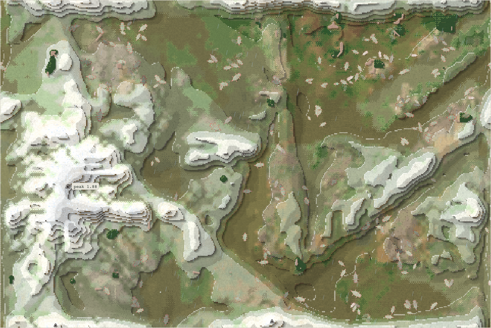
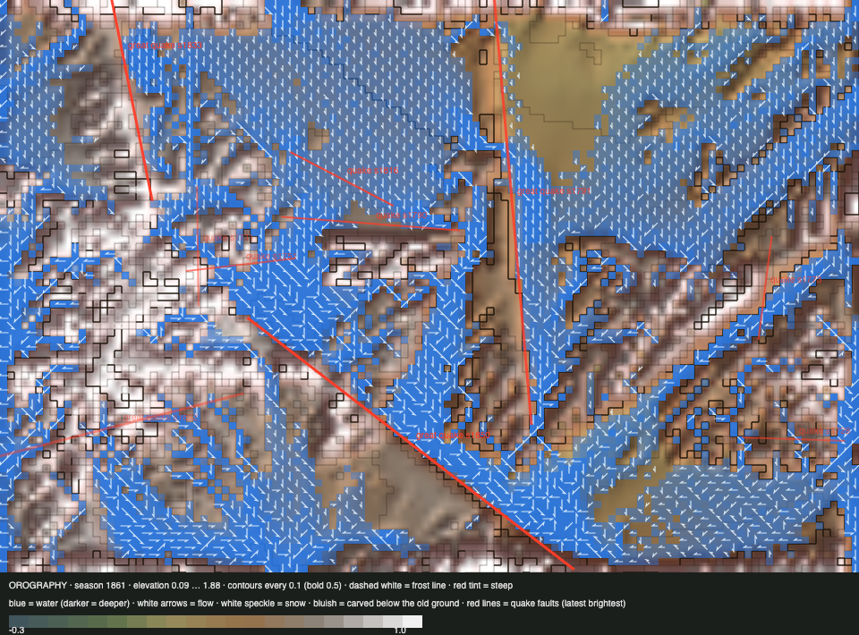

# World status — season 1861 (Oct 18, 04:50)

**Window:** the last 34 seasons (s1827 → s1861). Previous status report: [season 1827](2026-10-18_s1827.md). **Two of Luis's rule changes went live:** trees (s1838) and the speciation rework (s1847: the great divide ended, and new species need a real body difference). **The world now holds a single species,** the quilikes.

## 0. The world at this moment

**One kind of body everywhere:** 240 quilikes spread over the north-east, the river valleys and the south-east. The dark green patches are the first saplings and remaining thicket, drawn by the viewer's new tree layer.

## 0b. The land (orography X-ray)

*Elevation 0.09 … 1.88.*

- **Wet again:** 4,768 wet cells, against 1,419 at s1827.
- **Two great earthquakes:** s1832 in the lowlands (0.18, a 336 px fault) and s1850 in the mountains (0.19, 461 px).
- **Reef 98 cells (1.0%), thicket ~290.**

## 1. In one paragraph
**The quilikes ate everyone else, and now they are alone.**
- In the old rules' last seasons, the great divide cut the quilikes **six more times** (s1830–45). As the probe showed, each piece was the same body in a neighbouring place. Every piece was eaten or faded within 1–10 seasons.
- **Under the new rules (s1847), no new species has been born.** The great divide no longer runs, and no group's body has stood far enough apart to pass the test.
- **The venthudros**, the oldest line (61 seasons; toxic and shelled, pure grazers), were eaten from 93 to 0 in ten seasons. They died out at s1853, followed by the last pieces (zuushzus, venushquis).
- **Since s1853, one species: 240 quilikes.** A species doesn't eat its own kind unless starving, so predation has nearly stopped. Food and room now decide everything.

## 2. Then and now

| | s1827 | s1861 (now) |
|---|---|---|
| Bodies / species | 238 / 4 | **240 / 1** |
| Ways of life | grazers; omnivore labels came and went | 222 grazers, **16 decomposers** |
| Size (inherited) / legs / toxin / fat | 5.69 / 1.14 / 0.53 / 0.67 | **5.53 / 1.09 / 0.52 / 0.67** |
| Gut / climb / swim / bite | 0.12 / 0.31 / 0.15 / — | **0.15 / 0.22 / 0.09 / 0.02** |
| Trees (sapling cells / mature) | — | 6 / 0 (peak 23) |
| Wet cells / reef / thicket | 1,419 / 133 / ~250 | **4,768** / 98 / ~290 |

## 2b. Species alive at this report (s1861)

| Species | Bodies | Since | Size | Gut | Kills | Standing |
|---|---|---|---|---|---|---|
| **quilikes** | 240 | s1797 | 5.5 | 0.15 | **5,631** | alone since s1853 (64 seasons old); their kills are now mostly history |

## 3. What happened in the world (s1827 → s1861)
- **Births (7), all under the old rules:**
  - mothuzus (s1830, a drift split, 65 founders);
  - belbelgals (s1832);
  - zubelkes (s1833);
  - belliquis (s1838);
  - venushquis (s1840);
  - thuombels (s1844);
  - zuushzus (s1845, the only piece cut from the venthudros).

  All but the first came from the great divide (43–70 founders).
- **Births under the new rules (s1847–61): none.**
- **Extinctions (10):**
  - eaten: libelnas, mothuzus, zubelkes, belbelgals, thuombels, zuushzus, and **venthudros (s1853, 61 seasons)**;
  - faded (the last one died of age): sakeoms, belliquis, venushquis.
- **Quakes:** great quakes at s1832 (lowlands) and s1850 (mountains).
- **No fires:** too few trees.

## 4. What we changed (s1827 → s1861)

| When | Change |
|---|---|
| s1828 | **Probe of the great divide** (Luis's hypothesis: "just renaming"). On a copy of the world, the divide's pieces differed in body by 0.20 SD, the same as random halves (0.19), but sat 182 px apart, against 20. Confirmed: the divide split by place, not by kind |
| **s1838** | **Trees live** (roadmap step 3a, Luis): fruit, nut and conifer by rock and climate; succession from thicket; seeds in dung; cover like thicket; shade; roots; floods break trees; fire in drought (bodies flee it and can be burnt); fruit, nuts and cones; the bite gene |
| **s1847** | **Speciation rework live** (Luis, s1829: "fewer species is not bad in itself; we want species that are really different, not just renamed"): the great divide is off. Every split (niche, drift, mind) needs a body difference beyond chance (+0.5 SD over random splits), 15–40 founders gathered close, and **one season of grace**: kin species can interbreed and don't hunt each other unless starving. A group under 15 at the end blends back |
| s1846 | Commit `354b88d` (steward files, matching the live code); s1851 commit `0659a19` (the viewer, at its request: trees, fire, creatures for every way of life) |
| s1846– | **River build** (Luis, s1837): a wider seam river, swim-deep when full, spring-fed through droughts. Being built and tested headless, not live |

## 5. How it shows in the creatures
- **A monoculture is the first effect of the new rules, as expected.** Ending the divide removed the old brake on a dominant species. The quilikes, the hunters of the last window, ate the last other line.
- **Predation has nearly ended.** Since s1853 the only kills are starving bodies eating their own kind (about 200 in eight seasons). The young are no longer hunted.
- **Decomposing is coming back** (16 decomposers by recent diet, decomp gene 0.20). With no other species, dung is a niche worth splitting into, if the bodies diverge.
- **Trees are struggling.** Saplings reached 23 cells and fell back to 6, and the fruit and nut saplings died. The drought (s1827–45) and browsing hit them. The wet era now may help.

## 5b. Diets

| Species | Bodies | grass | browse | dung | carrion | flesh | host |
|---|---|---|---|---|---|---|---|
| quilikes | 240 | 83% | 2% | 14% | 1% | 0% | 0% |
| **family** | 240 | **83%** | **2%** | **14%** | **1%** | **0%** | **0%** |

**Ways of life across the reports:**

| Report | Ways of life |
|---|---|
| s1757 | grazer 220, mixed 5, decomposer 2, omnivore 1 |
| s1794 | grazer 117, decomposer 3 |
| s1827 | grazers, with omnivore labels on eight species |
| **s1861** | **grazer 222, decomposer 16** |

**What drove it:** **flesh fell to 0%** because there's no one else to eat. Carrion is 1%, from the cannibalism of the starving and natural deaths. Grass and dung are everything.

## 6. Backlog
- **In progress:** the river (Luis, s1837).
- **Then, as Luis set the order:** finish the energy and food steps (3b: flowers, insects, decomposers on carcasses, insect-eaters; then the step 4 proposal), make sure trees work, and **then a cost of being a predator**.
- **Watch the new rules:** the first split that passes the body test, if one comes.

## 7. Risks
- **One species, one stem.** A single disease-like shock, a cold era or a drought could empty the world. There are no rescues by Luis's rule.
- **Speciation may stay rare.** In a population this uniform, a group needs to drift far in body before it counts. The likeliest routes are the 16 decomposers (if their bodies diverge) and the coming river (swimmers).
- **Trees:** the forest may not take hold before the next drought.
- **Server: stable,** with 0 errors since both rollouts.

## 8. Next to watch
- **The first species under the new rules:** which split, how different, and whether it survives its grace season.
- **Starvation** as the main killer now, and whether the quilikes overshoot the grass.
- **Saplings in the wet era,** and the first mature tree.
- **The river** once it is live: swimming, crossings.

## 8b. Diversity

| Measure | s1827 → s1861 (34 seasons) |
|---|---|
| Species alive (mean / min–max) | 3.0 / **1**–4 |
| New species / extinctions (per 30 seasons) | 7 / 10 (6.4 / 9.1); **0 born since the new rules (s1847)** |
| Born by | great divide 6 (founders median 58) · drift split 1 (65) |
| Died by | eaten 7 (lived median 6 seasons) · faded 3 (median 5) |
| Lifetime of species that died (median) | 6 seasons |

## 9. What shapes the species

**How to read this:** the selection ledger compares the traits of everyone who **bred** (13,973) or **died** with the living, in units of how much each trait varies among the living. The deaths were from old age (645), starvation (3,568) and being eaten (9,642). *No snapshot was taken at s1827, so this window is s1794 → s1861 (67 seasons).* Living shift is the change of the living since s1794, in s1794's units.

| Trait | Living shift | Bred | Starved | Eaten | Reading |
|---|---|---|---|---|---|
| **Size** | **−3.62** | +1.25 | +1.54 | +1.18 | The giants of s1794 are gone. Everyone who died or bred was bigger than today's living, so the small line (the quilikes) took the world. |
| **Toxin** | −1.96 | +0.41 | +0.44 | +0.44 | Falling. The toxic venthudros were eaten out anyway. |
| **Fat** | −1.85 | +0.89 | **−1.79** | −0.47 | The lean starve. |
| Browse | +1.47 | −0.29 | −0.29 | −0.29 | Rising, with almost nothing to browse yet. |
| Armour | +1.09 | −0.32 | −0.39 | −0.33 | Shells pay. |
| Legs | +1.02 | +0.18 | +0.04 | +0.19 | Longer. |
| Gut | +0.57 | −0.41 | −0.35 | **−0.44** | The plant-guts were eaten: the hunters' line won. |

**Which rules and conditions drove the changes**
1. **The great divide's last seasons:** it fed small near-copies to their hunting parent.
2. **The speciation rework (s1847):** with no divide to cut the dominant line, the hunters ate the last other line.
3. **Step 2 (meat that pays):** made the quilikes the hunters.
4. **A dry era, then a wet one:** fat selected hard, and trees held back.
