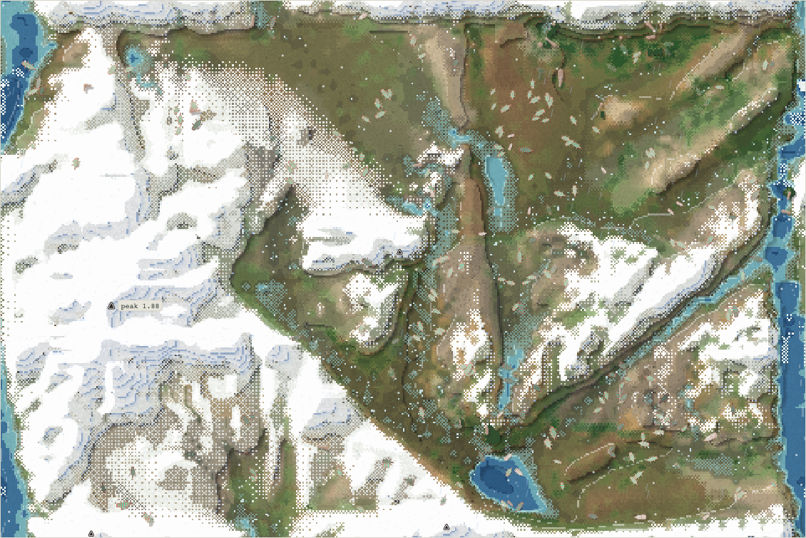
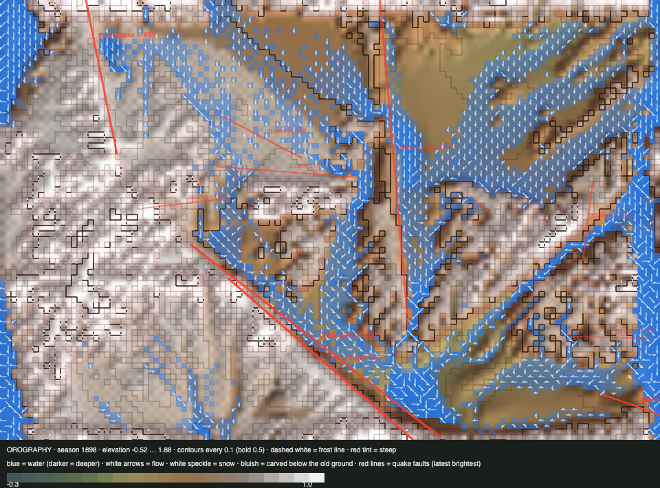

# World status — season 1897 (Oct 18, 06:50)

**Window:** the last 36 seasons (s1861 → s1897). Previous status report: [season 1861](2026-10-18_s1861.md). **The big river went live (s1862, reshaped by s1872).** The world is still one species. **A drought has set in** at the end of the window.

## 0. The world at this moment

**One species, 239 quilikes, in a drying world:** green cells fell from ~8,000 to 5,147, and plants from ~5,000 to 2,006.

## 0b. The land (orography X-ray)

*Elevation **−0.52** … 1.88. The new floor is the big river's bed.*

- **The big river is in place.** The seam river now runs as a broad blue band down both map edges, with gorges through the wall and the dome. In this drought it still carries water: 2,370 wet cells across the world, down from 4,768 at s1861.
- **Quakes:** a great one in the lowlands (s1871, 0.23, a 383 px fault), and a small one at s1893.
- **Reef 59 cells (0.6%), thicket 83:** the drought is taking the last of both.

## 1. In one paragraph
**A quiet, single-species window: the river made swimming pay for a while, then the drought came.**
- **Still only the quilikes.** No group has passed the new body test for a species since it went live (s1847). The 16 decomposers of s1861 fell back to 7.
- **The river did what Luis asked:**
  - 17% of cells became deeper than a typical body can wade (the viewer's measure, s1873);
  - falls at the steep banks rose (up to 1,177 a season), and bodies turned back more often;
  - **swimming started to pay:** bodies with swim above 0.2 went from 2 to 17 by s1888.
- **Then the drought cut it back.** By s1897 only 1 body has swim above 0.2 (mean 0.109). Lean bodies starve (fat −1.96 SD among the starved), and energy is at 0.74.
- **The trees haven't taken hold:** 18 saplings at the best, now 3. None has matured.
- **Deaths:** 1,609 starved, 1,389 eaten (starving bodies eating their own kind, the only predation left), 870 of old age.

## 2. Then and now

| | s1861 | s1897 (now) |
|---|---|---|
| Bodies / species | 240 / 1 | 239 / 1 |
| Ways of life | 222 grazers, 16 decomposers | 232 grazers, 7 decomposers |
| Size (inherited) / legs / toxin / fat | 5.53 / 1.09 / 0.52 / 0.67 | **4.86** / 1.13 / 0.55 / **0.42** |
| Gut / armour | 0.14 / 0.60 | 0.11 / 0.56 |
| Swim (mean / bodies > 0.2) / climb / bite | 0.09 / 2 / 0.22 / 0.02 | 0.11 / 1 (17 at s1888) / 0.27 / 0.03 |
| Plants / green cells / wet cells | ~4,600 / 6,143 / 4,768 | **2,006 / 5,147 / 2,370** |
| Trees (saplings / mature) | 6 / 0 | 3 / 0 (peak 18) |
| Reef / thicket | 98 / ~290 | 59 / 83 |
| Deaths: starved / eaten / old age | — | 1,609 / 1,389 / 870 |

## 2b. Species alive at this report (s1897)

| Species | Bodies | Since | Size | Gut | Kills | Standing |
|---|---|---|---|---|---|---|
| **quilikes** | 239 | s1797 | 5.1 | 0.12 | 6,965 | alone since s1853 (100 seasons old); gen ≤ 69 |

## 3. What happened in the world (s1861 → s1897)
- **Births:** none. **Extinctions:** none.
- **The big river** reshaped the seam river from s1862 to s1872.
- **Quakes:** great (s1871, lowlands, 0.23); small (s1893).
- **Weather:** wet to s1888, then a drought.
- **No fires:** the few saplings are too sparse to burn.

## 4. What we changed (s1861 → s1897)

| When | Change |
|---|---|
| **s1862** | **The big river** (Luis, s1837). The seam river widened and deepened over 10 seasons: a channel about 30–60 px wide that needs swimming when full, a wadeable floodplain on low ground, gorges through the wall and the dome, and 16 springs so it keeps flowing in droughts. Headless before going live: the swim-deep share went 0.10 → 0.52, with 0 dry rows in a forced drought. Built by a Sonnet subagent, reviewed by the steward |

No other changes. The trees and the speciation rework run as set at s1838 and s1847.

## 5. How it shows in the creatures
- **Swimming answered the river, then the drought took it back.** With water everywhere, a little swimming opened the far bank and the floodplain. In the drought, its upkeep costs more than it pays, and the swimmers are among the starved.
- **Smaller and leaner:** inherited size 5.53 → 4.86, fat 0.67 → 0.42. The starved were bigger (+1.14 SD) and leaner (−1.96 SD), and the bred carried more fat (+1.71).
- **The new species rule holds:** 50 seasons with no new species. The body gaps inside the quilikes stay small. Under the old rules, the great divide would have cut the quilikes about every 3 seasons.
- **The trees can't get going:** saplings keep starting from the thicket and keep dying. Browsing and the dry spells kill them before they mature.

## 5b. Diets

| Species | Bodies | grass | browse | dung | carrion | flesh | host |
|---|---|---|---|---|---|---|---|
| quilikes | 236 | 84% | 1% | 10% | 4% | 0% | 0% |
| **family** | 236 | **84%** | **1%** | **10%** | **4%** | **0%** | **0%** |

**Ways of life across the reports:**

| Report | Ways of life |
|---|---|
| s1794 | grazer 117, decomposer 3 |
| s1861 | grazer 222, decomposer 16 |
| **s1897** | **grazer 232, decomposer 7** |

**What drove it:** **carrion rose to 4%** because the drought kills, and the dead are eaten where they fall. Dung fell to 10% as the decomposers dwindled. Fruit, nuts and cones are absent: no tree has matured.

## 6. Backlog
- **Luis's order:** finish the energy and food steps (3b: flowers, insects, decomposers on carcasses, insect-eaters; then the step 4 proposal), make trees work, **then** a cost of being a predator.
- **Trees aren't working yet.** Saplings die before maturing (browsing, drought, unsuited ground). The steward will look at why and bring Luis a small, tested adjustment, such as gentler sapling browsing or a hardier start, rather than wait. It's a step 3 tuning, not a rescue.
- **The climbing ramp** (agreed in roadmap v2), and perhaps a gentler swim cost, so partial swimmers can pay their way.

## 7. Risks
- **A single species in a drought.** Energy 0.74, soil 0.18 and plants 2,006 are the conditions of past crashes. There are no rescues by Luis's rule.
- **Reef 59 and thicket 83:** if the thicket vanishes, the trees lose their only seed source until a tree matures.
- **Server: stable,** with 0 errors since the river went live.

## 8. Next to watch
- **The drought:** bodies, starvation, and whether the river's springs keep the valley green.
- **The first species under the new rules.**
- **Swimming** when the wet returns.
- **Trees:** whether any sapling reaches maturity.

## 8b. Diversity

| Measure | s1861 → s1897 (36 seasons) |
|---|---|
| Species alive | **1** throughout |
| New species / extinctions | **0 / 0**, the first such window since the quiet s1580 window |
| Share of deaths by starvation / predation (cannibalism of the starving) / old age | 41% / 36% / 22% |

## 9. What shapes the species

**How to read this:** the selection ledger compares the traits of everyone who **bred** (3,869) or **died** in the window with the living, in units of how much each trait varies among the living. The deaths were from old age (870), starvation (1,609) and being eaten by their own kind (1,389). Living shift is the change since s1861.

| Trait | Living shift | Bred | Starved | Eaten | Reading |
|---|---|---|---|---|---|
| **Fat** | −0.68 | **+1.71** | **−1.96** | −1.28 | The strongest force: the fat breed, the lean starve or are eaten. |
| **Size** | −0.74 | +0.95 | +1.14 | +0.65 | Smaller bodies live on less in the drought. |
| Armour | −0.76 | +0.26 | +0.28 | +0.27 | Shells fall, with no other species to fear. |
| Legs | +0.44 | −0.30 | −0.41 | −0.40 | Longer legs reach food and water. |
| Toxin | +0.42 | −0.34 | −0.29 | −0.38 | A little up: the less toxic are eaten by the starving. |
| Gut | −0.41 | +0.27 | +0.25 | +0.33 | Back toward plants: there's no prey. |

**Which rules and conditions drove the changes**
1. **One species, no prey:** shells and meat-leaning guts lose their use.
2. **The big river:** swimming paid in the wet, and cost more in the drought.
3. **The drought** (from about s1890): fat and small size.
4. **The speciation rework:** no new species without a real body difference, and none has formed.
