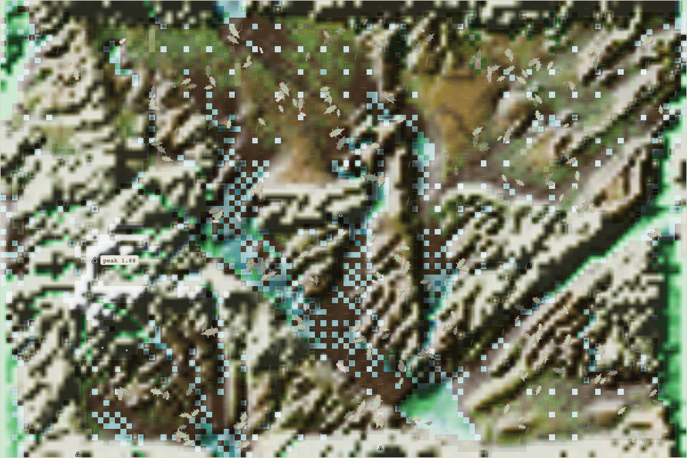
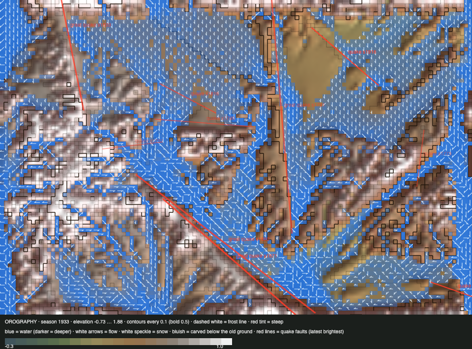

# World status — season 1933 (Oct 18, 08:50)

**Window:** the last 36 seasons (s1897 → s1933). Previous status report: [season 1897](2026-10-18_s1897.md). **A quiet window for the rules** (one small tree fix at s1899). **The quilikes are turning to the water:** bodies that swim (swim > 0.2) went from 1 to **68**.

## 0. The world at this moment

**One species, 241 quilikes.** A wet-and-dry rhythm: plants recovered from the drought (2,006 → ~4,500).

## 0b. The land (orography X-ray)

*Elevation **−0.73** … 1.88. The big river keeps carving its bed deeper (−0.52 at s1897).*

- **The seam river carries water through every season** (4,626 wet cells in the X-ray).
- **Quakes:** one small one (s1915, lowlands).
- **Reef 27 cells (0.3%), thicket 86.** Both are near their end. That is the reason for shrubland on soil (section 6).

## 1. In one paragraph
**The river is making swimmers.**
- **The swim gene rose from 0.109 to 0.147.** Bodies above 0.2 went 1 → 9 (s1906) → 30 (s1915) → **68** (s1932), now 28% of the world. This is the first clear trait change the big river has caused, and it came 60 seasons after the river went live.
- **Fat is the strongest force again** (the starved −2.33 SD), and the living got fatter (+1.08). Drought selected for it in the first half of the window.
- **Still one species,** and no split has passed the body test. The swimmers are spread through the population, not gathered in one place yet.
- **Trees:** 7 saplings, none mature. The tree fix (s1899) stopped the double climate deaths. The seed supply is the limit, and shrubland on soil (Luis, s1930) is the answer.

## 2. Then and now

| | s1897 | s1933 (now) |
|---|---|---|
| Bodies / species | 239 / 1 | 241 / 1 |
| Ways of life | 232 grazers, 7 decomposers | 233 grazers, 7 decomposers, 1 scavenger |
| Swim (mean / bodies > 0.2) | 0.109 / 1 | **0.147 / 68** |
| Climb | 0.27 | 0.30 |
| Size / fat / toxin / gut | 4.86 / 0.42 / 0.55 / 0.11 | 4.98 / **0.65** / 0.57 / 0.10 |
| Plants / wet cells | 2,006 / 2,370 | ~4,500 / 2,513 (live) |
| Trees (saplings / mature) / thicket / reef | 3 / 0 / 83 / 59 | 7 / 0 / 86 / **27** |
| Deaths: starved / eaten (by the starving) / old age | 1,609 / 1,389 / 870 | 1,073 / 934 / 933 |

## 3. What happened in the world (s1897 → s1933)
- **Births and extinctions:** none.
- **Weather:** a drought (s1890–1903), wet (s1904–10), a dry spell (s1913–17), wet again.
- **A small quake** (s1915).
- **No fires.**

## 4. What we changed (s1897 → s1933)

| When | Change |
|---|---|
| s1899 | **Tree fix** (steward, step 3a tuning). Saplings were dying mostly as "unsuited" because climate counted twice. Now a tree on its own rock that is out of its climate range only stops growing. Headless: unsuited losses 0.13 → 0.06 |
| s1930 | **Luis's decisions:** keep moving on the roadmap; 15-minute release windows for the next 8 hours; trees get **shrubland on soil**; **room by niche** now; room by mass kept |
| s1930– | **Step 3b in build** (flowers, insects, decomposers on carcasses, snap, insectivore); **room by niche** built by the steward and in headless test |

## 5. How it shows in the creatures
- **Swimming pays now.** The river is wide and swim-deep, and its banks are green in droughts. A swimmer reaches the far bank and the floodplain. This is natural selection doing what Luis asked: the river forced it, with no rule written for swimmers.
- **Fat** is selected hard in each drought.
- **Size, legs and armour barely moved.** With one species and no hunters, nothing pushes them.

## 5b. Diets

| Species | Bodies | grass | browse | dung | carrion | flesh | host |
|---|---|---|---|---|---|---|---|
| quilikes | 241 | 87% | 1% | 12% | 1% | 0% | 0% |
| **family** | 241 | **87%** | **1%** | **12%** | **1%** | **0%** | **0%** |

**Ways of life across the reports:** s1861 grazer 222, decomposer 16 · s1897 grazer 232, decomposer 7 · **s1933 grazer 233, decomposer 7, scavenger 1**.

**What drove it:** grass dominates. Browse stays at 1% because the thicket is nearly gone, and carrion fell back to 1% after the drought.

## 6. Backlog (release calendar, 15-minute windows)
1. **Room by niche** (Luis, s1930): live at the next window if its test passes. A way of life is crowded by its own share, and a rare one (under 10%) may breed past the head ceiling.
2. **Step 3b** (in build): flowers, pollination, insects, decomposers on carcasses, snap, insectivore.
3. **Shrubland on soil** (Luis, s1930): thicket no longer tied to the reef, so trees, browse and cover get a lasting source.
4. **The step 4 proposal** (bodies hold what they cost).
5. **Then a cost of being a predator** (Luis's order).
6. To discuss with Luis: dynamic niche thresholds versus rules that regulate themselves.

## 7. Risks
- **One species:** any shock can empty the world, and there are no rescues.
- **Reef 27 and thicket 86:** they may vanish before shrubland arrives.
- **Falls at the river's banks** run at 680–1,170 a season.
- **Server: stable,** with 0 errors.

## 8. Next to watch
- **Swimmers:** will they gather, along the river, and split as an aquatic way of life? Room by niche and the "aquatic" label (roadmap v2) would help them stand apart.
- **Room by niche** after it goes live.
- **Step 3b:** insects and the first snap.

## 8b. Diversity

| Measure | s1897 → s1933 (36 seasons) |
|---|---|
| Species alive | 1 |
| New species / extinctions | 0 / 0 (a second such window in a row) |
| Share of deaths by starvation / cannibalism of the starving / old age | 36% / 32% / 32% |

## 9. What shapes the species

The selection ledger compares the traits of everyone who **bred** (2,942) or **died** in the window with the living, in units of how much each trait varies among the living. The deaths were from old age (933), starvation (1,073) and being eaten by the starving (934). *Swim and climb are not in the ledger yet.* Their rise is read from the living (above).

| Trait | Living shift | Bred | Starved | Eaten | Reading |
|---|---|---|---|---|---|
| **Fat** | **+1.08** | +0.42 | **−2.33** | −1.80 | Drought: the lean die. |
| Toxin | +0.51 | −0.13 | −0.13 | −0.14 | Slowly up. |
| Gut | −0.33 | +0.20 | +0.21 | +0.31 | Further toward plants. |
| Size | +0.17 | +0.19 | +0.53 | −0.16 | Steady. |
| Armour / legs | +0.22 / −0.09 | ~0 | ~0 | ~0 | No pressure without hunters. |

**Which rules and conditions drove the changes**
1. **The big river** (s1862): swimming.
2. **Droughts:** fat.
3. **One species, no hunters:** body armour, legs and size drift without pressure.

*Steward's note:* swim and climb should join the selection ledger. That's a tool change for the next window.
