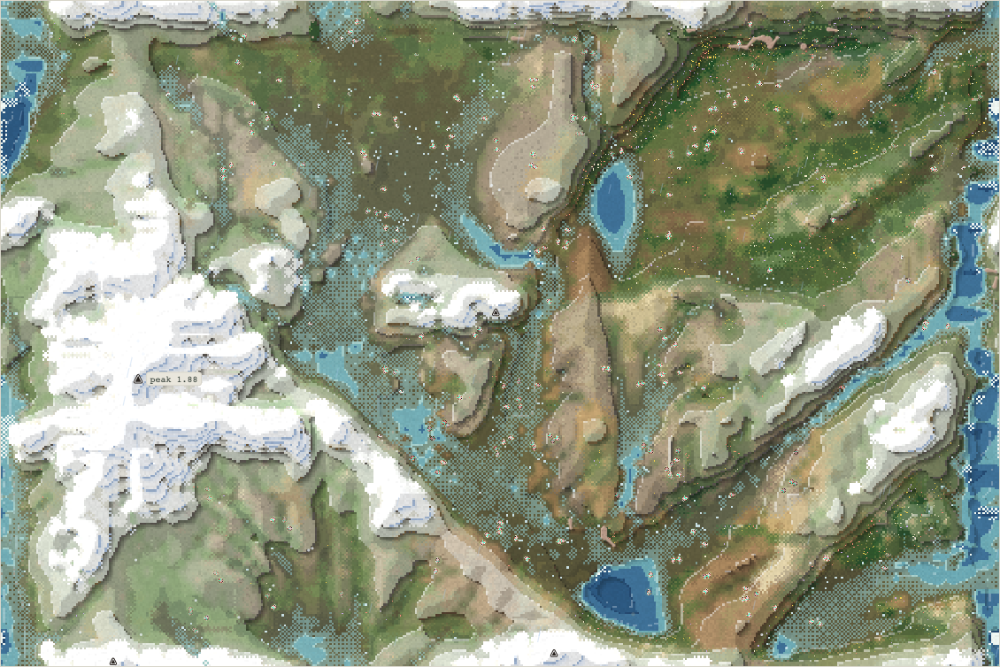
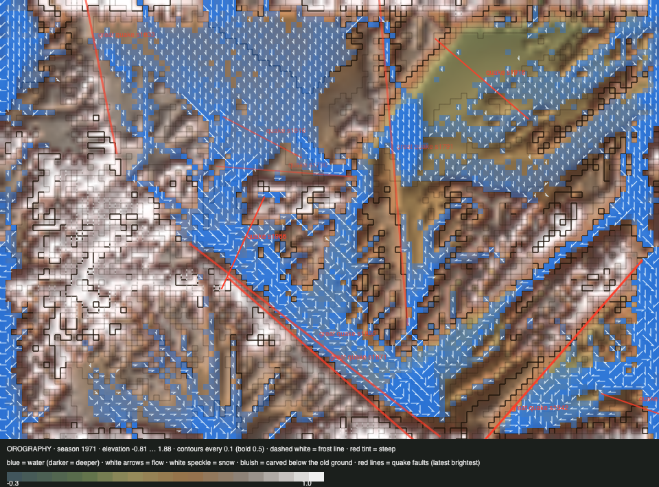

# World status — season 1971 (Oct 18, 11:30)

**Window:** the last 38 seasons (s1933 → s1971). Previous status report: [season 1933](2026-10-18_s1933.md). *A short report:* Claude's weekly usage is near its limit, so check-ins are hourly until 22:00. **Four changes went live:** step 3b (insects, s1942), room by niche (s1951), and the habitat labels (s1960). The viewer redrew everything at realistic scale.

## 0. The world at this moment

**One species, 238 quilikes,** now drawn at realistic size (a deer beside 7 m trees) as small sprites for each way of life.

## 0b. The land (orography X-ray)

- A small quake in the mountains (s1966).
- **Reef 18 cells, thicket 56.** The thicket is near the 40-cell trigger that moves it up the roadmap.

## 1. In one paragraph
**Still one species, but it now lives three ways.**
- The habitat labels (s1960) show **51 highland grazers** on the heights next to 182 lowland grazers. That's a real habitat split inside one species, the first visible structure in a long time.
- **Swimming is now ordinary:** the swim gene is at 0.219, up from 0.147 at s1933, and 145 bodies are above 0.2. But no body *lives* in deep water (0 aquatic). They swim to cross, not to stay.
- **Insects are alive but thin** (mean 0.005). The snap gene is stirring (0.015). There are no insectivores yet.
- **No split has passed the body test.** Highland bands attempted it in headless tests and were rejected. Their bodies don't yet differ beyond chance.

## 2. Then and now

| | s1933 | s1971 (now) |
|---|---|---|
| Bodies / species | 241 / 1 | 238 / 1 |
| Ways of life | 233 grazers, 7 decomposers, 1 scavenger | **182 grazers, 51 highland**, 2 decomposers, 2 omnivores, 1 scavenger |
| Swim / climb / snap / bite | 0.147 / 0.30 / – / 0.03 | **0.219** / **0.354** / 0.015 / 0.039 |
| Fat / size | 0.65 / 4.98 | 0.67 / 5.11 |
| Trees (saplings / mature) / thicket / reef | 7 / 0 / 86 / 27 | 7 / 0 / **56** / **18** |
| Insects (mean) | – | 0.005 |

## 4. What we changed (s1933 → s1971)

| When | Change |
|---|---|
| **s1942** | **Step 3b** (energy roadmap step 3; trees-and-insects phases 3–4): flowers and pollination, one insect field fed only by real stores (nectar, fruit, dung, carcasses, leaves), decomposers opening carcasses, the snap gene, middle-gut insect digestion, the insectivore way of life. Energy books close in the audit. Built by a Sonnet subagent |
| **s1951** | **Room by niche** (Luis, s1930): births are throttled by the rarer of a body's species and way-of-life share. The first test's extra room past the ceiling let 3% of bodies parent most births, so it was removed |
| **s1960** | **Habitat labels** (roadmap v2): "aquatic" and "highland" for grazers and mixed feeders, from a one-day memory of where a body lives; swim and climb added to the selection ledger. **Built by Codex** (CLI, on its own quota), reviewed by the steward |
| s1950–65 | **The viewer** (`76a74e4`, `949c9a6`): realistic scale, micro-sprites for each way of life, flowers and insect shimmer, trees as stands of crowns, sharp ground when zoomed |
| s1951 | Commit `376447f` (steward); `STEWARD-HANDOFF.md` so Codex can carry the stewardship if Claude's limit is hit |

## 5. How it shows in the creatures
- **Fat** is still the strongest force: the starved carried −2.05 SD.
- **Legs fell** (−0.59 SD) and the eaten had longer legs (+0.50). With no hunters, long legs only cost. Bodies are eaten only by their own starving kin.
- **Climbing rose** (0.30 → 0.35), with the highland bands.

## 5b. Diets

| Species | Bodies | grass | browse | dung | carrion | flesh | host | insect |
|---|---|---|---|---|---|---|---|---|
| quilikes | 238 | 88% | 0% | 10% | 1% | 0% | 0% | 0% |

Ways of life: s1897 grazer 232, decomposer 7 · s1933 grazer 233, decomposer 7, scavenger 1 · **s1971 grazer 182, highland 51, decomposer 2, omnivore 2, scavenger 1**.

## 6. Backlog
1. **Top: scale (Luis s1945; the viewer confirmed at s1950).**
   - A body moves so far that it crosses the map about 35 times in its life. So genes mix everywhere and no local band can diverge.
   - The world's body footprint (a body is almost a whole cell) no longer matches the realistic drawing.
   - **Options for Luis:** home ranges (recommended), slower cruising, a smaller body footprint.
2. The step 4 proposal; then the cost of being a predator; thicket last (its trigger is close: 56 of 40).
3. Builds now go to Codex (Luis, s1945), with the steward writing the specs and doing the review.

## 7. Risks
- **One species,** with no hunters to keep its shape.
- **Thicket near its end,** and trees still without a mature tree.
- **Usage:** Claude's weekly window is near its limit. The world runs on its own, and Codex holds the handoff.

## 8b. Diversity
Species alive 1 throughout. New species and extinctions 0 / 0, the third such window in a row.

## 9. What shapes the species

The selection ledger compares the traits of everyone who bred (2,398) or died with the living, in units of how much each trait varies. The deaths were from old age (1,216), starvation (758) and being eaten by the starving (427). Swim and climb joined the ledger at s1960, so they get their first comparison next report.

| Trait | Living shift | Bred | Starved | Eaten |
|---|---|---|---|---|
| **Fat** | +0.06 | +0.76 | **−2.05** | −1.50 |
| Legs | −0.59 | +0.25 | +0.21 | +0.50 |
| Gut | −0.43 | +0.03 | −0.02 | +0.13 |
| Size | +0.22 | +0.03 | +0.28 | −0.41 |

**Which rules and conditions drove the changes:** the big river (swimming); the heights and the habitat labels (a highland way of life shows); droughts (fat); no hunters (legs fall).
