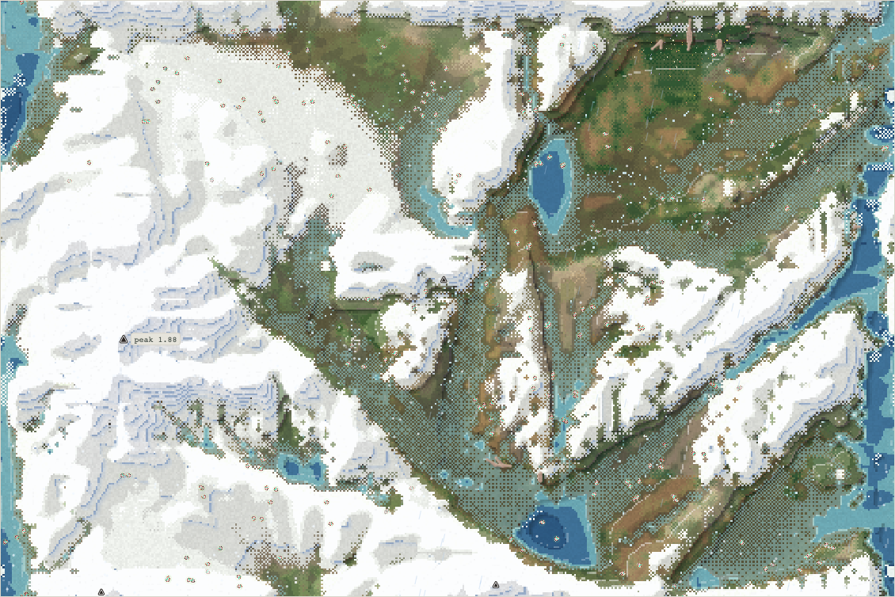
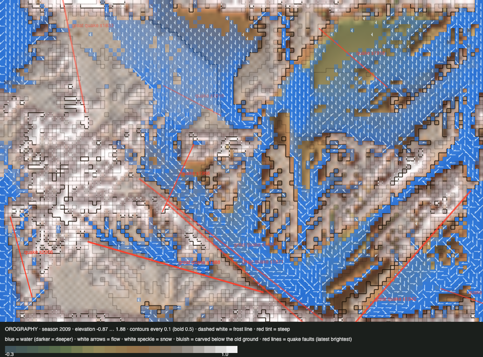

# World status — season 2009 (Oct 18, 13:35)

**Window:** the last 38 seasons (s1971 → s2009). Previous status report: [season 1971](2026-10-18_s1971.md). *A short report, while Claude's weekly usage is near its limit (hourly check-ins until 22:00).* **There were no rule changes in this window.** Luis received a new proposal: [movement, physics and diets](2026-10-18_s2008-movement-physics-diet-proposal.md).

## 0. The world at this moment

## 0b. The land (orography X-ray)

- **A great earthquake in the lowlands** (s1988, 0.16, a 364 px fault) shattered reef. Small quakes followed in the mountains (s1966, s2006).
- **Reef 16 cells, thicket 45.** The thicket is just above the 40-cell trigger that moves it up the roadmap.

## 1. In one paragraph
**Climbing is now the strongest trait on the rise.**
- **Climb** went from 0.354 to **0.488**, +1.43 SD in one window. The starved carried far less climbing (−2.05 SD), and even the breeders of the window climbed less than today's living (−1.39): the shift is fast. In this one-species world the heights, the dome's lichen and the highland grass pay those who can reach them. **Highland bodies are 67 of 239.**
- **Swimming keeps rising,** from 0.219 to 0.255 (+0.65 SD), and the starved swam less (−0.47).
- **Fat** stays the hunger buffer (the starved −2.48 SD).
- **Still one species,** with no split. The bodies' differences are spread across everyone rather than gathered in one place, as the s2008 proposal explains: the map is smaller than one home range.

## 2. Then and now

| | s1971 | s2009 (now) |
|---|---|---|
| Bodies / species | 238 / 1 | 239 / 1 |
| Ways of life | 182 grazers, 51 highland, 2 decomposers, 2 omnivores, 1 scavenger | **165 grazers, 67 highland**, 6 decomposers, 1 scavenger |
| Climb / swim / snap | 0.354 / 0.219 / 0.015 | **0.488 / 0.255** / 0.023 |
| Size / fat / gut | 5.11 / 0.67 / 0.06 | 5.32 / 0.79 / 0.055 |
| Trees / thicket / reef | 7 / 56 / 18 | 9 (none mature) / **45** / 16 |
| Insects (mean) | 0.005 | 0.001 (a dry spell) |

## 4. What we changed (s1971 → s2009)

| When | Change |
|---|---|
| — | **No rule changes.** The habitat labels and room by niche (s1951–60) ran unchanged |
| s1971 | Viewer commit `fe7b9dd` (the Life panel's Place and Change lenses) |
| s1986 | Usage: weekly 88% at 13:15, so hourly check-ins are enough to reach the 22:00 reset |
| **s2008** | **Proposal for Luis** (his order): M1 home ranges; M2 physics in metres (strength, slopes, climbing takes time, swimming by skill); M3 digestion time with stomach ∝ mass and leaner grass (the Jarman–Bell principle); M4 the smoothed gut valley, then the predator's cost. Nine decisions |

## 5b. Diets

| Species | Bodies | grass | browse | dung | carrion | flesh | host | insect |
|---|---|---|---|---|---|---|---|---|
| quilikes | 239 | 88% | 0% | 10% | 1% | 0% | 0% | 0% |

Ways of life: s1933 grazer 233, decomposer 7, scavenger 1 · s1971 grazer 182, highland 51, decomposer 2, omnivore 2, scavenger 1 · **s2009 grazer 165, highland 67, decomposer 6, scavenger 1**.

## 6. Backlog
**Awaiting Luis's nine decisions** (the s2008 proposal), then M1 → M2 → M3 → M4 → the predator's cost → the step 4 proposal → shrubland (bottom; its trigger is close).

## 7. Risks
- One species. The thicket is near its end. Server stable, 0 errors.

## 8b. Diversity
Species alive 1. New species and extinctions 0 / 0, the fourth such window.

## 9. What shapes the species

The selection ledger compares the traits of everyone who bred (2,315) or died with the living, in units of how much each trait varies among the living. The deaths were from old age (1,206), starvation (754) and being eaten by the starving (354). **This is the first window with swim and climb in the ledger.**

| Trait | Living shift | Bred | Starved | Eaten | Reading |
|---|---|---|---|---|---|
| **Climb** | **+1.43** | −1.39 | **−2.05** | −1.51 | The strongest selection: the poor climbers die. The living are better climbers than any group that died or bred in the window. The shift is fast |
| **Fat** | +0.38 | +0.31 | **−2.48** | −1.88 | The hunger buffer |
| Swim | +0.65 | −0.27 | −0.47 | −0.44 | Rising: the river |
| Size | +0.32 | −0.23 | +0.07 | −0.57 | Small bodies are eaten by the starving |
| Gut | −0.12 | 0 | +0.02 | +0.51 | |

**Which rules and conditions drove the changes:** the heights (climbing to the dome's lichen and the highland grass); the big river (swimming); dry spells (fat).
